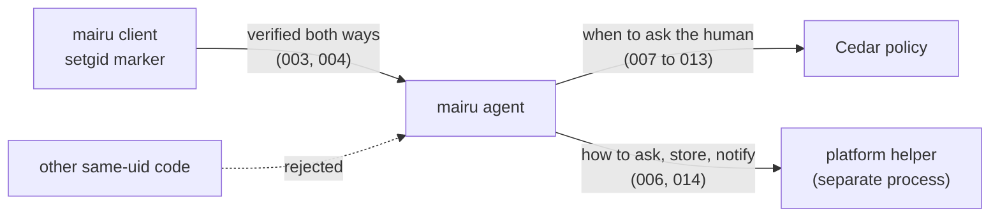
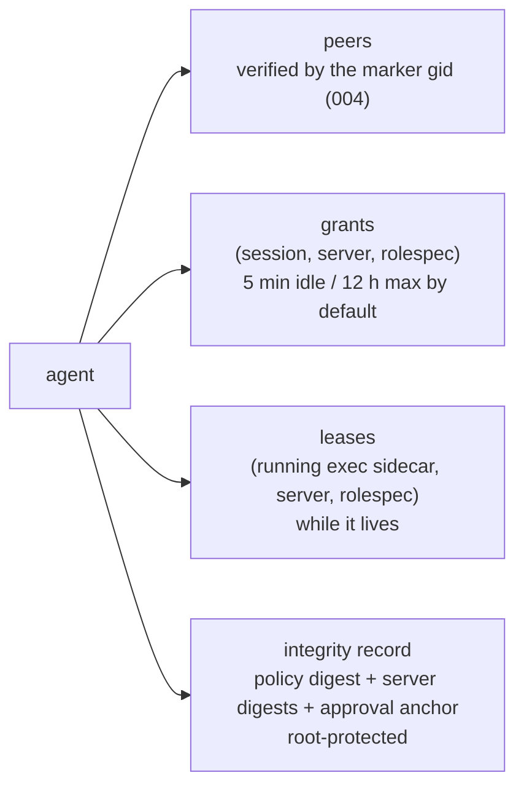
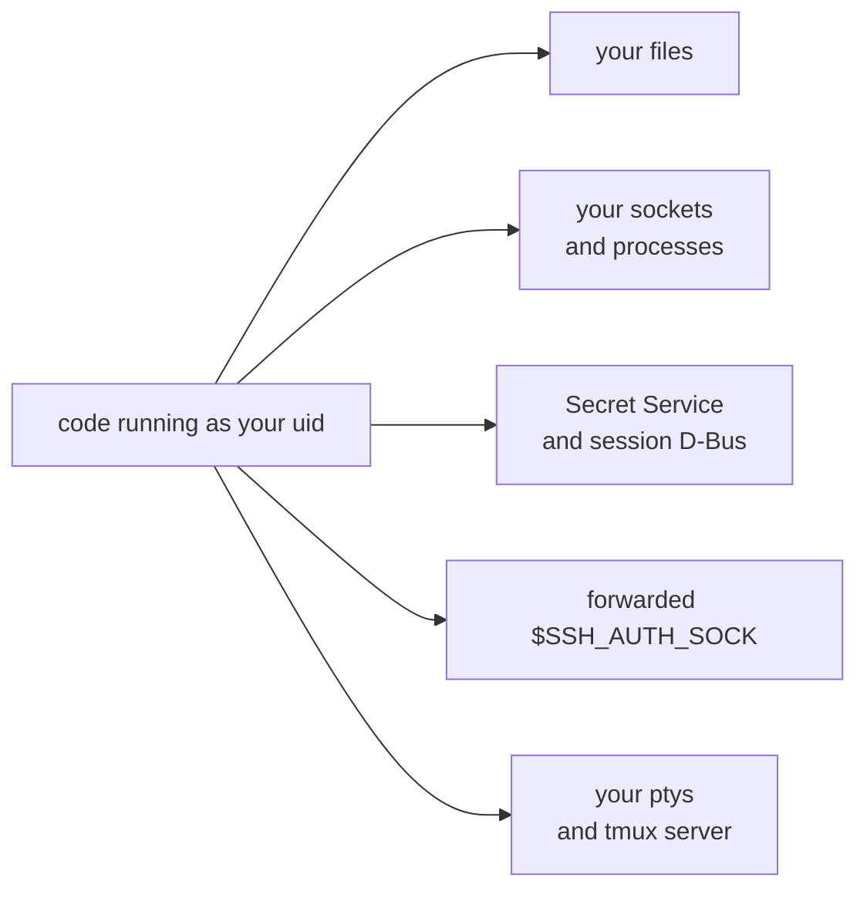
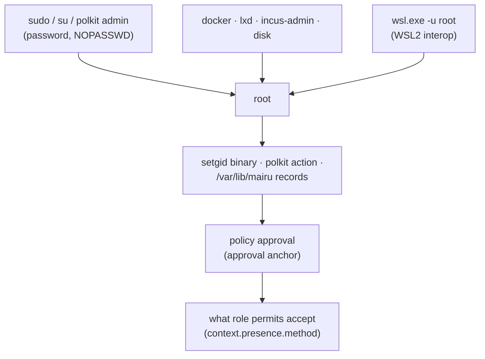
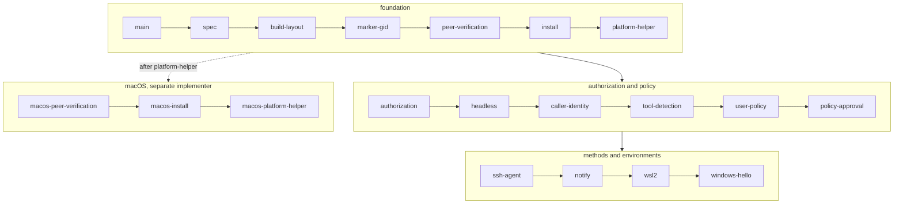

# 001-security-model

## Summary

`mairu agent` holds credential-server sessions in memory and vends AWS credentials to whoever connects to its Unix socket. Today that is any process running as the user. Specs 002 to 019 change that, one stack layer each. Clients and the agent verify each other through a mechanism that same-user code cannot forge. The agent asks the human, through a platform facility or a key, before credentials leave it, and a [Cedar](https://www.cedarpolicy.com/) policy decides when to ask. Every platform service runs in a separate platform helper process.

This spec is the shared base the others build on. It defines the threat model, the terminology, what counts as a boundary and what is only a guardrail, the trust chain that bounds every guarantee, and the roadmap of the numbered specs. It has no code of its own.

## Motivation

Any process running as the user can connect to `$XDG_RUNTIME_DIR/mairu/mairu-agent.sock` and call `AssumeRole` for any role of any logged-in server. The current design has four gaps:

- **Nobody checks the client.** A compromised dependency's install script gets the same credentials as the human typing `mairu exec`.
- **Nobody checks the agent.** A process that binds the socket path first receives what clients send, including the OAuth codes of `CompleteOauthCode`.
- **Nobody asks the human.** Credentials leave the agent without any human involvement.
- **The safety net is writable by what it restrains.** `disallow_roles` in `~/.config/mairu/config.json` can be edited by the same code it is meant to stop.

The adversary is not hypothetical. Code running as the user without the user intending it is routine: dependency install scripts, repository scripts, and AI coding agents that go beyond what they were asked to do. mairu's job is to make access to AWS deliberate, so it has to tell the human's requests from that code's.

The reference environment is the maintainer's own: long-lived tmux sessions on a remote Linux box, reached over SSH, with no GUI polkit agent, Secret Service or notification daemon. A GUI desktop session, WSL2 and macOS are also first-class, but every design choice has to work headless.

The work adds three things:

1. **Mutual verification** between `mairu` clients and `mairu agent`, anchored in a platform mechanism that same-user code cannot forge. Clients talk only to a genuine agent, and the agent serves only genuine clients (003, 004, 017).
2. **Platform authorization.** The agent asks the human, through a platform facility or a registered key, before vending credentials, and remembers the answer per terminal session for a short time. A Cedar policy decides when to ask, with a human check as just another condition, as MFA is in AWS IAM. The user's policy is integrity-protected (007 to 013, 016, 019).
3. **A common platform protocol** (`mairu.platform`, protobuf) with a matching Rust trait, covering authorization prompts, integrity records, notifications and opening URLs, so the agent core stays platform-independent. Every platform service runs in a separate platform helper process that shares the agent's lifetime (006, 014).

Linux is implemented first, with WSL2 as a first-class variant (015, 016). macOS is designed in 017 to 019 and implemented separately against them. BSD is design-only (003).

## Explanation



After the series, a hardened install behaves like this:

```text
sudo mairu harden                     once; or the distribution package does it (005)
mairu exec <role> -- aws …            first request in this terminal session asks the human (007)
                                        polkit / ssh-agent touch / Windows Hello / Touch ID
                                      later requests within 5 min idle, 12 h max: no prompt
mairu lock                            forget remembered approvals (007)
mairu policy init|check|approve       write, review and approve your Cedar policy (011, 012)
mairu doctor                          what is verified, what is available, what is weak (004, 005)
```

Without `sudo mairu harden` mairu behaves as today: no peer verification and no prompts. It suggests hardening periodically (005).

### Terminology



| Term | Meaning |
|---|---|
| client | Any `mairu` process that talks to the agent: `exec` (its sidecar), `credential-process`, `login`, `list-*`, `policy`, `lock`, `doctor`, … |
| agent | The `mairu agent` process. |
| hardened | A process whose integrity the platform enforces: on Linux/BSD, exec'd from the setgid marker binary; on macOS, running a validly signed binary with hardened runtime. |
| marker group | The Unix group `mairu`. It grants nothing; it marks processes exec'd from the hardened binary (003). |
| peer | The process on the other end of a Unix socket, as reported by the kernel. |
| gate 1, gate 2 | The two authorization points of `AssumeRole`: gate 1 before fetching credentials (007), gate 2 before vending them, with their real caller identity (009). |
| grant | A remembered authorization keyed by (session identity, server, rolespec), with an idle timeout and a hard cap (007). |
| lease | A remembered authorization tied to one live `mairu exec` sidecar process, valid for that process's lifetime (007). |
| presence method | How the human proves presence: the platform facility (polkit, LocalAuthentication), a signature through the SSH agent, or Windows Hello (007, 013, 016). |
| tool label | A label such as `ai-agent` that tool detection attaches to a request. A guardrail (010). |
| integrity record | Digests of the user policy files and of each server config, plus the approval anchor, kept where same-user code cannot rewrite them (012). |
| official build | Built by the upstream release pipeline from a signed tag and signed with the project's Apple Developer ID (017). |
| ad-hoc build | Any build without a Developer ID signature: `cargo build`/`cargo install`, Homebrew from source, forks (017). |
| dev profile | The isolated socket, state and record names that debug builds use by default, so a contributor's build never touches an installed mairu (004). |
| platform helper | The separate process, spawned by the agent and sharing its lifetime, that serves the `mairu.platform.PlatformHelper` service. Every platform service runs there (006). |

Each spec opens its sections with short visual summaries. They are illustrative; the text after them is normative.

### Adversary

```text
attacker = code running as your uid
  can     read/write ~, connect to your sockets, run genuine mairu with any args,
          use $SSH_AUTH_SOCK, read your ptys, drive your tmux server
  cannot  ptrace a hardened mairu, forge SO_PEERCRED or a code signature,
          become root*                     * unless the host allows it (Trust chain below)
```



The adversary is code running **as the same Unix user** as the human, which the human did not intend to act. Examples: a compromised dependency's install script, a malicious repository script, or an AI coding agent going beyond what it was asked to do. It can:

- read and write every file the user can, including `~/.config/mairu`, `~/.local/state/mairu` and `.mairu.json`
- connect to the user's Unix sockets, kill the user's processes, and bind sockets in the user's runtime directory
- run any binary, including genuine `mairu`, with arbitrary arguments, environment and file descriptors
- ptrace the user's ordinary, dumpable processes (subject to `kernel.yama.ptrace_scope`)
- read and write the user's Secret Service (no per-application access control on Linux) and claim names on the user's session D-Bus
- use the user's forwarded SSH agent socket
- open the user's ptys (`/dev/pts/N` belongs to the user) and race the foreground program for keystrokes
- drive the user's tmux server through its socket: key bindings that log and forward every key, `send-keys`, and `pipe-pane -I` to inject input

### Boundaries and guardrails

```text
boundary   platform prompt / ssh-agent approval / Windows Hello
           + mutual verification (prompt contents are true)
           + policy integrity
guardrail  tool detection (AI agents …) · disallow_roles · .mairu.json trust prompt
```

- **Boundary**:
  - The platform authorization step: polkit, macOS LocalAuthentication, a signature through your SSH agent under its own lock, or Windows Hello.
  - The mutual verification that makes the prompt's contents truthful: a genuine client reports what it will actually do with the credentials.
  - Integrity of the policy that decides when to prompt.
- **Guardrails**, best-effort and never relied on alone:
  - tool detection, such as AI agents (010)
  - `disallow_roles` in `config.json`
  - the `.mairu.json` trust prompt

### Trust chain



```text
strength = min(path to root, approval_methods, methods accepted by permits)
```

On a hardened Linux host every anchor is root-owned:
- the setgid binary (005)
- the polkit action file (007)
- the integrity records in `/var/lib/mairu`, including the approval anchor that says which keys may approve policy changes (012)

Root can replace any of these, and can also read the agent's memory directly. **Every guarantee in these specs is therefore bounded by how hard it is for same-user code to become root.**

Ways a same-user attacker reaches root:

| Path | How |
|---|---|
| `sudo`, `su` | PAM, usually the user's password, which is capturable at a tty (008). Also `NOPASSWD` rules and cached sudo timestamps. |
| polkit administrator actions | `auth_admin` actions such as `pkexec` and systemd units; PAM again |
| Root-equivalent group memberships | `docker`, `lxd`, `incus-admin`, `disk` |
| WSL2 interop | `wsl.exe -u root`, from inside the distribution, from any other distribution with interop on, or from any Windows process of the user (015) |

The effective strength of a deployment is the **weakest** of:
1. becoming root
2. approving a policy change (`approval_methods`, anchored in the protected record, 011 and 012)
3. the presence methods that a role's `permit` policies accept (`context.presence.method`, 007)

Registering an ssh-agent key whose use needs your approval (013), or a Windows Hello key (016), strengthens 2 and 3. It does nothing for 1. A password that passes `sudo` also passes polkit `auth_self` (007), so on a host where that password can be captured, key-based methods only add a guardrail.

Recommendations, in the README; `mairu doctor` warns where it can detect the condition (005):
- Back `sudo` and the `polkit-1` PAM stack with something a captured password cannot replay: `pam_u2f` locally, `pam_ssh_agent_auth` with an approval-protected key over SSH, `pam_wsl_hello` on WSL2. Avoid `NOPASSWD` and root-equivalent groups for the user.
- Once keys are registered, keep `approval_methods` key-only (the default), and require a key-based `context.presence.method` in permits for sensitive roles.
- On WSL2, disable interop for strong guarantees (015).

### Roadmap



Each layer builds on the one before it.

Read and implement the specs in order. Each spec describes only what its step adds and refers back to earlier ones, never forward.

| Spec | Stack layer | Adds |
|---|---|---|
| [001](001-security-model.md) | `hardening/spec` (all specs) | Threat model, terminology, trust chain, this roadmap |
| [002](002-build-layout.md) | `hardening/build-layout` | Release profile, the `cli` feature, CI size reports, per-architecture macOS releases |
| [003](003-marker-gid.md) | `hardening/marker-gid` | The setgid marker group and confinement of the marker gid; BSD design note |
| [004](004-peer-verification.md) | `hardening/peer-verification` | Mutual client ↔ agent verification, process facts, `GetAgentStatus`, `mairu doctor`, dev profile |
| [005](005-install.md) | `hardening/install` | `mairu harden`, re-exec, the harden suggestion, distribution packages, root-reachability warnings |
| [006](006-platform-helper.md) | `hardening/platform-helper` | The `mairu.platform` protocol and the mutually verified platform helper process |
| [007](007-authorization.md) | `hardening/authorization` | Gate 1: grants, leases, the decision procedure, Cedar with built-in policies, polkit |
| [008](008-headless.md) | `hardening/headless` | `pkttyagent` fallback and the tmux-over-SSH workflow |
| [009](009-caller-identity.md) | `hardening/caller-identity` | Gate 2: the real caller identity from `sts:GetCallerIdentity` |
| [010](010-tool-detection.md) | `hardening/tool-detection` | Tool labels such as `ai-agent`, and session marks |
| [011](011-user-policy.md) | `hardening/user-policy` | User `policy.cedar` and `authorization.json`, forbid-only until approved, `mairu policy` |
| [012](012-policy-approval.md) | `hardening/policy-approval` | Integrity records and stores, approval, per-server digests, lockdown |
| [013](013-ssh-agent.md) | `hardening/ssh-agent` | Presence through the SSH agent |
| [014](014-notify.md) | `hardening/notify` | Notifications and opening URLs |
| [015](015-wsl2.md) | `hardening/wsl2` | WSL2 detection, profiles and interop |
| [016](016-windows-hello.md) | `hardening/windows-hello` | Presence through Windows Hello |
| [017](017-macos-peer-verification.md) | macOS implementer's own layers | Build tiers, code-signature verification, the XPC LaunchAgent, minimum versions |
| [018](018-macos-install.md) | macOS implementer's own layers | `harden` on macOS, the release pipeline, distribution |
| [019](019-macos-platform-helper.md) | macOS implementer's own layers | The helper bundle, LocalAuthentication, keychain integrity stores, notifications |

The macOS specs can start once 006 has landed. 019's integrity stores hold the record format of 012.

## Drawbacks

- **Setup needs root.** The guarantees exist only after `sudo mairu harden` or a distribution package. Unhardened installs keep today's behavior.
- **Prompts add friction.** The defaults ask once per terminal session and remember the answer for 5 minutes idle and 12 hours at most, which trades some convenience for a human in the loop.
- **Guarantees are bounded by root.** On a host where same-user code can become root, through a capturable `sudo` password, `NOPASSWD`, a root-equivalent group or WSL2 interop, mairu adds guardrails, not boundaries.
- **The design is large.** It spans 18 implementation steps, three platforms and a separate macOS implementation.

## Considered Alternatives

- **Trust anchors that same-user code can forge.** Checking a peer's executable path or contents, or a secret file the client reads, gives nothing against the adversary above: same-user code can run the genuine binary under ptrace or `LD_PRELOAD`, read any file the user can, and bind the socket first. The anchors are therefore kernel-enforced: the setgid marker gid on Linux and BSD (003), the code signature on macOS (017).
- **Treating tool detection as a boundary.** Same-user code can rename itself, scrub its environment and detach from its ancestry, so labels such as `ai-agent` stay guardrails. Policies may use them to restrict or to grant, knowing that (010).
- **One spec per topic.** The design was first written as three topic specs (hardening, policy, platform helper). It is split into one spec per stack layer so that implementers can read and execute the steps in order.

## Prior Art

- `ssh-agent` and `gpg-agent` hold secrets in memory and serve any same-user process on their socket. `ssh-add -c` asks for confirmation per use. mairu's starting point was the same model.
- `sudo` remembers a successful authentication per terminal for a short time. mairu's grants work the same way, per terminal session.
- AWS IAM treats MFA as a condition in policy. mairu's Cedar policy treats a fresh human check the same way.
- Amazon Verified Permissions uses Cedar, the policy language mairu adopts.

## Security and Privacy Considerations

```text
out of scope   root · kernel · physical access · malicious credential server or IdP
               · escalation through your own sudo · credentials after delivery to your command
```

- Root, kernel compromise, physical access, and malicious credential servers or IdPs are out of scope.
- Escalation to root through the user's own `sudo` is also out of scope. If the user types the sudo password where same-user code can capture it (008), that code can become root. mairu cannot defend against that, and its guarantees hold only on hosts where sudo is not used that way, or is backed by FIDO. The Trust chain section covers this and the other routes to root.
- Credentials *after delivery* are also out of scope. Once `mairu exec` hands credentials to the user's command, same-user code that can inspect that command (its environment, its memory, or the ECS bearer token in its environment) can take them. This design protects the agent's ability to mint credentials for arbitrary roles and its session tokens. It does not protect credentials already given to an unprotected process.

| Threat | Mitigation |
|---|---|
| Root reached through `sudo`/polkit passwords, `NOPASSWD`, root-equivalent groups | Out of scope, but it bounds everything (Trust chain); `doctor` warns (005) |
| Root reached through WSL2 interop (`wsl.exe -u root`) | Isolated profile, or a `forbid` on `context.wsl_interop`; `doctor` and `harden` warn (015) |
| Credentials after delivery to the user's command | Out of scope |

Each later spec lists the threats its step addresses.

Privacy: to show and decide requests, the agent reads facts about its peers and their ancestry (executable, arguments, working directory, session ids) from the local kernel. They stay on the machine, in prompts, `doctor` output and the agent's log.

## Mission Scope

### Out of scope

- WSL1 hardening (015)
- BSD implementation; 003 records the design
- Tokens wrapped by TPM or Secure Enclave and unwrapped only for use, plus a zeroizing global allocator (`zeroizing-alloc`) so HTTP client buffers are wiped too
- Integrity for `.mairu.json` trust records
- Packaging changes in other repositories: AUR, and Homebrew (018)

### Expected Outcomes

- On a hardened Linux host, only genuine mairu processes can obtain credentials from the agent, and clients refuse an agent that is not genuine.
- The human approves credential use through polkit, a key in their SSH agent, Windows Hello or Touch ID, as their Cedar policy requires, including over SSH in tmux.
- The policy deciding this cannot be relaxed by same-user code without the human's approval.
- The weakest link of a deployment, usually the path to root, is visible in `mairu doctor`.

## Implementation Plan

This spec has no code. It fixes the conventions of the series:

- The specs are delivered as one `gh stack`, one PR per layer, in the Roadmap order. `hardening/spec` carries every spec.
- Each layer passes `cargo clippy` and `cargo test` on its own.
- Each layer updates `README.md`, `CHANGELOG.md` (`[not yet released]`), and the Current Status of its own spec.
- Review fixes to a lower layer are made on that layer, then rebased upstack.
- The macOS implementer (017 to 019) plans its own layers.

## Current Status

Spec drafted; awaiting review before implementation. Implementors MUST keep this section updated as they work.

### Checklist

- [ ] Manual end-to-end verification across 003 to 016: GUI session, SSH + tmux, headless

### Updates

- 2026-10-29: Split out of hardening.md, policy.md and platform-helper.md.
