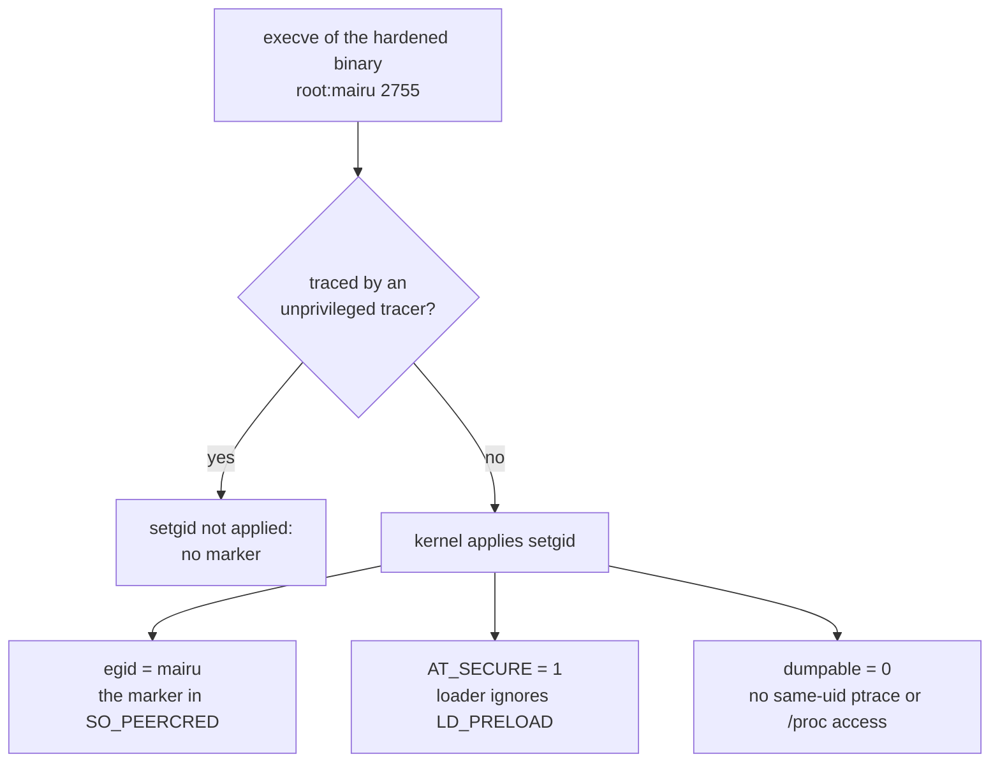

# 003-marker-gid

## Summary

On Linux, a process proves that it is genuine mairu through a Unix group, `mairu`, that the kernel applies when it execs a root-owned setgid binary. This group is the **marker**. Same-user code cannot obtain it without running the genuine binary, untraced and uninjected.

This step teaches every mairu process to classify itself at startup: whether its own exec applied the marker (`Hardened`), did not (`Unhardened`), or applied it in a way that same-user code could forge (`Misconfigured`). A hardened process keeps the marker only in its saved gid, raises it only around the few operations that need it, and drops it for good before it execs anything. Nothing in this step installs a setgid binary or checks peers. Without such a binary every process classifies itself as `Unhardened` and behaves exactly as today.

## Motivation

The adversary is code running as the same Unix user as the human ([001 Adversary](001-security-model.md#adversary)). The uid identifies nothing: every process the adversary starts has it. The agent needs a property of a process that the kernel grants and same-user code cannot forge. A setgid exec gives exactly that:

- the effective gid becomes the binary's group, and the kernel reports it to the other end of a Unix socket;
- the dynamic loader enters secure mode, so nothing can be injected through the environment;
- the process is non-dumpable, so same-user code cannot ptrace it or read its memory;
- an unprivileged tracer prevents the setgid bit from applying at all.

The marker is only meaningful if classification is exact. Several plausible checks are wrong:

- An effective gid inherited from a parent is not proof of anything. The marker has to come from this exec's own setgid grant.
- `AT_SECURE` alone is not enough, because file capabilities, which mairu already uses for `cap_ipc_lock`, set it too.
- Looking up the group by name and comparing gids trusts whatever NSS returns for the name `mairu`. A second `mairu` group in another NSS source could shadow the gid the kernel actually granted.
- A binary setgid to some other group would make that group's own setgid binaries pass as mairu.
- A user who is a member of `mairu`, or who knows a group password for it, can obtain the marker with `sg` or `newgrp`.

The marker must also never leak. `mairu exec` runs the user's command, which is attacker-influenced. If that command inherited the marker, it would pass every check built on it.

## Explanation

Diagrams and text blocks in this spec are illustrative; the text after them is normative.

### What the kernel gives a setgid exec



A hardened binary is root-owned, with group `mairu` and mode `2755` (setgid). When any user execs it, the kernel:

- sets the process's effective gid to `mairu`. This is the marker.
- sets `AT_SECURE`, so the dynamic loader ignores `LD_PRELOAD`, `LD_LIBRARY_PATH` and similar. Release musl binaries are static anyway.
- makes the process non-dumpable from the first instruction. Same-uid ptrace, `/proc/<pid>/mem`, `/proc/<pid>/environ` and `/proc/<pid>/fd` become inaccessible, and the existing `prctl(PR_SET_DUMPABLE, 0)` in the agent then only reaffirms it.
- **does not** apply the setgid bit if the exec happens under ptrace by an unprivileged tracer.

The marker therefore cannot be obtained by same-user code except by running the genuine binary untraced and uninjected. `SO_PEERCRED` reports the peer's *effective* gid, snapshotted by the kernel:

- for the connecting side, at `connect()`
- for the listening side, at `listen()`. A connected client socket inherits the listener's credentials.

So each side of a connection can check the other's marker without trusting anything it says. This step makes sure that a hardened process holds the marker exactly when it calls `connect()` or `listen()`, and at no other time.

### Preconditions

Checked at runtime by classification:

- The user must **not** be a member of `mairu`, neither as primary nor as supplementary group. A member can obtain the marker with `sg`/`newgrp`.
- `fs.protected_hardlinks = 1`, so users cannot hardlink old hardened binaries and keep running them after an upgrade. This is a warning only.

Not detectable by classification:

- The group must have **no password**. With one, anyone who knows it can `newgrp mairu` and get the marker as both real and effective gid. That would let them pass as mairu, and open anything only the marker gid can open. Only root can read `/etc/gshadow`, so a process cannot see the password. It is handled by installation, and by peer checks that reject a real gid equal to the marker.

### Classification

```text
detect()                                           # first in main, before anything changes the ids
  m = getegid()                                    # the binary's group, when this exec applied setgid
  getgrgid(rgid) is named "mairu"                  → Misconfigured (primary group is the marker)
  getauxval(AT_SECURE) == 0 or m == rgid           → Unhardened
  m ∈ {0, 65534} or getgrgid(m) is not "mairu"     → Unhardened, warn (setgid to another group)
  m ∈ getgroups() or user ∈ getgrgid(m).members    → Misconfigured (marker forgeable)
  /proc/sys/fs/suid_dumpable == 1                  → Misconfigured (setgid processes stay traceable)
  otherwise                                        → Hardened, marker = m; setresgid(rgid, rgid, m)
```

`crate::hardening::Hardening::detect()` runs first in `main`, before argument handling has any side effects:

1. Read `getresgid()` and `getauxval(AT_SECURE)`. The candidate marker `m` is the effective gid at startup, which after a setgid exec is the binary's group as granted by the kernel.
2. Classify, taking the first row that matches:

   | Condition | State |
   |---|---|
   | The real gid's group is named `mairu` | `Misconfigured`: the user's primary group is the marker. Warn, and act as `Unhardened`. |
   | `AT_SECURE` is 0, or `m == rgid` | `Unhardened`. No setgid bit applied to this exec, so an effective gid inherited from a parent is never taken as the marker. `AT_SECURE` alone is not enough, because file capabilities (`cap_ipc_lock`) set it too. |
   | `m` is 0 or 65534, or `getgrgid_r(m)` does not name `mairu` (a failed lookup included) | `Unhardened`, with a warning: the binary is setgid to some other group. A dedicated group is what makes the marker meaningful; with any other group, that group's own setgid binaries would pass. |
   | `m` is in `getgroups()`, or the user is listed among the group's members | `Misconfigured`: the marker is forgeable. Warn, and act as `Unhardened`. |
   | `/proc/sys/fs/suid_dumpable` is `1` | `Misconfigured`: the kernel leaves setgid processes dumpable, so same-uid code could ptrace them. Warn, and act as `Unhardened`. |
   | Otherwise | `Hardened`, with marker `m` |

   - The lookup goes from the granted gid to the name (`getgrgid_r`), not from the name to a gid. A second `mairu` group in another NSS source therefore cannot shadow the gid the kernel actually granted, and the gid peers compare against is that one.
   - Static musl builds read `/etc/group` only, which is fine because the group is meant to be a local system group.
   - A failed lookup, for example with a directory service down, fails closed as `Unhardened`.
3. When `Hardened`, immediately call `setresgid(rgid, rgid, m)`. The effective gid is then the real gid, and the marker stays only in the saved gid until needed.

Below, and in every later spec, `mairu` as a gid means this marker `m`.

What users see:

| State | Behavior |
|---|---|
| `Unhardened` | As today. No message, unless the binary is setgid to some other group, which prints a warning to stderr. |
| `Misconfigured` | A warning to stderr naming the cause (primary group, membership), then behaves as `Unhardened`. |
| `Hardened` | As today. The marker is used only by the privileged operations below. |

A missing `fs.protected_hardlinks = 1` produces a warning from a hardened process.

## Drawbacks

- A setgid process is non-dumpable. A hardened mairu writes no core dumps, and debugging it needs root.
- `AT_SECURE` makes the loader ignore `LD_LIBRARY_PATH` and friends. A dynamically linked build that relies on them to find its libraries, for example OpenSSL in a non-standard location, fails once hardened.
- The user must not be a member of `mairu`. Sites that manage groups centrally have to keep it out of their directory service, or at least keep the user out of it.
- glibc and musl apply `set*id` calls to every thread, so privileged sections are serialized by a process-wide mutex.

## Considered Alternatives

- **Look up the group by name and compare gids** (`getgrnam("mairu")`, then `egid == gid`). Rejected. It accepts an effective gid inherited from a parent, and trusts whatever NSS returns for the name, so a second `mairu` group in another NSS source could shadow the real one. The marker is the gid this exec was granted, confirmed by a reverse lookup of that gid.
- **`AT_SECURE` as the only proof of a setgid exec.** Rejected: file capabilities set it too, and mairu's packages already give the binary `cap_ipc_lock`. The check also requires `m != rgid`.
- **Any group as the marker,** for example reusing an existing system group. Rejected: every other setgid binary of that group would pass. The group must be named `mairu`, and gids 0 and 65534 are never accepted, since those groups exist everywhere and own unrelated files.
- **Failing open when the group lookup fails.** Rejected: a lookup failure classifies as `Unhardened`, which a hardened peer rejects.
- **Keeping the marker as the effective gid for the process's whole life.** Rejected: every file created and every child spawned would carry it. The marker lives in the saved gid, is raised only around the operations that need it, and is dropped permanently before any exec.
- **Detecting a group password at startup.** Not possible without root, since `/etc/gshadow` is root-readable only. The precondition is stated here and enforced by installation and by peer checks.

## Prior Art

- OpenSSH's `ssh-agent` was long installed setgid to a dedicated group on OpenBSD and Debian, so that same-user processes could not ptrace it and read keys from its memory.
- D-Bus and systemd authenticate local peers by the credentials the kernel records for a Unix socket (`SO_PEERCRED`).
- setgid helper groups such as `utmp`, `tty` and `mail` mark binaries allowed to write shared files, the same mechanism used here as an identity.

## Security and Privacy Considerations

```text
LD_PRELOAD / ptrace into mairu     ✗ AT_SECURE, non-dumpable, setgid dropped under ptrace
marker leaking to children         ✗ setresgid before every exec
inherited egid / other setgid grp  ✗ marker must come from this exec and be named mairu
user in the marker group           ✗ detected → Misconfigured
group password (newgrp / sg)       ! not detectable here; handled by installation and peer checks
```

| Threat | Mitigation |
|---|---|
| `LD_PRELOAD` or ptrace into the genuine binary | `AT_SECURE`, non-dumpable, setgid dropped under ptrace |
| Marker leaking to children | Permanent drop before every exec; `hardening::command()` ([Privileged gid](#privileged-gid)) |
| A binary setgid to some other group, or an inherited effective gid | The marker must come from this exec (`AT_SECURE`, `m != rgid`) and its group must be named `mairu`, and not be 0 or 65534 ([Classification](#classification)) |
| User in the marker group | Detected → `Misconfigured` ([Classification](#classification)) |
| `fs.suid_dumpable = 1`, which leaves setgid processes, and processes after a gid change, dumpable | Detected → `Misconfigured`; `PR_SET_DUMPABLE(0)` after every `setresgid` ([Privileged gid](#privileged-gid)) |
| Joining the marker group through a group password (`newgrp`, `sg`) | Not detectable by the process itself. Such a process has the marker as both real and effective gid, which distinguishes it from a genuine hardened process (real gid always the user's). |
| Hardlinked old hardened binaries | `fs.protected_hardlinks` warning |

- Classification reads only kernel-provided ids and the group database. Nothing an attacker controls in the environment changes the result.
- No privacy impact: nothing is logged beyond the warnings above.

## Mission Scope

### Out of scope

- Installing a setgid binary, and re-exec'ing one from a user-installed copy.
- Checking peers. No RPC behaves differently in this step.
- macOS, which uses code signatures instead of a marker group.
- BSD beyond the design note below.

### Expected Outcomes

- An unhardened mairu behaves exactly as before, with no new output.
- On a test machine where a build is installed by hand as `root:mairu 2755` (for example under `/usr/local/bin`), a run classifies as `Hardened`. While idle, its `Gid:` line in `/proc/<pid>/status` shows the marker only in the saved slot: `Gid: <rgid> <rgid> <mairu> <rgid>`.
- `mairu exec … -- sh -c 'id; grep Gid /proc/self/status'` from that build shows no `mairu` gid anywhere.
- A user who is a member of `mairu`, or whose primary group it is, gets the `Misconfigured` warning, and the process acts as `Unhardened`.
- A binary setgid to another group warns and acts as `Unhardened`.

## Implementation Plan

Stack layer: `hardening/marker-gid`.

| File | Change |
|---|---|
| `src/hardening.rs` | New: `Hardening`, `detect()`, classification, `with_privileged_gid`, `drop_privileged_gid_permanently`, `command()` |
| `src/lib.rs` | `pub mod hardening;` as a core module, outside the `cli` gate ([002 Cargo features](002-build-layout.md#cargo-features)): every mairu binary classifies itself |
| `src/main.rs` | `Hardening::detect()` first, before argument parsing has side effects |
| `src/agent.rs` | client `connect()` inside `with_privileged_gid` |
| `src/cmd/agent.rs` | `bind()` + `listen()` inside `with_privileged_gid`; spawning the agent through `hardening::command()` |
| `src/cmd/exec.rs` | the executor calls `drop_privileged_gid_permanently()` before exec'ing the user's command |
| `Cargo.toml` | `nix` features `user`, `socket` |

### Privileged gid

```text
with_privileged_gid(f)    egid := m; f(); egid := rgid      # connect, listen, protected I/O
before exec of anything   setresgid(rgid, rgid, rgid)       # marker never leaks
```

Helpers in `crate::hardening`:

- `with_privileged_gid(f)`: under a process-wide mutex, `setresgid(-1, mairu, -1)`, run `f`, then `setresgid(-1, rgid, -1)`. The kernel resets dumpability to `fs.suid_dumpable` on every credential change, so each `setresgid` is followed by `prctl(PR_SET_DUMPABLE, 0)`, in every hardened process, not only the agent. glibc and musl apply set\*id calls to all threads. Used around `connect()`, `bind()`+`listen()`, and access to files that only the marker gid may open. On an unhardened process it runs `f` unchanged.
- `drop_privileged_gid_permanently()`: `setresgid(rgid, rgid, rgid)`, then assert that `getresgid()` returns `rgid` three times. On failure the caller aborts; it never execs with the marker.
- `command(program)`: a `std::process::Command` whose `pre_exec` performs the permanent drop. Every child process mairu spawns uses it, the agent itself included, except the exec of the user's command, which calls the drop directly. Re-exec'ing the setgid binary re-acquires the marker through the setgid bit, so dropping before spawning the agent is harmless.

Process-specific rules:

- **Executor** (`mairu exec` parent): drops permanently before `exec`'ing the user's command. Without this, the command (attacker-influenced) would inherit `egid == mairu` and pass the agent's check.
- **Sidecar** (`mairu exec` child): keeps the saved marker for reconnects, and holds the effective marker only inside `with_privileged_gid`.
- **Agent**: holds the effective marker only for `listen()`.
- **Every other client**: holds it only for `connect()`.

### Types

```rust
pub enum HardeningState {
    Unhardened { setgid_other_group: Option<u32> },
    Hardened { marker: nix::unistd::Gid },
    Misconfigured { reason: MisconfiguredReason },
}

pub enum MisconfiguredReason {
    PrimaryGroupIsMarker,
    MarkerMember,
    SuidDumpable,
}
```

- `Hardening::detect()` stores the state process-wide; `Hardening::state()` and `Hardening::marker()` read it.
- The classification itself is a pure function over the ids, `AT_SECURE`, the group lookup results and the supplementary groups, so every row of the table is unit-tested without a setgid binary.

### Tests

- Unit tests: every classification row, including a failed lookup, gids 0 and 65534, `m == rgid` with `AT_SECURE` set (file capabilities), and membership through the group's member list.
- Unit test: `drop_privileged_gid_permanently()` asserts all three gids.
- Integration (root, disposable VM): a build installed `root:mairu 2755` classifies as `Hardened`; `mairu exec` children carry no marker.

### BSD (design only)

| Linux | BSD |
|---|---|
| `SO_PEERCRED` | `LOCAL_PEERCRED` (`xucred`: `cr_groups[0]` is the effective gid; `cr_pid` on 13+) |
| `/proc/<pid>/stat` | `kinfo_proc` via `sysctl` |
| `groupadd` | `pw groupadd` |
| marker group, installed layout | the same |

- FreeBSD `LOCAL_PEERCRED` (`struct xucred`, `cr_groups[0]` is the effective gid, `cr_pid` on 13+), with the setgid marker as on Linux.
- Process facts from `kinfo_proc` via `sysctl`.
- polkit is in ports.
- An installer would create the group with `pw groupadd`.
- `crate::ppid` already handles `PROC_PDEATHSIG_CTL`.

## Current Status

Spec drafted; awaiting review before implementation. Implementors MUST keep this section updated as they work.

### Checklist

- [ ] `Hardening::detect()` and classification in `src/hardening.rs`, called first in `main`
- [ ] `with_privileged_gid`, `drop_privileged_gid_permanently`, `command()`
- [ ] Privileged `connect()` and `bind()`+`listen()`; executor drop before exec; agent spawned through `command()`
- [ ] Unit tests for classification and the drop assertion
- [ ] BSD: design only

### Updates

- 2026-10-29: Split out of hardening.md, policy.md and platform-helper.md.
