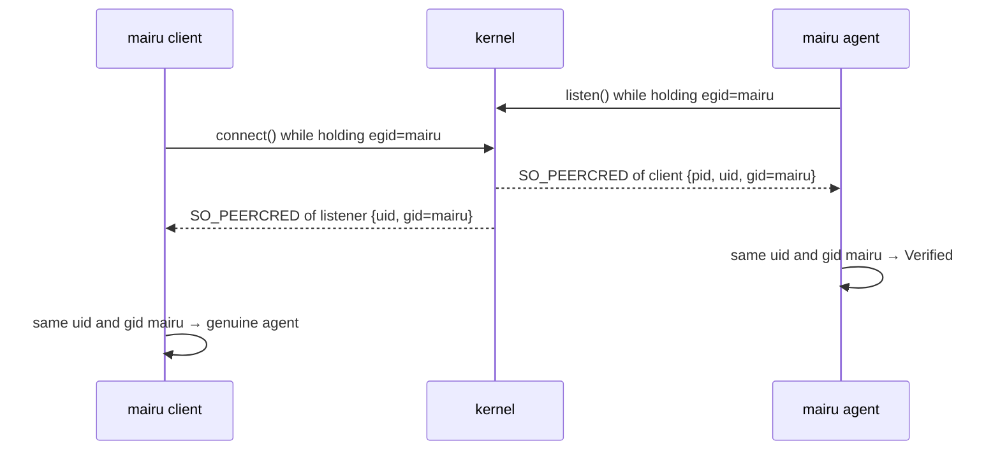
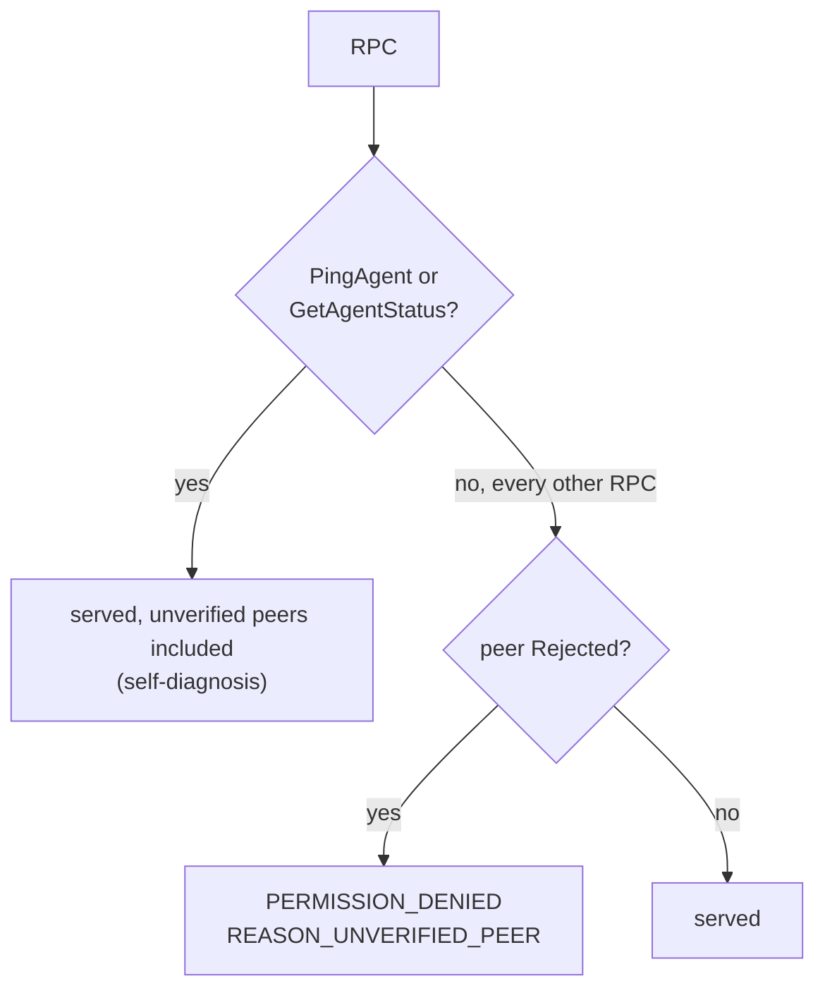
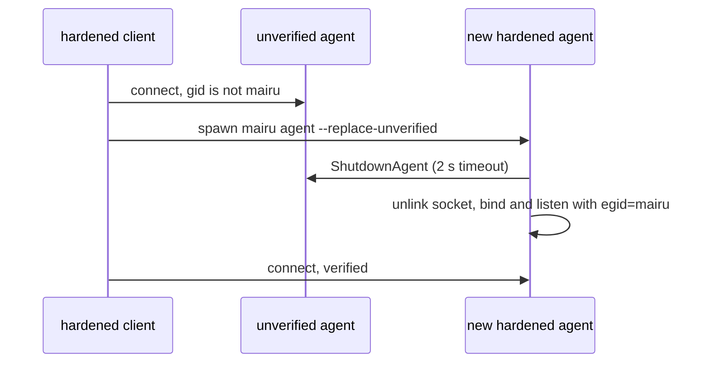
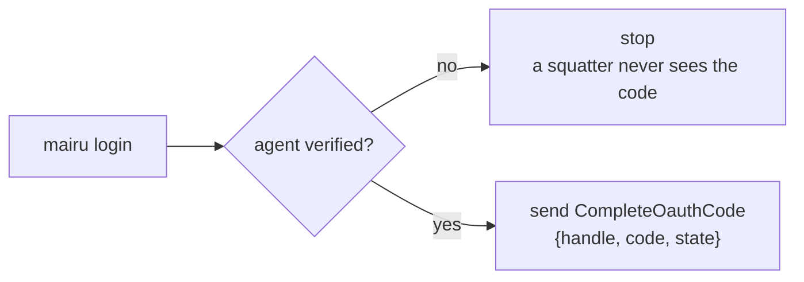

# 004-peer-verification

## Summary

`mairu agent` and its clients verify each other through the marker gid of [003](003-marker-gid.md). The agent records each connection's peer as the kernel reports it, and refuses every RPC except two diagnostic ones to a hardened-mode peer without the marker. A hardened client checks the agent's listen-time credentials before sending it anything, and replaces an agent that fails the check. Each identity is pinned with a pidfd and the process start time, so a recycled pid cannot inherit it.

This step also adds the in-process platform primitives that later steps build on (`ProcessPlatform`, `/proc` parsing, the first `mairu.platform` protobuf messages), the `GetAgentStatus` RPC, the `mairu doctor` command, and the dev profile that keeps a contributor's debug build away from their installed mairu.

## Motivation

`mairu agent` holds credential-server sessions in memory and vends AWS credentials to whoever connects to its Unix socket. Today that is any process running as the user ([001 Adversary](001-security-model.md#adversary)). Two things are missing:

- **The agent does not know who the client is.** Any same-user process can call `AssumeRole` for any role the user's sessions reach.
- **A client does not know who the agent is.** Same-user code can kill the agent and bind its socket path. `mairu login` would then send it the OAuth authorization code through `CompleteOauthCode`, and the squatter would own the session.

The kernel already records a trustworthy fact about each side of a Unix socket: the effective gid at `connect()` and at `listen()` ([003](003-marker-gid.md)). A hardened process holds the marker exactly then, so each side can check the other without trusting anything the other says.

Further requirements follow from that:

- **Pid reuse.** The pid in `SO_PEERCRED` can be recycled. Anything recorded about a peer (its start time, its real gid, later its session and ancestry) must provably belong to the process that connected.
- **Group passwords.** A process that joined `mairu` through a group password has the marker as both real and effective gid. A genuine hardened process never does, so the real gid tells them apart.
- **Diagnosability.** An unverified binary, such as a fresh `cargo build`, must still be able to ask a hardened agent what is wrong.
- **Upgrades.** An agent started before hardening, or a squatter, sits on the socket path. A hardened client must get rid of it without user intervention.
- **Contributors.** Once a hardened client replaces whatever agent it cannot verify, a contributor's debug build would replace their installed agent and drop its sessions. Debug builds therefore need their own socket and state.

## Explanation

Diagrams and text blocks in this spec are illustrative; the text after them is normative.



### What changes for users

| Agent | Client | Result |
|---|---|---|
| Unhardened | any | As today |
| Hardened | hardened | As today, verified both ways |
| Hardened | unhardened or `Misconfigured` | Every RPC except `PingAgent` and `GetAgentStatus` fails with `PERMISSION_DENIED`, `AuthorizationError{reason: REASON_UNVERIFIED_PEER}` |
| Unhardened, or a squatter | hardened | The client sends nothing but `PingAgent`, `GetAgentStatus` or `ShutdownAgent`, and replaces the agent ([Replacing an unverified agent](#replacing-an-unverified-agent)) |

- `mairu kill-agent` works against any agent, verified or not.
- `MAIRU_AGENT_SOCK` remains supported. A redirected socket still has to pass the client's check.
- `mairu login` stops before sending anything if the agent is unverified. A squatter never sees an authorization code.
- An unhardened client never replaces a hardened agent.

### Errors



Authorization failures are non-OK statuses whose binary details hold an `AuthorizationError`. Clients decode the details first and fall back to the status message. This step defines one reason:

```proto
message AuthorizationError {
  enum Reason {
    REASON_UNSPECIFIED = 0;
    REASON_UNVERIFIED_PEER = 1;          // PERMISSION_DENIED
  }
  Reason reason = 1;
  string detail = 2;
}
```

Existing status codes keep their meanings. In particular, `UNAUTHENTICATED` still means a credential-server login is required.

### GetAgentStatus

```proto
service Agent {
  // ... existing RPCs ...
  rpc GetAgentStatus(GetAgentStatusRequest) returns (GetAgentStatusResponse);
}

enum HardeningState {
  HARDENING_STATE_UNSPECIFIED = 0;
  HARDENING_STATE_UNHARDENED = 1;
  HARDENING_STATE_HARDENED = 2;
  HARDENING_STATE_MISCONFIGURED = 3;
}

message GetAgentStatusRequest {}
message GetAgentStatusResponse {
  string version = 1;
  HardeningState agent_hardening = 2;
  PeerView caller = 3;
  mairu.platform.Capabilities capabilities = 4;
  string profile = 10;                  // "default" or "dev"
}

message PeerView {
  bool verified = 1;
  uint32 pid = 2;
  uint64 start_time = 3;
}
```

- `GetAgentStatus` and `PingAgent` stay open to unverified peers, so that unverified binaries can diagnose themselves.
- `caller` is the requesting client as the agent sees it: whether it is verified, and the pid and start time the agent pinned.
- `capabilities` reports `peer_verification` (`SETGID` when the agent is hardened, `NONE` otherwise) and free-form `notes` ([Protocol additions](#protocol-additions)).
- Field numbers are those of the final protocol. Numbers not listed are added by later steps.

### mairu doctor

| Source | What `doctor` learns from it |
|---|---|
| `PingAgent` | the agent version |
| `GetAgentStatus` | the agent's hardening and profile, how the agent sees this client, capabilities |
| local checks | the client's own hardening, marker membership, `fs.protected_hardlinks`, `SO_PEERPIDFD` |

`mairu doctor` prints, as plain text for humans:

- the client's own hardening state, binary path, version and profile
- the agent's hardening state, version, profile and socket path, and whether the client verified it
- the caller as the agent sees it (`PeerView`)
- capabilities and their notes
- warnings:
  - `fs.protected_hardlinks != 1`
  - marker membership or a primary group of `mairu` (`Misconfigured`)
  - a real gid of `mairu`, which the agent rejects
  - missing `SO_PEERPIDFD` (kernel older than 6.5)
  - an unverified agent at the socket path

For example, on a hardened host:

```
client   hardened  /usr/local/libexec/mairu/mairu 0.13.0 (profile default)
agent    hardened  0.13.0 (profile default) $XDG_RUNTIME_DIR/mairu/mairu-agent.sock  verified
caller   verified  pid 41235 start_time 8812345
capabilities  peer_verification=SETGID
```

`doctor` uses only `PingAgent` and `GetAgentStatus`, so it works from an unverified binary too.

### Compatibility

| Client | Agent | Result |
|---|---|---|
| old | new | unverified when the agent is hardened, otherwise as today |
| new | old | unknown fields ignored; the existing version warning fires |

- New fields are optional, and an old agent ignores unknown ones.
- An old unhardened client talking to a hardened agent is unverified and gets `REASON_UNVERIFIED_PEER`.
- Versions already diverge noisily (the existing `PingAgent` warning). Hardened deployments run one binary, so mixed versions are transitional.

### Dev profile

```text
debug build (cfg(debug_assertions))  → profile "dev"        MAIRU_PROFILE=dev|default overrides
  agent socket       $XDG_RUNTIME_DIR/mairu/mairu-dev-agent.sock
  state directory    ~/.local/state/mairu-dev
  configuration      shared: ~/.config/mairu (servers.d and every other config file)
```

A contributor's build must never touch their installed mairu. Its identity differs from the installed agent's, so without isolation it would replace that agent ([Replacing an unverified agent](#replacing-an-unverified-agent)), dropping its sessions.

- Debug builds therefore default to the **dev profile**, and release builds to `default`. `MAIRU_PROFILE` overrides either way.
- The dev profile changes the agent socket (`mairu-dev-agent.sock` instead of `mairu-agent.sock`, in the same runtime directory) and the state directory (`mairu-dev` instead of `mairu`). Configuration is shared.
- An explicit `MAIRU_AGENT_SOCK` still wins over the profile's socket path.
- The profile appears in `GetAgentStatus` (`profile`) and `doctor`.
- Setting `MAIRU_PROFILE` on someone else's mairu gains nothing. A separate agent has no sessions.

## Drawbacks

- Hardening a host replaces the running unhardened agent the first time a hardened client runs, so its sessions are lost and the user logs in again. The replacement notice says so.
- Unverified binaries cannot use a hardened agent beyond diagnostics. Contributors rely on the dev profile, and anyone running an ad-hoc copy gets errors until it is hardened.
- Hardened mode needs Linux 5.3 for pidfds. Before 6.5 there is no `SO_PEERPIDFD`, and attribution has a small pid-reuse window (the gid check never does).
- The diagnostic RPCs answer anyone of the same uid. They reveal versions, the hardening state and capabilities, which same-user code could learn anyway.

## Considered Alternatives

- **Check only on the agent side.** Rejected: a squatter on the socket path receives OAuth authorization codes from `mairu login` (`CompleteOauthCode`). The client must verify the agent before sending anything.
- **Check identity per RPC with a fresh `getsockopt`.** Unnecessary on Linux: `SO_PEERCRED` is a snapshot taken at `connect()`, so the identity recorded at accept holds for the connection's lifetime. Enforcement still happens per RPC (`require_trusted`), because two RPCs stay open.
- **Close every RPC to unverified peers.** Rejected: an unverified binary could not explain why it is refused. `PingAgent` and `GetAgentStatus` stay open; they carry no secrets.
- **Refuse an unverified agent and ask the user to kill it.** Rejected in favor of automatic replacement with a notice. Shutting down an impostor is harmless, and the alternative leaves every hardened client broken until the user acts. An unhardened client never replaces a hardened agent, so the replacement only ever moves toward hardened.
- **Require verification for `kill-agent`.** Rejected for the same reason: stopping an impostor needs no trust.
- **Trust a pid without pinning it.** Rejected: pids are recycled. The agent obtains a pidfd (`SO_PEERPIDFD`, or `pidfd_open` on older kernels) and re-checks liveness after every `/proc` read.
- **Accept any peer whose effective gid is the marker.** Rejected: a process that joined the group through a group password has it too. The agent and clients also require the real gid to differ from the marker.
- **Dev profile as an opt-in.** Rejected: the failure it prevents (a contributor's agent replacing their installed one) happens on the first run. Debug builds use it by default; configuration stays shared so a contributor tests against their real servers.

## Prior Art

- D-Bus and systemd authenticate local peers by `SO_PEERCRED`, and systemd pins peers with pidfds where the kernel offers `SO_PEERPIDFD`.
- polkit identifies a `unix-process` subject by its pid together with its start time, for the same pid-reuse reason.

## Security and Privacy Considerations

```text
rogue client                       ✗ marker gid at connect()
socket squatter / rogue agent      ✗ client checks the listen-time marker; replaced
pid reuse                          ✗ pidfd + start time
group password (newgrp / sg)       ✗ a real gid of mairu is rejected
```

| Threat | Mitigation |
|---|---|
| Rogue client process | Marker gid via `SO_PEERCRED` at `connect()` ([Agent side](#agent-side)) |
| Socket squatter or rogue agent stealing OAuth codes | Client checks the agent's listen-time marker ([Client side](#client-side)); hardened clients replace unverified agents ([Replacing an unverified agent](#replacing-an-unverified-agent)) |
| Pid reuse | `SO_PEERPIDFD`/pidfd, start times in every identity, liveness re-checks ([Agent side](#agent-side), [Process facts](#process-facts)) |
| Joining the marker group through a group password (`newgrp`, `sg`) | Peers whose real gid is the marker are rejected by the agent and by clients |
| A connection from another uid | Closed at accept. The runtime directory is already `0700`; this is defense in depth. |
| A redirected `MAIRU_AGENT_SOCK` | Verified like the default path |
| A squatter that ignores `ShutdownAgent` | Keeps running on an unlinked socket and is never reached again |
| Contributor builds touching the installed agent | Dev profile ([Dev profile](#dev-profile)) |

- `/proc/<pid>/cmdline` is read for display only. The agent logs rejected peers with their pid, uid and gids, and nothing else.

## Mission Scope

### Out of scope

- Installing the hardened binary system-wide.
- macOS and BSD peer verification. On those systems `FallbackProcess` reports every peer as `Unverifiable`, which keeps today's behavior.
- Deciding whether a verified client may have credentials. Verification only establishes that the peer is genuine mairu.

### Expected Outcomes

On a test machine with a build installed by hand as `root:mairu 2755`:

- The hardened client and agent verify each other; `mairu doctor` shows both hardened and the caller verified.
- An unhardened copy of the same build (for example `./target/release/mairu list-sessions`) is refused with `REASON_UNVERIFIED_PEER`, while `mairu doctor` from it still works.
- An unhardened agent started on the socket path before the hardened client runs is shut down and replaced, with the notice. `mairu login` against an unverified agent stops before sending a code.
- A debug build uses `mairu-dev-agent.sock` and `~/.local/state/mairu-dev`, and never touches the installed agent.
- Without a hardened binary, everything behaves as before.

## Implementation Plan

Stack layer: `hardening/peer-verification`.

| File | Change |
|---|---|
| `src/platform/mod.rs` | New, core module: `ProcessPlatform`, `PeerIdentity`, `PeerTrust`, `AgentTrust`, `crate::platform::process()` |
| `src/platform/process/linux/{mod,procfs,peer}.rs` | New: `LinuxProcess`, `/proc` parsing, `SO_PEERCRED`, pidfds |
| `src/platform/process/fallback.rs` | New: `FallbackProcess` for macOS and BSD (`Unverifiable`) |
| `proto/mairu_platform.proto` | New: package `mairu.platform` with `PeerVerification` and `Capabilities` |
| `proto/mairu.proto` | `GetAgentStatus`, `HardeningState`, `PeerView`, `AuthorizationError` |
| `build.rs`, `src/proto.rs` | Compile `mairu_platform.proto`; expose it as `crate::proto::platform` |
| `src/agent.rs` | `require_trusted` in every handler but `PingAgent`/`GetAgentStatus`; `GetAgentStatus`; client-side `verify_agent` in `connect_to_agent_with_path` |
| `src/cmd/agent.rs` | `PeerStream`, `--replace-unverified`, unverified-agent handling in `connect_or_start` and `check_liveness` |
| `src/cmd/kill_agent.rs` | `ShutdownAgent` without requiring a verified agent |
| `src/cmd/login.rs` | Stop before `CompleteOauthCode` if the agent is unverified |
| `src/cmd/doctor.rs`, `src/cmd/mod.rs`, `src/main.rs` | New `mairu doctor` |
| `src/config.rs` | Profiles: socket path and state directory per profile |

`src/platform/` and `crate::proto::platform` are core modules, outside the `cli` gate ([002 Cargo features](002-build-layout.md#cargo-features)). `PeerStream`, the handlers and the commands are `cli` code.

### Agent side

```text
on accept(stream)
  cred = SO_PEERCRED                       cred.uid != me → close
  pidfd = SO_PEERPIDFD ?: pidfd_open(cred.pid)
  start_time = /proc/<pid>/stat field 22; pidfd still alive?
  real_gid = /proc/<pid>/status Gid: (first field)
  trust = hardened ? (cred.gid == mairu && real_gid != mairu ? Verified : Rejected) : Unverifiable
on every RPC except PingAgent, GetAgentStatus
  Rejected → PERMISSION_DENIED, REASON_UNVERIFIED_PEER
```

The agent wraps every accepted stream in `PeerStream { inner: tokio::net::UnixStream, peer: Arc<PeerIdentity> }`, which implements `tonic::transport::server::Connected<ConnectInfo = Arc<PeerIdentity>>`. tonic inserts the connect info into every request's extensions. At accept, `ProcessPlatform::inspect_peer`:

1. `SO_PEERCRED` → `(pid, uid, gid)`. If `uid != geteuid()`, close the connection immediately. The runtime directory is already `0700`; this is defense in depth.
2. Obtain a pidfd:
   - `SO_PEERPIDFD` on Linux 6.5+ is race-free.
   - Otherwise `pidfd_open(pid)` on Linux 5.3+. This leaves a pid-reuse window between `connect()` and accept handling that only affects attribution (start time, and anything later steps derive from the peer), never the gid check.
3. Read `/proc/<pid>/stat` ([Process facts](#process-facts)) for `start_time`, and the real gid from the `Gid:` line of `/proc/<pid>/status`, then confirm the pidfd still refers to a live process (`pidfd_send_signal(pidfd, 0)`) so the values read belong to it.
   - A genuine hardened client always has a real gid other than the marker ([003 Classification](003-marker-gid.md#classification)).
   - A process that got the marker through a group password (`newgrp`, `sg`) has it as both real and effective gid, so it is rejected.
   - `/proc/<pid>/status` stays readable for a non-dumpable process.
4. Compute trust:

   | Agent state | Peer gid | `PeerTrust` |
   |---|---|---|
   | Hardened | `mairu`, with a real gid other than `mairu` | `Verified` |
   | Hardened | anything else | `Rejected`; a real gid of `mairu` is logged, and `doctor` run by that process reports it |
   | Unhardened or Misconfigured | any | `Unverifiable` |

Each handler calls `require_trusted(&request)`. `Rejected` peers get `PERMISSION_DENIED` with `AuthorizationError{reason: REASON_UNVERIFIED_PEER}` on every RPC except `PingAgent` and `GetAgentStatus`. `Unverifiable` peers are served as they are today.

The agent binds and listens inside `with_privileged_gid` ([003 Privileged gid](003-marker-gid.md#privileged-gid)), so its listen-time credentials carry the marker.

### Client side

```text
connect_to_agent(path)                     # tonic calls this on every reconnect
  with_privileged_gid { std connect(path) }
  cred = SO_PEERCRED(stream)               # the agent's credentials at listen()
  require cred.uid == me
  hardened client: require cred.gid == mairu and the agent's real gid != mairu,
                   else only Ping / GetAgentStatus / Shutdown
```

`connect_to_agent_with_path` connects with a blocking `std::os::unix::net::UnixStream::connect` inside `with_privileged_gid`, then converts the stream to tokio. tonic calls the connector closure again on every reconnect, so reconnects behave the same. After connecting, `ProcessPlatform::verify_agent` reads `SO_PEERCRED` of the stream, which carries the agent's credentials at `listen()`:

- `uid` must equal `geteuid()`.
- If the client is `Hardened`, `gid` must equal `mairu`, and the agent's real gid (`/proc/<pid>/status`) must not. Otherwise the agent is **unverified**: never send it anything except `PingAgent`, `GetAgentStatus` or `ShutdownAgent`.

The resulting `AgentTrust` travels with the client handle. Calls other than those three return an error locally when the agent is unverified, before anything is sent.

### Replacing an unverified agent



A hardened client that finds a live but unverified agent at the socket path (an old agent started before hardening, or a squatter) does not use it. `connect_or_start` spawns a hardened agent with `--replace-unverified`. That agent's bind logic:

1. connects to the existing socket and sees an unverified agent
2. sends `ShutdownAgent` with a 2 s timeout
3. unlinks the socket file if it is a socket
4. binds and listens with the marker held

The client's connect loop treats unverified agents as not ready, and prints:

```
:: mairu :: Replacing an agent that is not hardened (pid 12345); you may need to log in again.
```

A squatter that ignores `ShutdownAgent` keeps running on an unlinked socket and is never reached again.

`mairu kill-agent` sends `ShutdownAgent` without requiring a verified agent, because shutting down an impostor is harmless. An unhardened client never replaces a hardened agent.

### Session tokens on the wire



`CompleteOauthCode` carries authorization codes to the agent. Client-side agent verification is what keeps these codes away from a socket squatter.

### Process facts

```text
stat = read /proc/<pid>/stat
rest = text after the LAST ")"           # comm may contain ") "
ppid, pgrp, session, tty_nr = fields 4..7
starttime = field 22                     # clock ticks since boot
pidfd still alive after reading?         # values belong to this process, not a recycled pid
```

`src/platform/process/linux/procfs.rs` parses `/proc/<pid>/stat` by splitting at the **last** `)` (comm may contain spaces and parentheses), giving:

- field 4 `ppid`
- 5 `pgrp`
- 6 `session`
- 7 `tty_nr`
- 22 `starttime` (clock ticks since boot)

It also reads `/proc/<pid>/comm`, `/proc/<pid>/exe` (readlink; may fail), `/proc/<pid>/status` (the `Gid:` line) and `/proc/<pid>/cmdline` (argv split on NUL, used only for display and matching, never for trust). Every read is followed by a pidfd or start-time liveness check so the values cannot belong to a recycled pid.

### Rust traits

`src/platform/mod.rs`:

```rust
/// Runs in-process in every mairu process; never remoted.
pub trait ProcessPlatform: Send + Sync + std::fmt::Debug {
    /// Agent side, at accept time.
    fn inspect_peer(&self, stream: &tokio::net::UnixStream) -> crate::Result<PeerIdentity>;
    /// Client side, right after connect.
    fn verify_agent(&self, stream: &std::os::unix::net::UnixStream) -> crate::Result<AgentTrust>;
}
```

- `PeerIdentity`: `uid`, `gid`, `real_gid`, `pid`, `pidfd: Option<OwnedFd>`, `start_time: u64`, `exe: Option<PathBuf>`, `trust: PeerTrust`.
- `PeerTrust`: `Verified`, `Rejected`, `Unverifiable`.
- `AgentTrust`: `Verified`, `Unverified`, `Unverifiable` (the client is not hardened, so only the uid is checked).
- `crate::platform::process()` returns the `ProcessPlatform` for the OS, chosen by `cfg`:
  - `LinuxProcess`
  - `FallbackProcess`: macOS and BSD until they are implemented. No verification (`Unverifiable`).
- The trust computations are pure functions over the agent's state, the peer's gids and the marker, and are unit-tested per table row.

### Protocol additions

`proto/mairu_platform.proto` starts with the types `GetAgentStatus` reports. Enum values are prefixed with the enum name, because proto3 enum values share their package's scope.

```proto
syntax = "proto3";
package mairu.platform;

enum PeerVerification {
  PEER_VERIFICATION_UNSPECIFIED = 0;
  PEER_VERIFICATION_NONE = 1;
  PEER_VERIFICATION_SETGID = 2;
  PEER_VERIFICATION_CODE_SIGNATURE = 3;
}

message Capabilities {
  PeerVerification peer_verification = 1;
  // Free-form diagnostics for `mairu doctor`, e.g. "SO_PEERPIDFD unavailable".
  repeated string notes = 6;
}
```

`proto/mairu.proto` gains `GetAgentStatus`, `HardeningState` and `PeerView` ([GetAgentStatus](#getagentstatus)) and `AuthorizationError` ([Errors](#errors)). `build.rs` compiles both files, and `src/proto.rs` exposes the new package as `crate::proto::platform`.

### Tests

- `/proc/<pid>/stat` parsing with a comm containing `) ` and spaces.
- Trust tables for both sides, as pure functions.
- Accept handling on a socketpair: a peer of another uid is closed; a dead pid after the read is detected.
- Integration (root, disposable VM): hardened client and agent verify each other; an unhardened client is refused; an unhardened agent is replaced; `kill-agent` stops an unverified agent.
- Dev profile path selection: debug default, `MAIRU_PROFILE` overrides, `MAIRU_AGENT_SOCK` wins.

### Requirements

Linux 5.3 (pidfd) is required for hardened mode; 6.5 (`SO_PEERPIDFD`) is recommended. `doctor` warns on older kernels.

## Current Status

Spec drafted; awaiting review before implementation. Implementors MUST keep this section updated as they work.

### Checklist

- [ ] `ProcessPlatform`, `PeerIdentity`, `LinuxProcess`, `FallbackProcess`
- [ ] `/proc` parsing, pidfds and liveness re-checks (`src/platform/process/linux/procfs.rs`)
- [ ] Agent side: `PeerStream`/`Connected`, real-gid check, `require_trusted`
- [ ] Client side: `verify_agent` in `connect_to_agent_with_path`, unverified agents limited to three RPCs
- [ ] Unverified-agent replacement (`--replace-unverified`); `kill-agent` without verification; `login` stops on an unverified agent
- [ ] `proto/mairu_platform.proto`; `GetAgentStatus`, `PeerView`, `AuthorizationError{REASON_UNVERIFIED_PEER}`
- [ ] `mairu doctor`
- [ ] Dev profile (socket path, state directory, `MAIRU_PROFILE`)

### Updates

- 2026-10-29: Split out of hardening.md, policy.md and platform-helper.md.
