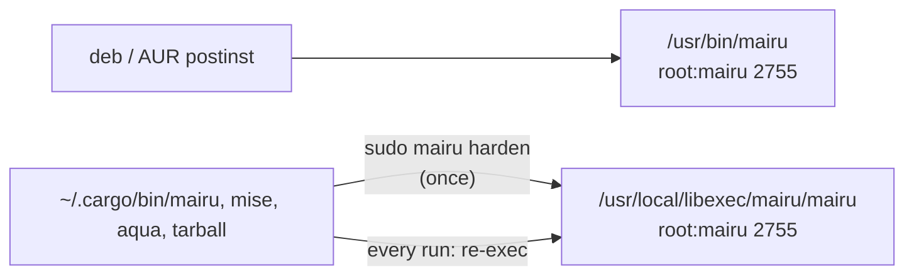
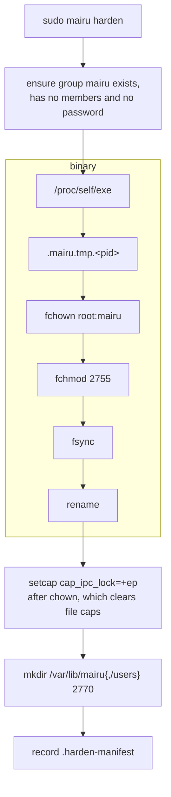
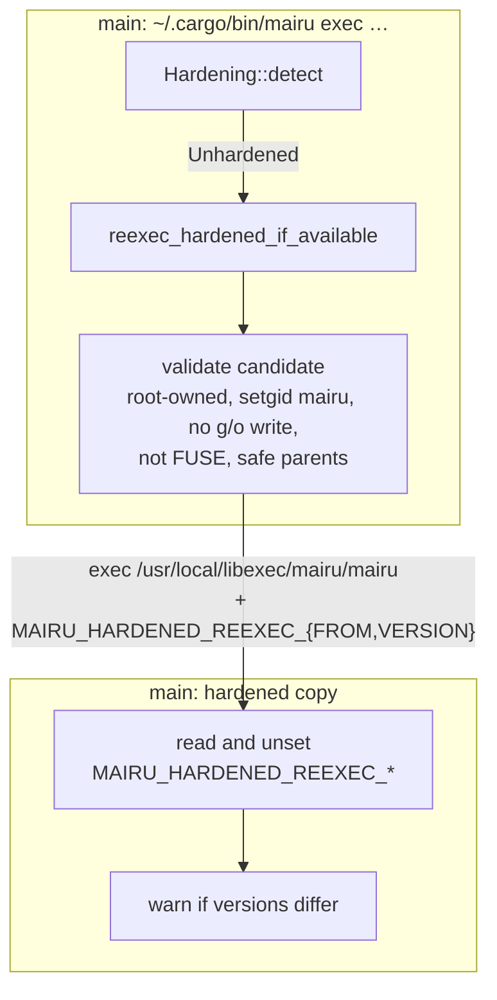
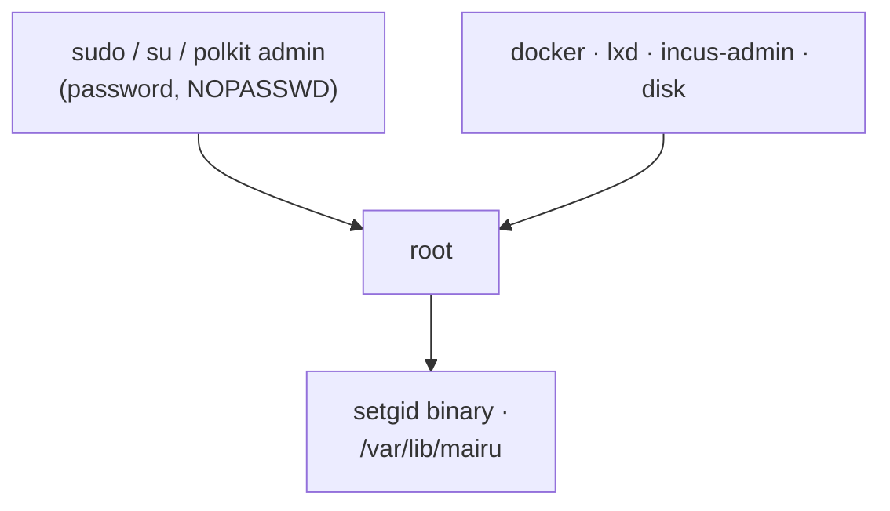

# 005-install

## Summary

`sudo mairu harden` turns any mairu installation into a hardened one. It creates the `mairu` group, copies the running binary to a root-owned location as setgid `mairu` ([003](003-marker-gid.md)), and creates the root-owned state directory that only the marker gid can traverse. Distribution packages do the same in their install scripts.

Copies installed in user-writable locations (mise, cargo, aqua, tarballs) cannot be setgid, so they re-exec the hardened copy on every run, after validating it. When no hardened copy exists, they suggest hardening, at most once an hour by default. `mairu doctor` also warns about the ways same-user code can reach root on the host, since every guarantee of this work is bounded by that.

## Motivation

The marker only exists if a root-owned setgid binary exists. Most mairu users do not install it from a distribution package: they use mise, `cargo install`, aqua or a release tarball, all of which keep the binary in a user-writable directory. A setgid bit there would mean nothing, since same-user code could replace the file. Hardening therefore needs:

- **One root-owned copy per host**, created once with root, and refreshed on upgrade.
- **A way for every other copy to use it.** Users keep invoking whichever `mairu` is first on their `PATH`. That copy must hand over to the hardened one, after checking that the hardened one really is root-owned and unmodifiable by the user.
- **One authoritative binary.** If user copies and the hardened copy ran side by side, the agent would see unverified clients from whichever copy did not hand over. The hardened copy runs every invocation, whatever version invoked it, and says so when versions differ.
- **A protected place for state** that the user cannot reach by path but the marker gid can.
- **Discoverability.** Users who never heard of `harden` should learn about it, without being nagged on every command.
- **Honesty about root.** Root can replace every anchor and read the agent's memory, so the strength of a deployment is bounded by how easily same-user code becomes root ([001 Trust chain](001-security-model.md#trust-chain)). `doctor` warns where it can detect an easy path.

## Explanation

Diagrams and text blocks in this spec are illustrative; the text after them is normative.



### Layout

```text
/usr/local/libexec/mairu/
├── mairu                   root:mairu 2755   # the hardened binary
└── .harden-manifest        root:root  0644   # what --uninstall removes
/var/lib/mairu/             root:mairu 2770   # users cannot traverse it
└── users/                  root:mairu 2770
```

| Path | Owner | Mode | Purpose |
|---|---|---|---|
| `/usr/local/libexec/mairu/mairu` | `root:mairu` | `2755` | Hardened binary installed by `mairu harden` |
| `/usr/bin/mairu` | `root:mairu` | `2755` | Hardened binary installed by distro packages |
| `/usr/local/libexec/mairu/.harden-manifest` | `root:root` | `0644` | Files written by `mairu harden`, for `--uninstall` |
| `/var/lib/mairu` | `root:mairu` | `2770` | Protected state root. Users cannot traverse it, but the marker gid can. |
| `/var/lib/mairu/users` | `root:mairu` | `2770` | Parent of the per-user protected directories |

A per-user directory under `/var/lib/mairu/users` is owned by its user, but the user cannot reach it by path: they are neither owner nor group of `/var/lib/mairu`, and "other" has no search permission. Only a process holding the marker gid can open it, and genuine mairu only ever opens the directory for `getuid()`. User namespaces do not help, because unmapped owners keep their permission semantics. This step creates only the two root-owned directories.

### mairu harden



Linux only (BSD later). It must run as root (`euid == 0`); otherwise it exits with the exact command to run: `sudo <canonical exe path> harden`. It is idempotent, and re-running it upgrades the binary.

1. **Group.** If `mairu` is missing, run `groupadd --system mairu`, falling back to `addgroup --system mairu` (busybox). Refuse if the group has members, or if `SUDO_UID`'s primary gid is `mairu`, and print how to fix it. If `/etc/gshadow` gives the group a password, remove it with `gpasswd -r mairu` (after which only members could `newgrp`, and there are none) and say so ([003](003-marker-gid.md)). `groupadd` leaves it locked, so this only undoes a password someone set.
2. **Directory.** Create `/usr/local/libexec/mairu` as `root:root 0755`. Check that the ancestor chain is root-owned and not group/other-writable.
3. **Binary.**
   1. Open `/proc/self/exe`, which is the exact image running as root.
   2. Create `.mairu.tmp.<pid>` in the target directory with `O_EXCL`, mode `0600`, and copy into it.
   3. `fchown(0, mairu)`, `fchmod(0o2755)`, `fsync`.
   4. `rename` to `mairu`, then `fsync` the directory.
   5. If `/usr/sbin/setcap` or `/usr/bin/setcap` exists, run `setcap cap_ipc_lock=+ep` on the final path. This must come after the `chown`, because `chown` clears file capabilities. It is needed so the agent's `mlockall` succeeds without RLIMIT_MEMLOCK headroom.
4. **State directory.** Create `/var/lib/mairu` and `/var/lib/mairu/users` as `root:mairu 2770`.
5. **Manifest.** Record every file written in `.harden-manifest`.
6. **Next steps.** Print them: the next hardened `mairu` invocation replaces the running unhardened agent automatically ([004 Replacing an unverified agent](004-peer-verification.md#replacing-an-unverified-agent)), or the user can run `mairu kill-agent`.

`mairu harden --uninstall` removes the files listed in the manifest. `--purge` also removes `/var/lib/mairu`. The group is left in place; `groupdel mairu` is documented.

### Re-exec



`mise`, `cargo install`, `aqua` and tarball installs keep the binary in a user-writable location, where it cannot be setgid. `crate::hardening::reexec_hardened_if_available()` runs right after classification ([003 Classification](003-marker-gid.md#classification)) when the state is `Unhardened`. It is skipped for the `harden` subcommand and when `MAIRU_NO_HARDENED_REEXEC=1` is set; the opt-out produces an unhardened client, which a hardened agent rejects anyway, so it is safe for development.

1. For each candidate in order, `/usr/local/libexec/mairu/mairu` then `/usr/bin/mairu`, validate it ([Candidate validation](#candidate-validation)).
2. Exec the first valid candidate with the original `argv[1..]`, setting `MAIRU_HARDENED_REEXEC_FROM=<own canonical exe path>` and `MAIRU_HARDENED_REEXEC_VERSION=<own CARGO_PKG_VERSION>`.
3. The hardened process reads and **unsets** both variables. If the version differs from its own, it prints once to the terminal:

   ```
   :: mairu :: Using hardened mairu 0.13.0 (/usr/local/libexec/mairu/mairu) instead of mairu 0.14.0 (/home/u/.local/share/mise/installs/mairu/0.14.0/mairu).
   :: mairu :: To update the hardened copy, run: sudo /home/u/.local/share/mise/installs/mairu/0.14.0/mairu harden
   ```

   The variables only feed this message, so a forged value cannot do more than print a misleading warning.
4. If no candidate exists, suggest hardening ([Harden suggestion](#harden-suggestion)).

The hardened copy is the single authoritative binary. Every installation execs it, whatever version invoked it.

The dev profile ([004 Dev profile](004-peer-verification.md#dev-profile)) turns re-exec off, as if `MAIRU_NO_HARDENED_REEXEC=1` were set, so a contributor's debug build never hands over to the installed hardened copy. `MAIRU_PROFILE=default` on a debug build turns it back on.

### Harden suggestion

```text
show when   Linux · Unhardened · no candidate · stderr is a terminal · not disabled
            · and interval_secs have passed since it was last shown (default 3600)
            · or, with interval_secs == 0, it has not been shown in this terminal session yet
state       state_dir()/harden-suggestion.json  {"last_shown": "<RFC 3339>", "session": {"sid": N, "start_time": T}}
disable     MAIRU_NO_HARDEN_SUGGESTION=1 · config.json "harden_suggestion": {"enabled": false}
```

- The message is `:: mairu :: Run 'sudo <exe> harden' to protect your AWS credentials from other programs …`, followed by when it will be shown again and how to turn it off.
- The terminal session is computed by the client for itself: the session id of its controlling terminal (`/proc/self/stat` field 6, [004 Process facts](004-peer-verification.md#process-facts)) and the start time of that session's leader. Each tmux pane is its own session.
- `config.json` (`UserConfig`, unprotected) sets the period:

  ```jsonc
  {"harden_suggestion": {"enabled": true, "interval_secs": 3600}}
  ```

  The default is 1 hour, counted across all terminals. `0` switches to once per terminal session instead.
- If the state file cannot be written, the suggestion is skipped rather than repeated on every invocation.
- `mairu doctor` always shows the hardening state, whatever the suggestion settings.

### Distribution packages

```diff
 #!/bin/sh
+getent group mairu >/dev/null || groupadd --system mairu
+chgrp mairu /usr/bin/mairu
+chmod 2755 /usr/bin/mairu
 setcap cap_ipc_lock=+ep /usr/bin/mairu
+install -d -o root -g mairu -m 2770 /var/lib/mairu /var/lib/mairu/users
```

- **Debian** (`cargo deb`, `pkg/debian/postinst`):

  ```sh
  getent group mairu >/dev/null || groupadd --system mairu
  chgrp mairu /usr/bin/mairu
  chmod 2755 /usr/bin/mairu
  setcap cap_ipc_lock=+ep /usr/bin/mairu   # after chgrp: chown clears file caps
  install -d -o root -g mairu -m 2770 /var/lib/mairu /var/lib/mairu/users
  ```

- **systemd distributions**: `pkg/sysusers.d/mairu.conf` (`g mairu -`) and `pkg/tmpfiles.d/mairu.conf` (`d /var/lib/mairu 2770 root mairu -`, `d /var/lib/mairu/users 2770 root mairu -`) for packagers.
- **AUR** (`mairu`, `mairu-bin`, separate repositories): install the sysusers/tmpfiles snippets. A `.install` `post_install`/`post_upgrade` runs `chgrp mairu /usr/bin/mairu && chmod 2755 /usr/bin/mairu && setcap cap_ipc_lock=+ep /usr/bin/mairu`. Tracked as a follow-up.
- **Homebrew on Linux, mise, cargo, aqua, tarballs**: `sudo mairu harden`.

### Operations

```text
upgrade     sudo mairu harden (or the package manager) → mairu kill-agent
uninstall   sudo mairu harden --uninstall [--purge] → groupdel mairu
diagnose    mairu doctor
```

- **Upgrade**: re-run `sudo mairu harden`, or let the package manager upgrade it. Running agents keep the old image until restarted; the existing version-divergence warning tells the user to run `mairu kill-agent`.
- **Uninstall**: `sudo mairu harden --uninstall [--purge]`, then optionally `groupdel mairu`.
- **Diagnose**: `mairu doctor` ([004](004-peer-verification.md)), which this step extends with the root-reachability warnings below.

### Root reachability in doctor



On a hardened host every anchor is root-owned, and root can also read the agent's memory directly. **Every guarantee is therefore bounded by how hard it is for same-user code to become root** ([001 Trust chain](001-security-model.md#trust-chain)). `mairu doctor` warns where it can detect an easy path:

| Path | How | `doctor` check |
|---|---|---|
| `sudo`, `su` | PAM, usually the user's password, which is capturable at a tty. Also `NOPASSWD` rules and cached sudo timestamps. | `sudo -n true` succeeding, meaning `NOPASSWD` or a cached timestamp; run through `hardening::command()` |
| polkit administrator actions | `auth_admin` actions such as `pkexec` and systemd units; PAM again | Covered by the README recommendation; not detected |
| Root-equivalent group memberships | `docker`, `lxd`, `incus-admin`, `disk` | Membership in any of them |

Recommendations (README):

- Back `sudo` and the `polkit-1` PAM stack with something a captured password cannot replay: `pam_u2f` locally, or `pam_ssh_agent_auth` with an approval-protected key over SSH.
- Avoid `NOPASSWD` and root-equivalent groups for the user.

## Drawbacks

- Hardening needs root once per host, and again for every upgrade of a user-installed copy.
- The hardened copy lags a newer user-installed version until `harden` is re-run. Every invocation then runs the older hardened copy, with a warning.
- Every invocation of a user-installed copy costs one extra exec and a few `stat` calls.
- `--uninstall` leaves the group behind.
- `doctor`'s `sudo -n true` check can leave an entry in the system's auth log.

## Considered Alternatives

- **Make user-installed copies setgid.** Impossible: a setgid binary in a user-writable directory can be replaced by the user. Only a root-owned copy can carry the marker.
- **Ask users to put the hardened copy first on `PATH`.** Rejected: mise, aqua and similar tools manage `PATH` themselves, and a forgotten shim would leave unverified clients. Re-exec makes every copy hand over.
- **Run the user's newer copy when versions differ.** Rejected: it would be unverified. The hardened copy is the single authoritative binary; a version mismatch prints which binary ran and the exact command to update it.
- **Trust the candidate path without validation.** Rejected: the candidate must be root-owned, setgid `mairu`, not group/other-writable, not on FUSE, with root-owned and non-writable ancestors. Otherwise same-user code could plant a "hardened" binary. The checks are pure functions so they can be unit-tested.
- **Copy the binary from a path given on the command line.** Rejected: `harden` copies `/proc/self/exe`, the exact image already running as root, so nothing can swap the file between check and copy.
- **Refuse when the group has a password.** Rejected in favor of removing it with `gpasswd -r`: the password would let anyone who knows it hold the marker as both real and effective gid, and open `/var/lib/mairu` directly. Peer checks reject such processes ([004 Agent side](004-peer-verification.md#agent-side)), but only removing the password protects the directory.
- **A one-time harden suggestion.** Rejected: it is easy to miss. The suggestion repeats, at most once an hour by default (`interval_secs`), or once per terminal session with `0`, and can be turned off.

## Prior Art

- `systemd-sysusers` and `systemd-tmpfiles` are the standard way for packages to declare system groups and directories.
- mairu's Debian package already applies `cap_ipc_lock` in its postinst; this step adds the group and setgid bit in the same place.

## Security and Privacy Considerations

| Threat | Mitigation |
|---|---|
| A planted "hardened" candidate | Candidate validation: root-owned, setgid `mairu`, no group/other write, not FUSE, safe ancestors ([Candidate validation](#candidate-validation)) |
| Forged `MAIRU_HARDENED_REEXEC_*` variables | They only feed the version message, and the hardened copy unsets them |
| Swapping the binary while `harden` copies it | `harden` copies `/proc/self/exe`; the temporary file is created with `O_EXCL`, mode `0600`, and renamed atomically |
| User in the marker group | `harden` refuses and explains ([mairu harden](#mairu-harden)) |
| Joining the marker group through a group password | `harden` removes the password. The password would also open the protected directory, which is why `harden` removes it rather than relying on peer checks. |
| Hardlinked old hardened binaries | Atomic replace; `fs.protected_hardlinks` warning ([003](003-marker-gid.md)) |
| Root reached through `sudo`/polkit passwords, `NOPASSWD`, root-equivalent groups | Out of scope, but it bounds everything; `doctor` warns ([Root reachability in doctor](#root-reachability-in-doctor)) |
| A tampered suggestion state file | It can only suppress or repeat a suggestion |

- `doctor` runs `sudo -n true` through `hardening::command()`, so the marker never reaches `sudo`.
- No privacy impact beyond the state file, which records when the suggestion was last shown.

## Mission Scope

### Out of scope

- macOS and BSD installation.
- AUR and Homebrew packaging changes, which live in separate repositories and are tracked as follow-ups.
- Anything stored under `/var/lib/mairu/users/<uid>`.

### Expected Outcomes

- `sudo ./target/debug/mairu harden` on a disposable VM creates the group, `/usr/local/libexec/mairu/mairu` as `root:mairu 2755` with `cap_ipc_lock`, `/var/lib/mairu{,/users}` as `root:mairu 2770`, and the manifest. Re-running it is a no-op apart from replacing the binary.
- A user-installed copy re-execs the hardened one, and prints the version warning when versions differ. `MAIRU_NO_HARDENED_REEXEC=1` produces an unverified client that a hardened agent refuses.
- The next hardened invocation replaces a running unhardened agent; `mairu doctor` shows client and agent hardened.
- Without a hardened copy, an interactive run prints the suggestion at most once an hour, and never with `MAIRU_NO_HARDEN_SUGGESTION=1` or `"enabled": false`.
- The Debian package installs `/usr/bin/mairu` as `root:mairu 2755` and creates the state directories.
- `mairu doctor` warns when `sudo -n true` succeeds or the user is in `docker`, `lxd`, `incus-admin` or `disk`.
- `sudo mairu harden --uninstall --purge` removes everything but the group.

## Implementation Plan

Stack layer: `hardening/install`.

| File | Change |
|---|---|
| `src/cmd/harden.rs`, `src/cmd/mod.rs`, `src/main.rs` | New `mairu harden [--uninstall [--purge]]` |
| `src/hardening.rs` | `reexec_hardened_if_available()`, candidate validation, version-skew message, harden suggestion |
| `src/config.rs` | `UserConfig.harden_suggestion`; the dev profile disables re-exec |
| `src/cmd/doctor.rs` | Root-reachability warnings |
| `pkg/debian/postinst` | Group, setgid, state directories |
| `pkg/sysusers.d/mairu.conf`, `pkg/tmpfiles.d/mairu.conf` | New snippets for packagers |
| `.github/workflows/_test.yml`, `.github/workflows/ci.yml` | linux-hardened job |
| `README.md`, `CHANGELOG.md` | Hardening, root-reachability recommendations |

### Candidate validation

For each candidate:

- canonicalize the path
- `statfs`: reject FUSE (`f_type == 0x65735546`)
- `stat`: regular file, `st_uid == 0`, `st_gid == mairu`, mode has `S_ISGID`, `mode & 0o022 == 0`, executable
- every ancestor directory of the canonical path: `st_uid == 0` and `mode & 0o022 == 0`

These checks are pure functions over `(uid, gid, mode, fs_magic)` so they can be unit-tested. `mairu` here is the gid of the group named `mairu`, looked up with `getgrnam_r`, since the unhardened invoker has no marker of its own; the hardened copy then classifies itself from its own grant ([003 Classification](003-marker-gid.md#classification)).

### Suggestion state

- `state_dir()/harden-suggestion.json` holds `last_shown` (RFC 3339) and the terminal session it was shown in (`sid`, leader `start_time`).
- `UserConfig.harden_suggestion`: `enabled: bool` (default `true`), `interval_secs: u64` (default `3600`).
- The suggestion is skipped when the state file cannot be written.

### Contributors and CI

```text
disposable VM/container  sudo ./target/debug/mairu harden → marker gid, re-exec, protected directory
linux-hardened job       sudo harden in the runner; marker, re-exec, peer verification
```

- Hardened paths need root: the marker gid, re-exec and the protected directory. Contributors run `sudo ./target/debug/mairu harden` in a disposable VM or container. CI does the same on its runners.
- The **linux-hardened** CI job runs on every pull request, forks included, with no secrets. It runs `sudo ./target/debug/mairu harden` in the runner, then integration tests for classification, peer verification both ways, unverified-agent replacement and re-exec. The re-exec tests set `MAIRU_PROFILE=default`, since debug builds default to the dev profile.

### Tests

- Candidate validation per rule, as pure functions.
- Version-skew message only when versions differ; variables unset in the hardened process.
- Suggestion timing: interval, `0` with the terminal session, disabled by environment and config, skipped when the state file is unwritable.
- `harden` against a scratch root in the linux-hardened job: fresh install, re-run, uninstall, purge.

## Current Status

Spec drafted; awaiting review before implementation. Implementors MUST keep this section updated as they work.

### Checklist

- [ ] `mairu harden`, `--uninstall`, `--purge`
- [ ] Re-exec with candidate validation and the version-skew warning; dev profile disables it
- [ ] Periodic harden suggestion (`harden_suggestion`, `MAIRU_NO_HARDEN_SUGGESTION`)
- [ ] Debian postinst; sysusers/tmpfiles snippets
- [ ] Root-reachability warnings in `doctor`
- [ ] linux-hardened CI job
- [ ] README and CHANGELOG
- [ ] Follow-up: AUR packages (`mairu`, `mairu-bin`, separate repositories)

### Updates

- 2026-10-29: Split out of hardening.md, policy.md and platform-helper.md.
