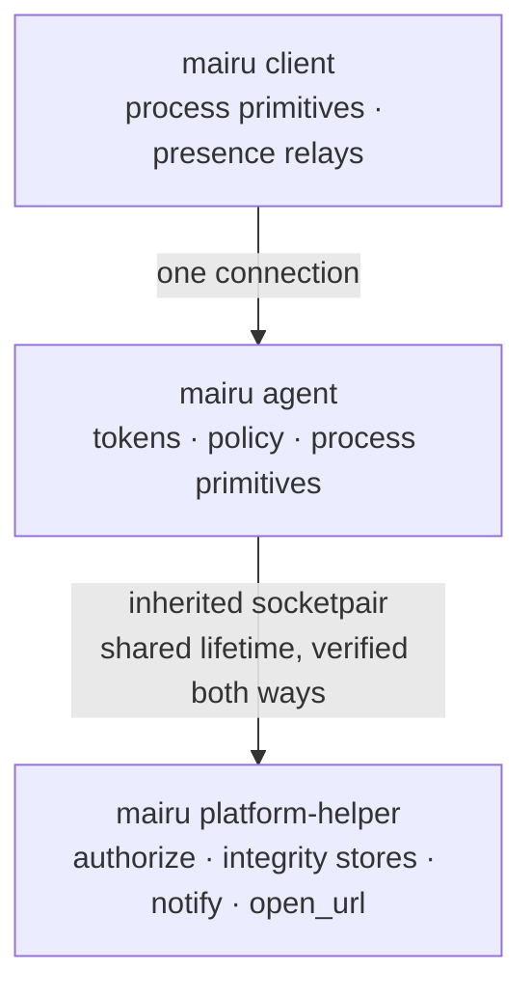
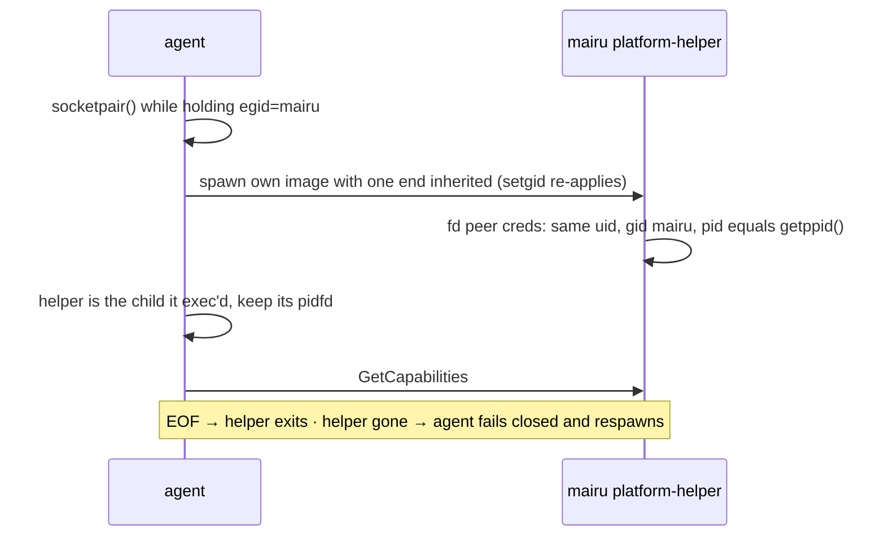
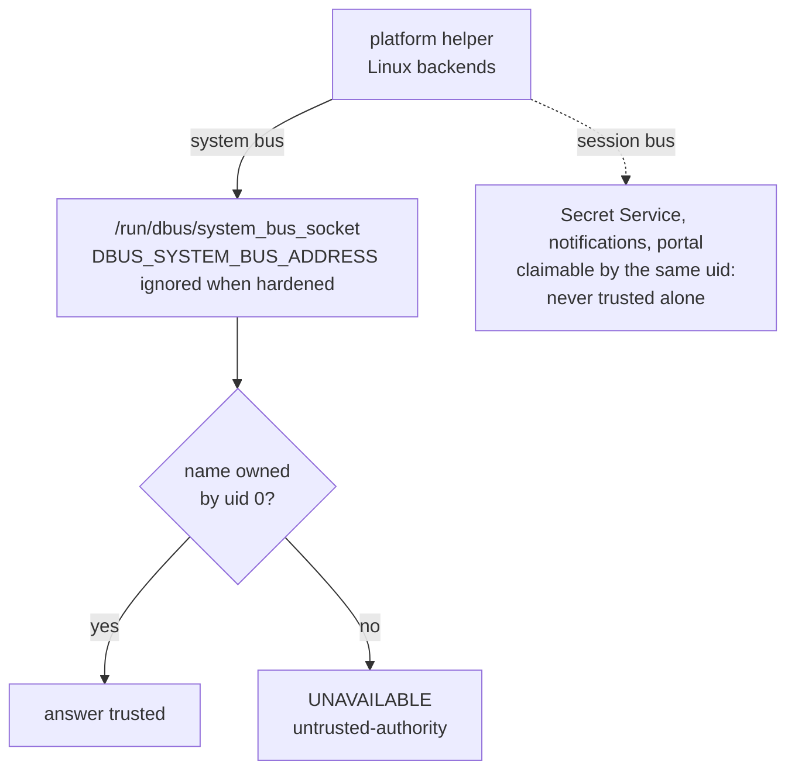

# 006-platform-helper

## Summary

Every platform service runs in a separate process, the **platform helper**, on every OS. The agent spawns it at startup with one end of a socketpair, the two verify each other, and the helper exits when the agent goes away. The agent reaches every service through a single client, `HelperClient`, over gRPC (`mairu.platform.PlatformHelper`). The process that holds session tokens therefore contains no D-Bus client, Secret Service, notification, desktop portal or LocalAuthentication code paths at run time.

This step adds the `PlatformServices` trait, the complete `mairu.platform.PlatformHelper` service, the helper process with its mutual verification, failure handling and respawn, the rules for verifying the system services the helper calls, and a standalone `mairu-platform-helper` binary behind the `platform-helper` cargo feature. Until later steps add backends, the helper serves `FallbackServices`: authorization `UNAVAILABLE`, no integrity stores, no notifications.

## Motivation

The agent holds credential-server session tokens, and vends AWS credentials from them. Platform services reach out to large, partly attacker-reachable surfaces: the system and session D-Bus, the Secret Service, notification daemons, the desktop portal, LocalAuthentication. A bug reached through any of them in the agent's own address space would land next to the tokens. Running those services in a separate process that holds no tokens confines such a bug.

A separate process also has to be trustworthy in both directions:

- A rogue **helper** answering `RESULT_ALLOWED` bypasses authorization, and answering `MATCHED` accepts a forged policy.
- A rogue **caller** of `RecordIntegrity` records a digest of a tampered policy.

So the helper is not a daemon that anything can connect to. It is a child of the agent, reachable only through a socketpair the agent created, sharing the agent's fate, and checked from both ends.

Platform-dependent code lives in four places, each with one home:

| Kind | Runs in | Examples | Trust |
|---|---|---|---|
| Process primitives | Every mairu process, in-process, never remoted | marker gid, peer credentials (`inspect_peer`, `verify_agent`), process facts, safe spawning ([004](004-peer-verification.md)) | Part of the process's own trust |
| Platform services | **Only the platform helper**, on every OS | `authorize`, integrity stores, `notify`, `open_url` | Verified both ways with the agent ([Helper process](#helper-process)) |
| Presence relays | The client | Client-side helpers that let the human answer a prompt | Untrusted by design: the agent trusts only the facility's own answer, never the relay |
| Convenience commands | The client | User-supplied commands for features with no security weight | No security weight |

- **The agent never runs platform-service code.** A bug reached through those surfaces lands in the helper, which holds no tokens.
- **One code path.** The agent reaches every service through `HelperClient`, always over IPC, with no in-process/IPC branching, on every OS.
- **Clients make one connection**, to the agent. They reach services only through agent RPCs, never directly.
- **The helper shares the agent's lifetime.** The agent spawns it, talks to it over an inherited socketpair, and the helper exits when the agent goes away.
- **Packaging does not matter.** The helper is `mairu platform-helper`, the same binary, by default. A separately signed executable, inside an app bundle or not, can serve the same protocol under the same checks, and nothing else changes. The standalone `mairu-platform-helper` binary ([Helper binary](#helper-binary)) is that executable.

## Explanation



Nothing changes for users in this step, apart from diagnostics:

- The agent starts its helper at startup, before serving clients. `ps` shows it as `mairu platform-helper --fd <n>`, a child of `mairu agent`.
- `mairu doctor` shows the helper's state through a new `GetAgentStatusResponse.platform_helper` field ([004 GetAgentStatus](004-peer-verification.md#getagentstatus)), for example `running pid=4321 verified` or `unavailable: helper-unverified`, and the helper's `Capabilities` (`notes` included, for example "session bus unreachable").
- When the helper is unavailable, every service call fails closed: authorization answers `UNAVAILABLE`, and capabilities are empty.
- At this step the helper serves fallback answers only. Later steps add backends ([001 Roadmap](001-security-model.md#roadmap)).

`mairu platform-helper --fd <n>` is hidden from `--help`. It is started only by the agent. Started by hand, it fails verification of its parent and exits.

## Drawbacks

- One more process per agent, and one more IPC hop for every service call.
- The helper can die independently of the agent. Until it is respawned, everything that needs it fails closed, for example a prompt-requiring role is refused for up to 30 s.
- Session-bus input (notification daemon, desktop portal, Secret Service) reaches the same process that answers `Authorize`. A bug there could forge helper answers. It is accepted to keep one helper process ([Security and Privacy Considerations](#security-and-privacy-considerations)).
- The `platform-helper` feature adds a second build configuration that CI must keep compiling.

## Considered Alternatives

- **In-process platform backends on Linux, with an opt-in helper** (an early plan: `MAIRU_PLATFORM_HELPER=1` made the agent spawn a helper, otherwise backends ran in the agent). Rejected: two code paths to keep consistent, and the agent would hold D-Bus and Secret Service code next to the tokens by default. Decided: the helper is always a separate process, on every OS, with no in-process/IPC branching.
- **Clients calling platform services themselves** (a `local` mode, where a client runs `PlatformServices` in-process where the OS allows it). Rejected: two paths, a client managing two connections, and a mode that cannot exist on macOS. Clients reach services only through the agent.
- **A helper listening on a socket path, found through the filesystem.** Rejected: any rendezvous in the filesystem can be squatted by same-user code, and a long-lived helper needs its own lifecycle. The inherited socketpair has nothing to squat, and fate sharing comes for free: EOF ends the helper.
- **Two helper instances split by exposure**: a system-side helper (polkit, protected directory) and a session-side helper (notifications, portal, Secret Service), so that session-bus input could not forge authorization or integrity answers. Rejected in favor of a single helper: a simpler process model. Session-bus exposure is recorded as an accepted risk, and the session-bus code is kept minimal and reviewed as security-sensitive.
- **The agent identifying the helper through `SO_PEERCRED`.** Not possible: a socketpair reports its creator to both ends. The agent trusts the child it exec'd instead, and keeps its pidfd.
- **A separate crate for the standalone helper binary** (for example `mairu-platform`, published alongside `mairu`). Rejected: mairu stays one crate on crates.io, released from one tag in one workflow run. A `[[bin]]` behind a cargo feature in the same package gives the same compile-time separation, as sccache does with `sccache-dist` (`required-features = ["dist-server"]`) and rage with `rage-mount` (`required-features = ["mount"]`). Decided 2026-10-29.

## Prior Art

- OpenSSH privilege separation: an unprivileged child talks to its parent over a socketpair created before the fork, and the two share their fate.
- XPC services on macOS: platform work split into separate processes that the main process launches and talks to over a private channel.
- sccache (`sccache-dist`) and rage (`rage-mount`) ship extra binaries from one package behind `required-features`.

## Security and Privacy Considerations

```text
rogue helper or helper caller     ✗ inherited socketpair, parent checked, child by construction, fail closed
bug via D-Bus / portal / keychain ✗ runs in the helper, which holds no tokens
fake bus / polkit authority       ✗ pinned system bus path, authority uid 0
session-bus input in the helper   ! accepted: one helper process, minimal reviewed code
```

| Threat | Mitigation |
|---|---|
| Rogue platform helper or rogue helper caller | Inherited socketpair with no filesystem rendezvous; the helper checks its parent's credentials, and the agent trusts the child it exec'd; fail closed ([Helper process](#helper-process)) |
| A bug reached through D-Bus, Secret Service, notification, portal or LocalAuthentication code | Platform services run only in the helper, which holds no tokens |
| Session-bus input (notification daemon, desktop portal, Secret Service) reaching the same helper that answers `Authorize` and writes integrity records | Accepted: one helper process by design (simpler process model). Session-bus replies are handled through typed zbus proxies and treated as untrusted. A bug there could forge helper answers, so that code is kept minimal and reviewed as security-sensitive. |
| A fake system bus through `DBUS_SYSTEM_BUS_ADDRESS`, or a fake authority on it | When hardened, the helper ignores the variable and connects to the pinned socket; an authority's owner must be uid 0 ([Verifying system services](#verifying-system-services)) |
| Taking over the helper's fd through `/proc` | The helper runs from the setgid binary, so it is non-dumpable |
| Platform code drifting into client or agent code in the standalone binary | With `cli` off the build fails; CI builds that configuration on every PR ([Helper binary](#helper-binary)) |

The helper is the only process that writes integrity records and answers authorization, so it is security-sensitive even though it holds no tokens. Every guarantee is bounded by the trust chain of [001 Trust chain](001-security-model.md#trust-chain).

## Mission Scope

### Out of scope

- Any concrete backend: authorization facilities, integrity stores, notifications and opening URLs, and the WSL2 variants. They arrive in later steps ([001 Roadmap](001-security-model.md#roadmap)); until then the helper serves `FallbackServices`.
- The macOS helper bundle, its code-signature checks between agent and helper, and shipping `mairu-platform-helper` in official builds (macOS implementer's own layers).

### Expected Outcomes

- Every agent runs exactly one helper child, verified both ways, before serving clients.
- Killing the helper makes service calls fail closed, and the agent respawns it within 30 s.
- A fake helper (an unverified process on the other end) is never trusted, and a second process that connects to a real helper's fd, or a helper started by hand, is refused.
- `cargo build --no-default-features --features platform-helper --bin mairu-platform-helper` succeeds without any client or agent module, on Linux and macOS.

## Implementation Plan

Stack layer: `hardening/platform-helper`.

### Module layout

```text
src/platform/
├── mod.rs        # ProcessPlatform (004) and PlatformServices traits, PeerIdentity (004)
├── process/      # in-process primitives per OS (004)
├── helper.rs     # HelperClient: the agent's only PlatformServices, over the socketpair
└── services/     # backends that run only inside the helper: mod.rs, fallback.rs (Linux backends come later)
```

| Need | Trait | Runs in |
|---|---|---|
| The agent accepting a connection | `ProcessPlatform::inspect_peer` | the agent itself ([004](004-peer-verification.md)) |
| A client connecting | `ProcessPlatform::verify_agent` | the client itself ([004](004-peer-verification.md)) |
| Authorization prompts, policy integrity, notifications, opening URLs | `PlatformServices`, through `HelperClient` | the platform helper, over the socketpair |

### PlatformServices trait

`src/platform/mod.rs`, next to `ProcessPlatform` ([004 Process facts](004-peer-verification.md#process-facts)):

```rust
/// The `PlatformHelper` contract as a trait. The agent only holds `HelperClient`;
/// the backends that implement it run inside the platform helper.
#[async_trait::async_trait]
pub trait PlatformServices: Send + Sync + std::fmt::Debug {
    async fn capabilities(&self) -> crate::proto::platform::Capabilities;

    async fn authorize(
        &self,
        req: crate::proto::platform::AuthorizeRequest,
    ) -> crate::proto::platform::AuthorizeResponse;
    async fn notify(&self, req: crate::proto::platform::NotifyRequest) -> crate::proto::platform::NotifyResponse;
    async fn open_url(&self, req: crate::proto::platform::OpenUrlRequest) -> crate::proto::platform::OpenUrlResponse;
    async fn record_integrity(
        &self,
        req: crate::proto::platform::RecordIntegrityRequest,
    ) -> crate::proto::platform::RecordIntegrityResponse;
    async fn verify_integrity(
        &self,
        req: crate::proto::platform::VerifyIntegrityRequest,
    ) -> crate::proto::platform::VerifyIntegrityResponse;
}
```

- The agent's `PlatformServices` is always `HelperClient`. When the helper is unavailable, every call returns `RESULT_UNAVAILABLE` (`helper-unavailable` or `helper-unverified`) and capabilities are empty, so the agent fails closed.
- Inside the helper, `crate::platform::services()` returns the backend for the OS, chosen by `cfg`. At this step that is `FallbackServices` everywhere: authorization `UNAVAILABLE`, no integrity stores, no notifications, and `open_url` through `/usr/bin/open` on macOS, unavailable elsewhere. Later steps add `LinuxServices` and extend it.
- Clients never construct a `PlatformServices`.
- `ResetIntegrity` has no trait method at this step. The helper answers it `UNIMPLEMENTED`.

### Protocol

| RPC of `mairu.platform.PlatformHelper` | Answers |
|---|---|
| `GetCapabilities` | peer verification, authorization facility, integrity stores, notifications, opening URLs, notes |
| `Authorize` | `ALLOWED`, `DENIED`, `CANCELLED`, or `UNAVAILABLE` with a reason |
| `Notify`, `OpenUrl` | whether it was delivered; both carry the client's `SessionHint` |
| `RecordIntegrity`, `VerifyIntegrity`, `ResetIntegrity` | a result per store; an `IntegrityRecord` is a generation, a digest and an `ApprovalAnchor` |

[004](004-peer-verification.md) created `proto/mairu_platform.proto` with `PeerVerification` and `Capabilities` (fields 1 and 6). This step adds the `PlatformHelper` service, the remaining enums and messages, and `Capabilities` fields 2–5. The complete file as of this step is below. The types are the contract. The helper serves them over gRPC on the inherited socketpair, and the agent is its only client. Enum values are prefixed with the enum name, because proto3 enum values share their package's scope.

```proto
syntax = "proto3";
package mairu.platform;

service PlatformHelper {
  rpc GetCapabilities(GetCapabilitiesRequest) returns (Capabilities);
  rpc Authorize(AuthorizeRequest) returns (AuthorizeResponse);
  rpc Notify(NotifyRequest) returns (NotifyResponse);
  rpc OpenUrl(OpenUrlRequest) returns (OpenUrlResponse);
  rpc RecordIntegrity(RecordIntegrityRequest) returns (RecordIntegrityResponse);
  rpc VerifyIntegrity(VerifyIntegrityRequest) returns (VerifyIntegrityResponse);
  rpc ResetIntegrity(ResetIntegrityRequest) returns (ResetIntegrityResponse);
}

enum PeerVerification {
  PEER_VERIFICATION_UNSPECIFIED = 0;
  PEER_VERIFICATION_NONE = 1;
  PEER_VERIFICATION_SETGID = 2;
  PEER_VERIFICATION_CODE_SIGNATURE = 3;
}

enum AuthorizationFacility {
  AUTHORIZATION_FACILITY_UNSPECIFIED = 0;
  AUTHORIZATION_FACILITY_NONE = 1;
  AUTHORIZATION_FACILITY_POLKIT = 2;
  AUTHORIZATION_FACILITY_LOCAL_AUTHENTICATION = 3;
}

// Strong: PROTECTED_DIRECTORY, DATA_PROTECTION_KEYCHAIN. Weak: SECRET_SERVICE, LEGACY_KEYCHAIN.
enum IntegrityStoreKind {
  INTEGRITY_STORE_KIND_UNSPECIFIED = 0;
  INTEGRITY_STORE_KIND_PROTECTED_DIRECTORY = 1;
  INTEGRITY_STORE_KIND_SECRET_SERVICE = 2;
  INTEGRITY_STORE_KIND_DATA_PROTECTION_KEYCHAIN = 3;
  INTEGRITY_STORE_KIND_LEGACY_KEYCHAIN = 4;
}

enum IntegrityStatus {
  INTEGRITY_STATUS_UNSPECIFIED = 0;
  INTEGRITY_STATUS_MATCHED = 1;
  INTEGRITY_STATUS_MISMATCHED = 2;
  INTEGRITY_STATUS_NOT_RECORDED = 3;
  INTEGRITY_STATUS_UNAVAILABLE = 4;
}

message GetCapabilitiesRequest {}

message Capabilities {
  PeerVerification peer_verification = 1;
  AuthorizationFacility authorization = 2;
  // Stores reachable right now, in authority order.
  repeated IntegrityStoreKind integrity_stores = 3;
  bool notifications = 4;
  bool open_url = 5;
  // Free-form diagnostics for `mairu doctor`, e.g. "session bus unreachable".
  repeated string notes = 6;
}

message Process {
  uint32 pid = 1;
  // Linux: clock ticks since boot (/proc/<pid>/stat field 22). macOS: microseconds since epoch.
  uint64 start_time = 2;
  uint32 uid = 3;
  bytes executable = 4;
  repeated bytes argv = 5;
  string name = 6;
}

message AuthorizeRequest {
  enum Action {
    ACTION_UNSPECIFIED = 0;
    ACTION_ASSUME_ROLE = 1;
    ACTION_APPROVE_POLICY = 2;
  }
  Action action = 1;
  // The process the human is approving; the polkit subject on Linux.
  Process subject = 2;
  // One line, shown where the facility allows a custom reason.
  string message = 3;
  // Keys: server, role, command, cwd, tty, requester, intent, tools, policy_digest.
  map<string, string> details = 4;
}

message AuthorizeResponse {
  enum Result {
    RESULT_UNSPECIFIED = 0;
    RESULT_ALLOWED = 1;
    RESULT_DENIED = 2;
    RESULT_CANCELLED = 3;
    RESULT_UNAVAILABLE = 4;
  }
  Result result = 1;
  // Machine-readable for UNAVAILABLE: "no-authentication-agent", "polkit-action-not-installed",
  // "polkit-unavailable", "untrusted-authority", "helper-unavailable", "helper-unverified", "timeout".
  string reason = 2;
  string detail = 3;
}

message NotifyRequest {
  enum Urgency {
    URGENCY_UNSPECIFIED = 0;
    URGENCY_LOW = 1;
    URGENCY_NORMAL = 2;
    URGENCY_CRITICAL = 3;
  }
  string title = 1;
  string body = 2;
  Urgency urgency = 3;
  string event = 4;  // "login-required" | "ai-agent-denied" | "policy-lockdown"
  SessionHint session = 5;
}
message NotifyResponse { bool delivered = 1; }

message OpenUrlRequest {
  string url = 1;
  SessionHint session = 2;
}
message OpenUrlResponse { bool opened = 1; string detail = 2; }

// The requesting client's desktop session, passed through by the agent.
message SessionHint {
  string display = 1;                   // $DISPLAY
  string wayland_display = 2;           // $WAYLAND_DISPLAY
  string dbus_session_bus_address = 3;  // honored only as unix:path= under $XDG_RUNTIME_DIR
  bool ssh = 4;                         // $SSH_CONNECTION or $SSH_TTY was set
}

// What an integrity store keeps for a name.
message IntegrityRecord {
  bytes digest = 1;            // 32 bytes
  ApprovalAnchor approval = 2;
  uint64 generation = 3;       // orders the records of strong stores
  map<string, bytes> server_digests = 4;  // server id → digest of its config
}

// Who may approve the next change: the approval_methods and their keys at the time of approval.
message ApprovalAnchor {
  repeated string methods = 1;             // e.g. "ssh-agent", "windows-hello", "platform"
  repeated string ssh_agent_keys = 2;      // OpenSSH public key lines
  repeated bytes windows_hello_keys = 3;   // DER SubjectPublicKeyInfo
}

message RecordIntegrityRequest {
  string name = 1;   // "policy"
  uint32 uid = 2;
  IntegrityRecord record = 3;
}
message RecordIntegrityResponse { repeated IntegrityStoreResult results = 1; }

message VerifyIntegrityRequest {
  string name = 1;
  uint32 uid = 2;
  bytes digest = 3;
}
message VerifyIntegrityResponse { repeated IntegrityStoreResult results = 1; }

// macOS only: asks for an administrator authorization, then removes the record from every strong store.
message ResetIntegrityRequest {
  string name = 1;
  uint32 uid = 2;
}
message ResetIntegrityResponse { repeated IntegrityStoreResult results = 1; }

message IntegrityStoreResult {
  IntegrityStoreKind store = 1;
  // For record: MATCHED means written; UNAVAILABLE means skipped.
  IntegrityStatus status = 2;
  string detail = 3;
  IntegrityRecord stored = 4;  // verify: the record the store holds, when it holds one
}
```

Helpers reject requests whose `uid` differs from their own. The messages for authorization, integrity records, notifications and URLs are defined in full now so the contract is fixed. Each later step that adds a backend fills them in without changing field numbers.

`proto/mairu.proto`: `GetAgentStatusResponse` ([004 GetAgentStatus](004-peer-verification.md#getagentstatus)) gains the helper's state:

```proto
message GetAgentStatusResponse {
  // ... fields of 004 ...
  string platform_helper = 8;           // e.g. "running pid=4321 verified", "unavailable: helper-unverified"
}
```

From this step, `GetAgentStatusResponse.capabilities` is what the helper's `GetCapabilities` returned, with the agent's own `peer_verification` and notes merged in.

### Helper process



The helper is a separate process on every OS. It holds no tokens, and the agent never runs platform-service code itself.

Rules:

1. **Spawn.** At startup, before serving clients, the agent:
   1. creates a `socketpair(AF_UNIX, SOCK_STREAM)` inside `with_privileged_gid` ([003 Privileged gid](003-marker-gid.md#privileged-gid)), so the credentials the kernel records for the pair carry the marker gid;
   2. spawns its own image (`/proc/self/exe platform-helper --fd <n>` on Linux) via `hardening::command()`, with that end as the only inherited fd. The setgid bit re-applies the marker, which the helper needs for the root-protected state directory ([005 Layout](005-install.md#layout));
   3. closes its copy of the helper's end.

   There is no rendezvous in the filesystem, so there is nothing to squat. The helper runs from the setgid binary, so it is non-dumpable and its fd cannot be taken over through `/proc`.
2. **The helper verifies the agent** before serving: `SO_PEERCRED` of the inherited fd must show `uid == own`, `gid == mairu` (when hardened) and **`pid == getppid()`**, and the parent's real gid (`/proc/<ppid>/status`) must not be `mairu` ([004 Agent side](004-peer-verification.md#agent-side)). On a socketpair the kernel reports the creator of the pair, which is the agent. The helper serves only that fd and exits on EOF, which is how it shares the agent's fate. `crate::ppid` remains a backstop.
3. **The agent verifies the helper by construction:** it exec'd its own image and keeps the child's pidfd. A socketpair reports its creator to both ends, so `SO_PEERCRED` cannot identify the helper, and the agent does not need it to.
4. Both ends reject requests whose `uid` differs from their own.
5. **Failure.** If the helper fails verification, exits or crashes, `HelperClient` returns `RESULT_UNAVAILABLE` (`helper-unavailable` or `helper-unverified`) and empty capabilities, and the agent fails closed. It respawns the helper at most once per 30 s. `GetAgentStatusResponse.platform_helper` reports the helper's state ([004 GetAgentStatus](004-peer-verification.md#getagentstatus)), and `GetAgentStatusResponse.capabilities` carries what `GetCapabilities` returned.
6. **Unhardened Linux:** the checks reduce to uid plus pid pinning.
7. **Other OSes** use the same process model with the same binary. How the two ends check each other there is specified by the OS's own steps.

`HelperClient` (`src/platform/helper.rs`) owns the spawn, the pidfd, the tonic channel over the socketpair, and the respawn timer. The helper side (`src/cmd/platform_helper.rs`) runs a current-thread tokio runtime, performs rule 2, then serves `PlatformHelper` on that one connection with `crate::platform::services()`.

#### Verifying system services



These rules apply to every Linux backend the helper runs, from the step that adds it:

- **System bus.** When hardened, the helper ignores `DBUS_SYSTEM_BUS_ADDRESS`, which is attacker-controllable environment, and connects to `unix:path=/run/dbus/system_bus_socket`. The socket's parent directory must be root-owned and not group/other-writable.
- **Authorities on the system bus.** Before trusting a result, the helper checks that the owner of the service's well-known name is uid 0 (`org.freedesktop.DBus.GetConnectionUnixUser`). For polkit that is `org.freedesktop.PolicyKit1`. A mismatch maps to `UNAVAILABLE`/`untrusted-authority`.
- **Session bus** services (Secret Service, notifications, the desktop portal) can be claimed by any same-uid process. They are treated as untrusted conveniences, and never as the only evidence for a security decision.

### Helper binary

```toml
[features]
# The `cli` feature of 002 also lists "platform-services".
platform-services = []                    # helper server and backends; later steps add backend deps here
platform-helper = ["platform-services"]   # the standalone helper binary

[[bin]]
name = "mairu-platform-helper"
path = "src/bin/mairu_platform_helper.rs"
required-features = ["platform-helper"]
```

- `platform-services` gates `src/platform/services/` and the helper server in `src/cmd/platform_helper.rs`. Both `cli` and `platform-helper` enable it, following the scheme of [002 Cargo features](002-build-layout.md#cargo-features). Backend dependencies (for example zbus) are optional dependencies enabled by `platform-services`.
- `mairu platform-helper --fd <n>`, the hidden subcommand, is what the agent spawns on Linux. It is part of the `cli` build.
- `mairu-platform-helper --fd <n>` serves exactly the same helper. Its `main` parses its two arguments by hand, so it needs no clap, and calls the same entry point as the subcommand.
- It is built with `cargo build --release --no-default-features --features platform-helper --bin mairu-platform-helper`. With `cli` off, the client and agent modules are not compiled, so the build fails if platform code touches them. That is the compile-time guarantee a separate crate would give.
- `cargo install mairu` builds only `mairu`: default features do not include `platform-helper`.
- Official macOS builds ship this binary inside their helper bundle. The Linux helper stays `mairu platform-helper`.
- CI builds `mairu-platform-helper` on Linux and macOS for every pull request, and its size joins the reports of [002 Size reports](002-build-layout.md#size-reports).

### Tests

- Unit: `HelperClient` maps a dead or unverified helper to `RESULT_UNAVAILABLE` with the right reason and empty capabilities; respawn is rate-limited to once per 30 s (injected clock).
- Integration (Linux, unhardened and in the hardened CI job):
  - the agent starts its helper, and `doctor` reports it `verified`;
  - killing the helper makes `Authorize` `UNAVAILABLE`, and the helper comes back;
  - a rogue helper: an unverified process on the agent's end of the socketpair is never trusted, and the agent reports `UNAVAILABLE`;
  - a rogue caller: a `mairu platform-helper --fd` started by a process other than the agent, or whose parent's real gid is `mairu`, refuses to serve;
  - requests with a foreign `uid` are rejected.
- Build: `--no-default-features --features platform-helper --bin mairu-platform-helper` on Linux and macOS.

### Files

| File | Change |
|---|---|
| `src/platform/mod.rs` | `PlatformServices` trait; `services()` |
| `src/platform/helper.rs` | `HelperClient`: spawn, pidfd, channel, respawn, fail closed |
| `src/platform/services/{mod,fallback}.rs` | Backend selection and `FallbackServices` |
| `src/cmd/platform_helper.rs` | Hidden `mairu platform-helper --fd`: parent verification, single-connection server |
| `src/bin/mairu_platform_helper.rs` | Standalone helper binary |
| `src/cmd/agent.rs` | Spawn the helper before serving; fill `GetAgentStatusResponse.platform_helper` and `capabilities` |
| `src/main.rs`, `src/cmd/mod.rs` | Register the hidden subcommand |
| `src/lib.rs` | Gate `platform::services` and the helper server behind `platform-services` |
| `proto/mairu_platform.proto` | `PlatformHelper` service and its messages; `Capabilities` fields 2–5 |
| `proto/mairu.proto` | `GetAgentStatusResponse.platform_helper` |
| `src/cmd/doctor.rs` | Print the helper's state and capabilities |
| `build.rs`, `src/proto.rs` | Server code generation for `mairu.platform` |
| `Cargo.toml` | Features `platform-services`, `platform-helper`; `[[bin]] mairu-platform-helper` |
| `.github/workflows/_test.yml` | Build the helper binary without `cli`; size report |
| `README.md`, `CHANGELOG.md` | Helper process noted under hardening |

## Current Status

Spec drafted; awaiting review before implementation. Implementors MUST keep this section updated as they work.

### Checklist

- [ ] `mairu.platform` service and messages; `PlatformServices` trait
- [ ] Platform helper process: inherited socketpair, mutual verification, fail closed, respawn
- [ ] `FallbackServices`; `ResetIntegrity` answered `UNIMPLEMENTED`
- [ ] System bus pinning and authority-owner check, ready for backends
- [ ] `platform-helper` feature and `mairu-platform-helper` binary; CI build without `cli` on Linux and macOS
- [ ] `GetAgentStatus` and `doctor` report the helper's state and capabilities
- [ ] Rogue-helper and rogue-caller tests

### Updates

- 2026-10-29: Split out of hardening.md, policy.md and platform-helper.md.
