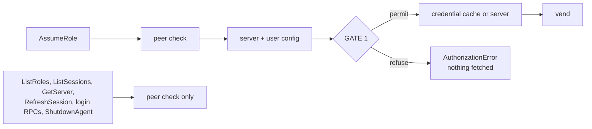
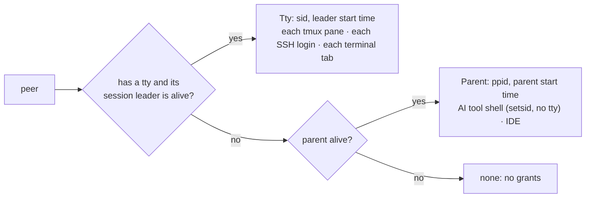
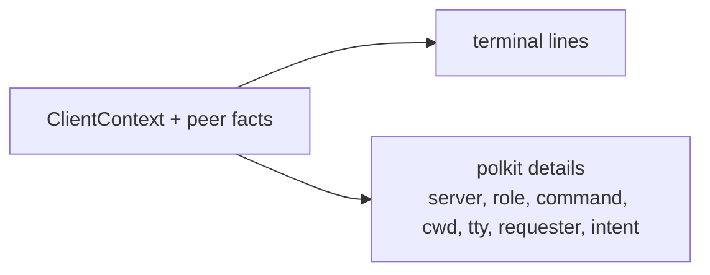
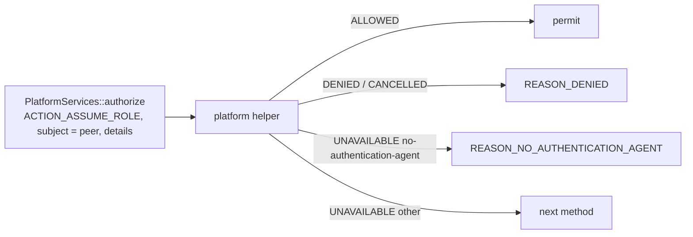
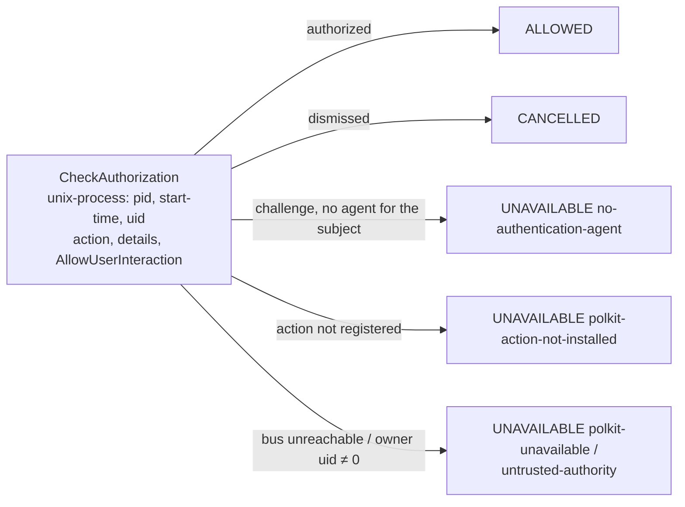
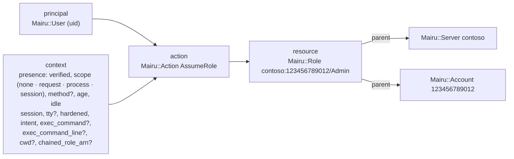
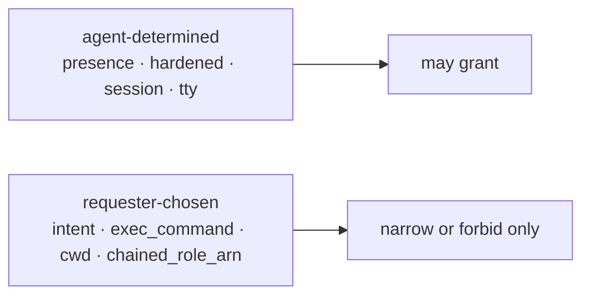
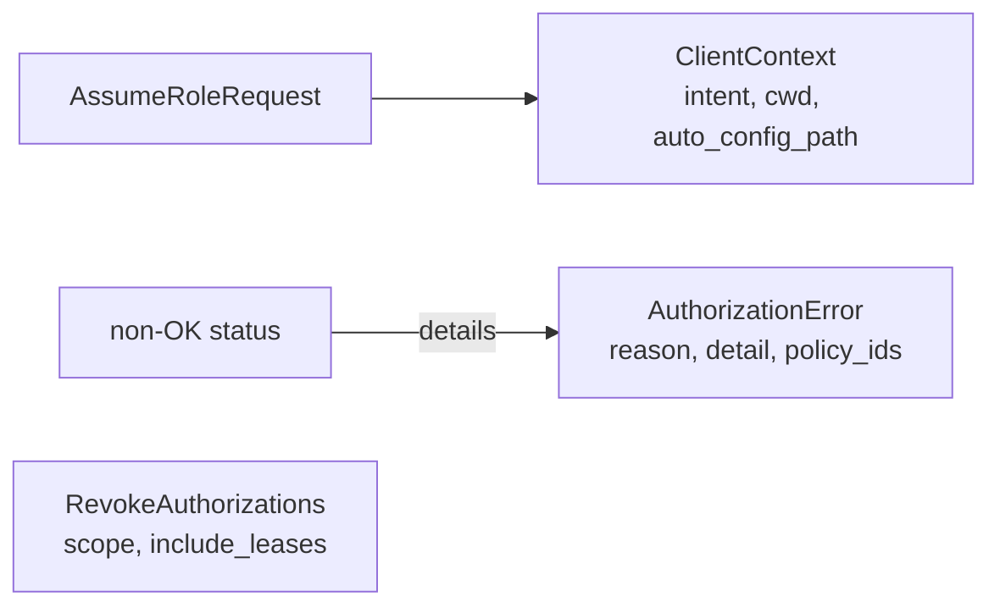

# 007-authorization

## Summary

Before vending credentials, `mairu agent` decides whether a human must approve the request, asks through the platform's own facility when needed, and remembers the answer for a while. The decision is made by a [Cedar](https://www.cedarpolicy.com/) policy in which a human check is just another condition on the request, as MFA is in AWS IAM. The agent never hardcodes "this role needs a prompt". It only asks whether some presence would make the policy permit the request.

This step adds gate 1 of `AssumeRole`: the session identity that answers are remembered against, grants per terminal session and leases per running `mairu exec`, the decision procedure, the Cedar engine with the built-in policies, the `platform` presence method backed by polkit in the platform helper, what the human sees, `mairu lock`, and the agent protocol for all of it (`ClientContext`, `AuthorizationError`, `RevokeAuthorizations`). On a hardened agent the built-in policy asks once per terminal session, server and role. An unhardened agent keeps today's behavior and never asks.

## Motivation

Peer verification ([004](004-peer-verification.md)) makes sure only genuine mairu clients reach the agent. It does not stop same-user code from running a genuine `mairu exec` itself and receiving credentials for any role. The boundary against that is a human check before credentials leave the agent ([001 Boundaries and guardrails](001-security-model.md#boundaries-and-guardrails)): a prompt that same-user code cannot answer, whose contents are truthful because the client that reports them is verified.

Asking on every request would make mairu unusable: `credential-process` and the `mairu exec` sidecar request credentials constantly. The agent therefore remembers a human check:

- per **terminal session**, so one approval covers the commands a human types in one tmux pane, SSH login or terminal tab for a few minutes, and nothing else;
- per **running `mairu exec`**, so a long-running command keeps its approval while it lives, and its auto-refresh never prompts again.

How long a remembered check is good enough, and for which roles a check is needed at all, differs between users and between roles. That is a policy question, so the policy decides it. The agent supplies facts (who asks, from which session, what was checked and how long ago) and asks the policy, the same way AWS IAM evaluates `aws:MultiFactorAuthPresent` and `aws:MultiFactorAuthAge`.

The authorization prompt is the boundary. Everything else in the request context is either determined by the agent or reported by a verified client, and the policy can tell which is which ([Which context can be trusted](#which-context-can-be-trusted)).

## Explanation

### When authorization applies



- `AssumeRole` runs gate 1 after the peer trust check and server/user-config loading, and **before** the credential cache lookup. Nothing is fetched for a request it refuses, so refused requests leave no credentials, CloudTrail events or server audit entries behind.
- `ListRoles`, `ListSessions`, `GetServer`, `RefreshSession`, the login RPCs and `ShutdownAgent` require only a trusted peer.

### Default behavior

```text
hardened agent, built-in policy
  terminal session (tmux pane, SSH login, GUI tab)   one check per (session, server, role): 5 min idle, 12 h max
  running `mairu exec`                               keeps its check while it runs, until 1 h without credentials
  no tty, parent gone                                every request asks, unless leased
unhardened agent                                     never asks (today's behavior)
mairu lock / agent restart                           forgets everything remembered
```

### Session identity



```
SessionIdentity =
  Tty    { sid, leader_start_time }   if tty_nr != 0 and /proc/<sid> exists with session == sid
  Parent { ppid, start_time }         else if ppid > 1 and the parent is alive
  none                                otherwise: no grants (every request prompts unless leased)
```

- Pairing each id with a start time defeats id reuse.
- Each GUI terminal tab, each SSH login and **each tmux pane** is its own POSIX session: the pane shell is created through `forkpty` → `setsid`. A grant therefore covers one pane, and survives detach/reattach within the idle window.
- Tools that run commands without a controlling tty and in a fresh session, such as an AI agent's shell tool (observed: Claude Code runs each command under `setsid` with no tty), fall into `Parent`. That parent is usually short-lived, so grants rarely carry over.
- Callers without a tty, such as IDEs running `credential-process`, are keyed to their parent process. Their SDKs cache credentials for about an hour, which outlasts the 5-minute idle window, so under the built-ins they are asked roughly once an hour ([Built-in policies](#built-in-policies)).

### Grants and leases

**Grant.**

- Key: `(SessionIdentity, server_id, Rolespec)`. `server_id` is the canonical id from the server config. `Rolespec` includes the chained `assume_role` fields, since a chained role is different access.
- Value: `{created, last_used, method}`.
- Recorded after every successful human check when the peer has a session identity.
- When a grant is what permits a request, `last_used = now`.
- Dropped after 43200 s (12 h) to bound memory. Freshness itself is a policy matter (`context.presence.age`, `context.presence.idle`).

**Lease.**

- Key: `(peer pid, peer start_time, server_id, Rolespec)`. Value: `{created, method, last_demand_expiry}` and the peer's pidfd.
- Recorded after every successful human check whose intent is `exec`. For `mairu exec`, the peer is its sidecar.
- Exists while the pidfd's process is alive. Swept every 60 s and checked on lookup. How long it stays good enough is a policy matter, through `context.presence.age` and `context.presence.idle`. The built-in policy keeps it for the process's lifetime, until the process goes 1 h without credentials.
- **Demand vs pre-fetch.** The sidecar's auto-refresh fetches credentials before they expire whether or not the command uses AWS, so it marks those requests `ExecIntent.prefetch`. Every other request under a lease is demand: the preflight check, the ECS endpoint serving the command, and static mode.
  - When credentials are vended on demand, `last_demand_expiry` becomes their expiration.
  - Pre-fetches never move it, so a process that stops using AWS goes idle even though auto-refresh keeps running.
  - A pre-fetch never prompts. If nothing remembered permits it, the agent answers `REASON_PRESENCE_REQUIRED` without asking anyone. The sidecar then stops pre-fetching until the command next asks for credentials, and that demand request asks the human as usual. A background refresh never raises a prompt.

All authorization state is in memory only. Restarting the agent forgets every grant and lease.

### What the human sees



While waiting, the client prints context to its terminal through `crate::terminal` (the existing `/dev/tty`-or-stderr writer):

```
:: mairu :: Authorization required: 123456789012/Admin on contoso
:: mairu ::   command: terraform apply
:: mairu ::   cwd:     /home/u/src/infra
:: mairu ::   from:    /dev/pts/3 (zsh, tmux pane)
:: mairu :: Approve in the system dialog.
```

The same keys go into polkit `details`:

- `server`, `role`
- `command`: shell-escaped, truncated to 512 bytes
- `cwd`, `tty`
- `requester`: peer exe path and pid
- `intent`

Whether a given polkit authentication agent shows these details varies, which is why the terminal always prints them too.

### Built-in policies

```text
no user policy at this step
  hardened agent    builtin-human
  unhardened agent  builtin-unhardened (permit everything, today's behavior)
```

The agent evaluates built-in policies embedded in the binary (`src/policy/builtin/*.cedar`). Ids starting with `builtin-` are reserved.

Hardened agent:

```cedar
// Humans: one check per terminal session, remembered for 5 minutes idle, 12 hours at most.
// A running `mairu exec` keeps its approval for its lifetime, until it goes 1 hour without credentials.
@id("builtin-human")
permit (principal, action == Mairu::Action::"AssumeRole", resource)
when {
  context.presence.verified &&
  (context.presence.scope != "session" ||
   (context.presence.idle <= 300 && context.presence.age <= 43200)) &&
  (context.presence.scope != "process" || context.presence.idle <= 3600)
};
```

Unhardened agent (today's behavior):

```cedar
@id("builtin-unhardened")
permit (principal, action == Mairu::Action::"AssumeRole", resource);
```

Callers without a tty, such as IDEs running `credential-process`, have `session == "parent"`. Their SDKs cache credentials for about an hour, so under the built-ins they are asked roughly once an hour. The built-ins keep 5 minutes.

### mairu lock

```text
mairu lock                  drop all grants
mairu lock --session        drop grants of my terminal session only
mairu lock --running        also drop leases: running `mairu exec` asks again on next refresh
```

`mairu lock` sends `RevokeAuthorizations{SCOPE_ALL}`.

- `--session` limits it to the caller's session identity (`SCOPE_CALLER_SESSION`).
- `--running` also revokes leases (`include_leases`), so running `mairu exec` processes prompt again on their next refresh.
- It prints how many grants and leases were revoked.

No authorization is required for any of these, since they only tighten.

### Errors

```text
PERMISSION_DENIED     UNVERIFIED_PEER · DENIED · FORBIDDEN · NOT_PERMITTED
FAILED_PRECONDITION   UNAVAILABLE · NO_AUTHENTICATION_AGENT · PRESENCE_REQUIRED (pre-fetch only: stop pre-fetching)
UNAUTHENTICATED       unchanged: log in to the credential server
```

Every authorization failure is a non-OK status whose binary details hold `AuthorizationError` ([Agent protocol](#agent-protocol)), with the status code given in the enum comments. Clients decode the details first and fall back to the status message. Existing codes keep their meanings. In particular, `UNAUTHENTICATED` still means a credential-server login is required.

| Reason | What the client prints |
|---|---|
| `REASON_DENIED` | The human said no, or dismissed the dialog |
| `REASON_FORBIDDEN` | Refused by a `forbid` policy or by `disallow_roles`, with the policy ids |
| `REASON_NOT_PERMITTED` | No policy permits this role, even after a human check |
| `REASON_UNAVAILABLE` | No method could ask the human, with what was tried |
| `REASON_NO_AUTHENTICATION_AGENT` | polkit has no authentication agent for this process, for example outside a desktop session |
| `REASON_PRESENCE_REQUIRED` | Not printed: the sidecar stops pre-fetching quietly |

## Drawbacks

- On a hardened host, the first use of each role in each terminal session now needs a human, and a new tmux pane asks again.
- Callers without a tty, such as IDEs, are asked roughly once an hour under the built-ins.
- Grants and leases are lost on agent restart, so everything asks again.
- `cedar-policy` is the largest new dependency of the whole roadmap, up to about 6 MB of the release binary ([002 Size reports](002-build-layout.md#size-reports)).
- Without a polkit authentication agent for the requesting process (no desktop session), the platform method cannot ask, and prompt-requiring requests fail closed.

## Considered Alternatives

- **Default for hardened installs.** Chosen: prompt once per terminal session, server and role, remembered 5 min idle, 12 h at most, with a running `mairu exec` keeping its approval. Rejected:
  - opt-in per role, with no prompts unless the user marks roles as protected: the smallest change, but weak by default;
  - always prompt, with no session cache: most secure, but unusable with `credential-process`.
- **Policy language.** Chosen: Cedar, evaluated by the `cedar-policy` crate, which has a formally verified engine, schema validation in strict mode and analysis tooling, and keeps IAM's semantics: default deny, a `forbid` overrides any `permit`, and a human check is a condition like IAM's MFA keys. Rejected:
  - IAM JSON with mairu's own evaluator for a documented subset: it looks exactly like IAM and adds no heavy dependency, but it is an evaluator to write, verify and maintain;
  - IAM JSON compiled to Cedar: both the IAM look and Cedar's engine, at the cost of a translation layer plus the dependency.
- **Presence as a policy condition vs a per-role "needs a prompt" flag.** A flag would hardcode one notion of freshness. As a condition, the policy can require a fresh check for one role, a session grant for another, and nothing for read-only roles, with the same engine.
- **Grant keys.** Chosen: `(SessionIdentity, server, Rolespec)`, with session ids paired with start times. A tty path or a bare pid can be reused by an unrelated process; a per-user grant would cover every terminal at once.
- **Lease lifetime.** Chosen: the process's lifetime under policy control, with a 1 h idle timeout counted from the expiry of the last credentials obtained on demand, and pre-fetches marked so they never prompt and never keep a lease alive. Rejected: a fixed lease duration, which would interrupt long commands, and counting auto-refresh as use, which would keep an idle `mairu exec` approved forever.
- **Callers without a tty.** Chosen: keep 5 min in the built-ins, and leave longer reuse to the user's own policy. Rejected: a longer built-in idle for `parent` sessions, which would weaken the default for every tty-less caller.
- **polkit's own caching (`auth_self_keep`).** Not used. mairu keeps its own grants, keyed by server and role and controlled by policy.
- **Clock.** `CLOCK_BOOTTIME`, so suspended time counts toward ages and idle times. `std::time::Instant` uses `CLOCK_MONOTONIC` on Linux, which excludes suspend.
- **Cedar evaluation errors.** Cedar skips a policy whose evaluation errors, which would silently drop a `forbid`. Chosen: any candidate whose response carries errors counts as `Deny`.

## Prior Art

- `sudo`'s timestamp, which can be kept per tty (`timestamp_type=tty`) and expires after a few minutes.
- AWS IAM conditions on MFA: `aws:MultiFactorAuthPresent` and `aws:MultiFactorAuthAge`.
- Amazon Verified Permissions, which evaluates Cedar policies.
- polkit's `auth_self_keep`, which caches an authorization per process or session.

## Security and Privacy Considerations

```text
prompt contents                  ✓ reported by a verified client, plus peer facts from the kernel
remembered checks                ✓ keyed with start times; leases bound to a live pidfd
forbid skipped by an error       ✗ errors count as Deny
requester-chosen context         ! narrow or forbid only; never grant on it alone
fake polkit authority            ✗ pinned system bus, owner uid 0 (006)
```

| Threat | Mitigation |
|---|---|
| Same-user code running a genuine `mairu exec` for any role | The human check before credentials leave the agent; the built-in policy asks once per terminal session on hardened agents |
| A grant reused by an unrelated process after pid or session id reuse | Session ids and pids are paired with start times; leases hold the peer's pidfd |
| A `forbid` silently skipped because its evaluation errors | Any evaluation error makes the candidate `Deny` ([Decision procedure](#decision-procedure)) |
| A `permit` that relies only on requester-chosen context (`cwd`, `exec_command`, …) | Documented ([Which context can be trusted](#which-context-can-be-trusted)) |
| Remote sessions silently refused, or silently allowed, by polkit defaults | `auth_self` on `allow_any`, `allow_inactive` and `allow_active`: every session gets a prompt ([Polkit](#polkit)) |
| A fake polkit authority or system bus | Pinned system bus path; the owner of `org.freedesktop.PolicyKit1` must be uid 0 ([006 Helper process](006-platform-helper.md#helper-process)) |
| A prompt left open after the client went away | The agent cancels its `Authorize` call; the helper cancels the polkit check; 5 min timeout ([Polkit](#polkit)) |

Every guarantee here is also bounded by the trust chain in [001 Trust chain](001-security-model.md#trust-chain).

Logging: authorization decisions go to the agent log at `info` (peer pid, session identity, server, rolespec, method, result), never with credentials.

## Mission Scope

### Out of scope

- Prompting without a polkit authentication agent for the requesting process, such as in tmux over SSH. Until a later step adds a fallback, such requests fail closed with `REASON_NO_AUTHENTICATION_AGENT` ([001 Roadmap](001-security-model.md#roadmap)).
- Checking the credentials themselves after fetching, tool detection, user policy files, policy approval and key-based presence methods: later steps ([001 Roadmap](001-security-model.md#roadmap)).
- Linux hosts without polkitd: the platform method is `UNAVAILABLE` there, so roles that require a prompt fail closed.
- The macOS facility (LocalAuthentication): the macOS implementer's own layers.

### Expected Outcomes

- On a hardened Linux desktop, the first `mairu exec` for a role in a terminal shows a polkit dialog. The same terminal does not ask again within 5 min idle, a new terminal asks, and `mairu lock` makes it ask again.
- A long `mairu exec` does not ask again on auto-refresh, and asks again on demand after 1 h without credentials.
- An unhardened agent behaves exactly as before.
- Refused requests fetch nothing from the credential server.
- The Cedar schema and built-in policies validate in strict mode, and every evaluation error is a `Deny`.

## Implementation Plan

Stack layer: `hardening/authorization`.

### Decision procedure

```text
authorize(request)
  disallow_roles matches                                → FORBIDDEN
  ctx = principal, resource, context(session, intent, cwd, …)
  for presence in [none, lease, grant]                  # what is remembered
    cedar(ctx + presence) == Allow                      → allow (touch grant)
  for m in methods                                      # what could be asked
    cedar(ctx + fresh(m)) == Allow                      → ask with m → record lease + grant → allow
  a forbid decided some evaluation                      → FORBIDDEN (policy ids)
  otherwise                                             → NOT_PERMITTED
  any Cedar evaluation error                            → that evaluation counts as Deny
```

`src/authorization.rs`, `Authorizer::authorize_assume_role`:

1. `UserConfig::is_role_disallowed` (existing `disallow_roles`) → `REASON_FORBIDDEN`. This check stays outside Cedar and behaves as today.
2. Build the Cedar request ([Entities and request](#entities-and-request)): principal, action, resource entities, and the base context.
3. Evaluate the effective policy set with each **remembered presence** in turn. At this step the effective policy set is the built-in policy for the agent's hardening state ([Built-in policies](#built-in-policies)). The first candidate that is `Allow` permits the request; for a grant, also touch `last_used`.

   | Candidate | `presence` |
   |---|---|
   | nothing remembered | `{verified: false, scope: "none", age: 0, idle: 0}` |
   | the lease for (peer, server, rolespec), if any | `{verified: true, scope: "process", method, age: now − created, idle: max(0, now − last_demand_expiry)}` |
   | the grant for (session, server, rolespec), if any | `{verified: true, scope: "session", method, age: now − created, idle: now − last_used}` |

4. Otherwise, for each method `m` in the method order that is usable for this request, evaluate a **fresh** candidate: `{verified: true, scope: "request", method: m, age: 0, idle: 0}`. The first `m` whose candidate is `Allow` is the method to ask with. At this step the only method is **platform** (`PlatformServices::authorize`, served by the platform helper), usable when the helper reports an authorization facility:
   - `ALLOWED` → permit.
   - `DENIED`/`CANCELLED` → `REASON_DENIED`.
   - `UNAVAILABLE`/`no-authentication-agent` → `REASON_NO_AUTHENTICATION_AGENT`.
   - Any other `UNAVAILABLE` → continue with the next method.

   If a fresh candidate allows but no method can ask → `REASON_UNAVAILABLE`, with a detail listing what was tried.
   **Pre-fetch requests skip this step.** If no remembered presence permits a request marked `ExecIntent.prefetch`, the agent returns `REASON_PRESENCE_REQUIRED` without asking anyone.
5. On a permit from step 4, record the lease (exec intent) and the grant (session identity present).
6. Otherwise refuse:
   - If any evaluation in steps 3–4 was `Deny` with a `forbid` among its determining policies → `REASON_FORBIDDEN`, listing those policy ids.
   - Otherwise → `REASON_NOT_PERMITTED`: no `permit` applies, even after a human check.

**Fail closed on evaluation errors.** Any candidate whose response carries errors is treated as `Deny`, and the errors are logged.

**Coalescing.** Concurrent requests with the same grant key wait on one platform prompt through the existing `crate::singleflight::Singleflight`.

**Clock.** `CLOCK_BOOTTIME` throughout, behind an injectable clock for tests.

**State.** Grants: `HashMap<(SessionIdentity, String, Rolespec), Grant>`. Leases: `HashMap<(u32, u64, String, Rolespec), Lease>` holding the pidfd. A sweeper task runs every 60 s: it drops leases whose process is gone and grants older than the retention.

**Session identity.** This step adds `session_identity` to `ProcessPlatform` ([004 Process facts](004-peer-verification.md#process-facts)), in `src/platform/mod.rs`:

```rust
pub trait ProcessPlatform: Send + Sync + std::fmt::Debug {
    // ... inspect_peer, verify_agent (004) ...
    fn session_identity(&self, peer: &PeerIdentity) -> Option<SessionIdentity>;
}
```

- `SessionIdentity`: `enum { Tty { sid: i32, leader_start_time: u64 }, Parent { ppid: i32, start_time: u64 } }`.
- `LinuxProcess` implements the rule of [Session identity](#session-identity) from `/proc/<pid>/stat` fields `session`, `tty_nr`, `ppid` and `starttime`, with the liveness re-checks of 004. `FallbackProcess` returns `None`.

**Status.** `GetAgentStatus` ([004 GetAgentStatus](004-peer-verification.md#getagentstatus)) reports the authorization state, and `mairu doctor` prints it:

```proto
message GetAgentStatusResponse {
  // ... fields of 004 and 006 ...
  uint32 grants = 6;
  uint32 leases = 7;
  repeated string authorization_methods = 9;  // effective order, e.g. ["platform"]
}

message PeerView {
  // ... fields of 004 ...
  string session = 4;                   // e.g. "tty sid=4242 /dev/pts/3", "parent pid=777", "none"
}
```

### Platform method



The agent calls `PlatformServices::authorize`, which the platform helper serves ([006 Helper process](006-platform-helper.md#helper-process)), with action `ACTION_ASSUME_ROLE`, the peer as the subject (for `mairu exec`, the sidecar), a one-line `message`, and the details of [What the human sees](#what-the-human-sees). A policy can require it through `context.presence.method == "platform"`.

### Polkit



This step adds `LinuxServices` to the helper, with the polkit backend in `src/platform/services/linux/polkit.rs`. Its other services stay as in `FallbackServices`. It reports `Capabilities.authorization = AUTHORIZATION_FACILITY_POLKIT` when the authority is reachable and trusted, and `NONE` with a note otherwise. The connection follows [006](006-platform-helper.md#helper-process)'s rules for system services: the pinned system bus when hardened, and an owner of `org.freedesktop.PolicyKit1` with uid 0.

`pkg/polkit/co.0w0.mairu.policy`:

```xml
<?xml version="1.0" encoding="UTF-8"?>
<!DOCTYPE policyconfig PUBLIC "-//freedesktop//DTD PolicyKit Policy Configuration 1.0//EN"
 "http://www.freedesktop.org/standards/PolicyKit/1/policyconfig.dtd">
<policyconfig>
  <vendor>mairu</vendor>
  <vendor_url>https://github.com/sorah/mairu</vendor_url>
  <action id="co.0w0.mairu.assume-role">
    <description>Provide AWS credentials</description>
    <message>Authentication is required to provide AWS credentials for $(role) on $(server)</message>
    <defaults>
      <allow_any>auth_self</allow_any>
      <allow_inactive>auth_self</allow_inactive>
      <allow_active>auth_self</allow_active>
    </defaults>
  </action>
  <action id="co.0w0.mairu.approve-policy">
    <description>Approve mairu authorization policy</description>
    <message>Authentication is required to approve the mairu authorization policy</message>
    <defaults>
      <allow_any>auth_self</allow_any>
      <allow_inactive>auth_self</allow_inactive>
      <allow_active>auth_self</allow_active>
    </defaults>
  </action>
</policyconfig>
```

- `co.0w0.mairu.approve-policy` backs `ACTION_APPROVE_POLICY`. It is registered now, so the installed action file does not change when policy approval arrives ([001 Roadmap](001-security-model.md#roadmap)).
- `auth_self` on `allow_any` means SSH and other remote sessions get a prompt rather than a silent "no". `auth_self_keep` is not used; mairu keeps its own grants.
- Check: `CheckAuthorization(subject, action_id, details, flags = AllowUserInteraction, cancellation_id)`.
  - `subject` is `("unix-process", {pid: u32, start-time: u64, uid: i32})` of the **peer** (the sidecar for `exec`), passed with `zbus_polkit` ≥ 5.1 (CVE-2026-78422).
  - `cancellation_id` is unique per check. If the request is dropped, for example because the client disconnected, the agent cancels its `Authorize` call, and a drop guard in the helper spawns `CancelCheckAuthorization`. The helper's own timeout is 5 min, after which it cancels and returns `CANCELLED`/`timeout`.
- `$(role)`/`$(server)` expand from `details`. Whether a given authentication agent shows the expansion or the other `details` keys varies, so the client terminal always prints the full context too ([What the human sees](#what-the-human-sees)). Confirm the expansion against polkit 127 during implementation.
- Result mapping. The exact signals for "no agent" and "dismissed" must be confirmed empirically on polkit 127 and pinned with a test; this table is the contract.

  | polkit outcome | `AuthorizeResponse` |
  |---|---|
  | `is_authorized` | `ALLOWED` |
  | not authorized, details `polkit.dismissed` | `CANCELLED` |
  | not authorized, `is_challenge`, no authentication agent for the subject | `UNAVAILABLE`/`no-authentication-agent` |
  | not authorized otherwise (wrong password, …) | `DENIED` |
  | `Error.Failed` "action … not registered" | `UNAVAILABLE`/`polkit-action-not-installed` |
  | system bus or authority unreachable | `UNAVAILABLE`/`polkit-unavailable` |
  | authority owner uid ≠ 0 | `UNAVAILABLE`/`untrusted-authority` |

**Installing the action file.**

- `mairu harden` ([005 mairu harden](005-install.md#mairu-harden)) gains a step: if `/usr/share/polkit-1/actions` exists, write `co.0w0.mairu.policy` (embedded with `include_str!`) unless an identical file is already there, and record it in the manifest. Otherwise warn that authorization will be unavailable.
- The Debian package ships it as an asset at `usr/share/polkit-1/actions/co.0w0.mairu.policy`, and adds `recommends: polkitd | policykit-1`.
- The AUR packages (`mairu`, `mairu-bin`, separate repositories) install the polkit file too. Tracked as a follow-up, with the rest of their packaging changes ([005 Distribution packages](005-install.md#distribution-packages)).

### Cedar schema



`src/policy/mairu.cedarschema`, as of this step (later steps show their additions):

```cedarschema
namespace Mairu {
  // The local Unix user the agent runs for. Entity id: the uid.
  entity User = {
    name: String,
    uid: Long
  };

  // A credential server from servers.d. Entity id: the server id.
  entity Server = {
    url: String
  };

  // An AWS account named by a role. Entity id: the 12-digit account id, shared across servers.
  entity Account;

  // A role on a server. Entity id: "<server id>:<role>".
  // Parents: its Server, and its Account when the role names one.
  entity Role in [Server, Account] = {
    name: String,
    server: Server,
    account_id?: String
  };

  type Presence = {
    // A human check covers this request.
    verified: Bool,
    // "none"; "request": checked for this very request; "process": the lease of this running
    // `mairu exec`; "session": a grant for this terminal session.
    scope: String,
    // The method that performed the check, such as "platform"; absent when not verified.
    method?: String,
    // Seconds since the covering human check; 0 when not verified.
    age: Long,
    // Session grant: seconds since it was last used.
    // Process lease: seconds since the credentials last obtained on demand expired (0 while valid).
    // Otherwise 0.
    idle: Long
  };

  action AssumeRole appliesTo {
    principal: [User],
    resource: [Role],
    context: {
      presence: Presence,
      // "tty", "parent" or "none"; tty is the device path when "tty".
      session: String,
      tty?: String,
      // Whether the agent runs hardened (003).
      hardened: Bool,
      // Reported by the client: truthful about what it will do, but chosen by whoever runs it.
      intent: String,
      exec_command?: String,
      exec_command_line?: String,
      cwd?: String,
      chained_role_arn?: String
    }
  };
}
```

Reference for the context attributes:

| Attribute | Values | Source |
|---|---|---|
| `presence.*` | as commented | agent ([Decision procedure](#decision-procedure)) |
| `session`, `tty` | `"tty"` `"parent"` `"none"`, `/dev/pts/N` | agent, from the kernel |
| `hardened` | | agent ([003 Classification](003-marker-gid.md#classification)) |
| `intent` | `"exec"` `"credential-process"` `"unknown"` | client |
| `exec_command` | basename of `argv[0]` | client, `exec` only |
| `exec_command_line` | shell-escaped argv, truncated to 4 KiB | client, `exec` only |
| `cwd` | absolute path | client |
| `chained_role_arn` | ARN | client (`--assume-role`, `.mairu.json`) |

Cedar strings are UTF-8, so non-UTF-8 bytes in paths and argv are replaced with U+FFFD.

Once released, the schema may only grow by adding optional attributes, so policies written against it stay valid across upgrades.

The engine is the `cedar-policy` crate (4.x, `default-features = false`, since no extension types are used). The schema and the built-in policies are embedded in the binary.

### Entities and request

```text
principal  Mairu::User::"1000"
action     Mairu::Action::"AssumeRole"
resource   Mairu::Role::"contoso:123456789012/Admin"  in  Server "contoso", Account "123456789012"
context    built per candidate presence
```

For each evaluation the agent builds:

- **principal**: `Mairu::User::"<uid>"` with `name` (from `getpwuid`) and `uid`.
- **action**: `Mairu::Action::"AssumeRole"`.
- **resource**: `Mairu::Role::"<server id>:<role>"` with `name`, `server` and `account_id`. Its parents are:
  - `Mairu::Server::"<server id>"` (`url`)
  - `Mairu::Account::"<account id>"`, when the role names an account: an AWS SSO role `^\d{12}/`, or an `arn:aws:iam::\d{12}:role/` ARN.
- **context**: as in the schema, with `presence` set per candidate.

`Request::new(…, Some(&schema))` and `Entities::from_json_value(…, Some(&schema))` check every request against the schema.

### Which context can be trusted



- **Determined by the agent**: `presence`, `hardened`, `session` and `tty`. These cannot be influenced by the requester beyond actually being in that position.
- **Reported by the client**: `intent`, `exec_command`, `exec_command_line`, `cwd` and `chained_role_arn`. A verified client reports them truthfully, but whoever runs `mairu` chooses them: same-user code can `cd` into any directory or exec any command. Use them to **narrow** a `permit` that also requires `context.presence.verified`, or in a `forbid`. Never rely on them alone to grant access.

### Agent protocol



`proto/mairu.proto` additions. Field numbers and enum values skipped here are assigned by later steps ([001 Roadmap](001-security-model.md#roadmap)); never reuse them.

```proto
service Agent {
  // ... existing RPCs ...
  rpc RevokeAuthorizations(RevokeAuthorizationsRequest) returns (RevokeAuthorizationsResponse);
}

message AssumeRoleRequest {
  string server_id = 1;
  oneof query {
    string role = 2;
    Rolespec rolespec = 4;
  }
  bool cached = 3;
  ClientContext client_context = 5;
}

// What the client is about to do with the credentials. Reported by a verified client, so it can
// be shown to the human as fact.
message ClientContext {
  oneof intent {
    ExecIntent exec = 1;
    CredentialProcessIntent credential_process = 2;
  }
  bytes cwd = 3;
  bytes auto_config_path = 4;      // .mairu.json path when role = auto
}

message ExecIntent {
  repeated bytes command = 1;
  string mode = 2;                 // "ecs" | "static"
  bool prefetch = 3;               // the sidecar's auto-refresh, not a request by the command
}

message CredentialProcessIntent {}

message RevokeAuthorizationsRequest {
  enum Scope {
    SCOPE_UNSPECIFIED = 0;
    SCOPE_ALL = 1;
    SCOPE_CALLER_SESSION = 2;
  }
  Scope scope = 1;
  bool include_leases = 2;
}
message RevokeAuthorizationsResponse {
  uint32 revoked_grants = 1;
  uint32 revoked_leases = 2;
}
```

`AuthorizationError` ([004](004-peer-verification.md) introduced it with `REASON_UNVERIFIED_PEER`) gains the reasons and fields of this step:

```proto
// Carried as the binary details of a non-OK tonic::Status (grpc-status-details-bin).
message AuthorizationError {
  enum Reason {
    REASON_UNSPECIFIED = 0;
    REASON_UNVERIFIED_PEER = 1;          // PERMISSION_DENIED
    REASON_DENIED = 2;                   // PERMISSION_DENIED: the human said no or cancelled
    REASON_FORBIDDEN = 3;                // PERMISSION_DENIED: a forbid policy, or disallow_roles
    REASON_NOT_PERMITTED = 4;            // PERMISSION_DENIED: no permit applies, even after a human check
    REASON_UNAVAILABLE = 5;              // FAILED_PRECONDITION: no method could ask the human
    REASON_NO_AUTHENTICATION_AGENT = 7;  // FAILED_PRECONDITION: polkit has no agent for the requesting process
    REASON_PRESENCE_REQUIRED = 9;        // FAILED_PRECONDITION: pre-fetch needs a fresh check; nobody was asked
  }
  Reason reason = 1;
  string detail = 2;
  repeated string policy_ids = 4;        // @id of the determining forbid policies, for REASON_FORBIDDEN
}
```

**Compatibility.** A request without `ClientContext`, from an older client, has intent `"unknown"`, gets no lease, and its command is shown as "(unknown)". An older agent ignores the new fields.

### Client changes

- `src/cmd/exec.rs`: build `ClientContext` (argv, mode, cwd, `.mairu.json` path) into every `AssumeRoleRequest`: the preflight check, the ECS `AgentBackend` (`src/ecs_server.rs`) and auto-refresh. Auto-refresh sets `ExecIntent.prefetch`, and on `REASON_PRESENCE_REQUIRED` stops pre-fetching until the command next asks for credentials. `assume_role_with_long_attempt_notice` prints the context lines of [What the human sees](#what-the-human-sees) while a prompt is pending.
- `src/cmd/credential_process.rs`: `CredentialProcessIntent`, and the same context lines on `/dev/tty` when one opens.
- A shared decoder for `AuthorizationError` from `grpc-status-details-bin`, mapping reasons to the messages of [Errors](#errors).
- `src/cmd/lock.rs`: `mairu lock [--session] [--running]`.

### Tests

- Unit, with an injected clock and a mock `PlatformServices`:
  - the evaluation order of the decision procedure: remembered candidates before fresh ones, grant touch on use, lease and grant recording after a prompt;
  - grant idle and hard-cap expiry, lease idle from `last_demand_expiry`, pre-fetches never moving it and never prompting;
  - every platform result mapping to its reason;
  - an evaluation error turning into `Deny`;
  - singleflight: concurrent requests with one grant key cause one prompt.
- The schema and built-in policies validate in strict mode, and evaluate as commented for each candidate presence.
- polkit without a human: the hardened CI job ([005](005-install.md)) installs a test-only rules file, `/etc/polkit-1/rules.d/49-mairu-test.rules`, that returns `YES` or `NO` for `co.0w0.mairu.*`, which covers the result mapping:

  ```js
  // CI only; the test writes YES or NO per case.
  polkit.addRule(function (action, subject) {
    if (action.id.indexOf("co.0w0.mairu.") === 0) {
      return polkit.Result.YES;
    }
  });
  ```

- Manual, on a hardened desktop: the first use shows a dialog, the same terminal reuses the grant within 5 min, a new terminal asks, `mairu lock` makes it ask again, and a long `mairu exec` does not ask on refresh.

### Files

| File | Change |
|---|---|
| `src/authorization.rs` | `Authorizer`: grants, leases, sweeper, singleflight, decision procedure |
| `src/policy/mod.rs` | Cedar engine: schema, entities, request building, fail-closed evaluation |
| `src/policy/mairu.cedarschema` | Schema as of this step |
| `src/policy/builtin/*.cedar` | `builtin-human`, `builtin-unhardened` |
| `src/platform/services/linux/{mod,polkit}.rs` | `LinuxServices` with the polkit backend |
| `src/platform/mod.rs`, `src/platform/process/linux/*.rs` | `ProcessPlatform::session_identity`, `SessionIdentity` |
| `src/cmd/doctor.rs` | Grants, leases, method order, the caller's session |
| `src/agent.rs` | Gate 1 in `assume_role` before the cache lookup; `RevokeAuthorizations` |
| `src/cmd/{exec,credential_process,lock}.rs`, `src/ecs_server.rs` | `ClientContext`, pre-fetch marking, waiting notice, error messages, `mairu lock` |
| `src/cmd/harden.rs` | Write the polkit action file |
| `proto/mairu.proto` | `ClientContext`, `ExecIntent`, `CredentialProcessIntent`, `AuthorizationError` reasons, `RevokeAuthorizations`; `GetAgentStatusResponse.grants`, `leases`, `authorization_methods`; `PeerView.session` |
| `pkg/polkit/co.0w0.mairu.policy` | polkit actions |
| `Cargo.toml` | `cedar-policy` (enabled by `cli`); Linux `zbus` (tokio) and `zbus_polkit` ≥ 5.1 (enabled by `platform-services`); deb asset for the polkit file |
| `.github/workflows/_test.yml` | polkit test rules in the hardened job |
| `README.md`, `CHANGELOG.md` | Authorization, defaults, `mairu lock` |

## Current Status

Spec drafted; awaiting review before implementation. Implementors MUST keep this section updated as they work.

### Checklist

- [ ] Cedar engine: schema, entities, built-in policies, fail-closed evaluation
- [ ] `Authorizer`: grants, leases, singleflight, decision procedure (gate 1)
- [ ] Agent RPCs: `ClientContext`, `AuthorizationError`, `RevokeAuthorizations`
- [ ] polkit backend and policy file; system bus and authority checks
- [ ] `mairu harden` writes the polkit action; deb asset
- [ ] Client: context lines, pre-fetch marking, error messages; `mairu lock`
- [ ] polkit test rules in the hardened CI job; confirm the result signals and `$(role)` expansion on polkit 127

### Updates

- 2026-10-29: Split out of hardening.md, policy.md and platform-helper.md.
