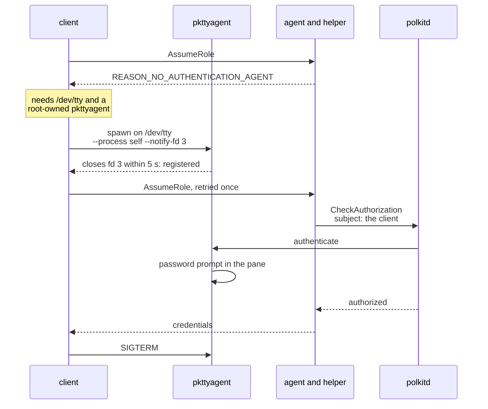

# 008-headless

## Summary

Headless Linux is a first-class environment, and the reference workflow is long-lived **tmux sessions on a remote host, reached over SSH**. There, polkit has no authentication agent for the requesting process, so the platform method of [007](007-authorization.md) can only answer `REASON_NO_AUTHENTICATION_AGENT`. This step makes the client register polkit's own text agent, `/usr/bin/pkttyagent`, for itself on its terminal and retry once, so the password prompt appears in the pane that made the request.

It also records how authorization behaves across GUI, SSH + tmux, no-session-bus and no-polkitd hosts, what fails closed, the password-capture risk of a tty prompt, headless checks in `mairu doctor`, and admin guidance in the README.

## Motivation


polkit asks the human through an authentication agent registered for the subject. Desktop sessions have one. An SSH login does not. polkit also evaluates `allow_*` from the subject's logind session, and a tmux server keeps the session of the SSH login that started it, even after that login ends. So in the user's daily environment every prompt-requiring request would fail closed with `REASON_NO_AUTHENTICATION_AGENT`.

polkit already ships a text agent for this, `pkttyagent`, and other tools use it the same way: `systemctl` spawns it on its terminal when no agent is running. The prompt must appear where the human is, which is the terminal of the requesting client, not the agent, which has no tty.

Because the subject is a `unix-process` and the fallback agent registers for that same process, prompting works regardless of the logind session's state.

## Explanation

### Tmux over SSH

- Each tmux pane is its own terminal session, so a grant covers one pane ([007 Session identity](007-authorization.md#session-identity)). It survives detach and reattach, even from a new SSH connection, within the idle window. A new pane asks again.
- The first request in a pane that needs a check shows the context, then polkit's password prompt, in that pane:

  ```
  :: mairu :: Authorization required: 123456789012/Admin on contoso
  :: mairu ::   command: terraform apply
  :: mairu ::   cwd:     /home/u/src/infra
  :: mairu ::   from:    /dev/pts/3 (zsh, tmux pane)
  :: mairu :: Enter your password below.
  ==== AUTHENTICATING FOR co.0w0.mairu.assume-role ====
  Authentication is required to provide AWS credentials for 123456789012/Admin on contoso
  Authenticating as: u
  Password:
  ```

  The last four lines come from `pkttyagent` and are illustrative.
- polkit asks for the user's own login password: the actions use `auth_self` on `allow_any` ([007 Polkit](007-authorization.md#polkit)).
- A command run without a terminal, such as an AI tool's shell command (`setsid`, no tty) or a cron job, cannot be prompted. It fails with guidance.

### pkttyagent fallback



On `REASON_NO_AUTHENTICATION_AGENT` the client (`src/polkit_tty_agent.rs`) does the following:

1. Check it can prompt: `/dev/tty` must open. Otherwise it fails with guidance; no tty means no prompt, as with an AI agent's non-interactive shell.
2. Locate `/usr/bin/pkttyagent`, a **fixed path** that must be root-owned and not group/other-writable. `PATH` is attacker-controlled, and a fake agent would receive the password.
3. Spawn `/usr/bin/pkttyagent --process <own pid>,<own start_time> --fallback --notify-fd 3` via `hardening::command()` ([003 Privileged gid](003-marker-gid.md#privileged-gid)), with stdio on `/dev/tty`. Wait up to 5 s for fd 3 to close, which means the agent is registered.
4. Print the context ([007 What the human sees](007-authorization.md#what-the-human-sees)) with `Enter your password below.`, then retry the RPC once.
5. Send `SIGTERM` to `pkttyagent` when the RPC returns.

The process that spawns `pkttyagent` is the one making the RPC, so polkit's subject and the registered agent are the same process. For `exec` that is the sidecar.

`--fallback` makes `pkttyagent` step aside when another agent is already registered for the subject, so a desktop session keeps its own dialog.

### Capability matrix

| Capability | GUI session | SSH + tmux | No session bus | No polkitd |
|---|---|---|---|---|
| Peer verification | ✓ | ✓ | ✓ | ✓ |
| polkit prompt | GUI agent | `pkttyagent` in the pane | ✓ (system bus) | ✗ → `UNAVAILABLE` |
| Prompt for a command without a tty | GUI agent, when it covers the subject | ✗ | ✗ | ✗ |

**Fails closed:**
- A role that requires a prompt when no method can ask: polkit unavailable, or no tty for `pkttyagent`.

### mairu doctor

`mairu doctor` gains a headless section, from local checks and the agent's capabilities ([004 GetAgentStatus](004-peer-verification.md#getagentstatus)):

```text
headless
  tty           /dev/pts/3 (tmux pane)
  ssh           yes ($SSH_CONNECTION)
  polkit        available (authorization: POLKIT)
  pkttyagent    /usr/bin/pkttyagent root:root 0755 ✓
```

It warns when `/usr/bin/pkttyagent` is missing or writable by others, when polkit is unavailable, and when there is no tty.

### Admin guidance (README)

- polkit's PAM stack (`/etc/pam.d/polkit-1`) can use `pam_fprintd` or `pam_u2f` on local machines, so the prompt asks for a fingerprint or a key instead of a password.
- `auth_self` asks for the same login password as `sudo`. Back both PAM stacks with something a captured password cannot replay: `pam_u2f` locally, or `pam_ssh_agent_auth` with an approval-protected key over SSH ([001 Trust chain](001-security-model.md#trust-chain)).

## Drawbacks

- The password is typed into a tmux pane, where same-user code has more ways to capture it than in a desktop dialog ([Security and Privacy Considerations](#security-and-privacy-considerations)).
- Commands without a tty cannot be prompted at all, so tty-less callers on headless hosts are refused whenever a check is needed.
- The prompt competes for the terminal with whatever runs in the foreground, for example when an `exec` sidecar asks on demand while its command is running.

## Considered Alternatives

- **No fallback, fail closed without a GUI agent.** Rejected: it makes the reference workflow unusable for any role that needs a check.
- **The agent registering a polkit agent itself.** Rejected: the agent has no tty and is not where the human is.
- **A session-wide text agent** (registered for the logind session rather than the process). Rejected: the tmux server's logind session may belong to an SSH login that has already ended, and a session-wide agent would answer for other panes. Registering for the requesting process ties the prompt to the pane that asked.
- **Looking `pkttyagent` up through `PATH`.** Rejected: `PATH` is attacker-controlled, and a fake agent would receive the password.
- **Dropping the tty prompt because of the capture risk.** Rejected: it is the same exposure as `sudo`'s prompt in the same pane, so it is documented instead ([Security and Privacy Considerations](#security-and-privacy-considerations)).

## Prior Art

- `systemctl` and other systemd tools spawn `pkttyagent --notify-fd <n> --fallback` on their terminal when no polkit agent is running.
- `pkexec` registers its own text authentication agent when none is available.
- `sudo` prompting in the same terminal, and `pam_u2f` / `pam_ssh_agent_auth` as PAM backends that a captured password cannot satisfy.

## Security and Privacy Considerations

```text
fake pkttyagent                 ✗ fixed /usr/bin/pkttyagent, root-owned, not writable by others
password capture in a pane      ! documented: same exposure as sudo in that pane
prompt for another process      ✗ --process registers for the requesting process only
no tty                          ✗ no prompt; fail with guidance
```

| Threat | Mitigation |
|---|---|
| A fake `pkttyagent` receiving the password | Fixed path `/usr/bin/pkttyagent`, root-owned and not group/other-writable; never looked up through `PATH` |
| Password capture at a tty prompt | Documented below |
| The text agent answering for another process | `--process <pid>,<start_time>` registers it for the requesting process only, which is also polkit's subject |
| A prompt raised where no human is | No tty, no prompt: the client fails with guidance |

**Risk documented for users:** same-user code can capture a password typed at a tty prompt and replay it later. The echo is off, so output capture such as `pipe-pane -O` or `capture-pane` does not see it. Input capture does:

- reading the pane's pty concurrently
- tmux key bindings installed through the server socket
- a fake prompt written to the pty first
- ptrace of the terminal path when `kernel.yama.ptrace_scope = 0`

This is the same exposure as `sudo`'s prompt in the same pane, and `auth_self` asks for the same login password. So on a host where the user types the sudo password into tmux, same-user code can already become root, which defeats everything here ([001 Trust chain](001-security-model.md#trust-chain)). The mairu prompt adds more opportunities, not a new kind of exposure. For `sudo` itself, the analogous fix is PAM backed by a key: `pam_u2f` locally, or `pam_ssh_agent_auth` with an approval-protected key over SSH.

## Mission Scope

### Out of scope

- Ways to approve that do not involve typing a password on the remote host ([001 Roadmap](001-security-model.md#roadmap)).
- Linux hosts without polkitd: prompts are `UNAVAILABLE` there, so roles that require a platform prompt fail closed.
- Configuring PAM itself: the README gives guidance only.

### Expected Outcomes

- Over `ssh localhost`, inside tmux, `mairu exec …` in a pane shows the `pkttyagent` prompt in that pane, and the request succeeds with the right password.
- After a detach and a reattach from a new SSH connection, the same pane does not ask again within 5 min. A new pane asks.
- A desktop session keeps its GUI dialog: `--fallback` never takes over from a registered agent.
- `setsid -w mairu exec … </dev/null` is refused with guidance, and no prompt appears anywhere.
- `doctor` reports the tty, SSH, polkit and `pkttyagent` state.

## Implementation Plan

Stack layer: `hardening/headless`.

### Client retry paths

`src/polkit_tty_agent.rs` exposes one function that runs an RPC, and on `REASON_NO_AUTHENTICATION_AGENT` performs the [pkttyagent fallback](#pkttyagent-fallback) and retries that RPC once. Every client path that can trigger a platform prompt uses it:

- `src/cmd/exec.rs`: the preflight check, wrapped by `assume_role_with_long_attempt_notice`.
- `src/ecs_server.rs`: the ECS `AgentBackend` serving the command (demand requests). Auto-refresh pre-fetches never prompt ([007 Grants and leases](007-authorization.md#grants-and-leases)), so they never spawn `pkttyagent`.
- `src/cmd/credential_process.rs`.

Only one `pkttyagent` runs per client process at a time; concurrent requests in the sidecar wait for it.

### Doctor

`src/cmd/doctor.rs` adds the headless section of [mairu doctor](#mairu-doctor): `isatty`/`/dev/tty`, `SSH_CONNECTION`/`SSH_TTY`, `Capabilities.authorization`, and an `lstat` of `/usr/bin/pkttyagent` and its ancestors.

### Tests

- Unit: the path check rejects a missing, non-root-owned or group/other-writable `pkttyagent`; no tty → guidance, no spawn.
- Integration: `pkttyagent` is exercised through a pty, with a password fed through the pty, in the hardened CI job ([005](005-install.md)), alongside the polkit test rules of [007](007-authorization.md).
- Manual: the tmux-over-SSH outcomes in [Expected Outcomes](#expected-outcomes).

### Files

| File | Change |
|---|---|
| `src/polkit_tty_agent.rs` | `pkttyagent` registration, path check, retry once |
| `src/cmd/{exec,credential_process}.rs`, `src/ecs_server.rs` | Retry paths |
| `src/cmd/doctor.rs` | Headless capability report |
| `README.md` | Tmux over SSH, the password-capture risk, PAM guidance |
| `CHANGELOG.md` | Headless prompts |

## Current Status

Implemented on `hardening/headless`. Verified in Docker (debian:trixie, polkit 126) with tmux panes and `ssh localhost`, without logind; a real host with logind and a desktop session is not verified (see Updates).

### Checklist

- [x] `pkttyagent` fallback: fixed-path check, registration for the requesting process, retry once
- [x] Retry paths in `exec` (preflight, ECS backend) and `credential-process`
- [x] `doctor` headless capability report
- [x] README: tmux over SSH, password-capture risk, PAM guidance
- [x] pty integration test in the hardened CI job
- [ ] Manual verification over SSH + tmux: covered in Docker (tmux panes, `ssh localhost`) but not on a host with logind and a desktop session

### Updates

- 2026-10-29: Split out of hardening.md, policy.md and platform-helper.md.
- 2026-10-31: Implemented. Decisions and deviations:
  - **No `--fallback`.** polkit 126 consults an agent registered with `fallback` for a `unix-process` scope only when the subject also has a logind session (`get_authentication_agent_for_subject` jumps out when the session lookup fails), so in a container, and for any process outside a logind session, the registered agent is never asked and the retry fails again with `REASON_NO_AUTHENTICATION_AGENT`. Confirmed in Docker: with `--fallback` every check found no agent; without it the prompt works. The client spawns `pkttyagent` only after polkit answered that no agent covers the process or its session, so without `--fallback` it replaces nothing: a process-scope registration never displaces a session (desktop) agent, and polkit refuses a second registration for the same process. The command is `/usr/bin/pkttyagent --process <pid>,<start_time> --notify-fd 3`.
  - `pkttyagent` runs with the hardened agent's sanitized environment (allowlist plus fixed `PATH`) and `TERM`, so variables such as `LD_PRELOAD` or `DBUS_SYSTEM_BUS_ADDRESS` from the client's environment cannot redirect the password. It is spawned through `hardening::command()`, with stdin/stdout/stderr on `/dev/tty` and the notify pipe dup'ed to fd 3.
  - `polkit_tty_agent::with_fallback(notice, rpc)` runs the RPC; on `REASON_NO_AUTHENTICATION_AGENT` it takes a per-process lock (one `pkttyagent` at a time), registers, prints the context lines headed "Authorization required" and ending "Enter your password below.", retries once without the "may be required" notice (the prompt owns the terminal), and sends `SIGTERM` when the RPC returns. A `pkttyagent` that exits instead of registering (it prints its own error on the terminal), or does not answer within 5 s, is a failure.
  - Failures keep `REASON_NO_AUTHENTICATION_AGENT` and add the cause as its detail: no tty ("there is no terminal to ask for a password on; run the command in a terminal"), an untrusted or missing `pkttyagent` (owner, mode, symlink or missing component), or a failed registration. The client prints them through the existing refusal messages. The tty check comes first, so without a tty nothing is spawned.
  - `credential-process` without a terminal also goes through the fallback (`assume_role_quietly`), so it is refused with the same guidance.
  - `doctor`'s headless section shows the tty with its origin (`/dev/pts/3 (zsh, tmux pane)`), SSH (`$SSH_CONNECTION` or `$SSH_TTY`), polkit from `Capabilities.authorization` (or "not used" for an unhardened agent), and the `pkttyagent` check. It warns about a missing tty, unavailable polkit and an unusable `pkttyagent` only when the agent may ask (hardened or unknown).
  - The linux-hardened CI job installs `expect`, sets a random password for the runner user, and with polkit's defaults checks that `credential-process` in a pty prompts through `pkttyagent` (right password approves, wrong denies) and that a `setsid` call without a tty is refused with guidance.
  - Verified in Docker as root (scenario `008-headless`, 65 checks): `doctor` reports tty, SSH, polkit and `pkttyagent`, and warns without a tty; `credential-process` with no agent registers `pkttyagent` as its own child for its own pid and start time from `/usr/bin/pkttyagent` (a fake one earlier in `PATH` is never run) with a sanitized environment, prints the context, approves with the right password and denies a wrong one, and `pkttyagent` is gone afterwards; two requests in one terminal prompt once; `exec` prompts in its preflight and, with `--no-preflight-check`, from the sidecar serving the ECS request (403 on a wrong password); `setsid -w mairu exec … </dev/null` and tty-less `credential-process` are refused with guidance after one polkit check and spawn nothing; a `pkttyagent` owned by the user, writable by others or missing is refused with the reason and shown as ✗ in `doctor`; an agent already registered for the process is used and the client spawns none; in tmux the prompt appears in the pane, a reattach keeps the pane's approval, and a new window asks again; over `ssh -tt localhost` the prompt works and `doctor` reports `ssh yes ($SSH_CONNECTION)`. Scenarios 003, 004 (its "no warnings" doctor check now ignores the two headless warnings, since that container has neither a tty nor polkitd), 005-install, 005-ci-script (with the new CI section) and 006, 007 still pass.
  - Not verified: a host with logind (the tmux server's session after its SSH login ended), a desktop session keeping its GUI dialog, and `pkttyagent` competing for the terminal with a foreground command during an on-demand `exec` prompt.
