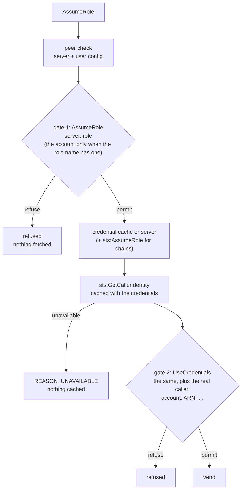

# 009-caller-identity

## Summary

Before fetching credentials, the agent knows only the server and the role name. For a custom credential server a role name can be opaque, and only the credentials themselves say which account they open. This step adds a second authorization gate. Once the credentials are in hand, the agent asks `sts:GetCallerIdentity` who they really are, once per credential set, and caches the answer with the credentials. It then runs the decision procedure of [007](007-authorization.md#decision-procedure) again with the action `UseCredentials`, the real caller in `context.caller`, and the role's `Account` parent set to the real account.

Gate 1 (`AssumeRole`, [007](007-authorization.md)) still runs first, before anything is fetched. Gate 2 runs before every vend, from the server or from the cache. Two always-on built-in policies apply at gate 2: an open default, and a refusal when the role name declares one account and the credentials belong to another. If the caller identity cannot be obtained, gate 2 fails closed.

## Motivation

Account-based rules are the natural way to protect production: "anything in account 999999999999 needs a fresh check". At gate 1 such a rule only sees the account a role name **declares**:

- An AWS IAM Identity Center role is named `<account>/<permission set>`, and an ARN-style role names its account. Those can be trusted to say where the request is going, but only as far as the server config is honest.
- A custom credential server can name roles anything (`deploy`, `admin`). Gate 1 cannot tell which account `admin` opens, so an account rule never matches it.
- A role name can also declare one account while the server hands out credentials for another, by mistake or because the server config was pointed somewhere else.

The credentials themselves are the only reliable source. `sts:GetCallerIdentity` answers for any valid credentials, needs no IAM permission, and cannot be denied by policy. Checking the answer before vending closes the gap without giving up gate 1, which keeps refused requests from fetching anything at all.

## Explanation

### Gate 2

Each credential request now passes two gates, and each gate decides with the full decision procedure of [007](007-authorization.md#decision-procedure):



1. **Gate 1**, action `AssumeRole`, runs after the peer trust check and server/user-config loading, and **before** the credential cache lookup ([007](007-authorization.md#decision-procedure)). Nothing is fetched for a request it refuses, so refused requests leave no credentials, CloudTrail events or server audit entries behind.
2. **Fetch** from the cache, or from the server, plus `sts:AssumeRole` for a chained role.
3. **Caller identity.** `sts:GetCallerIdentity` with the final credentials, once per credential set ([Caller identity](#caller-identity)).
4. **Gate 2**, action `UseCredentials`, runs the same decision procedure with:
   - the same principal and context, plus `context.caller`;
   - the same role entity, except that its `Account` parent is the caller's real account;
   - first, as an extra remembered candidate, the presence that gate 1 accepted for this request. A human check made at gate 1 therefore also counts at gate 2.
5. **Vend**, or refuse with the reason from whichever gate refused. `AuthorizationError.gate` says which.

Rules:

- Gate 2 runs once the credentials are in hand and their caller identity is known, **before** they are returned, whether they came from the cache or the server. It applies to every vend from the cache.
- If gate 2 needs a fresh check, it asks exactly as gate 1 would. The prompt shows the real identity ([What the human sees at gate 2](#what-the-human-sees-at-gate-2)).
- A check at gate 2 records the lease and the grant as at gate 1, under the same keys ([007 Grants and leases](007-authorization.md#grants-and-leases)).
- Pre-fetches (`ExecIntent.prefetch`) never ask at gate 2 either. They get `REASON_PRESENCE_REQUIRED`.
- When gate 2 answers with a status the client retries after, such as `REASON_NO_AUTHENTICATION_AGENT` ([008](008-headless.md#pkttyagent-fallback)), the credentials are held with that pending check for at most 60 s, so the retry fetches nothing again.
- If the caller identity cannot be obtained, gate 2 fails closed with `REASON_UNAVAILABLE`, and nothing is cached for that credential set.
- Gate 2 is skipped on an unhardened agent, where the built-in policy permits everything ([007 Built-in policies](007-authorization.md#built-in-policies)).

**Always-on built-in policies.** These are added to every effective policy set wherever gate 2 runs:

```cedar
// Gate 2 is open unless a forbid closes it. A forbid that a fresh human check would satisfy
// makes the agent ask at gate 2.
@id("builtin-use-credentials")
permit (principal, action == Mairu::Action::"UseCredentials", resource);

// Credentials for another account than the one the role name declares are never vended.
@id("builtin-caller-account-mismatch")
forbid (principal, action == Mairu::Action::"UseCredentials", resource)
when {
  resource has account_id && context has caller &&
  resource.account_id != context.caller.account
};
```

- Every `permit` that matters is written for gate 1. Gate 2 therefore starts open and is closed by `forbid` policies, as above.
- A role name that declares an account (`^\d{12}/` for AWS SSO roles, or an `arn:aws:iam::\d{12}:role/` ARN) sets `resource.account_id`. When the credentials carry another account, they are never vended, whatever else the policy says.

### Caller identity

The identity the credentials really carry, from `sts:GetCallerIdentity`, is available to policies as `context.caller`, present exactly at gate 2:

| Attribute | Value |
|---|---|
| `caller.account` | the 12-digit account id |
| `caller.arn` | the caller ARN, such as `arn:aws:sts::999999999999:assumed-role/Admin/alice` |
| `caller.user_id` | the unique id STS returns, such as `AROA…:alice` |
| `caller.type` | taken from the ARN: `"assumed-role"`, `"user"`, `"federated-user"`, `"root"` or `"other"` |
| `caller.role_name` | for an assumed role: the role's name |
| `caller.session_name` | for an assumed role: the session name |

- The identity is **determined by the agent**, so a policy may rely on it to grant. It comes from STS over TLS to an endpoint the agent fixes, and cannot be influenced by the requester beyond actually holding those credentials.
- **The endpoint is fixed by the agent, never by the environment.** The default is the global endpoint, `sts.amazonaws.com`. For this call, a hardened agent ignores the environment's endpoint and region overrides (`AWS_ENDPOINT_URL*`, `AWS_REGION`, `AWS_PROFILE` and the shared config files), and verifies TLS against the build's own roots. Under `AT_SECURE`, OpenSSL ignores `SSL_CERT_FILE` and `SSL_CERT_DIR` anyway ([003 Classification](003-marker-gid.md#classification)).
- The result is cached with the credentials, in memory, so later vends from the cache need no network call.

**Writing rules for the real account.** At gate 2, the role's `Account` parent is the account in `context.caller`, while `resource.account_id` keeps the account the role name declares:

```text
resource in Mairu::Account::"999999999999"
  gate 1 (AssumeRole)        the account the role name declares, when it declares one
  gate 2 (UseCredentials)    the account the credentials really belong to
```

- A policy with `action == Mairu::Action::"UseCredentials"` applies only at gate 2.
- A policy that leaves `action` unconstrained applies at both gates.

Example, protecting production whatever the role is called:

```cedar
// Production, whatever the role is called: credentials whose real account is production
// need a fresh human check (gate 2). The opaque role names of a custom server cannot say
// which account they open.
@id("prod-by-real-account")
forbid (principal, action == Mairu::Action::"UseCredentials", resource in Mairu::Account::"999999999999")
unless { context.presence.verified && context.presence.scope == "request" };
```

- A session grant or a lease does not satisfy it, so a request for production credentials asks the human again at gate 2, unless gate 1 already asked for this very request.
- `context.presence.method` can narrow such a rule to one presence method.

### What the human sees at gate 2

A prompt raised at gate 2 adds the identity the credentials really carry to the terminal context of [007 What the human sees](007-authorization.md#what-the-human-sees):

```
:: mairu :: Authorization required: contoso:admin on contoso
:: mairu ::   identity: 999999999999 assumed-role/Admin
:: mairu ::   command: terraform apply
:: mairu :: Approve in the system dialog.
```

The polkit `details` gain `caller`: the account and ARN, at gate 2 only.

### Errors

Refusals keep the reasons of [007](007-authorization.md#decision-procedure). `AuthorizationError` gains:

- `gate`: `"assume-role"` (gate 1) or `"use-credentials"` (gate 2).
- `caller_arn`: at gate 2, the identity the credentials carry.

A refusal by `builtin-caller-account-mismatch` is `REASON_FORBIDDEN` with that policy id, at gate `use-credentials`. Clients print both, for example `refused at use-credentials: credentials belong to 999999999999 (arn:aws:sts::999999999999:assumed-role/Admin/alice), not to the account the role name declares`.

## Drawbacks

- One extra STS call per credential set. It is cached with the credentials, so vends from the cache cost nothing, but the first vend of each credential set waits for it.
- STS becomes a dependency of every vend on a hardened agent. If STS cannot be reached, gate 2 fails closed even though the credentials were fetched.
- The default endpoint is the global endpoint of the `aws` partition. Roles in other partitions (`aws-cn`, `aws-us-gov`), and networks that reach STS only through a VPC endpoint, cannot be served from it, so a hardened agent refuses them at gate 2 with `REASON_UNAVAILABLE`.
- A request refused at gate 2 has already fetched credentials. Unlike a gate-1 refusal, it leaves CloudTrail events and server audit entries behind.
- Gate 2 can ask a second time for the same request when gate 1 was satisfied by a remembered grant and a gate-2 `forbid` wants a fresh check. That is the intended behavior for account-based rules, but it is a second prompt.

## Considered Alternatives

- **Forbid-only gate 2.** Gate 2 could only refuse and never ask. It is simpler, but a production account behind an opaque role name would be denied instead of prompted. Rejected for the full decision procedure, which can ask. A `forbid` that a fresh check would satisfy makes the agent ask at gate 2. (Decided 2026-10-24.)
- **A single gate after fetching.** Deciding only once the credentials are known would fetch credentials for every refused request, leaving credentials, CloudTrail events and server audit entries behind. Gate 1 stays, so most refusals happen before anything is fetched.
- **Trusting the declared account.** Policies could use only the account a role name declares. Opaque role names on custom servers, and a server config pointed elsewhere, defeat that.
- **Calling STS on every vend.** The identity of a credential set never changes, so it is fetched once and cached with the credentials.
- **Rewriting `resource.account_id` at gate 2.** Keeping the declared account in `resource.account_id` and moving only the `Account` parent lets `builtin-caller-account-mismatch` compare the two, while `resource in Mairu::Account::"…"` rules follow the real account.
- **One action for both gates.** A separate `UseCredentials` action lets a policy target gate 2 alone, as `prod-by-real-account` does. Policies that leave `action` unconstrained still apply at both gates.
- **Requiring a gate-2 `permit`.** Every `permit` would have to be written twice. Gate 2 starts open through `builtin-use-credentials` instead, and is closed by `forbid` policies.
- **Taking the STS endpoint from the environment, as the SDK does by default.** An endpoint that answered `GetCallerIdentity` falsely could report any identity, so the agent fixes it.

## Prior Art

- The Terraform AWS provider's `allowed_account_ids` and `forbidden_account_ids` check the account of the credentials through `sts:GetCallerIdentity` before acting, for the same reason: names and profiles do not prove which account the credentials open.
- `aws sts get-caller-identity` is the conventional way to ask "who am I" with any credentials, since it needs no permission.

## Security and Privacy Considerations

```text
a role name hiding the account     ✗ gate 2 checks the real caller identity
a forged identity answer           ✗ endpoint fixed by the agent; environment overrides ignored; TLS
```

| Threat | Mitigation |
|---|---|
| A server or role name that hides the real account | Gate 2 checks `sts:GetCallerIdentity`; built-in forbid when the declared and real accounts differ ([Gate 2](#gate-2)) |
| A forged `GetCallerIdentity` answer through an endpoint override | Endpoint fixed by the agent; environment overrides ignored on hardened agents; TLS against the build's own roots ([Caller identity](#caller-identity)) |
| A cached vend skipping the check | Gate 2 applies to every vend, from the cache too, using the identity cached with the credentials |
| A policy rule that silently stops matching for opaque role names | Rules written with `resource in Mairu::Account::"…"` follow the real account at gate 2 |

- The caller identity is kept in memory only, with the credentials it belongs to, and is dropped with them.
- Authorization decisions are logged at `info` as in [007](007-authorization.md#security-and-privacy-considerations), with the gate added. The caller ARN appears in the log for gate-2 decisions. It can carry a session name such as an email address, which the agent log already holds for the same user. Credentials are never logged.
- Every guarantee here is still bounded by the trust chain ([001 Trust chain](001-security-model.md#trust-chain)).

## Mission Scope

### Out of scope

- Choosing another STS endpoint or region. This step always uses the default endpoint.
- Checking anything about the credentials beyond their identity, such as their permissions or session tags.
- Gate 2 on unhardened agents.

### Expected Outcomes

- On a hardened agent, every vend, from the server or from the cache, passes gate 2 with the real caller identity in `context.caller`.
- Credentials for another account than the one the role name declares are never vended.
- A `forbid` written for a real account applies whatever the role is called, and asks the human when a fresh check would satisfy it.
- A check made at gate 1 counts at gate 2 for the same request. Pre-fetches never ask at either gate.
- If the identity cannot be obtained, nothing is vended or cached for that credential set.

## Implementation Plan

Stack layer: `hardening/caller-identity`, on top of `hardening/headless`.

### Files

| File | Change |
|---|---|
| `src/caller_identity.rs` | New. `GetCallerIdentity` with a fixed client configuration; ARN parsing into `Caller` |
| `src/credential_cache.rs` | Cache entries carry the `Caller` of their credentials |
| `src/authorization.rs` | `Authorizer::authorize_use_credentials`; the gate-1 presence as an extra candidate; held credentials |
| `src/agent.rs` | `assume_role`: gate 1 → fetch → caller identity → gate 2 → vend |
| `src/policy/mairu.cedarschema` | `Caller`, `UseCredentials`, `context.caller` |
| `src/policy/builtin/always_on.cedar` | `builtin-use-credentials`, `builtin-caller-account-mismatch` |
| `src/policy/mod.rs` | Always-on built-ins joined to the effective policy set wherever gate 2 runs |
| `proto/mairu.proto` | `AuthorizationError.gate`, `AuthorizationError.caller_arn` |
| `src/cmd/{exec,credential_process}.rs` | Print the identity line and the gate of a refusal |
| `src/platform/services/linux/polkit.rs` | `caller` in the polkit details |

### Flow in the agent

```text
assume_role(request)
  gate 1: authorize(AssumeRole, declared entities)               → refuse, nothing fetched
  creds = held(peer, request digest) or cache or server (+ chain)
  caller = creds.caller or GetCallerIdentity(creds)               → REASON_UNAVAILABLE, cache nothing
  gate 2: authorize(UseCredentials, real Account parent, caller,
                    extra candidate = gate-1 presence)
    retryable refusal  → hold creds for (peer, request digest), 60 s
  cache (creds, caller); vend
```

- The decision procedure is the one of [007](007-authorization.md#decision-procedure), steps 1–6, with action `UseCredentials`. The remembered candidates are, in order: the presence gate 1 accepted for this request, then nothing, the lease and the grant. Fresh candidates follow as in step 4.
- The gate-1 presence is passed from gate 1 to gate 2 inside the same `AssumeRole` call. When gate 1 was satisfied by a grant, the candidate is that grant's presence (`scope: "session"`); when gate 1 asked, it is the fresh one (`scope: "request"`).
- `disallow_roles` (step 1) refuses at gate 1 already, so gate 2 never sees such a role.
- Grants and leases recorded at gate 2 use the keys of [007 Grants and leases](007-authorization.md#grants-and-leases).

**Held credentials.** When gate 2 refuses with a status the client retries after, the agent keeps the fetched credentials and their caller under `(peer pid, peer start time, request digest)` for at most 60 s. The retry finds them there and skips the fetch. They are dropped on expiry, on the next decision for that key, and by `mairu lock`. They are never vended from there without passing gate 2.

**Caching.** The credential cache entry gains `caller: Caller`. Vends from the cache run gate 2 with the cached caller and make no network call. When `GetCallerIdentity` fails, the credentials are not cached, so the next request fetches and checks again.

### Caller identity

`src/caller_identity.rs`:

- Builds an `aws_sdk_sts::Client` directly from an explicit `aws_sdk_sts::Config`, never through `aws_config::load_from_env`. Region `us-east-1`, endpoint `https://sts.amazonaws.com`, the fetched credentials as a static credentials provider, and the crate's default HTTPS client. Nothing is read from the environment or the shared config files on a hardened agent.
- Calls `GetCallerIdentity` and fills:

  ```rust
  pub struct Caller {
      pub account: String,     // GetCallerIdentity.Account
      pub arn: String,         // GetCallerIdentity.Arn
      pub user_id: String,     // GetCallerIdentity.UserId
      pub r#type: CallerType,  // from the ARN
      pub role_name: Option<String>,
      pub session_name: Option<String>,
  }
  ```

- ARN parsing:

  | ARN resource | `type` | Extra fields |
  |---|---|---|
  | `sts::<account>:assumed-role/<role>/<session>` | `assumed-role` | `role_name`, `session_name` |
  | `iam::<account>:user/<path…>/<name>` | `user` | |
  | `sts::<account>:federated-user/<name>` | `federated-user` | |
  | `iam::<account>:root` | `root` | |
  | anything else | `other` | |

- Errors map to `REASON_UNAVAILABLE` with the STS error in `detail`.

### Cedar schema

The schema of [007](007-authorization.md#cedar-schema) gains the `Caller` type, the `UseCredentials` action, and `context.caller`. As of this step:

```cedarschema
namespace Mairu {
  // The local Unix user the agent runs for. Entity id: the uid.
  entity User = {
    name: String,
    uid: Long
  };

  // A credential server from servers.d. Entity id: the server id.
  entity Server = {
    url: String
  };

  // An AWS account named by a role. Entity id: the 12-digit account id, shared across servers.
  entity Account;

  // A role on a server. Entity id: "<server id>:<role>".
  // Parents: its Server, and its Account when the role names one.
  entity Role in [Server, Account] = {
    name: String,
    server: Server,
    account_id?: String
  };

  type Presence = {
    // A human check covers this request.
    verified: Bool,
    // "none"; "request": checked for this very request; "process": the lease of this running
    // `mairu exec`; "session": a grant for this terminal session.
    scope: String,
    // The method that performed the check, such as "platform"; absent when not verified.
    method?: String,
    // Seconds since the covering human check; 0 when not verified.
    age: Long,
    // Session grant: seconds since it was last used.
    // Process lease: seconds since the credentials last obtained on demand expired (0 while valid).
    // Otherwise 0.
    idle: Long
  };

  // The identity the credentials really carry, from sts:GetCallerIdentity.
  type Caller = {
    account: String,
    arn: String,
    user_id: String,
    // "assumed-role", "user", "federated-user", "root" or "other".
    type: String,
    role_name?: String,
    session_name?: String
  };
  // AssumeRole is gate 1, before fetching; UseCredentials is gate 2, before vending.
  action AssumeRole, UseCredentials appliesTo {
    principal: [User],
    resource: [Role],
    context: {
      presence: Presence,
      // "tty", "parent" or "none"; tty is the device path when "tty".
      session: String,
      tty?: String,
      // Whether the agent runs hardened.
      hardened: Bool,
      // Reported by the client: truthful about what it will do, but chosen by whoever runs it.
      intent: String,
      exec_command?: String,
      exec_command_line?: String,
      cwd?: String,
      chained_role_arn?: String,
      // Present exactly at gate 2.
      caller?: Caller
    }
  };
}
```

Context reference, added row:

| Attribute | Values | Source |
|---|---|---|
| `caller` | from `sts:GetCallerIdentity`; `type` from the ARN; `role_name` and `session_name` for an assumed role | agent, gate 2 only |

Trust, added row: `caller` is **agent-determined** and may grant, like `presence`, `hardened`, `session` and `tty` ([007](007-authorization.md#cedar-schema)).

### Entities at gate 2

```text
principal  Mairu::User::"1000"
action     Mairu::Action::"UseCredentials"
resource   Mairu::Role::"contoso:admin"  in  Server "contoso", Account "<context.caller.account>"
           account_id = the account the role name declares, if any
context    as at gate 1, plus caller; presence per candidate
```

- The `Account` parent is always present at gate 2, since every caller has an account, even for roles whose names declare none.
- `Request::new(…, Some(&schema))` and `Entities::from_json_value(…, Some(&schema))` check every gate-2 request against the schema, as at gate 1.

### Protocol

Adds two fields to `AuthorizationError` ([007](007-authorization.md#implementation-plan)):

```proto
message AuthorizationError {
  // ... fields 1–5 as before ...
  string gate = 6;                       // "assume-role" (gate 1) or "use-credentials" (gate 2)
  string caller_arn = 7;                 // gate 2: the identity the credentials carry
}
```

### Tests

- ARN parsing for each row of the table above, including paths in user ARNs and session names with `@`.
- Decision tests with a fake STS:
  - declared account ≠ real account → `REASON_FORBIDDEN`, `builtin-caller-account-mismatch`, gate `use-credentials`;
  - `prod-by-real-account` with an opaque role name: a session grant → asks at gate 2; a fresh check at gate 1 → permitted without a second prompt;
  - a pre-fetch that would need a fresh check at gate 2 → `REASON_PRESENCE_REQUIRED`, nobody asked;
  - STS failure → `REASON_UNAVAILABLE`, nothing cached, the next request calls STS again;
  - a vend from the cache runs gate 2 with the cached caller and no STS call;
  - a retry after `REASON_NO_AUTHENTICATION_AGENT` at gate 2 uses the held credentials and fetches nothing.
- The hardened STS client ignores `AWS_ENDPOINT_URL_STS`, `AWS_REGION` and `AWS_PROFILE` set in the agent's environment.
- Cedar: the always-on built-ins and `prod-by-real-account` validate strictly against the schema of this step.

## Current Status

Spec drafted; awaiting review before implementation. Implementors MUST keep this section updated as they work.

### Checklist

- [ ] `sts:GetCallerIdentity` with the agent's fixed client configuration; environment overrides ignored on hardened agents
- [ ] Caller identity cached with the credentials; nothing cached when it cannot be obtained
- [ ] `UseCredentials` action, `Caller` type and `context.caller` in the schema
- [ ] Gate 2 in `assume_role`, for every vend; the gate-1 presence as a candidate; leases and grants recorded at gate 2
- [ ] Always-on built-ins: `builtin-use-credentials`, `builtin-caller-account-mismatch`
- [ ] Held credentials for retried gate-2 checks (60 s)
- [ ] `AuthorizationError.gate` and `caller_arn`; identity line in the client and `caller` in polkit details

### Updates

- 2026-10-29: Split out of hardening.md, policy.md and platform-helper.md.
