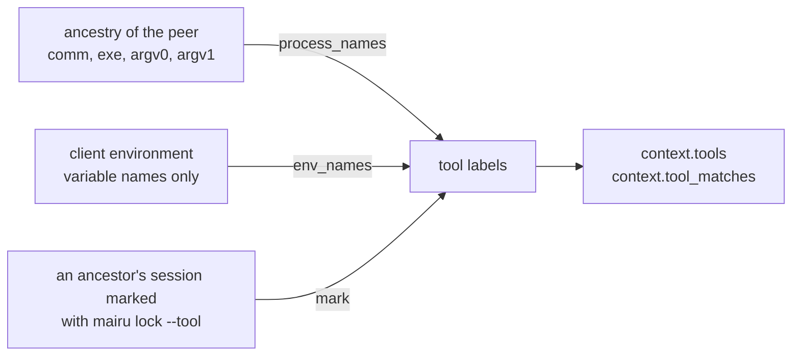

# 010-tool-detection

## Summary

AI coding agents and other tools run commands in the user's own terminal session, with the user's uid. Session grants ([007](007-authorization.md#grants-and-leases)) would let them ride on the human's approval. This step attaches **tool labels** to each request, such as `ai-agent`, from three positive-only signals: the process ancestry, the names of the client's environment variables, and session marks that a human sets with `mairu lock --tool <label>`. Policies see them as `context.tools` and `context.tool_matches`.

`ai-agent` ships with built-in signals, and the built-in policies use it: a request labelled `ai-agent` needs a human check for every new request and never reuses a terminal-session grant. `mairu unlock --tool <label>` removes a mark, and always asks the human. Labels are a guardrail, not a boundary: they can be evaded and forged.

## Motivation

The human check of [007](007-authorization.md) is remembered per terminal session for a few minutes. That is right for a person typing commands, and wrong for an AI agent working in the same session:

- The agent's tool calls come from processes the human started, in the human's session, with the human's uid. The peer check ([004](004-peer-verification.md)) proves only that the client is a genuine mairu.
- A grant the human made a minute ago would then cover whatever the agent asks for next.
- Many agents run each command in a fresh session with no tty (observed: Claude Code runs each command under `setsid` with no tty). They fall into the `Parent` session identity ([007 Session identity](007-authorization.md#session-identity)), but their ancestry still passes through the human's terminal.

Detecting such tools lets the policy require a fresh check for each of their requests, while the human keeps the convenience of session grants. The same mechanism serves other tools a user wants to treat specially, such as CI runners or `terraform`, so it is generalized into labels rather than a single AI flag.

Detection can fail: a renamed binary or a double fork escapes the ancestry match. A human who knows a terminal hosts a tool can therefore mark the session explicitly, and the tool itself must not be able to remove that mark.

## Explanation



### Labels and signals

Detection attaches **labels** to a request, each with its own signals. `ai-agent` ships with built-in signals, and the built-in policies use it.

Signals, all positive-only (they can add a label, never remove one):

- **Ancestry.** Walk from the peer up through `ppid`, stopping at pid 1, at a uid change, or after 64 hops. Match each ancestor's `comm`, `exe` basename, `argv[0]` basename and `argv[1]` basename (interpreters such as `node script`) exactly against each label's `process_names`.
  - The built-in `ai-agent` list is `["claude", "codex", "gemini", "cursor-agent", "aider", "opencode", "goose", "amp", "crush", "qwen", "copilot"]`. Recheck it against current agents during implementation.
- **Environment names.** The client sends the names (never values) of its environment variables. They are matched against each label's `env_names`.
  - The built-in `ai-agent` list is `["AI_AGENT", "CLAUDECODE", "GEMINI_CLI", "CODEX_SANDBOX"]`. `AI_AGENT` and `CLAUDECODE` were observed in Claude Code's tool environment, and the rest need verifying.
  - The agent cannot read `/proc/<pid>/environ` of a hardened (non-dumpable) peer ([003](003-marker-gid.md#classification)), so the genuine client reports the names.
- **Session marks.** A human runs `mairu lock --tool <label>` in a terminal before starting a tool there ([Session marks](#session-marks)).

The result is `context.tools`, the set of labels, and `context.tool_matches`, what matched, prefixed `process:`, `env:` or `mark:`. What happens to a labelled request is up to the policy. The built-in policy requires a human check for every new `ai-agent` request, and never lets such requests reuse session grants.

Labels are lowercase `[a-z0-9-]+`.

**This is a guardrail** ([001 Boundaries and guardrails](001-security-model.md#boundaries-and-guardrails)):

- Labels can be evaded: `setsid` plus a double fork, `systemd-run --user`, or a renamed binary.
- They can also be forged: any program can call itself `terraform` or set `CI=1`, and same-user code can mark a session.
- Policies may still use labels both to restrict and to grant, knowing this. The authorization prompt remains the boundary.
- Detected labels appear in the prompt details and in `doctor`.

### Session marks

```text
mairu lock --tool <label>   drop my session's grants, and mark my session as that tool
mairu unlock --tool <label> remove the mark from my session: asks the human
```

- `--tool <label>` (repeatable) implies `--session`: it drops the grants of the caller's terminal session ([007](007-authorization.md#explanation)), and adds the marks.
- It needs a terminal session: with no tty there is nothing lasting to mark, and the command fails with guidance.
- The agent records the label against that terminal session ([007 Session identity](007-authorization.md#session-identity)): the session id and its leader's start time.
- A request carries the label when any process in its ancestry belongs to a marked session. This covers commands that an AI tool runs in a fresh session with no tty, as long as their ancestry passes through the marked terminal.
- A mark lasts until that session ends.
- Marking needs no authorization, like the rest of `mairu lock`, since it only tightens. A label used to grant in a policy is the exception: marking then relaxes, which is part of why labels are a guardrail.

`mairu unlock --tool <label>` removes a mark early. Removing a mark relaxes the guardrail, and the marked tool itself could run it, so the agent **always asks the human**. It uses the effective presence methods, and never a grant or lease. The prompt names the session and the labels being removed.

Typical use, in a tmux pane before starting an agent the ancestry match would miss:

```console
$ mairu lock --tool ai-agent
:: mairu :: Marked this terminal session (/dev/pts/7) as: ai-agent
$ my-agent
```

### Policies with labels

Built-in policies from this step on, on a hardened agent:

```cedar
// Humans: one check per terminal session, remembered for 5 minutes idle, 12 hours at most.
// A running `mairu exec` keeps its approval for its lifetime, until it goes 1 hour without credentials.
@id("builtin-human")
permit (principal, action == Mairu::Action::"AssumeRole", resource)
when {
  !context.tools.contains("ai-agent") &&
  context.presence.verified &&
  (context.presence.scope != "session" ||
   (context.presence.idle <= 300 && context.presence.age <= 43200)) &&
  (context.presence.scope != "process" || context.presence.idle <= 3600)
};

// AI agents: a human approves every new request; a running `mairu exec` keeps its approval
// as above.
@id("builtin-ai-agent-per-request")
permit (principal, action == Mairu::Action::"AssumeRole", resource)
when {
  context.tools.contains("ai-agent") &&
  context.presence.verified &&
  (context.presence.scope == "request" ||
   (context.presence.scope == "process" && context.presence.idle <= 3600))
};
```

- `builtin-human` replaces the version of [007 Built-in policies](007-authorization.md#built-in-policies), which had no label condition.
- `builtin-ai-agent-per-request` is new. An `ai-agent` request never reuses a terminal-session grant. A lease of a running `mairu exec` still covers it, so a long-running command started with the human's approval keeps working.
- The unhardened built-in (`builtin-unhardened`) and the always-on gate-2 built-ins ([009](009-caller-identity.md#gate-2)) are unchanged.

A rule written with labels, for example:

```cedar
// Never hand production to AI agents, on any server.
@id("no-ai-prod")
forbid (principal, action, resource in Mairu::Account::"999999999999")
when { context.tools.contains("ai-agent") };
```

It leaves `action` unconstrained, so it applies at both gates: at gate 1 to roles that declare the account, and at gate 2 to credentials that really belong to it ([009 Gate 2](009-caller-identity.md#gate-2)).

### What the human sees

The terminal context of [007 What the human sees](007-authorization.md#what-the-human-sees) shows the labels and what matched:

```
:: mairu :: Authorization required: 123456789012/Admin on contoso
:: mairu ::   command: terraform apply
:: mairu ::   cwd:     /home/u/src/infra
:: mairu ::   from:    /dev/pts/3 (zsh, tmux pane)   tools: ai-agent (process:claude)
:: mairu :: Approve in the system dialog.
```

- The polkit `details` gain `tools`.
- Refusals carry `AuthorizationError.tools`, the labels detected.
- `mairu doctor` shows the labels the agent detects for the caller, with their matches, and the marks on the caller's session.

## Drawbacks

- Detection is easy to evade and to forge. It raises the bar for a well-behaved tool working in the user's session, and does nothing against code that tries to hide.
- The built-in name lists drift as new agents appear and old ones are renamed. They need rechecking at implementation time and over time.
- An `ai-agent` request asks the human for every new request. Agents that run many short commands, each a new `mairu exec` or `credential-process`, prompt often.
- On a host with no way to reach the human for a request without a tty, labelled requests fail closed rather than reuse a session grant.
- Walking the ancestry reads several `/proc` files per ancestor for every request.
- A label used in a `permit` turns `mairu lock --tool` from a tightening into a relaxation.

## Considered Alternatives

- **A single AI-agent flag** (`ai_agents`, `ai_agent_*` settings, an `ai_agent` context attribute). Generalized into labels on 2026-10-24, so that the same signals can mark CI runners, `terraform` or anything else a user wants to treat specially. `ai-agent` remains the built-in label.
- **Labels may only restrict.** Policies would be limited to tightening with labels (forbid, or require a check), with `permit` policies that depend on a label rejected or warned about. Rejected: labels are a guardrail either way, and a user may knowingly relax for a label such as `ci`. Such permits are listed when the policy is checked.
- **Letting AI requests reuse the human's session grant.** Convenient, but the agent then rides on the human's approval. The built-in policy requires a fresh check per `ai-agent` request instead, except within a running `mairu exec`'s lease.
- **Reading the peer's environment from `/proc/<pid>/environ`.** A hardened peer is non-dumpable, so the agent cannot read it. The genuine client reports the names instead, never the values.
- **Signals that remove a label** (an "I am human" marker). Anything that can remove a label lets the tool remove its own. Every signal only adds.
- **Automatic marking only.** Ancestry and environment matches miss renamed binaries and double forks. Human marks with `mairu lock --tool` cover what detection misses.
- **Removing a mark without asking.** The marked tool could run `mairu unlock --tool` itself, so unmarking always asks the human.
- **Marks keyed by tty path.** Tty devices are reused. Marks are keyed by session id plus the leader's start time, like grants, so they end with the session.

## Prior Art

- Most CI services set `CI=true` in job environments, and many tools change behavior on it. The `env_names` signal follows the same convention.
- Claude Code sets `CLAUDECODE` in the environment of the commands it runs (observed), which is what the built-in `env_names` list relies on.

## Security and Privacy Considerations

```text
AI agent in your session          ! tools ∋ ai-agent: fresh check per request (built-ins)
tool removing its own mark        ✗ unmarking always asks the human
```

| Threat | Mitigation |
|---|---|
| AI agent sharing the user's terminal session | Ancestry, env-name and session-mark signals in `context.tools`; built-in policy requires a fresh check per `ai-agent` request. Guardrail only. |
| A marked tool removing its own mark | `UnmarkTools` always asks the human |
| A `permit` that depends on a forgeable tool label | Documented as a guardrail; labels can be produced or avoided by same-user code |

- Trust: `tools` and `tool_matches` are a **guardrail**. The agent collects them, but from process names, environment names and session marks that same-user code can produce or avoid. Policies may use them both to restrict and to grant, knowingly.
- Only environment variable **names** leave the client, never values.
- Authorization decisions are logged with the detected tool labels ([007](007-authorization.md#security-and-privacy-considerations)).

## Mission Scope

### Out of scope

- Configuring labels and their signals beyond the built-in `ai-agent` label.
- Detecting tools that deliberately hide: renamed binaries, double forks, `systemd-run --user`.
- Marks that outlive their terminal session.

### Expected Outcomes

- A request from a process whose ancestry or environment matches the built-in `ai-agent` signals carries `context.tools = {"ai-agent"}`, with the matches in `context.tool_matches`.
- On a hardened agent, such a request asks the human for every new request, and never reuses a session grant; a running `mairu exec`'s lease still covers it.
- `mairu lock --tool ai-agent` labels every later request whose ancestry passes through that terminal session, until the session ends.
- `mairu unlock --tool ai-agent` asks the human before removing the mark.
- Detected labels appear in the prompt, in refusals and in `doctor`.

## Implementation Plan

Stack layer: `hardening/tool-detection`, on top of `hardening/caller-identity`.

### Files

| File | Change |
|---|---|
| `src/tool_detection.rs` | New. Labels and their signals, built-in `ai-agent` lists, ancestry and env-name matching, session marks |
| `src/platform/process/linux/procfs.rs` | Ancestry entries carry `comm`, `exe`, `argv[0]`, `argv[1]` and the session id of each ancestor |
| `src/authorization.rs` | `context.tools` and `context.tool_matches` in every Cedar request; marks recorded by `RevokeAuthorizations`; `UnmarkTools` |
| `src/policy/mairu.cedarschema` | `tools`, `tool_matches` |
| `src/policy/builtin/*.cedar` | `builtin-human` with the label condition; `builtin-ai-agent-per-request` |
| `src/cmd/lock.rs` | `--tool`; `mairu unlock --tool` |
| `src/main.rs` | The `unlock` subcommand |
| `src/cmd/{exec,credential_process}.rs`, `src/ecs_server.rs` | Fill `ClientContext.env_names`; print labels |
| `src/cmd/doctor.rs` | Detected labels, matches and marks for the caller |
| `src/platform/services/linux/polkit.rs` | `tools` in the polkit details |
| `proto/mairu.proto` | `env_names`, `AuthorizationError.tools`, `mark_tools`, `UnmarkTools` |
| `README.md` | Tool labels, `mairu lock --tool` |

### Detection

```rust
pub struct ToolLabel {
    pub name: String,                 // [a-z0-9-]+
    pub process_names: Vec<String>,
    pub env_names: Vec<String>,
}

pub struct Detection {
    pub tools: std::collections::BTreeSet<String>,
    pub tool_matches: std::collections::BTreeSet<String>,  // "process:claude", "env:CI", "mark:ai-agent"
}
```

`tool_detection::detect(peer, env_names, marks, labels) -> Detection`:

1. Walk the ancestry from the peer through `ppid` ([004 Process facts](004-peer-verification.md#process-facts)). Stop at pid 1, at the first ancestor whose uid differs from the peer's, or after 64 hops. The peer itself is included.
2. For each process, compare `comm`, the basename of `exe`, and the basenames of `argv[0]` and `argv[1]` exactly against every label's `process_names`. A hit adds the label and `process:<name>`.
3. Compare each name in `ClientContext.env_names` exactly against every label's `env_names`. A hit adds the label and `env:<name>`.
4. For each process in the ancestry, look up its session `(sid, leader start time)` in the marks. A hit adds every marked label and `mark:<label>`.

The built-in label is:

```rust
ToolLabel {
    name: "ai-agent".into(),
    process_names: ["claude", "codex", "gemini", "cursor-agent", "aider", "opencode",
                    "goose", "amp", "crush", "qwen", "copilot"].map(Into::into).into(),
    env_names: ["AI_AGENT", "CLAUDECODE", "GEMINI_CLI", "CODEX_SANDBOX"].map(Into::into).into(),
}
```

- Each ancestor's facts are read with the same pid-reuse protection as the peer: the start time is read with the other facts, and a process that vanished mid-walk ends the walk.
- `/proc/<pid>/cmdline` of a non-dumpable ancestor is still readable by the same uid; `exe` may not be, in which case only the other names are compared.
- Detection runs once per decision, before the Cedar requests are built, and its result is used for every candidate at both gates.

### Session marks

```rust
struct Marks {
    // Key: the marked terminal session, as in SessionIdentity::Tty.
    by_session: std::collections::HashMap<(libc::pid_t, u64), std::collections::BTreeSet<String>>,
}
```

- `RevokeAuthorizations` with `mark_tools` requires the caller's session identity to be `Tty`. Otherwise it fails with `FAILED_PRECONDITION` and guidance; the client checks for a tty first and prints the same guidance without calling the agent.
- With `mark_tools`, the scope is forced to `SCOPE_CALLER_SESSION`: the session's grants are dropped as for `--session`, then the labels are added to the session's marks.
- Marks are swept with leases, every 60 s, and checked on lookup: a mark whose session leader is gone, or whose leader's start time differs, is removed.
- Marks are in memory only, like grants and leases. Restarting the agent forgets them.

**`UnmarkTools`** never consults Cedar, grants or leases. It asks the human with the first usable method in the effective method order, as step 4 of [007 Decision procedure](007-authorization.md#decision-procedure) would, but unconditionally:

- the platform method calls `PlatformServices::authorize` with `ACTION_APPROVE_POLICY`, the caller as the subject, a message such as `Remove the tool mark "ai-agent" from /dev/pts/7`, and the details `tty` and `tools`;
- on `ALLOWED`, it removes the labels from the caller's session and returns the labels still marked;
- the other results map as in the decision procedure (`REASON_DENIED`, `REASON_NO_AUTHENTICATION_AGENT`, `REASON_UNAVAILABLE`).

### Cedar schema

Adds two required attributes to the context of both actions ([009](009-caller-identity.md#cedar-schema)):

```text
context: {
  presence: Presence,
  // Tool labels, such as "ai-agent", and what matched.
  tools: Set<String>,
  tool_matches: Set<String>,
  …
}
```

Context reference, added row:

| Attribute | Values | Source |
|---|---|---|
| `tools`, `tool_matches` | labels; matches prefixed `process:`, `env:` or `mark:` | agent (ancestry, session marks) + client (env names) |

Trust, added row:

| Class | Attributes | May be used to |
|---|---|---|
| guardrail | `tools`, `tool_matches` (names and marks anyone can produce or avoid) | restrict or grant, knowingly |

### Protocol

Adds to `ClientContext` ([007](007-authorization.md#implementation-plan)):

```proto
message ClientContext {
  // ... fields 1–4 as before ...
  repeated string env_names = 5;   // names only, never values; used for tool detection
}
```

Adds to `AuthorizationError`:

```proto
  repeated string tools = 5;             // tool labels detected
```

Adds to `PeerView`, so that `GetAgentStatus` and `doctor` show how the agent labels the caller:

```proto
message PeerView {
  // ... fields 1–4 as before ...
  repeated string tools = 5;            // tool labels, e.g. "ai-agent"
  repeated string tool_matches = 6;     // e.g. "process:claude", "env:AI_AGENT", "mark:ai-agent"
}
```

Adds `mark_tools` to `RevokeAuthorizationsRequest`, and the `UnmarkTools` RPC:

```proto
service Agent {
  // ... existing RPCs ...
  rpc UnmarkTools(UnmarkToolsRequest) returns (UnmarkToolsResponse);
}

message RevokeAuthorizationsRequest {
  // ... fields 1–2 as before ...
  repeated string mark_tools = 3;       // mark the caller's terminal session with these labels
}

// Always asks the human.
message UnmarkToolsRequest {
  repeated string tools = 1;
  ClientContext client_context = 2;     // env_names, and the presence response when a method needs one
}
message UnmarkToolsResponse {
  repeated string remaining = 1;        // labels still marked on the caller's session
}
```

The client fills `env_names` in every `ClientContext`: `exec` (preflight, the ECS endpoint's `AgentBackend`, auto-refresh), `credential-process`, and `UnmarkTools`.

### Tests

- Ancestry matching by `comm`, `exe` basename, `argv[0]` and `argv[1]` (`node /path/to/agent.js`), stopping at a uid change and after 64 hops.
- Env-name matching never looks at values.
- A `setsid` child with no tty, started from a marked pane, carries `mark:ai-agent`; a process started from another pane does not.
- A mark disappears once its session leader exits, and does not attach to a new session that reuses the session id.
- `mairu lock --tool` without a tty fails with guidance.
- `UnmarkTools` asks the human every time, also right after a grant was made.
- Built-in policy evaluations on a hardened agent: human with a session grant → permitted; `ai-agent` with a session grant → asks; `ai-agent` with a fresh check → permitted; `ai-agent` within a lease idle ≤ 3600 → permitted.
- Cedar: every block above validates strictly against the schema of this step.

## Current Status

Implemented on `hardening/tool-detection`. Verified in Docker with fake `claude`/`codex` processes, environment markers and session marks under polkit test rules (see Updates); real AI agents were not run.

### Checklist

- [x] Labels and signals: ancestry (`comm`, `exe`, `argv[0]`, `argv[1]`), env names, built-in `ai-agent` lists rechecked against current agents
- [x] `context.tools` and `context.tool_matches` in the schema and every Cedar request
- [x] Built-in policies: `builtin-human` with the label condition, `builtin-ai-agent-per-request`; README relaxation updated
- [x] Session marks: `mairu lock --tool`, sweep on session end
- [x] `mairu unlock --tool` (`UnmarkTools`), always asking the human
- [x] `ClientContext.env_names` from every client path; `AuthorizationError.tools`; labels in prompts and `doctor`

### Updates

- 2026-10-29: Split out of hardening.md, policy.md and platform-helper.md.
- 2026-10-31: Implemented. Decisions and deviations:
  - The built-in `env_names` list is extended after checking the variables current agents set (as collected by the `is-ai-agent` crate and similar detectors): `AI_AGENT`, `CLAUDECODE`, `GEMINI_CLI`, `CODEX_SANDBOX`, `CODEX_THREAD_ID`, `CURSOR_AGENT`, `QWEN_CODE`, `OPENCODE`, `GOOSE_TERMINAL`, `AMP_CURRENT_THREAD_ID`, `COPILOT_CLI`, `CRUSH`. Generic names such as `AGENT` are left out. The `process_names` list is unchanged.
  - The ancestry walk is `ProcessPlatform::ancestry(pid, start_time, uid)`, so `Detection::detect` takes the ancestry rather than the peer, and `ProcessPlatform::session_alive` backs the mark sweep. `FallbackProcess` (macOS) returns no ancestry and no live sessions. The walk excludes pid 1, stops at the first process whose real or effective uid differs, and pins each ancestor with a pidfd while reading `stat`, `status`, `comm`, `exe` and `cmdline`; it also re-reads the child's `ppid` afterwards, so an ancestor whose pid was reused mid-walk ends the walk.
  - Each ancestor carries its session as `SessionIdentity::Tty` with its leader's current start time, whether or not it has a tty, so a mark matches only the session it was made in, and a reused session id never does. Marks live in the `Authorizer` state and are swept with leases.
  - `GetAgentStatusRequest` gains `ClientContext client_context = 1`, so that `doctor` can show env matches; `doctor` sends it only to an agent it does not consider unverified. `PeerView` also gains `marks = 7`, the labels on the caller's own terminal session, which `doctor` prints with a hint to `unlock`.
  - `mairu lock --tool` starts the agent when none runs, so the mark exists. Labels are validated by the client and by the agent (`INVALID_ARGUMENT`). `UnmarkTools` needs a `Tty` session like marking (`FAILED_PRECONDITION`), is not coalesced, and asks with `ACTION_APPROVE_POLICY` and the message `Remove the tool mark "ai-agent" from /dev/pts/7`. `mairu unlock` goes through the `pkttyagent` fallback of 008 like other requests and prints the labels still marked.
  - `AuthorizationError.tools` is set on every refusal, `disallow_roles` included, and the shared refusal wording appends `(tools: …)`. Decisions are logged with the matches.
  - The terminal lines: the client cannot know the agent's detection while a request is pending, so the `tools:` part of the `from:` line shows what the client detects for itself (ancestry and environment, not marks), plus the labels of the refusal in the `pkttyagent` password notice. The polkit `details` gain `tools` (labels and matches), which, like the other details, reach polkit only when the helper runs as root (007).
  - An approval of an `ai-agent` request still records the session grant, as in 007: an unlabelled request from that session may reuse it, since a human gave it. Labelled requests never do.
  - `AuthorizationError` grew past clippy's `result_large_err` threshold; `src/authorization.rs` allows that lint, since refusals are the protocol message itself.
  - Verified in Docker as root (scenario `010-tool-detection`, 35 checks; polkit 126 with a YES/NO rules file, the `harden`ed copy, a credential server that is never reached): a human terminal makes one polkit check for two requests and `doctor` shows `tools none`; under a binary named `claude` (comm and exe), under `bash /opt/agents/codex` (argv[1]), with `CLAUDECODE` set, and for `setsid -w` children without a tty under `claude`, every request asks, and the agent log names `process:claude`/`process:codex`; `doctor` shows `ai-agent (process:claude)` and `ai-agent (env:AI_AGENT)` and the log holds no values; a refusal names `(tools: ai-agent)`; a human terminal is unaffected afterwards; `mairu exec` under `claude` asks once and its lease covers the second ECS request; `lock --tool` without a tty fails with guidance and rejects an invalid label; `lock --tool ai-agent` prints the mark, labels the pane's requests and its `setsid` child (`mark:ai-agent`, a marks line in `doctor`), and another pane is unaffected; `unlock --tool` asks through `co.0w0.mairu.approve-policy` every time, removes the mark on YES, keeps it on NO, and fails without a tty. Scenarios 003, 004, 005-install, 005-ci-script, 006, 007, 008 and 009 still pass.
  - Not verified: real agents (Claude Code, Codex, …) and their process titles; the 60 s sweep dropping the mark of an ended session, and a reused session id (unit-tested with a fake process platform); macOS, where the fallback detects nothing but environment names.
