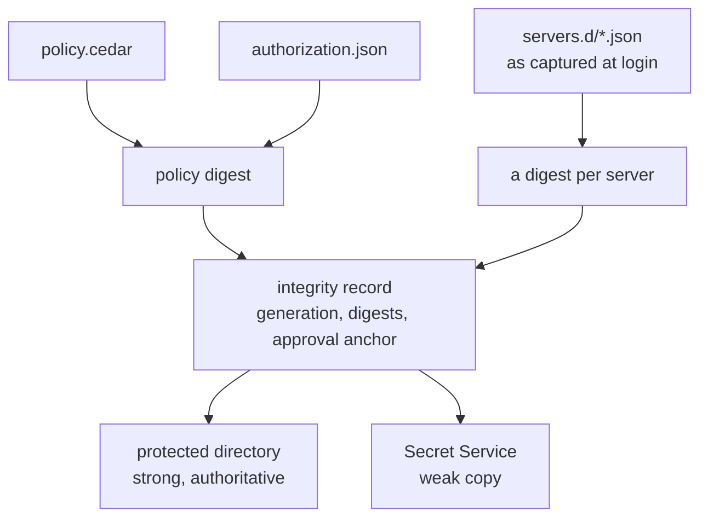
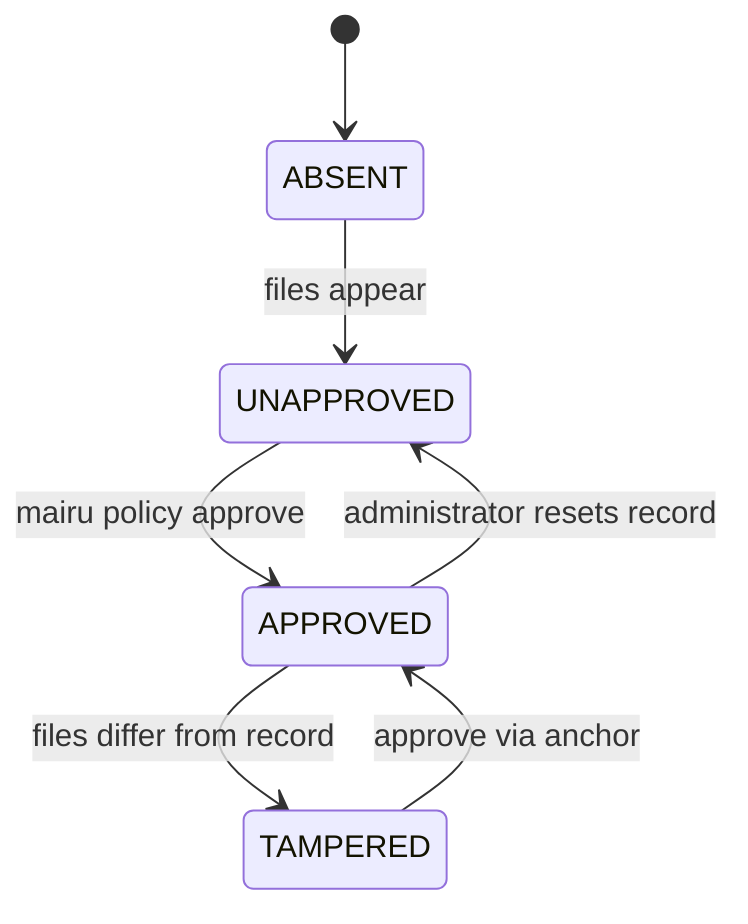
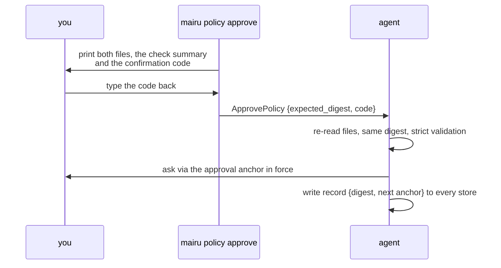

# 012-policy-approval

## Summary

The policy files of [011](011-user-policy.md) stay in the user's home directory, where any process of the user can edit them, so so far only their `forbid` policies apply. This step lets a human **approve** them. `mairu policy approve` asks the human, then writes an **integrity record** to stores that same-user code cannot write: a digest of both files, a digest of each server config in `servers.d`, a generation, and an **approval anchor** saying who may approve the next change. The agent verifies the files against the record before every decision:

- `APPROVED`: the user's `policy.cedar` and `authorization.json` are in force, `permit` policies included.
- `TAMPERED`: the files changed since approval. **Lockdown** applies: every request needs a fresh human check, AI agents are refused, and the file's `forbid` policies still apply.
- A server whose config changed since approval is refused on its own until approved again, and a server never approved is treated as unapproved.

On Linux the record lives in two stores at once: the protected directory `/var/lib/mairu/users/<uid>/` after hardening (strong), and Secret Service (weak). When every approval key is lost, root resets the record with `sudo mairu harden --reset-policy-record --user <name>`.

## Motivation

- **Relaxing needs a human.** A `permit` that skips the human check, or a new presence method, is a relaxation. If editing a file were enough, same-user code could relax the policy for itself. Approval through a presence method ([007](007-authorization.md#decision-procedure)) proves a human saw and accepted the exact content.
- **Values stay where users edit them.** The files remain ordinary files in `~/.config/mairu`, readable, diffable and kept in dotfiles. Only the record leaves the home directory.
- **Edits after approval must be caught.** Silently falling back to the old content would hide the edit, and applying the new content would accept it. Lockdown does neither: the user keeps working with fresh checks, and sees a warning until they re-approve.
- **Approval must not be downgradable.** If the methods allowed to approve came from the files being approved, an edit of `authorization.json` could make the next approval accept a captured password. The anchor in the last approved record decides instead.
- **Server ids must keep their meaning.** Policies name servers by id. Without protection, same-user code could point an approved `dev` at the production credential server in `servers.d`, and wait for the next routine `mairu login dev`.

## Explanation

| Event | What it takes | Result |
|---|---|---|
| First approval (no record yet) | a check through `platform` | record {digest₁, anchor: `[platform]`} |
| Next approval | a check through the anchored methods | record {digest₂, anchor from the new files} |
| An attacker edits the files | the anchor is unchanged | approving still needs the anchored method |
| An attacker repoints a server | its digest differs | that server is refused |
| Every key lost | root resets the record | the anchor falls back to `platform` |



### Integrity states



```text
ABSENT      built-ins
APPROVED    your policy.cedar + authorization.json
UNAPPROVED  built-ins + your forbid policies only
TAMPERED    lockdown + your forbid policies only
```

The agent collects each store's status for the record ([Integrity stores](#integrity-stores)), then decides:

| Situation | State |
|---|---|
| Both files absent and no store has a record | `ABSENT` |
| Any store `MISMATCHED` (including a record existing while both files are absent) | `TAMPERED` |
| A strong store `MATCHED` | `APPROVED`, and every available store that is `NOT_RECORDED` is backfilled |
| A strong store is available, and none `MATCHED` | `UNAPPROVED`. Re-approve after hardening, whatever weak stores say. |
| No strong store available, unhardened agent, a weak store `MATCHED` | `APPROVED` |
| Otherwise | `UNAPPROVED` |

On Linux this means that hardened hosts are approved by the protected directory alone, and unhardened ones by Secret Service.

**Effective policy:**

| State | Policies | Settings |
|---|---|---|
| `ABSENT` | Built-ins for the hardening state | Defaults |
| `APPROVED` | `policy.cedar`, or the built-ins when only `authorization.json` exists | `authorization.json` |
| `UNAPPROVED` | Built-ins **plus only the `forbid` policies** of `policy.cedar`, as in [011 Effective policy](011-user-policy.md#effective-policy) | Defaults, plus `tool_detection` additions and a smaller `grant_retention_secs`. `methods` and keys in the file are ignored, since registering a key relaxes. Key-based methods use only the keys of the approval anchor in force ([Approval](#approval)), followed by `"platform"`. |
| `TAMPERED` | **Lockdown**: lockdown built-ins plus the file's `forbid` policies (same rules as `UNAPPROVED`) | As `UNAPPROVED`: the keys in the file are not trusted, but the anchored keys are. `doctor` and every client print a warning. |

The always-on gate-2 built-ins ([009](009-caller-identity.md#gate-2)) join every effective policy set, in every state, wherever gate 2 runs.

**Lockdown built-ins:**

```cedar
@id("builtin-lockdown")
permit (principal, action == Mairu::Action::"AssumeRole", resource)
when {
  context.presence.verified &&
  (context.presence.scope == "request" ||
   (context.presence.scope == "process" && context.presence.idle <= 3600))
};

@id("builtin-lockdown-no-ai")
forbid (principal, action, resource)
when { context.tools.contains("ai-agent") };
```

- Every request needs a fresh human check. A running `mairu exec` keeps its lease, as long as it does not go 1 hour without credentials.
- Requests labelled `ai-agent` ([010](010-tool-detection.md#labels-and-signals)) are refused at both gates.

Other rules:

- **`APPROVED` settings** are `authorization.json` as approved: its `methods`, `approval_methods`, `tool_detection`, `grant_retention_secs` and `sts` all apply. `sts` is taken only from an approved file ([011 Settings](011-user-policy.md#settings)).
- **Schema drift.** An `APPROVED` policy that no longer validates against this binary's schema, for example after an upgrade, is treated as `UNAPPROVED`, and the user is warned to re-approve.
- **Gate 2** is skipped only on an unhardened agent without an approved policy, where everything is permitted anyway. An unhardened agent with an approved policy runs gate 2 ([009 Gate 2](009-caller-identity.md#gate-2)).
- **Records are keyed by uid, never by path.** An agent started with a different `HOME` or `XDG_CONFIG_HOME` reads files whose digest does not match, and ends up in `TAMPERED` → lockdown.
- **Rollback.** Only the latest record is kept. Restoring older files plus their record works against weak stores only; strong stores do not allow it.

Verification runs:

- at agent start;
- before every authorization decision, cached by `(dev, ino, mtime, size)` of both files plus a 5 s TTL, as the files themselves are ([011](011-user-policy.md#effective-policy));
- after `ApprovePolicy`.

### Server states

Policies name servers by id, so a server's id must keep meaning the server that was approved. Each request's server has its own state:

| Server state | When | Treated as |
|---|---|---|
| `APPROVED` | The record holds the server's id with a matching digest | the policy's own state |
| `UNAPPROVED` | The record does not hold the id, for example a server just added with `setup-sso` | `UNAPPROVED` for that server's roles |
| `CHANGED` | The record holds the id with another digest | **refused** for that server's roles, until the server is approved again |

- A request for a `CHANGED` server is refused with `REASON_FORBIDDEN` and a detail naming the server and `mairu policy approve`. Lockdown is not enough there: it still permits after a fresh check, and the human, who sees only the role, would then approve credentials issued by whatever server the id now points at.
- Otherwise a request uses the stricter of the policy's state and its server's state, in the order `APPROVED` < `UNAPPROVED` < `TAMPERED`. With no record at all (`ABSENT`), the built-ins apply anyway.
- The digest is taken from the server config **captured in the session at login**, which is what actually fetches credentials, not merely from the current file. After approving a change to a server, log in to it again. `mairu policy approve` warns when a session still holds a config other than the one being approved.
- A changed server does not affect the other servers.
- The real account is still checked at gate 2 ([009](009-caller-identity.md#gate-2)), so rules written by account hold even for a server that was never approved.

What counts in a server's digest is what decides where credentials come from: the server id, `url`, OAuth endpoints, client id and scopes, and the AWS SSO region and scopes. Secrets and operational fields (`client_secret`, `client_expires_at`, `default_grant_type`, `local_port`) do not count ([Integrity records](#integrity-records)).

### Approval



`mairu policy approve`:

1. The client runs `check` ([011 Policy commands](011-user-policy.md#policy-commands)), prints both files, the summary and every server's counted fields, and computes the digest and the server digests.
2. It needs a controlling terminal. It prints a **confirmation code**, the first 8 characters of the base32 of SHA-256 over the digest and the sorted server digests, and the human types it back. Without a terminal, or with a wrong code, it stops.
3. It sends `ApprovePolicy{expected_digest, expected_server_digests, confirmation_code}`.
4. The agent re-reads both files and `servers.d`. If any digest differs, or the code does not match the digests → `FAILED_PRECONDITION` ("policy changed while approving"). This binds approval to what the human saw.
5. The agent validates them → `INVALID_ARGUMENT` on error.
6. The agent asks the human with action `approve-policy`. This **always asks and never uses grants**. It uses only the methods and keys of the **approval anchor in force**, never those of the files being approved or of the current effective settings. Before any approval, that anchor is `["platform"]`, which is how the first approval is bootstrapped.
   The prompt carries the confirmation code: in the polkit details, the LocalAuthentication reason and the signed statement. The human can match the prompt to the terminal where they typed the code.
7. When the new files change the anchor, that is the `approval_methods` or the keys registered for them, a **second check** follows ([Anchor changes](#anchor-changes)).
8. It records the new digest and the current set of server digests into all available stores, and returns the per-store results. Servers no longer in `servers.d` drop out of the record. An unchanged anchor stays; a changed one is recorded as pending.

When the platform method has no authentication agent to ask through, the client registers `pkttyagent` and retries, as for credential requests ([008 pkttyagent fallback](008-headless.md#pkttyagent-fallback)).

**Approval anchor in force:**

- The strong record, when a strong store holds one. Weak stores are never consulted for it then.
- Otherwise, on an unhardened agent: the weak record. Same-user code can rewrite it, but an unhardened agent verifies no peers either.
- No record (never approved, or reset by an administrator): `["platform"]`.

**`approval_methods`** joins `authorization.json` ([011 Settings](011-user-policy.md#settings)):

```jsonc
{
  "version": 1,
  "methods": ["platform"],
  // Methods allowed to approve the next policy change. Recorded in the approval anchor.
  // Default: the key-based methods with registered keys; ["platform"] only when no key is registered.
  "approval_methods": ["platform"]
}
```

- It takes effect only through the record: the anchor written by an approval holds the `approval_methods` of the files approved then, and the corresponding registered keys.
- Putting `"platform"` in `approval_methods` while keys are registered lets a captured password approve a policy that registers someone else's key. `check` warns about it, and `doctor` warns when the anchor in force has it ([001 Trust chain](001-security-model.md#trust-chain)).

### Anchor changes

One approval obtained under false pretences, for example a key touch that a substituted signing request turned into another statement, could otherwise register the attacker's key as the anchor and approve every later change silently. A change of the anchor therefore costs more than one approval, and waits:

```text
approval      as above, through the anchor in force
second check  a separate fresh check through the anchor in force: a second prompt or challenge,
              started only after the first succeeded, with its own statement naming the new anchor
pending       the record keeps the anchor in force, plus the new one as pending, effective in 24 hours
meanwhile     every client warns (PingAgent); doctor and policy show name the change and its time
cancel        mairu policy cancel-anchor-change, through the anchor in force
after 24 h    the pending anchor becomes the anchor in force at the next verification
```

- The rest of an approved change applies at once. Only the anchor waits.
- The first registration of keys waits too. Until then the anchor in force, `["platform"]` before any approval, keeps approving, as it did before.
- The delay is fixed. It cannot be shortened by the policy being approved, which is exactly what it guards against. Root bypasses it through recovery ([Recovery](#recovery)).
- The confirmation code is a guardrail: a process with its own pseudo-terminal can type a code too. What bounds a stolen approval is the second check and the delay.
- **Q-A1 (open): how the confirmation binds the gesture to the terminal.** A code typed back from the terminal binds nothing that same-user code cannot reproduce. Under exploration: number matching, with the code shown only in the platform prompt and typed in the terminal, wherever the prompt is a channel same-user code cannot read (the macOS sheet, a polkit dialog under Wayland), and what headless sessions and key-based methods can do instead. The typed code above stands until this is settled.

**What the user sees:**

- `mairu policy show` adds the per-store statuses and each server's state.
- `mairu doctor` shows the policy state and each store's status.
- Every client prints a warning while the policy is `TAMPERED`. It learns the state from `PingAgent`, without an extra RPC.

### Recovery

When every approval key is lost, root removes the record from the strong store:

```text
sudo mairu harden --reset-policy-record --user <name>
```

- It deletes `/var/lib/mairu/users/<uid>/policy.record` ([005 mairu harden](005-install.md#mairu-harden)).
- The state becomes `UNAPPROVED`, and the anchor falls back to `["platform"]`.
- A stale weak record then reads as `MISMATCHED`, so lockdown applies until the next approval.
- Requiring root here is deliberate: root is already the top of the trust chain ([001 Trust chain](001-security-model.md#trust-chain)).

## Drawbacks

- Every change to `policy.cedar`, `authorization.json` or a server config needs `mairu policy approve` and a human check before it relaxes anything. A forgotten approval after a routine edit means lockdown until it is done.
- A server change also needs a new login to that server, since the digest is taken from the config captured at login.
- On an unhardened host the only store is Secret Service, which same-user code can rewrite. Approval there catches careless and offline edits only.
- Headless unhardened hosts usually have no Secret Service, so their policy can never be approved and stays forbid-only.
- Only the latest record is kept. There is no history to roll back to.
- Lost approval keys need root to recover.

## Considered Alternatives

- **Where the record lives (Linux).** Options were a group-only state directory, a MAC key in Secret Service, or both. A MAC key in Secret Service stops offline edits only: Secret Service has no per-application access control, so any same-user process can read the key while the keyring is unlocked. The group-only directory holds up against same-user code but needs hardening. Chosen: **both, concurrently**. The protected directory is strong and authoritative on hardened hosts, and Secret Service is a weak copy on every host where it is reachable. The record is not secret, so a digest is stored rather than a MAC key.
- **Weak stores approving on hardened agents.** Rejected: same-user code could forge a weak record and relax a policy that the marker gid otherwise protects. Weak stores approve only on unhardened agents, which verify no peers either.
- **Ordering strong stores by time.** A generation number, written one higher than any strong store held, orders records when strong stores disagree. Only strong stores take part, since a weak store could claim any generation.
- **The anchor from the current files.** Approval methods taken from the files being approved, or from whatever the home directory says now, would let an edit downgrade approval to a password. The anchor lives with the digest instead.
- **On tamper: refuse everything, or ignore the files.** Refusing everything stops the user's work; ignoring the files hides the edit. Lockdown keeps every request possible with a fresh check, refuses AI agents, and keeps the file's `forbid` policies.
- **`servers.d` inside the one policy digest.** Any server change, even `setup-sso` adding one, would make the whole policy unapproved or tampered. Rejected for **per-server records** (decided 2026-10-24): a new server gets the built-ins and `forbid` policies for its roles, and a changed approved server is refused on its own. Lockdown would not be enough, since it still permits after a fresh check.
- **No server integrity, relying on gate 2.** Account-based rules hold through the real caller identity, but rules written by server id would stay forgeable. Per-server records protect both.
- **Digesting the current server file.** The session fetches credentials with the config captured at login, so a file restored after login would hide a repointed session. The captured config is what is digested.
- **Records keyed by path.** An agent started with another `HOME` would then find a matching record for files of the attacker's choosing. Records are keyed by uid.

## Security and Privacy Considerations

```text
relaxing the policy by editing     ✗ lockdown on tamper; unapproved files contribute forbids only
repointing a server id            ✗ per-server digests; a changed server is refused
one stolen approval               ✗ anchor changes need a second check and wait 24 h
downgrading approval to password   ✗ approval uses the stored anchor
rolling back the policy           ✗ the protected directory keeps only the latest record
```

| Threat | Mitigation |
|---|---|
| Editing the policy to relax it | Integrity records; only `forbid` policies apply when unapproved; lockdown on tamper |
| One approval obtained under false pretences (a substituted ssh-agent request, a generic prompt) used to install the attacker's approval key | A change of the anchor needs a second check through the anchor in force and waits 24 hours, during which every client warns and the change can be cancelled ([Anchor changes](#anchor-changes)) |
| An approval run by a tool without a human at the terminal | Approval needs a terminal and a typed confirmation code, also shown in the prompt (a guardrail) |
| Pointing an approved server id at another credential server by editing `servers.d` | Per-server digests in the record; a changed server is refused until approved again, a new one gets only built-ins and forbids; checked against the config captured at login |
| Rolling back the policy | The protected directory keeps only the latest record |
| Approval downgraded to a password by editing or tampering with `authorization.json` | Approval uses only the anchor in the last approved record |
| Schema drift after an upgrade | Approved policy re-validated at load; invalid → `UNAPPROVED` |
| Environment injection into a hardened agent (`HOME`, `XDG_*`) | Integrity keyed by uid; a different home reads as `TAMPERED`. `servers.d` is covered by per-server digests. |
| Forging the weak record | Secret Service counts as approval only on unhardened agents; on hardened hosts a disagreeing weak record means `TAMPERED` |
| A forged `GetCallerIdentity` answer through an endpoint override | `sts` taken only from approved settings ([009](009-caller-identity.md#caller-identity)) |

- The record holds digests and public keys only. It is not secret.
- The Secret Service item is readable by any process of the user, which reveals nothing beyond what the files themselves show.
- Every guarantee here is bounded by the trust chain: root can rewrite the protected directory ([001 Trust chain](001-security-model.md#trust-chain)).

## Mission Scope

### Out of scope

- Integrity stores and recovery on other platforms.
- A history of records, or rolling back to an earlier approval.
- Integrity for `.mairu.json` trust records.

### Expected Outcomes

- `mairu policy approve` records the files and server configs after a human check through the anchor in force; `permit` policies then apply.
- Editing either file after approval puts the agent in lockdown until the next approval, which is authorized only by the anchored methods.
- A server added after approval gets the built-ins and `forbid` policies for its roles; a server whose config changed is refused on its own.
- On a hardened Linux host the protected directory alone decides `APPROVED`; Secret Service only catches disagreement.
- `sudo mairu harden --reset-policy-record --user <name>` returns the user to `UNAPPROVED` with a `["platform"]` anchor.

## Implementation Plan

Stack layer: `hardening/policy-approval`, on top of `hardening/user-policy`.

### Files

| File | Change |
|---|---|
| `src/policy/integrity_state.rs` | New. Digests, verify algorithm, states, server states, approval anchor in force |
| `src/policy/files.rs` | Policy digest of both files; server digests |
| `src/policy/settings.rs` | `approval_methods`; `APPROVED` and `TAMPERED` settings |
| `src/policy/mod.rs` | Effective policy set per state, per server; lockdown built-ins |
| `src/policy/builtin/lockdown.cedar` | `builtin-lockdown`, `builtin-lockdown-no-ai` |
| `src/platform/services/linux/integrity.rs` | New. `ProtectedDirectoryStore`, `SecretServiceStore` in the platform helper |
| `src/session_manager.rs` | Server digest of the config captured at login |
| `src/agent.rs` | `ApprovePolicy`; `PingAgentResponse.policy_integrity`; `GetPolicy` digests, stores and servers |
| `src/cmd/policy.rs` | `approve`; `show` with stores and servers |
| `src/cmd/harden.rs` | `--reset-policy-record --user <name>` |
| `src/cmd/doctor.rs` | Policy state and per-store statuses; the `approval_methods` warning |
| `src/client.rs` | Warn on `TAMPERED` from `PingAgent` |
| `proto/mairu.proto` | `ApprovePolicy`, `ServerIntegrity`, the rest of `GetPolicyResponse`, `PingAgentResponse.policy_integrity` |
| `Cargo.toml` | The Secret Service crate |

### Integrity records

- **Digest**: `SHA-256("mairu.policy.v1\0" || part(policy.cedar) || part(authorization.json))`, where `part(f)` is `0x00` when the file is absent, and `0x01 || u64be(len) || bytes` otherwise.
- **Server digest**, one per server in `servers.d`: `SHA-256("mairu.server.v1\0" || canonical JSON)` of the server config, sorted keys, no whitespace. Every field counts except `client_secret`, `client_expires_at`, `default_grant_type` and `local_port`, which are secret or operational.
- **Record**: name `"policy"`, or `"policy-dev"` under the dev profile ([004 Dev profile](004-peer-verification.md#dev-profile)), in every store. Configuration is shared between profiles but records are not, so a dev agent sees the user's policy files as `UNAPPROVED` until they are approved under the dev profile, and applies only their `forbid` policies. Content: `IntegrityRecord` ([006 Protocol](006-platform-helper.md#protocol)):
  - a **generation**: each approval writes one higher than any strong store held;
  - the **digest**;
  - the **server digests**, by server id;
  - the **approval anchor**: the `approval_methods` and the corresponding registered keys from the approved `authorization.json`.

  Stores serialize it as JSON:

  ```json
  {"version": 1, "generation": 7, "digest": "<hex>",
   "servers": {"contoso": "<hex>", "amc": "<hex>"},
   "approval": {"methods": ["platform"], "ssh_agent_keys": [], "windows_hello_keys": []}}
  ```

  The anchor lives with the digest so that the next approval is authorized by what was *last approved*, never by whatever the home-directory files say now. Editing `authorization.json`, or tampering with it and forcing lockdown, cannot downgrade approval to a password.

### Integrity stores

Every store holds the same record, `"policy"` = {generation, digest, server digests, approval anchor}. Stores are either:

- **strong**: writable only by a genuine helper; counts as approval; the anchor's source. On Linux: the protected directory, after hardening.
- **weak**: writable by any process of the user; catches careless edits; approves only on unhardened agents. On Linux: the Secret Service item, when reachable.

Stores are served by the platform helper through `RecordIntegrity` and `VerifyIntegrity` ([006 Protocol](006-platform-helper.md#protocol)). Every available store is written on approval. Linux uses two **concurrently**:

| Store | Available when | Location | Strength |
|---|---|---|---|
| `PROTECTED_DIRECTORY` | Helper hardened (it inherits the marker through the setgid exec, [006 Helper process](006-platform-helper.md#helper-process)), and `/var/lib/mairu` is `root:mairu`, mode `2770` with no "other" bits, not FUSE | `/var/lib/mairu/users/<uid>/policy.record` (the record JSON above), written atomically (temp + rename + fsync) by the helper inside `with_privileged_gid` ([003 Privileged gid](003-marker-gid.md#privileged-gid)) | Strong: unreachable by same-user code. Authoritative when present. |
| `SECRET_SERVICE` | Session bus reachable, `org.freedesktop.secrets` present, default collection unlocked. A locked collection is `UNAVAILABLE`; the helper never triggers an unlock prompt. | Item in the default collection: label `mairu policy record (uid N)`, attributes `{application: "co.0w0.mairu", kind: "policy-record", name: "policy", uid: "N"}`, secret = the record JSON | Weak: same-user code can read and write it. It catches offline or careless edits, and on hardened hosts any disagreement with the protected directory. |

- `Capabilities.integrity_stores` lists the stores reachable right now, in authority order.
- The per-user directory `/var/lib/mairu/users/<uid>` is created `0700` by the helper on first write.
- Secret Service crate: `secret-service`, or `oo7` if the `secret-service` crate's zbus major version does not match the one already in use.
- Helpers reject requests whose `uid` differs from their own ([006](006-platform-helper.md#protocol)).

### Verify

`integrity_state::verify(files, sessions, stores) -> (State, Anchor, ServerStates, Vec<IntegrityStoreResult>)`:

1. Compute the digest of both files, and the server digest of each server: from the config captured in its session when logged in, otherwise from its file. Each file is read once; the digest and the parser use the same bytes.
2. `VerifyIntegrity{name, uid, digest}`. Each store returns `MATCHED`, `MISMATCHED`, `NOT_RECORDED` or `UNAVAILABLE`, with the record it holds.
3. **Strong record.** Among the strong stores that hold a record, the one with the highest generation is the strong record. A strong store holding a lower generation missed an approval while it was unavailable, so it is overwritten with the strong record before step 4. Only strong stores take part: a weak store could claim any generation.
4. **State** from the table in [Integrity states](#integrity-states), evaluated after step 3.
5. **Backfill**: when `APPROVED`, write the record to every available store that is `NOT_RECORDED`.
6. **Anchor in force**: the strong record's anchor; else, on an unhardened agent, the weak record's; else `["platform"]`. A pending anchor whose time has come replaces the anchor in force first, and the record is rewritten.
7. **Server states**: for each server, compare its digest with the record's `servers` entry: equal → `APPROVED`, missing → `UNAPPROVED`, different → `CHANGED`.
8. **Schema check**: when `APPROVED`, validate `policy.cedar` strictly against the embedded schema; failure → `UNAPPROVED` plus a note and a warning.

Per request, a `CHANGED` server is refused before any policy is evaluated. Otherwise the effective policy set is the one for `max(policy state, server state)` in the order `APPROVED` < `UNAPPROVED` < `TAMPERED`. Effective sets are built once per state and reused.

### Approve

`Agent::approve_policy`:

1. Re-read both files and `servers.d`; compare with `expected_digest` and `expected_server_digests`, and the confirmation code with the one computed from them → `FAILED_PRECONDITION` on any difference.
2. Validate as `mairu policy check` does ([011](011-user-policy.md#policy-commands)) → `INVALID_ARGUMENT`.
3. Ask the human with the first usable method of the anchor in force. The platform method calls `PlatformServices::authorize` with `ACTION_APPROVE_POLICY` and the detail `policy_digest` ([007 Polkit](007-authorization.md#polkit)). Results map as in [007 Decision procedure](007-authorization.md#decision-procedure). Grants and leases are neither used nor recorded.
4. `generation = 1 + max(generation of every strong store's record)`.
5. When the anchor built from the new `authorization.json` differs from the anchor in force: a second check through the anchor in force, with a statement naming the new anchor. On success, the new anchor goes into `pending_anchor` with `pending_anchor_effective_at` 24 hours ahead.
5a. `RecordIntegrity{name, uid, record}` with the new digest, the current server digests, the anchor in force, and the pending anchor if any.
6. Fail with `FAILED_PRECONDITION` when no store is available; otherwise return the per-store results and the new state.

The client side of `mairu policy approve` calls `GetPolicy` first. Each `ServerIntegrity.digest` is taken from the config captured in that server's session, so when it differs from the file digest being approved, the client warns that the session still holds another config and that the server needs a new login.

### Reset

`mairu harden --reset-policy-record --user <name>` (root only): resolves the uid with `getpwnam`, deletes `/var/lib/mairu/users/<uid>/policy.record`, and prints the state the user will see next (`UNAPPROVED`, anchor `["platform"]`, lockdown while a stale weak record remains). It leaves the user's Secret Service item alone.

### Protocol

```proto
service Agent {
  // ... existing RPCs ...
  rpc ApprovePolicy(ApprovePolicyRequest) returns (ApprovePolicyResponse);
  rpc CancelAnchorChange(CancelAnchorChangeRequest) returns (CancelAnchorChangeResponse);
}

// Adds to IntegrityRecord (006):
//   ApprovalAnchor pending_anchor = 5;
//   int64 pending_anchor_effective_at = 6;   // Unix seconds

message PingAgentResponse {
  string version = 1;
  // Lets every client warn about lockdown without an extra RPC.
  PolicyIntegrity policy_integrity = 2;
  // Set while an anchor change is pending: when it takes effect, in Unix seconds.
  int64 anchor_change_effective_at = 3;
}

message GetAgentStatusResponse {
  // ... other fields as before ...
  PolicyIntegrity policy_integrity = 5;
}

message GetPolicyResponse {
  string effective_policies = 1;        // Cedar text actually in force, built-ins included
  string effective_settings_json = 2;   // authorization.json as in force
  PolicyIntegrity integrity = 3;
  bytes digest = 4;                     // digest of the files as read
  repeated mairu.platform.IntegrityStoreResult stores = 5;
  repeated string notes = 6;            // e.g. "dropped forbid policy.cedar#3: validation error …"
  repeated ServerIntegrity servers = 7;
}

message ServerIntegrity {
  enum State {
    STATE_UNSPECIFIED = 0;
    STATE_APPROVED = 1;
    STATE_UNAPPROVED = 2;
    STATE_CHANGED = 3;
  }
  string server_id = 1;
  State state = 2;
  bytes digest = 3;                     // of the config captured in the session, or of the file when not logged in
}

message ApprovePolicyRequest {
  bytes expected_digest = 1;
  ClientContext client_context = 2;     // env_names, and the presence response when a method needs one
  map<string, bytes> expected_server_digests = 3;   // server id → server digest
  string confirmation_code = 4;         // typed back by the human
}

message CancelAnchorChangeRequest {
  ClientContext client_context = 1;     // the presence response when a method needs one
}
message CancelAnchorChangeResponse {}
message ApprovePolicyResponse {
  PolicyIntegrity integrity = 1;
  repeated mairu.platform.IntegrityStoreResult stores = 2;
}
```

- `GetPolicyResponse` gains fields 4, 5 and 7 over [011](011-user-policy.md#implementation-plan). `integrity` now takes all four states.
- `ApprovePolicy` requires a trusted peer and always asks the human.

### Tests

- State table: every row, including a record with both files absent (`TAMPERED`) and a hardened agent whose Secret Service item matches while the protected directory has no record (`UNAPPROVED`).
- Generation: a strong store with a lower generation is overwritten before the state is decided; a weak store with a higher generation is ignored.
- Backfill: deleting only the Secret Service item → `APPROVED`, and the item is written again.
- Altering only the Secret Service item on a hardened host → `TAMPERED`.
- Anchor in force: approval asks through the anchored methods, never through `methods` of the files being approved; with no record, `["platform"]`.
- Approve race: a file edited between `check` and `ApprovePolicy` → `FAILED_PRECONDITION`.
- Server states: `setup-sso` adds a server → `UNAPPROVED` for its roles only; editing an approved server's `url` → refused for that server only; a session still holding the old config keeps `CHANGED` until re-login.
- Lockdown: a session grant no longer permits; a fresh check does; an `ai-agent` request is refused.
- Schema drift: an approved policy using an attribute this binary's schema lacks → `UNAPPROVED` with a warning.
- `harden --reset-policy-record`: afterwards `UNAPPROVED`, anchor `["platform"]`; with a stale Secret Service record, lockdown until the next approval.
- Secret Service: a locked collection is `UNAVAILABLE` and never prompts.
- End to end on a hardened host: hand-edit `policy.cedar` → `doctor` shows `TAMPERED` → `mairu policy approve` restores `APPROVED`, with records in both stores.
- Cedar: the lockdown built-ins validate strictly against the schema.

## Current Status

Spec drafted; awaiting review before implementation. Implementors MUST keep this section updated as they work.

### Checklist

- [ ] Integrity records: digest, server digests, generation, approval anchor
- [ ] Linux stores in the platform helper: protected directory (strong), Secret Service (weak), used concurrently
- [ ] Verify: strong record by generation, state table, backfill, anchor in force, schema drift
- [ ] `APPROVED` and `TAMPERED` effective policies; lockdown built-ins; warnings in every client
- [ ] Per-server digests: server states, the stricter-state rule, digests of the configs captured at login, `ServerIntegrity` in `GetPolicy`
- [ ] `ApprovePolicy` and `mairu policy approve`; `approval_methods`; confirmation code
- [ ] Settle Q-A1, the confirmation design
- [ ] Anchor changes: second check, pending anchor with a 24-hour delay, `CancelAnchorChange` and `mairu policy cancel-anchor-change`, warnings
- [ ] `CHANGED` servers refused, with the server URL in prompts
- [ ] `PingAgentResponse.policy_integrity`
- [ ] Recovery through `harden --reset-policy-record`
- [ ] `doctor`: policy state, per-store statuses, the `approval_methods` warning

### Updates

- 2026-10-29: Split out of hardening.md, policy.md and platform-helper.md.
