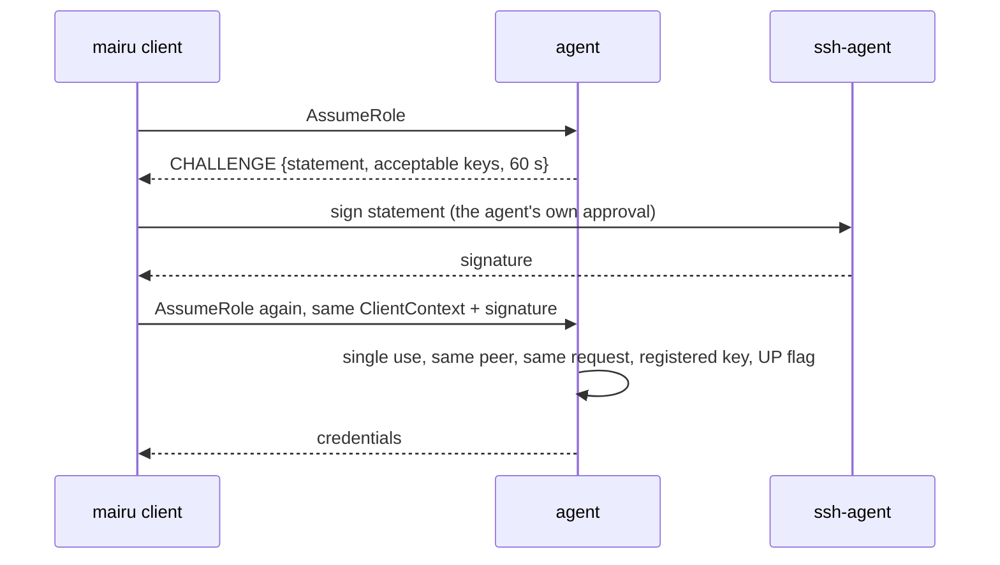
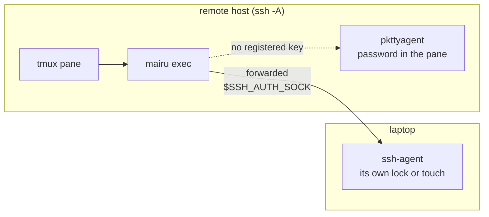

# 013-ssh-agent

## Summary

This step adds `ssh-agent`, the first key-based presence method. The agent issues a single-use challenge bound to the requesting process and the exact request. The genuine client relays it to the SSH agent at `$SSH_AUTH_SOCK`, which is usually forwarded over SSH. The agent then verifies the returned SSHSIG against public keys registered in `authorization.json`.

The lock on the key belongs to your SSH agent, not to mairu: a FIDO touch, an `ssh-add -c` confirmation, Touch ID, or nothing at all. mairu checks the only lock visible in a signature, the user-present flag of `sk-` keys. The method is platform-independent, so it works wherever the client runs, including macOS. On headless hosts it is often the only way to reach the human.

## Motivation

The reference workflow is long-lived tmux sessions on a remote host, reached over SSH ([008 Capability matrix](008-headless.md#capability-matrix)). There, the platform method has two problems:

- It may not reach the human at all. With no polkit agent, the client falls back to `pkttyagent` in the pane ([008 pkttyagent fallback](008-headless.md#pkttyagent-fallback)), and with no tty there is nothing to prompt.
- When it does, the human types a password into a tmux pane, where same-user code can capture it (`tmux pipe-pane`, or ptrace on `pkttyagent`) and replay it.

A signature over a one-time challenge cannot be replayed. It also reaches the user's local SSH agent through agent forwarding, under whatever lock that agent applies, which PAM on the remote host cannot. The challenge is bound to one requesting process and one request, so a signature approves exactly what the human was shown.

This method is also what makes approval keys possible. Once a key is registered and approved, the approval anchor ([012 Integrity records](012-policy-approval.md#integrity-records)) can name it, and a captured password no longer approves a policy change.

## Explanation



### Registering a key

Keys go into `authorization.json` ([011 Settings](011-user-policy.md#settings)) as `ssh_agent_keys[]`:

```jsonc
{
  "version": 1,
  // Default: the key-based methods with registered keys, then "platform".
  "methods": ["ssh-agent", "platform"],
  // Default: the key-based methods with registered keys; ["platform"] only when no key is registered.
  "approval_methods": ["ssh-agent"],
  "ssh_agent_keys": [
    {"key": "sk-ssh-ed25519@openssh.com AAAA... me@laptop"},
    {"key": "sk-ecdsa-sha2-nistp256@openssh.com AAAA... spare", "require_user_verification": true},
    {"key": "ecdsa-sha2-nistp256 AAAA... secretive@mac"}
  ]
}
```

- `{"key": "<OpenSSH public key line>"}` accepts any key type an SSH agent can sign with:
  - `ssh-ed25519`
  - `ecdsa-sha2-nistp256/384/521`
  - `ssh-rsa`, signed as `rsa-sha2-512`
  - `sk-ssh-ed25519@openssh.com`, `sk-ecdsa-sha2-nistp256@openssh.com`
- For `sk-` keys the signature carries a user-present flag, and mairu requires it. That flag is the only lock visible in a signature.
- Optional `"require_user_verification": true`, for `sk-` keys only, additionally requires the user-verified flag: a PIN or biometric on the key.
- `"ssh-agent"` becomes a valid name in `methods` and `approval_methods`. With keys registered, the defaults put the key-based methods first.

**The lock on a key belongs to your SSH agent, not to mairu.** mairu cannot know what an agent requires before it signs: a FIDO touch, an `ssh-add -c` confirmation, Touch ID (for example Secretive or a password manager's SSH agent), or nothing at all. Registering a key states that its use requires your approval. Choosing such a key, and configuring its agent, is your responsibility.

**Bootstrap.** Registering the first key is a policy change, so it is approved like any other with `mairu policy approve` ([012 Approval](012-policy-approval.md#approval)). Before any approval, the anchor in force is `["platform"]`, so the first registration is approved through the platform method. From then on, the anchor holds `ssh-agent` and the registered keys, and only a signature by one of them approves the next change.

`mairu policy check` warns when `"platform"` is in `approval_methods` while keys are registered: a captured password could then approve a policy that registers someone else's key ([001 Trust chain](001-security-model.md#trust-chain)).

### What the human sees

While the client waits for a signature, it prints the request context ([007 What the human sees](007-authorization.md#what-the-human-sees)), ending with:

```
:: mairu :: Authorization required: 123456789012/Admin on contoso
:: mairu ::   command: terraform apply
:: mairu ::   cwd:     /home/u/src/infra
:: mairu ::   from:    /dev/pts/3 (zsh, tmux pane)
:: mairu :: Approve the signature on your SSH agent (me@laptop) to authorize 123456789012/Admin on contoso
```

The key comment names which key the SSH agent will use. What happens next is the SSH agent's business: a touch, a confirmation dialog, or nothing.

The same relay serves every RPC that can ask the human: `AssumeRole` from `mairu exec` and `mairu credential-process`, `ApprovePolicy` from `mairu policy approve`, and `UnmarkTools` from `mairu unlock --tool`.

### Requiring the method in a policy

`context.presence.method` is `"ssh-agent"` when a signature covers the request. A policy can require it:

```cedar
// Admin: approve through the SSH agent for every new command.
// A running `mairu exec` keeps its approval.
@id("admin-ssh-agent")
permit (
  principal,
  action == Mairu::Action::"AssumeRole",
  resource == Mairu::Role::"contoso:123456789012/Admin"
) when {
  context.presence.verified &&
  ["request", "process"].contains(context.presence.scope) &&
  context.presence has method && context.presence.method == "ssh-agent"
};
```

### Headless hosts and tmux



ssh-agent presence works in every column of the headless capability matrix ([008 Capability matrix](008-headless.md#capability-matrix)):

| Capability | GUI session | SSH + tmux | No session bus | No polkitd |
|---|---|---|---|---|
| ssh-agent presence | ✓ (registered key in your agent) | ✓ (forwarded agent) | ✓ | ✓ |

A role that requires a prompt now fails closed only when no method can ask: no reachable registered key, and polkit unavailable or no tty for `pkttyagent`.

For SSH, the ssh-agent method is preferred over the platform method. It reaches your local SSH agent, under whatever lock it applies, which PAM on the remote host cannot.

**Stale sockets.** `SSH_AUTH_SOCK` in a long-lived pane points at a forwarded socket that disappears when that SSH login ends. The README recommends a stable symlink:

- `~/.ssh/rc` updates `~/.ssh/agent.sock` to the current forwarded socket on every login.
- tmux uses it: `set -g update-environment` without `SSH_AUTH_SOCK`, and `SSH_AUTH_SOCK=~/.ssh/agent.sock` in the shell.

A stale socket declines, and the agent moves on to the next method.

### `mairu lock` and `mairu doctor`

- `mairu lock`, in every form, also drops all outstanding ssh-agent challenges.
- `mairu doctor` reports:
  - whether `$SSH_AUTH_SOCK` is reachable, and which registered keys it holds
  - a warning for a stale `SSH_AUTH_SOCK`
  - in the root-reachability checks: `"platform"` in an anchored `approval_methods` while keys are registered
- `GetAgentStatusResponse.authorization_methods` ([004 GetAgentStatus](004-peer-verification.md#getagentstatus)) shows the effective order, for example `["ssh-agent", "platform"]`.

## Drawbacks

- mairu cannot see the lock on a key. A registered key held unlocked in an SSH agent proves only that the agent is reachable.
- Same-user code on the remote host can also reach the forwarded agent socket and request a signature. Only the agent's own lock stands between that code and a signature.
- An attacker who times a request to coincide with the user's own can steal one approval: the human sees one signature request and cannot tell whose it is.
- Agent forwarding has its own well-known risks on the host it is forwarded to. This method relies on it rather than removing them.
- Every new request under a policy that requires `scope == "request"` needs a signature, which some agents make tedious. Policies choose the scope.

## Considered Alternatives

- **Accept only `sk-` keys by default, with a per-key opt-in (`"presence": "unverified-confirm"`) for other key types.** Rejected on 2026-10-23. mairu cannot verify agent-side locks such as `ssh-add -c`, Touch ID agents (Secretive) or password-manager agents, so the restriction excluded strong locks that mairu simply cannot see, while the opt-in added nothing mairu could check. Any registered key type is accepted, the lock is the SSH agent's and the user's responsibility, and the user-present flag is still checked for `sk-` keys.
- **The platform method's password prompt only.** A password typed into a tmux pane can be captured and replayed by same-user code. A signature over a one-time challenge cannot be replayed, so key-based methods are preferred where a key is registered.
- **A raw signature over a nonce.** Rejected for SSHSIG with its own namespace, `co.0w0.mairu.authorize`. SSHSIG is the standard `ssh-keygen -Y` format, and the namespace keeps a signature made for another purpose, such as git commit signing, from counting as an approval.
- **A streaming RPC for the challenge.** Rejected. The challenge travels in the details of a unary RPC's `FAILED_PRECONDITION` status, and the client retries once with the same `ClientContext`. Existing unary RPCs and every client path (`exec`, `credential-process`, `policy approve`, `unlock`) keep their shape.
- **Binding only to the challenge id.** The challenge is also bound to the peer `(pid, start_time)` and to the request digest, so a signature obtained for one request or one process cannot be used by another.
- **Coalescing challenges like platform prompts.** Rejected. A signature approves one request, so challenges are per request and never shared between waiting requests.
- **Unlimited outstanding challenges.** At most 4 per peer, and expired ones are evicted, so a misbehaving client cannot grow the agent's memory.
- **Trusting the SSH agent's identity list.** The agent compares the public key in the SSHSIG with a registered key and verifies the signature itself. Nothing the client or the SSH agent says counts on its own.

## Prior Art

- OpenSSH SSHSIG (`ssh-keygen -Y sign` / `-Y verify`), used for git commit signing. The namespace field separates purposes.
- `pam_ssh_agent_auth`, which lets `sudo` authenticate through a forwarded SSH agent.
- `ssh-add -c`, which makes an OpenSSH agent confirm each use of a key.
- FIDO `sk-` keys, whose signatures carry user-present and user-verified flags.
- SSH agents with their own approval UI, such as Secretive (Secure Enclave keys behind Touch ID).

## Security and Privacy Considerations

```text
replayed or relayed signatures     ✗ single-use challenge bound to peer and request
abuse of the forwarded ssh-agent   ! the SSH agent's own lock; UP flag verified for sk- keys
password capture in tmux/tty       ✓ key-based methods preferred over the tty prompt
approval downgraded to a password  ✗ anchor holds ssh-agent + keys; check warns about "platform"
```

| Threat | Mitigation |
|---|---|
| Replayed or relayed signatures | Challenge single use, bound to peer `(pid, start_time)` and request digest, expires after 60 s; the statement names the agent instance |
| Abuse of the forwarded ssh-agent | The SSH agent's own lock (the user's choice of key; the user-present flag is verified for `sk-` keys). Challenge bound to peer + request; single use; 60 s. |
| Password capture in tmux/tty | Key-based methods preferred over the `pkttyagent` prompt ([008 pkttyagent fallback](008-headless.md#pkttyagent-fallback)) |
| Approval downgraded to a password by adding `"platform"` to `approval_methods` | The approval anchor in force decides ([012 Approval](012-policy-approval.md#approval)); `check` warns, and `doctor` lists it under root reachability |
| A signature made for another purpose (git, SSH login) | SSHSIG namespace `co.0w0.mairu.authorize` is checked |
| A client lying about which key signed | The agent verifies the SSHSIG against the registered keys only |

**Residual risk.** Same-user code can also reach the agent socket and request a signature. The only thing between that code and a signature is the agent's own lock. With an unlocked key, this method proves no more than "the agent is reachable", which is why the choice of key is yours. The challenge is bound to the requesting process and request, and one approval satisfies one pending request. An attacker who times a request to coincide with the user's own can steal one approval. This is documented.

Every guarantee here is also bounded by the trust chain ([001 Trust chain](001-security-model.md#trust-chain)). Registering a key whose use needs your approval strengthens the steps after root; it does nothing against root.

Logging: decisions are logged as before, with the method; signatures, statements and nonces are never logged.

## Mission Scope

### Out of scope

- Verifying locks that a signature does not show: `ssh-add -c`, Touch ID, or an agent's own policy.
- Removing the general risks of SSH agent forwarding.
- Other key-based methods.

### Expected Outcomes

- A request whose policy needs a fresh check is approved by a signature from a registered key, through the forwarded SSH agent, inside a tmux pane on a remote host.
- A reused `challenge_id`, a replayed signature, a signature for another request or another process, or an `sk-` signature without the user-present flag is refused with `REASON_INVALID_RESPONSE`.
- A stale `SSH_AUTH_SOCK` declines and falls back to the next method.
- After the first approval that registers a key, policy changes need a signature by an anchored key.
- `doctor` shows `SSH_AUTH_SOCK` reachability, the registered keys it holds, and the `"platform"` approval warning.

## Implementation Plan

Stack layer: `hardening/ssh-agent`.

| File | Change |
|---|---|
| `src/ssh_agent_presence.rs` | New. Agent side: challenge issue, store, expiry, verification. Client side: SSH agent protocol client and relay. |
| `src/authorization.rs` | Key-based branch of step 4; request digest; pending challenges; challenges at gate 2 |
| `proto/mairu.proto` | Challenge messages; `ClientContext.authorization_response`; `AuthorizationError.challenge` |
| `src/policy/settings.rs` | `ssh_agent_keys`, the `ssh-agent` method name, default orders, the `check` warning |
| `src/cmd/{exec,credential_process,policy,lock}.rs` | Client relay and retry on `REASON_CHALLENGE` |
| `src/cmd/doctor.rs` | `SSH_AUTH_SOCK` reachability, keys, warnings |
| `Cargo.toml` | `ssh-key`, `ssh-encoding` (behind `cli`, [002 Cargo features](002-build-layout.md#cargo-features)) |
| `README.md` | Registering a key, the lock is the agent's, tmux `SSH_AUTH_SOCK` symlink |

### Decision procedure changes

Step 4 of the decision procedure ([007 Decision procedure](007-authorization.md#decision-procedure)) gains the key-based branch. For each method `m` in the effective order that is usable for this request, the agent evaluates a fresh candidate `{verified: true, scope: "request", method: m, age: 0, idle: 0}`. When the first `Allow` is for `ssh-agent`:

- The request carries a valid `sshsig` for an outstanding challenge of that method → verify → permit.
- It carries `declined` → continue with the next method.
- Otherwise → issue a challenge for that method → `REASON_CHALLENGE`.

`ssh-agent` is usable when at least one key is registered in the effective settings. A permit records the lease and the grant exactly as a platform prompt does, with `method = "ssh-agent"`.

**Request digest.** SHA-256 over the prost encoding of `{action, server_id, rolespec, ClientContext without authorization_response}`. It binds ssh-agent challenges to the exact request, which the retry must repeat.

Concurrent requests with the same grant key still wait on one platform prompt through `crate::singleflight::Singleflight`. ssh-agent challenges are per request and are not coalesced.

**Gate 2** ([009 Gate 2](009-caller-identity.md#gate-2)). When gate 2 needs a fresh check, it now may issue a challenge, with the statement's `action` set to `"use-credentials"`. `REASON_CHALLENGE` is a refusal the client retries after, so the fetched credentials are held under `(peer, request digest)` for at most 60 s, as for every such refusal at gate 2, and the retry fetches nothing again.

`ApprovePolicy` and `UnmarkTools` use the same challenge flow with their own `action` values. `ApprovePolicy` offers only the methods and keys of the approval anchor in force ([012 Approval](012-policy-approval.md#approval)), which now records `ssh_agent_keys` (`ApprovalAnchor.ssh_agent_keys = 2`).

### Challenge and statement

```text
verify(response)
  challenge = pending.remove(id)                 # single use
  not expired; same peer (pid, start); same request digest
  sshsig namespace == "co.0w0.mairu.authorize"
  key ∈ ssh_agent_keys and key.verify(statement, sshsig)
  sk- key only: flags & UP (and & UV if required) # the one lock visible in a signature
```

**Issue.** In step 4, when keys are registered and ssh-agent is the selected method, the agent:

1. creates `AuthorizationStatement{nonce, agent_instance_id, peer pid/start_time, action, server_id, rolespec, request_digest, expires_at = now + 60 s}` and serializes it once
2. stores `PendingChallenge{statement bytes, peer, request_digest, expires_at}` under a fresh `challenge_id`, keeping at most 4 outstanding per peer and evicting expired ones
3. returns `REASON_CHALLENGE` with `AuthorizationChallenge{challenge_id, statement, key_fingerprints, expires_at}`

`agent_instance_id` is 16 random bytes chosen at agent start, so a statement from a previous agent never matches. `mairu lock` clears every `PendingChallenge`.

**Client relay** (`src/ssh_agent_presence.rs`):

1. Connect to `$SSH_AUTH_SOCK` and send `SSH_AGENTC_REQUEST_IDENTITIES`. Pick the first identity whose `SHA256:` fingerprint is in `key_fingerprints`. If there is no socket or no key, retry with `declined` (`"no-ssh-agent"` or `"no-registered-key"`).
2. Print the context ([007 What the human sees](007-authorization.md#what-the-human-sees)) with `:: mairu :: Approve the signature on your SSH agent (<key comment>) to authorize …`.
3. Build the SSHSIG signed-data blob for namespace `co.0w0.mairu.authorize`, hash `sha512`, message = `statement` bytes, and send `SSH_AGENTC_SIGN_REQUEST`. Wrap the result into a binary SSHSIG. A refused or failed signing retries with `declined = "sign-failed"`.
4. Retry once with `authorization_response{challenge_id, sshsig}` and the same `ClientContext`.

**Verification** (agent):

1. The challenge exists and is **removed** (single use).
2. It has not expired.
3. The peer `(pid, start_time)` matches.
4. `request_digest` matches the retried request.
5. The SSHSIG namespace is `co.0w0.mairu.authorize`.
6. The public key equals a registered key.
7. The signature verifies with the `ssh-key` crate (`PublicKey::verify`, which covers the key types above, including sk-ed25519 and sk-p256).
8. For `sk-*` keys, mairu **parses the flags byte itself**, because `ssh-key` does not check it: the trailer after the inner signature is `flags (u8) || counter (u32)`. It requires `UP (0x01)`, plus `UV (0x04)` when configured.

A failure at any step returns `REASON_INVALID_RESPONSE`.

### Protocol

Adds `authorization_response = 6` to `ClientContext`:

```proto
message ClientContext {
  // ... fields 1–5 as before ...
  AuthorizationResponse authorization_response = 6;
}
```

Adds `challenge = 3` to `AuthorizationError`, returned with `REASON_CHALLENGE = 6` (`FAILED_PRECONDITION`: sign `challenge` and retry). A bad, expired or replayed response is `REASON_INVALID_RESPONSE = 8` (`PERMISSION_DENIED`).

```proto
message AuthorizationError {
  // ... reason, detail, policy_ids, tools, gate, caller_arn as before ...
  AuthorizationChallenge challenge = 3;
}
```

New messages:

```proto
message AuthorizationChallenge {
  bytes challenge_id = 1;          // 16 random bytes
  bytes statement = 2;             // serialized AuthorizationStatement; signed byte-for-byte
  // Acceptable registered keys: OpenSSH "SHA256:..." fingerprints for ssh-agent.
  repeated string key_fingerprints = 3;
  google.protobuf.Timestamp expires_at = 4;
  string method = 5;               // "ssh-agent"
}

message AuthorizationStatement {
  bytes nonce = 1;                 // 32 random bytes
  bytes agent_instance_id = 2;     // 16 random bytes chosen at agent start
  uint32 peer_pid = 3;
  uint64 peer_start_time = 4;
  string action = 5;               // "assume-role" | "use-credentials" | "approve-policy" | "unmark-tools"
  string server_id = 6;
  Rolespec rolespec = 7;
  bytes request_digest = 8;        // see the request digest above
  google.protobuf.Timestamp expires_at = 9;
}

message AuthorizationResponse {
  bytes challenge_id = 1;
  oneof result {
    bytes sshsig = 2;              // binary SSHSIG blob
    string declined = 3;           // why the client could not sign: "no-ssh-agent", "no-registered-key", "sign-failed"
  }
}
```

`ApprovePolicyRequest.client_context` and `UnmarkToolsRequest.client_context` carry the response the same way.

Errors, as clients handle them:

```text
FAILED_PRECONDITION   CHALLENGE (sign, retry once)
PERMISSION_DENIED     INVALID_RESPONSE (bad, expired or replayed response)
```

### Settings

- `ssh_agent_keys[]`: objects with `key` (an OpenSSH public key line) and optional `require_user_verification` (bool, `sk-` keys only). Unknown fields are rejected, as for every settings key. A key that does not parse, or `require_user_verification` on a non-`sk-` key, fails validation.
- `"ssh-agent"` is accepted in `methods` and `approval_methods`.
- Defaults: `methods` is the key-based methods with registered keys, then `"platform"`. `approval_methods` is the key-based methods with registered keys, or `["platform"]` only when no key is registered.
- `mairu policy check` warns when `"platform"` is in `approval_methods` while keys are registered.

### Tests

- Statement serialization and request-digest stability.
- Verification with recorded SSHSIG vectors for each key type, including sk-ed25519 and sk-p256 with and without the UP and UV flags.
- Single use, expiry, peer mismatch, request-digest mismatch, wrong namespace and unregistered key, each refused with `REASON_INVALID_RESPONSE`.
- The per-peer limit of 4 outstanding challenges, and `mairu lock` clearing them.
- The client relay against an in-process SSH agent (`ssh-agent-lib` or a test double), including `declined` paths.
- Manual: `ssh -A` into the host, a tmux pane, `mairu exec`; touch the key; detach and reattach from a new SSH connection with a stale socket and see the fallback.

## Current Status

Spec drafted; awaiting review before implementation. Implementors MUST keep this section updated as they work.

### Checklist

- [ ] ssh-agent presence method: challenge issue, store and verification (`src/ssh_agent_presence.rs`)
- [ ] Key-based branch of the decision procedure; request digest; challenges at gate 2 with held credentials
- [ ] Proto: `AuthorizationChallenge`, `AuthorizationStatement`, `AuthorizationResponse`, `ClientContext.authorization_response`, `AuthorizationError.challenge`
- [ ] Client relay and retry in `exec`, `credential-process`, `policy approve`, `unlock --tool`
- [ ] Settings: `ssh_agent_keys`, `ssh-agent` method, defaults, `check` warning
- [ ] `doctor`: `SSH_AUTH_SOCK` reachability, registered keys, stale socket, approval warning
- [ ] README: registering a key, tmux `SSH_AUTH_SOCK` symlink

### Updates

- 2026-10-29: Split out of hardening.md, policy.md and platform-helper.md.
