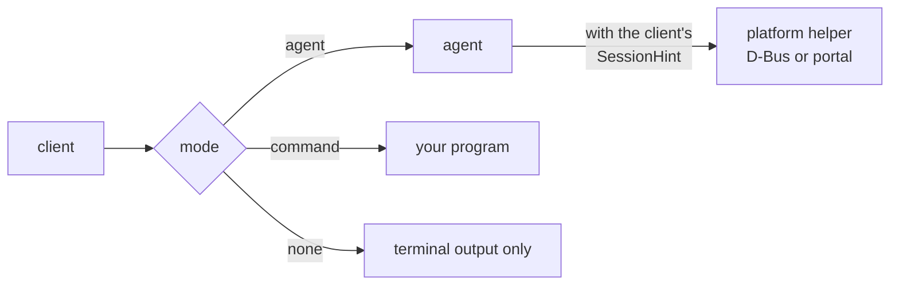
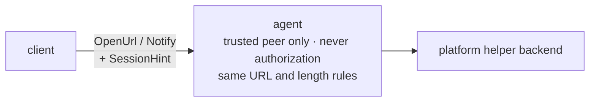

# 014-notify

## Summary

This step adds desktop notifications and opening URLs. `mairu login` opens the authorize URL in a browser, and clients notify the user of a few events: a login required while `mairu exec` serves credentials, a refused AI-agent request, and a policy lockdown.

These features carry no security weight, so each client chooses how they work from unprotected settings: `auto`, `agent`, `command` or `none`. In `agent` mode the client asks the agent, which passes the request with the client's session hint to the platform helper. The helper delivers it through D-Bus notifications or the desktop portal on Linux. In `command` mode the client runs the user's own helper program. Terminal output never depends on any of this.

## Motivation

- **Logins.** A device-code or authorization-code login today prints a URL that the user copies into a browser. On a desktop, opening it directly saves that step.
- **Events the user would otherwise miss.** A `mairu exec` sidecar that hits `UNAUTHENTICATED` keeps failing quietly in the background, and a refused AI-agent request happens in a terminal the user may not be watching. A lockdown ([012 Integrity states](012-policy-approval.md#integrity-states)) changes how every request behaves.
- **The right desktop.** The agent may have been started from an SSH login, while the user sits at a desktop session, or the other way round. Only the requesting client knows which session it runs in. Delivery therefore follows the client's choice and the client's session.
- **Headless hosts.** In tmux over SSH there is no local desktop at all. Users need to switch these features off, or point them at their own program, for example one that forwards the URL to their local machine.

D-Bus, the notification daemon and the desktop portal are session-bus services that any same-user process can claim. That code runs in the platform helper ([006 Helper process](006-platform-helper.md#helper-process)), never in the agent.

## Explanation



These carry no security weight. Nothing relies on a notification being seen or a URL being opened, and the URLs involved are not secret (PKCE and `state` protect the code flow). They are therefore chosen **per client**, from unprotected settings, and can be redirected or switched off freely. Terminal output and printed URLs never depend on these settings.

### Who emits what

Emission always happens in a client, never on the agent's own initiative, so every notification follows the client's choice.

| Event | Emitted by | Limit |
|---|---|---|
| Open the authorize URL (`verification_uri_complete` for the device code grant) | `mairu login`, including the login inside `mairu exec` | once per login |
| Login required | `mairu exec` sidecar (ECS backend and auto-refresh) when the agent returns `UNAUTHENTICATED` | once per server per 10 min |
| AI-agent request refused | The client that receives `REASON_FORBIDDEN` or `REASON_NOT_PERMITTED` whose `tools` include `ai-agent` ([010 Labels and signals](010-tool-detection.md#labels-and-signals)) | once per (server, rolespec) per minute |
| Policy lockdown | Any client whose `PingAgent` reports `POLICY_INTEGRITY_TAMPERED` (`PingAgentResponse.policy_integrity`, [012 Integrity states](012-policy-approval.md#integrity-states)) | once per agent instance |

Rate-limit state is best-effort: one file per event key under `runtime_dir()/notified/`, compared by mtime.

### Modes

```text
per feature (open_url, notify):   auto | agent | command | none
```

`open_url` and `notify` each take one of:

| Mode | Behavior |
|---|---|
| `auto` (default) | For `open_url`: `$BROWSER` in the client's environment, run in `command` mode, when it is set. Otherwise `agent`. For `notify`: `agent`. |
| `agent` | Ask the agent through the `OpenUrl`/`Notify` RPCs. The agent passes the request, with the client's `SessionHint`, to the platform helper, whose backend decides where to deliver it. The helper delivers to the client's desktop session when the hint names one, even if the agent was started elsewhere. It reports `opened`/`delivered = false`, rather than using some other session, when the hint shows SSH without a display, or no display at all. |
| `command` | Run a different helper program supplied by the user (below) |
| `none` | Disabled |

A failure in any mode is logged at debug level and otherwise ignored.

### Configuration

```text
--no-browser  >  MAIRU_OPEN_URL / MAIRU_NOTIFY (+ *_COMMAND)  >  config.json  >  auto
helper argv   open_url → command + [url]
              notify   → command + [title, body], env MAIRU_NOTIFY_{URGENCY,EVENT}
```

Precedence: command-line flag, then environment, then `config.json`, then `auto`.

- `config.json` (`UserConfig`, unprotected):

  ```jsonc
  {
    "open_url": {"mode": "command", "command": ["my-open-url"]},
    "notify": {"mode": "agent"}
  }
  ```

  `command` is an argv array, required when `mode` is `command`.
- Environment:
  - `MAIRU_OPEN_URL` / `MAIRU_NOTIFY` set the mode: `auto|agent|command|none`.
  - `MAIRU_OPEN_URL_COMMAND` / `MAIRU_NOTIFY_COMMAND` hold a shell command line, run as `/bin/sh -c '<value> "$@"' mairu <args…>`. Setting one implies `command` mode.
- Flags: `--no-browser` on `mairu login` and `mairu exec` means `open_url = none`.

The helper command interface:

- `open_url`: argv is `command + [url]`.
- `notify`: argv is `command + [title, body]`, plus the environment variables `MAIRU_NOTIFY_URGENCY` (`low|normal|critical`) and `MAIRU_NOTIFY_EVENT` (`login-required|ai-agent-denied|policy-lockdown`).
- The command is spawned through `hardening::command()`, which drops the marker gid ([003 Privileged gid](003-marker-gid.md#privileged-gid)), with stdin set to `/dev/null`. It isn't waited on for more than 5 s, and is reaped in the background.

The README gives examples: a `notify-send` wrapper, and for tmux over SSH, a script that forwards the URL to the local machine or calls `tmux display-message`.

Every mode passes on only `http`/`https` URLs, so a URL can never reach `file://` or a custom-scheme handler. Notification title and body are truncated to 256 and 1024 bytes.

### Headless hosts

These rows complete the headless capability matrix ([008 Capability matrix](008-headless.md#capability-matrix)):

| Capability | GUI session | SSH + tmux | No session bus | No polkitd |
|---|---|---|---|---|
| Notifications, `auto` mode | ✓ | ✗ (no-op) | ✗ | — |
| Open URL, `auto` mode | ✓ | ✗ (URL printed) | ✗ | — |
| Notifications / open URL, `command` mode | as configured | as configured (e.g. forward to the local machine) | as configured | as configured |

Without a desktop, both features degrade to terminal output only, and users can point them at their own helper.

### Agent RPCs



```proto
service Agent {
  rpc OpenUrl(mairu.platform.OpenUrlRequest) returns (mairu.platform.OpenUrlResponse);
  rpc Notify(mairu.platform.NotifyRequest) returns (mairu.platform.NotifyResponse);
}
```

Both need only a trusted peer ([004 Agent side](004-peer-verification.md#agent-side)), never authorization. The agent applies the URL and length rules before forwarding to the helper, which applies them again.

`mairu doctor` shows the `notifications` and `open_url` capabilities with their notes, for example "session bus unreachable", and the mode each feature resolves to for the calling client.

## Drawbacks

- In `agent` mode the helper talks to whichever process owns the notification name or the portal on the session bus. Any same-user process can claim them and see notification text and URLs. They contain no secrets, which is why this is acceptable.
- The session hint is requester-chosen. A same-user process can make the agent open a URL or post a notification on the user's desktop through the RPCs. It could do so directly anyway.
- Rate-limit state is best-effort files; a cleared runtime directory repeats a notification.
- On headless hosts, nothing is delivered unless the user configures `command` mode.

## Considered Alternatives

- **The agent emits notifications on its own** (login required while serving credentials, policy tampered, AI-agent request denied), rate-limited in the agent. Rejected on 2026-10-23. The agent may run in a different session from the user, and one agent serves many clients with different preferences. Emission moved to the clients, and every notification follows the requesting client's mode and session.
- **A fixed backend chosen by the agent's environment**, such as disabling URL opening when `SSH_CONNECTION` is set or no graphical session exists in the agent. Rejected for the client's `SessionHint`: delivery follows the client's own session, and `agent` mode reports `false` rather than using another session.
- **Many modes, with per-backend settings.** Reduced on 2026-10-23 to `auto|agent|command|none` plus the session hint. `command` mode covers every special case with the user's own program.
- **D-Bus and portal code in the agent.** Rejected. Platform services always run in the platform helper ([006 Helper process](006-platform-helper.md#helper-process)), which holds no tokens.
- **Protected settings for these features.** Rejected. They carry no security weight, so they live in the unprotected `config.json`, environment and flags, and can be redirected or switched off freely.
- **Honoring any URL scheme.** Rejected. Only `http`/`https` pass, so nothing reaches `file://` or a custom-scheme handler.
- **`$BROWSER` ignored.** `auto` honors it for `open_url` when the client's environment sets it, which matches the convention other CLIs follow.
- **Agent-initiated login with browser opening.** Out of scope: logins stay client-initiated.

## Prior Art

- The `$BROWSER` environment variable, honored by many CLIs that open URLs.
- `xdg-open` and the XDG desktop portal's `OpenURI` interface.
- `org.freedesktop.Notifications` and `notify-send`.
- `--no-browser` flags on CLIs with browser-based logins, such as `aws sso login --no-browser`.

## Security and Privacy Considerations

```text
spoofed notifications / URLs     · no security weight by design
session-bus input in the helper  ! accepted: typed proxies, untrusted replies, minimal code
custom-scheme or file:// URLs    ✗ http/https only, checked by the agent and again by the helper
marker gid leaking to helpers    ✗ hardening::command() drops it before exec
```

| Threat | Mitigation |
|---|---|
| Spoofed, redirected or suppressed notifications and URL opening | Not relied on for security; unprotected client settings by design. Helpers run with the marker dropped and receive only `http`/`https` URLs. |
| Session-bus input (notification daemon, desktop portal) reaching the same helper that answers `Authorize` and the integrity stores | Accepted: one helper process by design. Session-bus replies are handled through typed zbus proxies and treated as untrusted. A bug there could forge helper answers, so that code is kept minimal and reviewed as security-sensitive. |
| A hint pointing the helper at a bus that same-user code controls, to attack the process that also answers `Authorize` | The default session bus is already claimable by same-user code ([006](006-platform-helper.md)), so the hint adds no new peer. The helper treats every session-bus reply as untrusted input, and its D-Bus client runs only for `notify` and `open_url`. |
| A hint pointing the helper at an arbitrary socket or a TCP address | `dbus_session_bus_address` is honored only as `unix:path=` under the user's `$XDG_RUNTIME_DIR` |
| A URL reaching a custom-scheme handler or a local file | Only `http`/`https`, checked by the agent and again by the helper |
| Oversized notification content | Title and body truncated to 256 and 1024 bytes |

Notification text and URLs never contain credentials, tokens or authorization codes. The authorize URL carries only the public parts of the flow.

## Mission Scope

### Out of scope

- Agent-initiated login with browser opening.
- Notification actions or click handling.
- Delivering to a session other than the one the client's hint names.
- Platform backends beyond Linux and the fallback (below).

### Expected Outcomes

- `mairu login` on a desktop opens the authorize URL in the browser of the client's session. `--no-browser`, `MAIRU_OPEN_URL=none` or `open_url.mode = "none"` turn it off.
- A `mairu exec` whose server needs a login posts "login required" at most once per server per 10 min.
- A refused AI-agent request and a lockdown each post one notification within their limits.
- In tmux over SSH, `auto` reports `false` and the terminal output stays; `command` mode runs the user's program.
- With no session bus or notification daemon, `doctor` reports `notifications = false`, and calls are no-ops.

## Implementation Plan

Stack layer: `hardening/notify`.

| File | Change |
|---|---|
| `src/convenience.rs` | New. Mode resolution (`auto|agent|command|none`), helper commands, rate limits, event emission helpers |
| `src/config.rs` | `UserConfig.open_url`, `UserConfig.notify` |
| `src/platform/services/linux/notify.rs` | New. D-Bus notifications backend in the helper |
| `src/platform/services/linux/open_url.rs` | New. Portal and `xdg-open` backend in the helper |
| `proto/mairu.proto` | `OpenUrl`, `Notify` RPCs on `Agent` |
| `src/agent.rs` | `OpenUrl`/`Notify` handlers: trusted peer, URL and length rules, forward to the helper |
| `src/cmd/login.rs`, `src/cmd/exec.rs` | `--no-browser`; open the authorize URL; event emission in the sidecar and on refusals |
| `src/cmd/doctor.rs` | Capabilities, resolved modes |
| `README.md` | Modes, configuration, helper examples (`notify-send` wrapper, URL forwarding over SSH, `tmux display-message`) |

### Platform helper messages

The helper service already carries `Notify` and `OpenUrl`, with the client's `SessionHint`, `NotifyRequest.event` and `NotifyRequest.urgency` ([006 Protocol](006-platform-helper.md#protocol)). Until this step only the fallback services answered them. This step adds the Linux backends and the agent RPCs that forward to them. `Capabilities.notifications` and `Capabilities.open_url` report what the backends can do right now.

### Backends (in the platform helper)

| Feature | Backend | Otherwise |
|---|---|---|
| `notify` | `org.freedesktop.Notifications` on the session bus | a no-op without a session bus or notification daemon |
| `open_url` (`http`/`https` only) | the desktop portal's `OpenURI` | `xdg-open` when the portal fails |

- **Session hint.** The client fills `SessionHint` from its own environment, and the agent passes it through unchanged. The values are requester-chosen, which is acceptable because these features carry no security weight. The helper honors `dbus_session_bus_address` only as `unix:path=` under the user's `$XDG_RUNTIME_DIR`, so a hint cannot point it at an arbitrary socket or a TCP address.
- **Linux notifications**:
  - `org.freedesktop.Notifications.Notify` on the session bus (`app_name = "mairu"`, urgency hint).
  - The address comes from the hint's `dbus_session_bus_address` when honored, otherwise the helper's `DBUS_SESSION_BUS_ADDRESS`, falling back to `unix:path=$XDG_RUNTIME_DIR/bus` when that exists.
  - Headless (no bus, or no notification daemon): `notifications = false`, and calls are no-ops.
- **Linux open URL**: `org.freedesktop.portal.OpenURI.OpenURI("", url, {})` on that bus, falling back to `xdg-open` via `hardening::command()` with `DISPLAY`/`WAYLAND_DISPLAY` from the hint. A `PATH` lookup is acceptable here.
- **Other platforms** keep the fallback services: `/usr/bin/open` on macOS, otherwise unavailable.

The helper applies the `http`/`https` rule and the 256/1024-byte truncation again, whatever the agent did.

### Client side

- `src/convenience.rs` resolves each feature's mode with the precedence above, once per client process.
- `command` mode runs the program through `hardening::command()`, stdin `/dev/null`, waits at most 5 s, and reaps it in the background.
- `agent` mode calls the RPC with a `SessionHint` built from `DISPLAY`, `WAYLAND_DISPLAY`, `DBUS_SESSION_BUS_ADDRESS`, and whether `SSH_CONNECTION` or `SSH_TTY` is set.
- Events are emitted where they happen: `mairu login` (authorize URL), the exec sidecar (`UNAUTHENTICATED`), any client receiving a refusal with `tools ∋ ai-agent`, and any client whose `PingAgent` reports `POLICY_INTEGRITY_TAMPERED`.
- Rate limits: one file per event key under `runtime_dir()/notified/`, compared by mtime.

### Tests

- Mode resolution and precedence, including `*_COMMAND` implying `command` mode and `--no-browser`.
- URL scheme filtering and truncation, in the agent and in the helper.
- `SessionHint` address validation: only `unix:path=` under `$XDG_RUNTIME_DIR`.
- Rate limiting with a temporary runtime directory.
- The D-Bus backend against a test session bus (`dbus-daemon --session`) with a stub notification server; absent daemon → `notifications = false`.

## Current Status

Implemented on `hardening/notify`. Verified in Docker against a fake notification daemon and desktop portal on test session buses; a real desktop session (GNOME/KDE portal, a real notification daemon, a browser) was not available. Implementors MUST keep this section updated as they work.

### Checklist

- [x] Notifications and open-url: helper backends, `SessionHint`, client-chosen modes (`auto|agent|command|none`), agent `OpenUrl`/`Notify` RPCs
- [x] `UserConfig.open_url`, `UserConfig.notify`; environment variables; `--no-browser`
- [x] Event emission: authorize URL, login required, AI-agent request refused, policy lockdown; rate limits
- [x] Headless no-op behavior and `doctor` reporting
- [x] README: modes and helper examples

### Updates

- 2026-10-29: Split out of hardening.md, policy.md and platform-helper.md.
- 2026-10-31: Implemented. Decisions and deviations:
  - Proto: `GetCapabilitiesRequest` gains `SessionHint session = 1` and `GetAgentStatusRequest` gains `mairu.platform.SessionHint session = 2`, so `notifications`/`open_url` describe the calling client's session as `doctor` needs. `PlatformServices::capabilities` takes the request. Without a hint the helper does not touch the session bus and reports both as false; the agent's own capability checks (authorization) pass none.
  - The URL rule, truncation (at a UTF-8 boundary) and the display rule live on the proto types (`OpenUrlRequest::checked_url`, `NotifyRequest::truncate`, `SessionHint::refusal`) and are applied by the client, the agent and the helper. The display rule ("SSH without a display, or no display at all") applies to both features: a hint without `DISPLAY` and `WAYLAND_DISPLAY` gets `false` and no session-bus traffic.
  - Hint validation (`src/platform/services/session_bus.rs`): only `unix:path=<p>` (optionally with `guid=`), no `%` escapes and no `;`, where the canonical `<p>` lies under the canonical `$XDG_RUNTIME_DIR` and is a socket owned by the helper's uid. A refused hint falls back to the default bus, with an info line in the agent log and a doctor note ("ignored the client's session bus address ..."). The default bus is that of the Secret Service store (012), moved into the same module: `$DBUS_SESSION_BUS_ADDRESS` on an unhardened helper, otherwise `$XDG_RUNTIME_DIR/bus`.
  - Capabilities count a notification daemon or portal that is running or D-Bus activatable (`ListActivatableNames`), without activating it; `open_url` is also true when `xdg-open` is on `PATH`. `xdg-open` counts as opened when it exits 0 or is still running after 5 s (then reaped in the background), and gets `DISPLAY`/`WAYLAND_DISPLAY` from the hint (only `[A-Za-z0-9.:/_-]`, at most 256 bytes) and the bus address in use.
  - Mode resolution (`src/convenience.rs`): an explicit `MAIRU_OPEN_URL`/`MAIRU_NOTIFY` wins over the matching `*_COMMAND`; `MAIRU_*=command` without `*_COMMAND` uses `config.json`'s `command`; `command` mode without a command disables the feature; an invalid environment value is ignored with a warning. `$BROWSER` is run like a `*_COMMAND` line (no colon-separated list or `%s`). Helper programs get stdin and stdout on `/dev/null` and keep stderr.
  - Rate limits record only notifications that were delivered, so a client over SSH (whose `agent` mode reports `false`) does not hold back the next client on the desktop. File names are `<event>-<first 8 bytes of SHA-256 of the key, hex>`; "once per agent instance" is keyed to the agent's pid and its socket's mtime.
  - The authorize URL is opened in a background task, so a login never waits for it. Refusals are checked in `assume_role_with_notice`/`assume_role_quietly` (every `exec`, sidecar and `credential-process` path) and in the sidecar's auto-refresh; login required in the ECS backend's error feedback and the auto-refresh. An unverified agent is never asked.
  - Notification bodies are sent as plain text; no markup escaping.
  - Tests: unit tests cover mode precedence, URL and truncation rules, hint validation, rate limits with injected times, command execution, and the D-Bus backend against a private `dbus-daemon` with an in-process stub `org.freedesktop.Notifications` (skipped when `dbus-daemon` is not installed). Verified in Docker as root (debian:trixie, scenario `014-notify`, 66 checks): the portal and `xdg-open` fallback (marker gid dropped), `--no-browser`/`none`/command/`$BROWSER`/`*_COMMAND`, SSH and no-display no-ops with the URL still printed, X forwarding over SSH opening, login required once per server per 10 min, AI-agent refusals once per (server, role) per minute and not for humans, notify command mode arguments and environment, refused hints (root-owned socket, regular file, a bus outside the runtime dir, `tcp:`) falling back to the default bus, `doctor` capabilities/notes/modes, a user without a session bus, and lockdown once per agent instance. Earlier scenarios 003–013 still pass.
