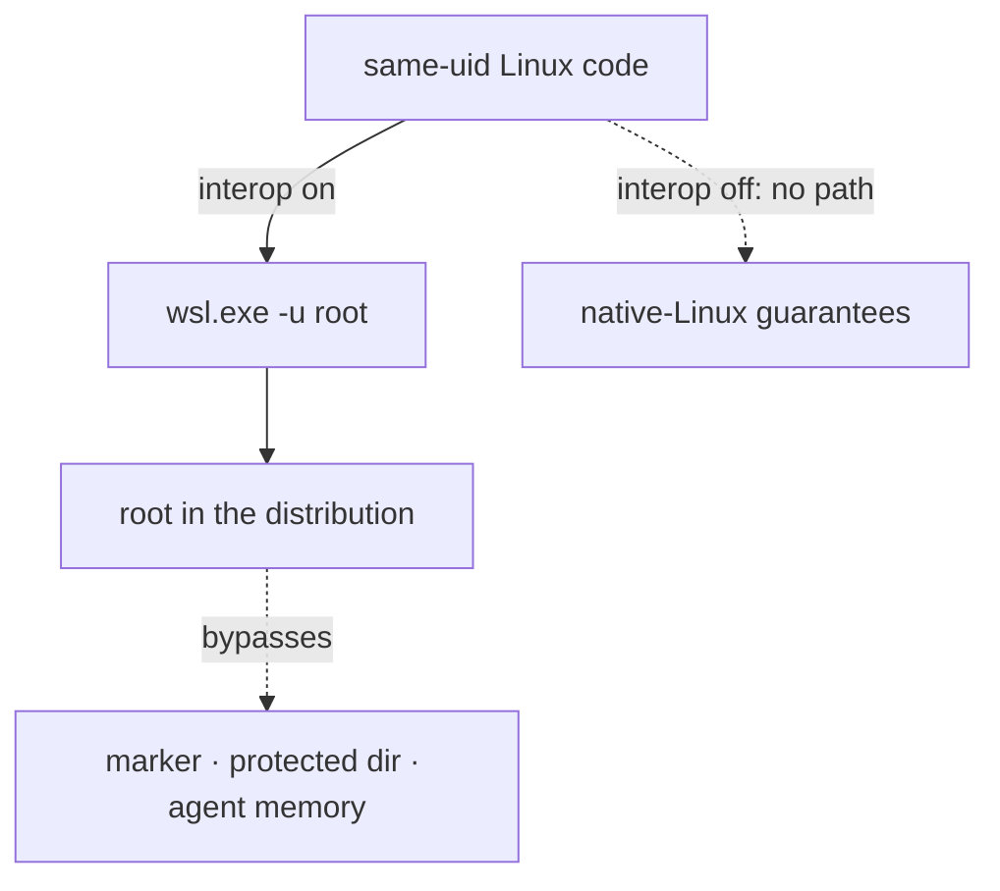

# 015-wsl2

## Summary

This step makes WSL2 a first-class variant of Linux. WSL2 runs a real Linux kernel in a lightweight VM, so everything in the earlier specs applies inside a distribution unchanged. Two things differ: Windows interop, and what the Windows side offers (its browser, its SSH agent).

The agent detects WSL2 and whether interop is enabled, reports it in `context.wsl_interop`, `GetAgentStatus` notes and `mairu doctor`, and lets a policy refuse sensitive roles while interop is on. With interop on, same-user Linux code can become root through `wsl.exe -u root`, so mairu is a guardrail there. With interop off, a distribution keeps native-Linux strength against code inside it. The platform helper opens URLs in the Windows default browser when interop is on.

## Motivation

WSL2 is a common way to run Linux tooling on Windows, including AI coding agents. Users there want the same protection as on Linux, and need to know where it stops.



### Interop makes root reachable

| Same-uid code | Runs | Result (confirmed) |
|---|---|---|
| inside the distribution, interop on | `/mnt/c/…/wsl.exe -u root` | uid 0, no prompt |
| inside the distribution, interop off | `wsl.exe` | fails: the host refuses the interop socket |
| outside: any Windows process of the user, or any distribution with interop on | `wsl.exe -d <distro> -u root` | uid 0, whatever the distribution's interop setting |

Confirmed on Windows 11 25H2 (build 26200), WSL 3.0.3, with Ubuntu 26.04 (Q-W1):

- **Inside a distribution with interop on**, a normal user runs `/mnt/c/Windows/System32/wsl.exe -u root -e id` and gets `uid=0` with no prompt. It can, for example, read `/etc/shadow`.
- **Inside a distribution with interop off**, `wsl.exe` fails (`UtilAcceptVsock … accept4 failed 110`), and so does every bypass tried: running `/init` directly, or setting `WSL_INTEROP` by hand. The host enforces it; the `WSLInterop` binfmt entry still reads "enabled", because binfmt_misc is shared across the VM.
- **From outside**, any non-elevated Windows process of the user can run `wsl.exe -d <distro> -u root` and get root in any distribution, whatever its interop setting. So can a process in any *other* distribution that has interop on.

So with interop on, same-user Linux code can become root and bypass the marker group, the protected directory and the agent's memory protection ([001 Trust chain](001-security-model.md#trust-chain)). mairu still runs hardened in this mode, reports `context.wsl_interop = true`, and `harden` and `doctor` warn.

Turning interop off protects a distribution only against processes **inside** it. The Windows user session, and every other distribution with interop on, remain root-equivalent over it. Like root, they are outside the threat model: on WSL2 the Windows account sits at the top of the trust chain. `doctor` states this limit on every WSL2 host. From inside an interop-off distribution it cannot list the other distributions, because doing so needs interop.

Users therefore need to see which situation they are in, to choose between convenience and strength, and to write policy that depends on it.

## Explanation

### Profiles

```text
integrated (interop on)    convenient: Windows browser, Windows SSH agent relay · guardrail only
isolated   (interop off)   ssh -A from Windows into the distro · native-Linux strength
```

| | Integrated (interop on, the WSL default) | Isolated (interop off) |
|---|---|---|
| Root reachable by same-user Linux code | Yes, through `wsl.exe -u root` | Not from inside this distribution. From Windows-side processes and from other distributions with interop on: yes |
| Strength | A guardrail against over-eager tools such as AI agents, and against accidents. Not a boundary against malicious code. | As native Linux ([001 Trust chain](001-security-model.md#trust-chain)) against code inside the distribution. Code running as the Windows user, or in another distribution with interop on, is out of scope. |
| Presence methods | `ssh-agent` ([013](013-ssh-agent.md)) through a relay of the Windows OpenSSH agent (npiperelay + socat, or `wsl2-ssh-agent`). `platform` through `pkttyagent` ([008 pkttyagent fallback](008-headless.md#pkttyagent-fallback)). | `ssh-agent`, by SSHing into the distribution from Windows with `ssh -A`. This is the headless reference workflow ([008 Capability matrix](008-headless.md#capability-matrix)). The key is whatever the Windows SSH agent holds: a hardware security key works. A Windows SSH agent that asks for Windows Hello before each signature works too. mairu sees an ordinary signature and cannot verify that Windows Hello was asked; as with any registered key, that lock is the agent's ([013](013-ssh-agent.md)). `platform` through `pkttyagent`. |
| `open_url` in `auto` mode | The Windows default browser, through `rundll32.exe url.dll,FileProtocolHandler <url>` | URL printed, or `command` mode |
| `notify` in `auto` mode | None: WSLg has no notification daemon. Use `command` mode with a Windows toast helper. | None |
| Secret Service | Usually absent | Usually absent |

**Disabling interop.** Write `/etc/wsl.conf` and then restart the distribution from Windows (`wsl.exe --terminate <distro>`). Turning it back on requires root inside the distribution, or Windows-side access.

```ini
[interop]
enabled = false
appendWindowsPath = false
```

WSL1 translates system calls instead of running a Linux kernel, and is not supported for hardening. On WSL1, `doctor` reports `HARDENING_STATE_MISCONFIGURED`.

### Policy

`context.wsl_interop` is present only on WSL2, and is `true` while Windows interop is enabled. It is determined by the agent, so a policy may rely on it to grant or refuse. It lets a policy refuse sensitive roles while interop is on:

```cedar
@id("no-prod-with-interop")
forbid (principal, action, resource in Mairu::Account::"999999999999")
when { context has wsl_interop && context.wsl_interop };
```

The attribute is optional, so policies test it with `has`, as strict validation requires.

### Opening URLs and notifications

| | Integrated (interop on) | Isolated (interop off) |
|---|---|---|
| `open_url` | `rundll32.exe url.dll,FileProtocolHandler`, `explorer.exe` as fallback | printed |
| `notify` | `command` mode with a Windows toast helper | terminal only |
| authorization | ssh-agent relay, `pkttyagent` | `ssh -A` from Windows |

The modes of [014 Modes](014-notify.md#modes) apply unchanged. Inside a WSL2 distribution, measured on Windows 11 25H2 with WSLg 1.0.79 (Q-W5):

- **What WSLg provides.** `DISPLAY=:0`, `WAYLAND_DISPLAY=wayland-0` and a session bus. It provides no Linux browser, no `xdg-open`, and no `org.freedesktop.Notifications` owner, and `wslview` (wslu) is not installed by default. WSLg's display variables therefore never select a Linux-side backend.
- **`open_url`.** With interop on, `agent` mode opens the URL in the Windows default browser. WSL forwards localhost, so a loopback OAuth redirect listener in WSL is reachable from the Windows browser.
- **`notify`.** The helper has no WSL2 notification backend: the D-Bus backend applies only when `org.freedesktop.Notifications` has an owner, and WSLg provides none. `agent` mode reports `delivered = false`, and terminal output always remains. `command` mode with a Windows toast helper is the documented option.
- **`$BROWSER`.** When the client's environment sets it, `auto` honors it for `open_url`, which also covers users who installed `wslview`.
- **Isolated profile (interop off).** URLs are printed and notifications stay on the terminal.
- **Authorization facility.** WSL2 normally has no polkit agent, so the `pkttyagent` fallback applies. The key-based methods are preferred.
- **Integrity stores.** Secret Service is usually absent, so hardened distributions rely on the protected directory alone ([012 Integrity stores](012-policy-approval.md#integrity-stores)).

### `doctor` and `harden`

```text
doctor   WSL version · interop · profile · relayed agent
harden   proceeds, warns about interop
policy   forbid … when { context has wsl_interop && context.wsl_interop }
sudo     pam_wsl_hello closes the sudo row of the trust chain, not the interop row
```

- **`doctor`** reports:
  - the WSL version, interop state and profile in effect
  - whether a relayed Windows OpenSSH agent is reachable
  - under root reachability: WSL2 interop
  - on every WSL2 host, the limit above: the Windows account and other distributions with interop on are root-equivalent over this one
- **`harden`** on WSL2 with interop enabled proceeds, but prints the root-reachability warning and how to disable interop.
- **`GetAgentStatus`** capability notes carry the same facts.
- **`sudo`.** `pam_wsl_hello` (WSL-Hello-sudo) backs `sudo` with Windows Hello, which addresses the `sudo` row of the trust chain ([001 Trust chain](001-security-model.md#trust-chain)). It cannot close the interop row. The README recommends it.

## Drawbacks

- In the integrated profile, which is the WSL default, mairu is only a guardrail. Users may read "hardened" as more than that, which is why `harden` and `doctor` say otherwise on every WSL2 host.
- The isolated profile gives up the Windows browser and Windows interop for the whole distribution, not only for mairu.
- Even the isolated profile cannot protect against the Windows account or other distributions with interop on, and from inside it mairu cannot list those distributions to warn about them.
- `wsl_interop` is read at request time from a file the host controls. A change of interop takes a distribution restart, so this is accurate in practice, but the agent does not watch for it.

## Considered Alternatives

- **Support WSL1.** Rejected. WSL1 translates system calls instead of running a Linux kernel, so the kernel mechanisms the marker gid and peer verification rely on are not there. `doctor` reports `HARDENING_STATE_MISCONFIGURED`.
- **Refuse to run hardened while interop is on.** Rejected. The integrated profile still stops over-eager tools and accidents, which is what most WSL users want from it. mairu runs hardened, reports `context.wsl_interop = true`, warns in `harden` and `doctor`, and lets the policy refuse sensitive roles.
- **Have `harden` disable interop.** Rejected. It changes the whole distribution, needs a restart from Windows, and is the user's choice. `harden` prints how.
- **Opening URLs:**
  - `rundll32.exe url.dll,FileProtocolHandler <url>`: chosen. It exits 0 on success.
  - `explorer.exe <url>`: the fallback only, because its exit status is 1 even on success.
  - `cmd.exe /c start`: rejected, because it mangles `&` in URLs.
  - `wslview` (wslu): not installed by default; `$BROWSER` covers users who have it.
  - WSLg's display: rejected, because WSLg provides no Linux browser (Q-W5).
- **A Windows notification backend in the helper.** Rejected for now. It would need a Windows-side program, and these notifications carry no security weight. `command` mode with a Windows toast helper is documented instead.
- **Helper-held keys for the integrated profile** (evaluated 2026-10-29): encrypting the agent's session tokens with a key held on the Windows side, so that root in the distribution cannot read them. Rejected as a way to close the gap:
  - Root reached through interop is also the Windows user: interop children run as the active Windows user with the same rights. It can ask the same Windows-side key holder the agent asks, or call DPAPI or Windows Hello itself.
  - No Windows primitive tells the agent's interop child from root's. DPAPI, DPAPI-NG and non-exportable TPM keys work silently for any process of the user. Windows Hello key credentials need a gesture per use, but any process of the user can request one.
  - Root can also read the plaintext from the agent's memory whenever the agent uses it (`CAP_SYS_PTRACE` overrides non-dumpable).
  - The one variant with a defensible cost is a Windows Hello gesture for every unwrap of a refresh token. It turns a grab at any moment into waiting for the human's next gesture, and costs about one extra prompt per hour per server. It would be a guardrail, not a boundary, and is not planned. The isolated profile stays the answer for strong guarantees.
- **Isolated profile presence.** The isolated profile reaches the human with `ssh -A` from Windows into the distribution, the same as the headless reference workflow. The Windows OpenSSH agent's own lock, including one that asks for Windows Hello, protects the key.

## Prior Art

- WSL-Hello-sudo (`pam_wsl_hello`), which backs `sudo` with Windows Hello inside WSL.
- npiperelay with socat, and `wsl2-ssh-agent`, which relay the Windows OpenSSH agent into WSL.
- wslu's `wslview`, which opens URLs in the Windows browser.

## Security and Privacy Considerations

```text
root via sudo / groups / WSL       ! out of scope, bounds everything; doctor warns
root via interop (wsl.exe -u root) ! guardrail only; context.wsl_interop lets policy forbid
interop off                        ✓ native-Linux strength against code inside the distribution
Windows account / other distros    ! root-equivalent over this one; outside the threat model
```

| Threat | Mitigation |
|---|---|
| Root reached through WSL2 interop (`wsl.exe -u root`) | Isolated profile, or `context.wsl_interop` forbids; `doctor` and `harden` warn |
| Root reached from the Windows side or another distribution with interop on | Outside the threat model, like root; `doctor` states the limit on every WSL2 host |
| URL injection into a Windows command line | The URL is passed as its own argv element to `rundll32.exe` or `explorer.exe`, never through `cmd.exe /c start`; `http`/`https` only ([014 Modes](014-notify.md#modes)) |
| A replaced `rundll32.exe`/`explorer.exe` path | Located through `wslpath`; carries no security weight, like every `open_url` backend |

Every guarantee in the earlier specs is bounded by the trust chain. On WSL2 with interop on, the interop row dominates.

## Mission Scope

### Out of scope

- WSL1 hardening.
- Protection against the Windows account and other distributions, which are root-equivalent over a distribution.
- A Windows notification backend.
- Disabling interop on the user's behalf.

### Expected Outcomes

- On WSL2 with interop on, `doctor` reports WSL2, interop enabled and the integrated profile, with the root-reachability warning. `harden` proceeds and warns.
- With interop off, `doctor` reports the isolated profile and the limit about the Windows side.
- A policy forbidding a role `when { context has wsl_interop && context.wsl_interop }` refuses it with interop on, and does not apply on other Linux hosts.
- `mairu login` in `auto` mode opens the authorize URL in the Windows default browser with interop on, and the loopback redirect completes.
- On WSL1, `doctor` reports `HARDENING_STATE_MISCONFIGURED`.

## Implementation Plan

Stack layer: `hardening/wsl2`.

| File | Change |
|---|---|
| `src/platform/process/linux/wsl.rs` | New. Detection of WSL2, WSL1 and interop |
| `src/platform/services/linux/wsl.rs` | New. Windows-side `open_url` backend in the helper |
| `src/policy/mairu.cedarschema` | `wsl_interop?: Bool` in the context |
| `src/authorization.rs` | Fill `context.wsl_interop` |
| `src/agent.rs` | `GetAgentStatus` capability notes |
| `src/cmd/doctor.rs` | WSL version, interop, profile, relayed agent, root reachability, the Windows-side limit |
| `src/cmd/harden.rs` | Interop warning and how to disable it |
| `README.md` | WSL2 guide: profiles, disabling interop, relaying the Windows SSH agent, `pam_wsl_hello`, a Windows toast helper in `command` mode |

### Detection

The agent detects these facts, and reports them through `context.wsl_interop`, the `GetAgentStatus` notes and `doctor`:

- **WSL2**: `/proc/sys/kernel/osrelease` contains `microsoft-standard-WSL2`, and `/run/WSL` exists.
- **Interop enabled**: `/proc/sys/fs/binfmt_misc/WSLInterop` (or `WSLInterop-late`) exists, and its first line is `enabled`.
- **WSL1**: the kernel release names Microsoft without `microsoft-standard-WSL2`. The classification reports `HARDENING_STATE_MISCONFIGURED` there.

These facts are agent-determined and feed `context.wsl_interop`, `GetAgentStatus` capability notes and `doctor`.

**Implementation check.** Q-W1 found that the `WSLInterop` binfmt entry still reads "enabled" inside an interop-off distribution, because binfmt_misc is shared across the VM. The binfmt rule above can therefore report interop on where it is off, which errs on the strict side for policy but misreports the profile. Before this layer lands, confirm on a WSL2 host which signal tells the two apart (for example `[interop] enabled` in `/etc/wsl.conf`, or whether the interop socket accepts a connection), and record it here.

### Cedar schema

Added to the context of `AssumeRole` and `UseCredentials`:

```text
// Present only on WSL2: whether Windows interop is enabled, which makes root reachable.
wsl_interop?: Bool,
```

Reference row:

| Attribute | Values | Source |
|---|---|---|
| `wsl_interop` | present only on WSL2 | agent |

`wsl_interop` joins the agent-determined attributes, which may be used to grant ([007 Cedar schema](007-authorization.md#cedar-schema)). It is optional, so approved policies stay valid across the upgrade.

### Windows-side `open_url` backend

With interop on, the helper's backend opens the URL in the Windows default browser:

1. `rundll32.exe url.dll,FileProtocolHandler <url>`, which exits 0 on success.
2. `explorer.exe <url>` as the fallback. Its exit status is 1 even on success, so it is ignored.

- Both are located through `wslpath` and started via `hardening::command()`.
- The URL is passed as its own argv element, never through `cmd.exe /c start`, which mangles `&`.
- The helper runs in the same distribution as the agent, so it has interop whenever the agent does.
- WSLg's `DISPLAY` and `WAYLAND_DISPLAY` never select a Linux-side backend.
- `Capabilities.open_url` is true with interop on. `Capabilities.notifications` stays false unless a notification daemon owns the name.

### Open questions (settled on a WSL2 host)

```text
Q-W1 root via interop (confirmed)   Q-W5 WSLg and auto modes (settled)
```

- **Q-W1** (confirmed): `wsl.exe -u root` started from inside a WSL2 session obtains root without authentication. Interop off blocks this only from inside, never from outside (see Motivation).
- **Q-W5** (settled): WSLg sets `DISPLAY=:0` and `WAYLAND_DISPLAY=wayland-0`, and the session bus exists. But the Linux side has no browser, no `xdg-open`, no notification daemon, and no `wslview` by default. `auto` therefore ignores WSLg.

### Tests

- Detection from fixture files for osrelease, `/run/WSL` and the binfmt entries (`WSLInterop`, `WSLInterop-late`, enabled and disabled), and a WSL1 release string.
- Context building with and without `wsl_interop`; the example policy validates strictly and applies only when present and true.
- The Windows-side backend's argv: the URL as one element, `rundll32.exe` first, `explorer.exe` fallback ignoring its exit status.
- Manual, on a Windows host: integrated and isolated profiles, `doctor` output, `harden` warning, browser login through the loopback redirect.

The WSL2 parts can be built and unit-tested on Linux. Verifying them end to end needs a Windows host with WSL2.

## Current Status

Implemented on `hardening/wsl2`, verified on Linux with faked WSL markers; checking on a real WSL2 host is pending (see Updates). Implementors MUST keep this section updated as they work.

### Checklist

- [x] Detection and `context.wsl_interop`
- [ ] Confirm on a WSL2 host a signal that tells an interop-off distribution apart despite the shared binfmt entry (see Detection). Implemented with `/etc/wsl.conf` and the distribution's start time (see Updates); still to be confirmed on a host.
- [x] WSL1 reported as `HARDENING_STATE_MISCONFIGURED`
- [x] `doctor` and `harden` warnings; `GetAgentStatus` notes
- [x] WSL2: Windows-side `open_url` (Q-W5 settled)
- [x] README WSL2 guide
- [x] Settle Q-W1 and Q-W5 on a WSL2 host

### Updates

- 2026-10-29: Split out of hardening.md, policy.md and platform-helper.md.
- 2026-10-31: Implemented.
  - Detection (`src/platform/process/linux/wsl.rs`) is a pure classification over the osrelease, `/run/WSL`, the `WSLInterop`/`WSLInterop-late` entries, `/etc/wsl.conf` and whether its mtime predates the start of pid 1 (the distribution's init), read on every request. Interop counts as off when no entry reads `enabled`, or when `/etc/wsl.conf` has `[interop] enabled = false` and was last modified before pid 1 started. A `wsl.conf` changed after the start still counts as on, the strict side for policy, and `doctor` says a restart is pending. Whether this is the signal that tells an interop-off distribution apart (Implementation check) still needs a WSL2 host, as does whether pid 1's start time is the distribution's start with and without systemd.
  - `context.wsl_interop` comes from `ProcessPlatform::wsl_interop()`, so the authorizer's tests fake it. `mairu policy explain` uses the value detected locally and shows it in its header.
  - The WSL facts are part of the process platform's notes: `GetAgentStatus` capability notes carry them, and `doctor` prints them as warnings (root reachability through interop with the integrated profile; the Windows-side limit on every WSL2 host; a pending restart). `doctor` also prints a `wsl` section: version and kernel release, interop, profile, and whether `$SSH_AUTH_SOCK` reaches an agent, labelled as forwarded over SSH or a local socket such as a relay. mairu cannot tell a relay of the Windows agent from a Linux agent.
  - WSL1 is `MisconfiguredReason::Wsl1`, applied like `SuidDumpable`: only to an exec through the setgid marker binary, so an unhardened mairu on WSL1 stays unhardened. Deviation: `harden` refuses WSL1 instead of installing a copy that can only be misconfigured, and the harden suggestion is not shown there.
  - `harden` on WSL2 proceeds and prints the notes, plus, with interop on, the `wsl.conf` snippet and `wsl.exe --terminate <$WSL_DISTRO_NAME>`.
  - Windows-side `open_url` (`src/platform/services/linux/wsl.rs`): on WSL2 the helper never uses the portal or `xdg-open`. With interop on it opens through `rundll32.exe url.dll,FileProtocolHandler <url>`, then `explorer.exe <url>` with its status ignored, each located by `/usr/bin/wslpath -u` of `C:\Windows\System32\rundll32.exe` and `C:\Windows\explorer.exe` (Windows is assumed to be in `C:\Windows`). This does not need a display, since WSLg's says nothing about the Windows desktop, but a client in an SSH session is refused, because the Windows desktop may not be in front of the user. With interop off, `open_url` is unavailable with an "isolated profile" note, and URLs are printed.
  - `SessionHint` gains `wsl_interop` (field 5): the client's `$WSL_INTEROP`, which the helper passes to the Windows program only as a socket at `/run/WSL/<digits>_interop`. A hardened agent's environment has no `WSL_INTEROP`. Without one, the helper relies on WSL's interpreter to find an interop socket itself, which needs confirming on a host.
  - Verified in Docker (scenario `015-wsl2`, 50 checks), with the osrelease bind-mounted, a tmpfs over `binfmt_misc`, `/run/WSL`, a fake `wslpath` and shell-script `rundll32.exe`/`explorer.exe`. Covered: `harden`'s warnings; `mairu login` with a code grant opening the short URL through `rundll32.exe` (two argv elements, the client's `WSL_INTEROP`, no marker gid), and the fake browser completing the loopback redirect; a URL with `&` as one argument; the `explorer.exe` fallback; SSH printing the URL; doctor's integrated, isolated, pending-restart and binfmt-disabled output, and its agent notes; the `no-prod-with-interop` forbid refusing with interop on and vending with it off and off WSL; no WSL without `/run/WSL`; WSL1 misconfigured (client and agent) and refused by `harden`.
  - Needs a real WSL2 host: the interop-off signal above; `rundll32.exe` opening the default browser and exiting 0; the helper running Windows programs with or without `WSL_INTEROP`; the Windows browser reaching the loopback redirect listener; a relayed Windows OpenSSH agent; `wsl.exe -u root` with each profile; and the manual checks under Tests.
