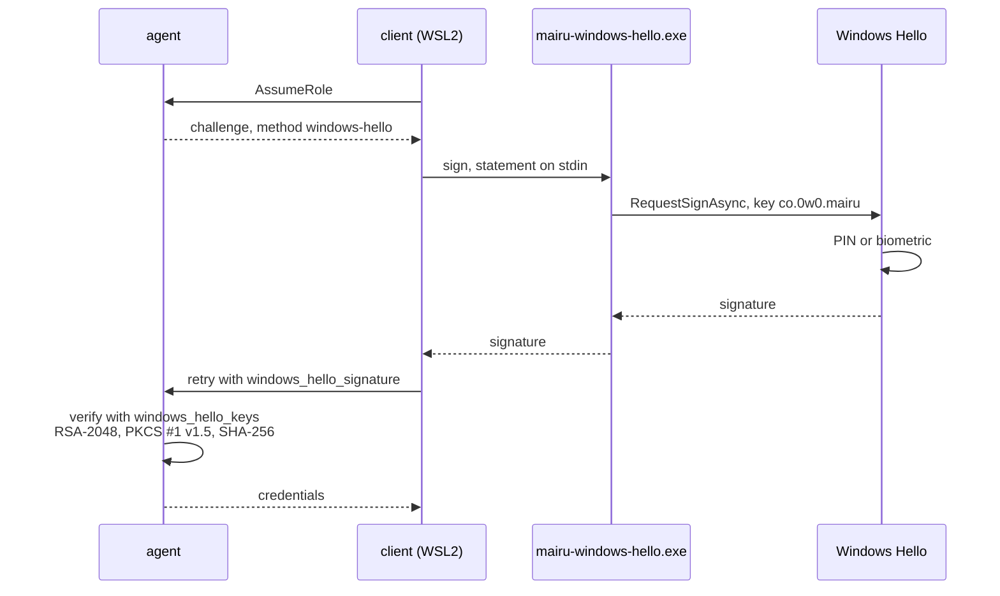
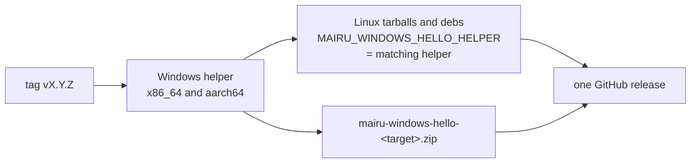

# 016-windows-hello

## Summary

This step adds `windows-hello`, a key-based presence method for WSL2 distributions with Windows interop enabled. A TPM-backed Windows Hello key credential signs the agent's challenge on the Windows side, and the agent verifies the signature against a public key registered in `authorization.json`. The flow is the one ssh-agent uses ([013 Challenge and statement](013-ssh-agent.md#challenge-and-statement)), with a different signer.

The signer is `mairu-windows-hello.exe`, a small Windows binary built from the mairu package. Linux release builds of mairu carry it for the matching Windows architecture and write it out to the Windows side on first use, so it always has mairu's own version. The client runs it through WSL interop. Its output is never trusted on its own: only a signature that verifies against a registered key counts.

## Motivation

In the integrated WSL2 profile ([015 Profiles](015-wsl2.md#profiles)), the human sits at Windows. Windows Hello (PIN, fingerprint or face) is the check they already use there. The alternatives inside the distribution are weaker or fiddly:

- WSL2 normally has no polkit agent, so the platform method falls back to a password typed into the terminal.
- `ssh-agent` needs a relay of the Windows OpenSSH agent and a key in it.
- Windows OpenSSH cannot use Windows Hello as a FIDO authenticator on current builds (Q-W3), so a Windows Hello-backed `sk-` key is not available.

A KeyCredential created by Windows Hello is TPM-backed, and every signature with it requires the PIN or a biometric. A valid signature therefore means a verified user, which is more than mairu can say of an ssh-agent key.

On WSL2 with interop enabled, the root path ([015](015-wsl2.md)) dominates anyway, so this method strengthens a guardrail. It still stops over-eager tools from obtaining credentials without the human noticing.

## Explanation



### Installing the helper

Nothing to install with a release build. Linux release binaries embed the helper for the matching Windows architecture: `x86_64` carries `x86_64-pc-windows-msvc`, and `aarch64` carries `aarch64-pc-windows-msvc`. The client writes it out on first use:

```text
%LOCALAPPDATA%\mairu\windows-hello-<version>\mairu-windows-hello.exe
  found through   $(wslpath "$(cmd.exe /c echo %LOCALAPPDATA%)"), so it needs interop
  before each run compared with the embedded bytes; rewritten when they differ
  cleanup         other windows-hello-* directories unused for 30 days are removed
```

Builds without an embedded helper, such as `cargo install` or distribution packages built from source, take the helper from the release's `mairu-windows-hello-<target>.zip`, at the path set in the unprotected configuration:

```jsonc
// ~/.config/mairu/config.json (UserConfig)
{
  // Overrides the extracted copy; required when the binary embeds no helper.
  "windows_hello_helper": "/mnt/c/Users/me/AppData/Local/mairu/mairu-windows-hello.exe"
}
```

A replaced helper can trigger prompts, but cannot forge a signature.

### Enrolling a key

1. `mairu policy enroll-windows-hello` runs the helper's `create` (or `public-key` if the key already exists).
2. It prints the entry to add to `authorization.json` `windows_hello_keys`.
3. The user approves the new policy as usual (`mairu policy approve`, [012 Approval](012-policy-approval.md#approval)).

```jsonc
{
  "version": 1,
  // Default: the key-based methods with registered keys ("ssh-agent", "windows-hello"), then "platform".
  "methods": ["windows-hello", "platform"],
  // Default: the key-based methods with registered keys; ["platform"] only when no key is registered.
  "approval_methods": ["windows-hello"],
  "windows_hello_keys": [
    // base64 SubjectPublicKeyInfo
    {"name": "desktop", "public_key": "MIIBIjANBgkqhkiG9w0BAQEFAAOCAQ8AMIIBCgKCAQEA..."}
  ]
}
```

- `"windows-hello"` becomes a valid name in `methods` and `approval_methods`.
- Once approved, the approval anchor holds `windows-hello` and the registered keys, so only Windows Hello approves the next change ([012 Integrity records](012-policy-approval.md#integrity-records)).
- `context.presence.method` is `"windows-hello"` when a Windows Hello signature covers the request, so a policy can require it.

### What happens on a request

When the policy needs a fresh check and `windows-hello` is the selected method, the agent returns a challenge with `method = "windows-hello"`. The client prints the request context ([007 What the human sees](007-authorization.md#what-the-human-sees)) ending with `:: mairu :: Approve in the Windows Hello dialog …`, pipes the statement to the helper, and retries with the signature. The Windows Hello dialog asks for the PIN or a biometric.

If the user cancels the dialog or it times out, the request is denied: the client does not move on to another method.

### Profiles

The integrated profile ([015 Profiles](015-wsl2.md#profiles)) gains `windows-hello` as its preferred presence method. The isolated profile has no Windows Hello: the helper needs interop, and Windows OpenSSH cannot yet enroll a Windows Hello key (Q-W3).

| Profile | Authorization |
|---|---|
| Integrated (interop on) | `windows-hello`, ssh-agent relay, `pkttyagent` |
| Isolated (interop off) | `ssh -A` from Windows |

### `doctor`

`mairu doctor` reports whether the Windows Hello helper is reachable and its key enrolled, alongside the WSL facts of [015](015-wsl2.md).

## Drawbacks

- Interop must be enabled, which is the profile where same-user Linux code can become root. The method strengthens a guardrail, not a boundary.
- Same-user code on either side can run its own program against the same key credential and cause a Windows Hello dialog. The human still has to pass it, but may not tell whose request it is.
- Linux release binaries grow by the size of the embedded helper, on every host, whether it runs under WSL2 or not.
- Builds from source embed no helper. Their users fetch it from the release and configure its path.
- A console process owns no foreground window, so the helper needs extra work to bring the dialog to the front.

## Considered Alternatives

- **Windows Hello through Windows OpenSSH's FIDO support** (Q-W3). This would give the isolated profile Windows Hello through ssh-agent forwarding with no helper. Not possible on current builds: libfido2 rejects Windows Hello's self-attestation, so enrollment fails. The KeyCredential helper is used instead, and `sk-` keys through Windows OpenSSH are for hardware security keys.
- **A channel to Windows that does not use interop** (Q-W4), for Windows Hello in the isolated profile, for example a Hyper-V socket to a Windows-side service. Not the default: it needs a one-time administrator registration, and vsock carries no peer credentials. The isolated profile keeps using `ssh -A`.
- **Trusting the helper's answer.** Rejected. The helper's output never counts on its own; the agent verifies the signature over the statement against a registered key.
- **RSA-PSS, as Microsoft's documentation says.** Every PSS salt length fails. The signatures are PKCS #1 v1.5 with SHA-256 (Q-W2, confirmed), and the verifier is pinned by a recorded test vector.
- **Passing a digest to the helper.** Rejected. Windows hashes the data itself, so the helper passes the statement bytes, never a digest.
- **A separate Cargo package under `windows-hello-helper/`.** Rejected. mairu stays one package and one crate, released from one tag in one workflow run ([002 Cargo features](002-build-layout.md#cargo-features)). The helper is a feature-gated `[[bin]]` of that package, like the platform helper ([006 Helper binary](006-platform-helper.md#helper-binary)).
- **The helper as a separate download only,** installed by the user at a known path. Rejected as the default: it is a manual step on every upgrade, and the helper's version drifts from mairu's. Embedding it in the Linux release binary keeps both at one version from one release. The release asset remains for builds that embed nothing.
- **Falling back to another method when the user cancels the dialog.** Rejected. A cancelled or timed-out Windows Hello dialog is a denial, so cancelling never leads to a second prompt by another method.

## Prior Art

- WSL-Hello-sudo (`pam_wsl_hello`): a TPM-backed Windows Hello key credential signs a challenge from Linux, and Linux verifies the signature against a registered public key. This method follows the same pattern.
- Windows Hello key credentials (`Windows.Security.Credentials.KeyCredentialManager`), as used by Windows Hello for Business.

## Security and Privacy Considerations

| Threat | Mitigation |
|---|---|
| Abuse of the Windows Hello credential | Windows Hello requires the PIN or biometric for every signature. Challenge bound to peer + request; single use; 60 s ([013 Challenge and statement](013-ssh-agent.md#challenge-and-statement)). |
| A replaced or malicious helper | It can trigger prompts but cannot forge a signature: only a signature verifying against a registered key counts. The extracted copy is writable by the user's processes on both sides, so the client compares it with the embedded bytes before each run; a swap between the check and the run still only causes a prompt. |
| Replayed or relayed signatures | Same single-use, peer- and request-bound challenge as ssh-agent |
| Approval downgraded to a password | The anchor holds `windows-hello` and its keys after the first approval |

**Residual risk.** This is the same as ssh-agent:
- Same-user code (Windows-side, or Linux-side through interop) can run its own program against the same key credential and cause a Windows Hello dialog. The human still has to pass it.
- The challenge binds the signature to one request and peer.
- Timing-based phishing remains possible.

On WSL2 with interop enabled, the root path dominates anyway ([015](015-wsl2.md)).

Logging: signatures, statements and public keys are never logged; the method name is.

## Mission Scope

### Out of scope

- Windows Hello in the isolated profile (no interop): see Q-W3 and Q-W4.
- Windows Hello on native Windows; mairu does not run there.
- Signing or notarizing the Windows helper.

### Expected Outcomes

- On WSL2 with interop, `mairu policy enroll-windows-hello` creates the key credential and prints the `windows_hello_keys` entry.
- After approval, a request that needs a fresh check shows the Windows Hello dialog in the foreground and succeeds after the PIN or biometric.
- A cancelled dialog denies the request without a second prompt.
- A forged or replayed signature is refused with `REASON_INVALID_RESPONSE`.
- `doctor` reports the helper's reachability and enrollment.
- Every Linux release binary, tarballs and debs alike, embeds the helper for its Windows architecture, and the client writes it out on first use without any setup.
- Every release also carries `mairu-windows-hello-<target>.zip` for `x86_64-pc-windows-msvc` and `aarch64-pc-windows-msvc`, built in the same workflow run as the other artifacts.

## Implementation Plan

Stack layer: `hardening/windows-hello`.

| File | Change |
|---|---|
| `src/bin/mairu-windows-hello.rs` | New. The Windows helper, `[[bin]] mairu-windows-hello` |
| `Cargo.toml` | `[[bin]] mairu-windows-hello` with `required-features = ["windows-hello-helper"]`; the `windows` crate as an optional `cfg(windows)` dependency enabled by that feature |
| `src/windows_hello.rs` | New. Agent verification; client relay (extract or locate, run, decline) |
| `build.rs` | Embeds the file named by `MAIRU_WINDOWS_HELLO_HELPER` in Linux builds, when set |
| `src/authorization.rs` | `windows-hello` in the key-based branch of step 4 |
| `src/policy/settings.rs` | `windows_hello_keys`, the `windows-hello` method name, default orders |
| `src/config.rs` | `UserConfig.windows_hello_helper` |
| `src/cmd/policy.rs` | `enroll-windows-hello` |
| `src/cmd/doctor.rs` | Helper reachability and enrollment |
| `proto/mairu.proto` | `AuthorizationResponse.windows_hello_signature`; `windows-hello` values in `AuthorizationChallenge` |
| `.github/workflows/release.yml` | Windows helper builds first in the same run; Linux tarballs and debs embed them |
| `README.md` | WSL2 guide: the embedded helper and its path for builds from source, enrolling, approving |

### Windows Hello helper

`mairu-windows-hello.exe` is a `[[bin]]` of the mairu package, built for `x86_64-pc-windows-msvc` and `aarch64-pc-windows-msvc` with the `windows` crate:

```text
cargo build --release --target <arch>-pc-windows-msvc \
  --no-default-features --features windows-hello-helper --bin mairu-windows-hello
```

The package's always-on dependencies must build for these targets, or move under `[target.'cfg(unix)'.dependencies]`, and `src/lib.rs` compiles its Unix-only modules only on Unix. The helper uses none of them.

**Embedding in Linux builds.**

- When `MAIRU_WINDOWS_HELLO_HELPER` names an `.exe` at build time, `build.rs` embeds it with `include_bytes!` and records its SHA-256. Unset, the binary embeds nothing, and the client uses `windows_hello_helper` alone.
- The client finds `%LOCALAPPDATA%` through `cmd.exe /c echo %LOCALAPPDATA%` and `wslpath`, which needs interop, as the method itself does.
- It writes `windows-hello-<version>\mairu-windows-hello.exe` there: a temporary sibling first, then a rename. Before each run it compares the file's SHA-256 with the embedded one, and writes it again when they differ.
- `windows_hello_helper` in `config.json`, when set, takes precedence over the extracted copy.
- Directories `windows-hello-*` other than the current version's, unused for 30 days, are removed when extracting.

It uses `Windows.Security.Credentials.KeyCredentialManager` with credential name `co.0w0.mairu`:
- `create`: `RequestCreateAsync(…, FailIfExists)` creates the key, then prints the base64 SubjectPublicKeyInfo of the public key.
- `public-key`: `OpenAsync` the existing key, then print its public key. Neither shows a prompt.
- `sign`: read base64 bytes on stdin, `OpenAsync`, then `RequestSignAsync`, which shows the Windows Hello dialog. Print the base64 signature.
- A console process owns no foreground window, so the dialog can open behind other windows (observed). The helper makes sure it comes to the front, for example by creating a foreground window to own it. `UserCanceled` and timeouts are a denial, reported with their own exit status.

### Challenge and verification

This is the same flow as ssh-agent ([013 Challenge and statement](013-ssh-agent.md#challenge-and-statement)), with `AuthorizationChallenge.method = "windows-hello"`:

1. The agent issues the challenge with `key_fingerprints` of the form `"wh:SHA256:..."`, the SHA-256 of each registered SubjectPublicKeyInfo.
2. The client locates the helper. If it is missing, or no registered key matches, it retries with `declined` (`"no-helper"` or `"no-registered-key"`).
3. The client pipes the `statement` bytes, base64, to `sign` through WSL interop, and retries with `windows_hello_signature`. A cancelled or timed-out dialog ends the request as denied, without a retry.
4. The agent runs the checks of 013 (single use, expiry, peer, request digest), then verifies the signature over the statement bytes with the registered key: RSA-2048, **PKCS #1 v1.5 with SHA-256** (Q-W2, confirmed on Windows 11 25H2). Microsoft's documentation says PSS, but every PSS salt length fails. Windows hashes the data itself, so the helper passes the statement, never a digest.
5. Windows Hello itself requires the PIN or biometric, so a valid signature means a verified user.

A failure at any check returns `REASON_INVALID_RESPONSE`. A permit records the lease and the grant with `method = "windows-hello"`.

**Test vector (Q-W2).** From a Windows Hello key on Windows 11 25H2, verified with OpenSSL 3.5.5 (`openssl dgst -sha256 -verify`). Unit tests pin the verifier with it.

```text
spki       MIIBIjANBgkqhkiG9w0BAQEFAAOCAQ8AMIIBCgKCAQEAzXqNwEiMhTbmSIZQbFz7qICqSP/pTwGiwHPzu5pUh6uIK72wZGT2NgfmkahtC0wZBW2VXw9Z37fCLdYdAhtIl7dU//58lktKckkwfXCKkYQ4QD/K1R5CvnceXUuqIgwR3qxJCV1KW1Kv7CvH7NiZK1VaiAtqbPNOe4Uilk14rntMfH0OhPfS6HiTg7UmRoaYsR4q70owKnC6ahHBYILwDY6X4h3Lip8k9sOUUGVsE2CSCON78jejJqism166CNYsP99nlundVddlhh2m3BhcYoqObg7WVNGqZH/ovQQluuh0oktVGsrvvBpTFs7LKoHZMHt/YWSF+A1CSUue+PpFaQIDAQAB
data       bWFpcnUgUS1XMiB0ZXN0IHZlY3RvcjogaGVsbG8=      ("mairu Q-W2 test vector: hello")
signature  yQ3hK8Zppf577e0I86Kr1jmsENGG5By1w6viC81BSRsbkmP+TFTDCcuF1Wmp3qPkCD6E9fpJoVL8nM6YFEAETsLDdCbGRSodBGV8konQrp3AZCcLN768hU6UtJ0VNOooZ7aJh3RvyMd3hQ2RdWaRyR15gPESvlWNRVN+Q9G65A+iGgEFyIyH7O6pLeJIT8t1JazKyzfSCKT37BZiOd3WVwolruy7vKHV96+i5XWGF6mkrx+F2ArjwBnnRTuUWfu6ntswzh2zc0lSS8obKzHCX1hSEfQlwbCZjiTcTqhmSjRtOiGUroq4UoRtIOTHvdTVs35iYRJ5i6uvcrVHVf8oBA==
```

### Protocol

Adds `windows_hello_signature = 4` to the `result` oneof of `AuthorizationResponse`, and `"no-helper"` to the `declined` values:

```proto
message AuthorizationResponse {
  bytes challenge_id = 1;
  oneof result {
    bytes sshsig = 2;              // binary SSHSIG blob
    string declined = 3;           // why the client could not sign: "no-ssh-agent", "no-helper", "no-registered-key", "sign-failed"
    bytes windows_hello_signature = 4;
  }
}
```

`AuthorizationChallenge` gains the values for this method:

```proto
message AuthorizationChallenge {
  bytes challenge_id = 1;          // 16 random bytes
  bytes statement = 2;             // serialized AuthorizationStatement; signed byte-for-byte
  // Acceptable registered keys: OpenSSH "SHA256:..." fingerprints for ssh-agent,
  // "wh:SHA256:..." (SHA-256 of the SubjectPublicKeyInfo) for Windows Hello.
  repeated string key_fingerprints = 3;
  google.protobuf.Timestamp expires_at = 4;
  string method = 5;               // "ssh-agent" | "windows-hello"
}
```

The approval anchor records the keys in `ApprovalAnchor.windows_hello_keys = 3` (DER SubjectPublicKeyInfo).

### Settings

- `windows_hello_keys[]`: objects with `name` and `public_key`, a base64 SubjectPublicKeyInfo of an RSA-2048 key. Unknown fields are rejected; a key that does not parse fails validation.
- `"windows-hello"` is accepted in `methods` and `approval_methods`, and counts as a key-based method for the defaults.
- `UserConfig.windows_hello_helper` (unprotected `config.json`): a helper path that overrides the extracted copy. Required when the binary embeds no helper.

### Release workflow

The same release workflow run, triggered by the same tag, builds the helper on Windows runners for both targets, with the command above, before any Linux artifact:



- The Linux jobs, the musl tarballs and the debs, download the helper of the matching architecture from the Windows jobs and build with `MAIRU_WINDOWS_HELLO_HELPER` set.
- `mairu-windows-hello-<target>.zip` is uploaded to the same GitHub release for builds that embed nothing. It is not published anywhere else.
- The crate published to crates.io embeds nothing.

### Open questions (settled on a WSL2 host)

```text
Q-W2 Hello padding (confirmed)   Q-W3 Hello via OpenSSH (fails)   Q-W4 channel without interop (not default)
```

- **Q-W2** (confirmed): KeyCredential signatures are RSA-2048 PKCS #1 v1.5 with SHA-256, not PSS. The test vector is above.
- **Q-W3** (answered: not on current builds). Whether Windows OpenSSH's FIDO support (`webauthn.dll`) can use Windows Hello itself as the authenticator, which would give the isolated profile Windows Hello through ssh-agent forwarding with no helper. Tested with OpenSSH_for_Windows 9.5p2 and WebAuthn API version 9 on Windows 11 25H2, `ssh-keygen -t ecdsa-sk`:
  - The Windows Security dialog offers Windows Hello on this device when the Windows setting to save passkeys to this device is on, alongside any third-party passkey providers.
  - Choosing Windows Hello creates the platform credential (relying party `ssh:`), but libfido2 rejects its self-attestation (`fido_cred_verify_self: FIDO_ERR_INVALID_ARGUMENT`, "invalid format"), so enrollment fails and no key is written. A third-party passkey provider fails the same way.
  - libfido2 names every `webauthn.dll` device `windows://hello`, so that name in a log does not mean Windows Hello was used.
  - `-O resident` and `-O no-touch-required` were not tried. Windows Hello does not do EdDSA, so `ed25519-sk` cannot use it.

  Windows Hello on WSL2 therefore comes only from the KeyCredential helper, which needs interop. `sk-` keys through Windows OpenSSH are for hardware security keys. A later Win32-OpenSSH or libfido2 release that accepts self-attestation could make this path work; that would need a re-test.
- **Q-W4** (answered: not the default). Whether a channel that doesn't use interop is practical for Windows Hello in the isolated profile, for example a Hyper-V socket (`AF_VSOCK`) to a Windows-side service:
  - A non-elevated Windows process can bind an `AF_HYPERV` listener, but the guest cannot reach it. Its `AF_VSOCK` connect returns EOF immediately.
  - Making it reachable needs a one-time administrator registration of a service GUID under `HKLM\SOFTWARE\Microsoft\Windows NT\CurrentVersion\Virtualization\GuestCommunicationServices`. That much is confirmed; whether it then works end to end is inferred, not tested.
  - vsock also carries no peer credentials: any process of any uid in any distribution of the shared VM could connect.
  - The isolated profile therefore keeps using `ssh -A` into the distribution.

### Tests

- Verification with the Q-W2 test vector, plus negative cases: wrong key, altered statement, PSS-encoded signature.
- Settings validation for `windows_hello_keys` and the method name.
- The client relay with a fake helper executable: success, missing helper (`declined = "no-helper"`), cancellation (denied, no retry).
- A CI build of the helper for both Windows targets with `--no-default-features --features windows-hello-helper`.
- Manual, on a Windows host: enrollment, approval, the dialog in the foreground, cancellation.

## Current Status

Spec drafted; awaiting review before implementation. Implementors MUST keep this section updated as they work.

### Checklist

- [ ] Windows Hello method: agent verification, client relay (`src/windows_hello.rs`)
- [ ] `mairu-windows-hello.exe` as a feature-gated `[[bin]]`, with the dialog brought to the front
- [ ] `mairu policy enroll-windows-hello`
- [ ] Proto: `windows_hello_signature`; `windows-hello` challenge values
- [ ] Settings: `windows_hello_keys`, `windows-hello` method; `UserConfig.windows_hello_helper`
- [ ] `doctor`: helper reachability and enrollment
- [ ] Embedding in Linux release builds (`MAIRU_WINDOWS_HELLO_HELPER`) and extraction on first use
- [ ] Release workflow: Windows helper builds first in the same run; Linux tarballs and debs embed them
- [x] Settle Q-W2, Q-W3 and Q-W4 on a WSL2 host

### Updates

- 2026-10-29: Split out of hardening.md, policy.md and platform-helper.md.
