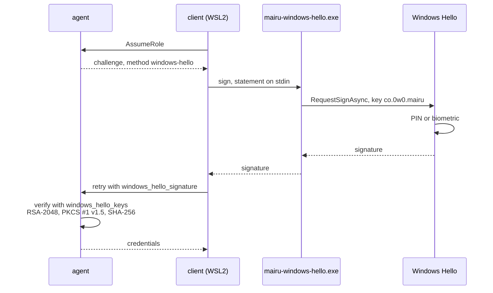
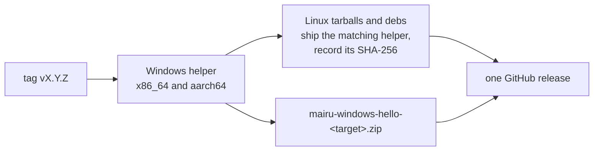

# 016-windows-hello

## Summary

This step adds `windows-hello`, a key-based presence method for WSL2 distributions with Windows interop enabled. A TPM-backed Windows Hello key credential signs the agent's challenge on the Windows side, and the agent verifies the signature against a public key registered in `authorization.json`. The flow is the one ssh-agent uses ([013 Challenge and statement](013-ssh-agent.md#challenge-and-statement)), with a different signer.

The signer is `mairu-windows-hello.exe`, a small Windows binary built from the mairu package. Linux release archives ship it next to `mairu`, for the matching Windows architecture, so it always has mairu's own version. The client runs it through WSL interop. Its output is never trusted on its own: only a signature that verifies against a registered key counts.

## Motivation

In the integrated WSL2 profile ([015 Profiles](015-wsl2.md#profiles)), the human sits at Windows. Windows Hello (PIN, fingerprint or face) is the check they already use there. The alternatives inside the distribution are weaker or fiddly:

- WSL2 normally has no polkit agent, so the platform method falls back to a password typed into the terminal.
- `ssh-agent` needs a relay of the Windows OpenSSH agent and a key in it.
- Windows OpenSSH cannot use Windows Hello as a FIDO authenticator on current builds (Q-W3), so a Windows Hello-backed `sk-` key is not available.

A KeyCredential created by Windows Hello is TPM-backed, and every signature with it requires the PIN or a biometric. A valid signature therefore means a verified user, which is more than mairu can say of an ssh-agent key.

On WSL2 with interop enabled, the root path ([015](015-wsl2.md)) dominates anyway, so this method strengthens a guardrail. It still stops over-eager tools from obtaining credentials without the human noticing.

## Explanation



### Installing the helper

Nothing to install with a release archive. Linux archives ship the helper for the matching Windows architecture next to `mairu`, `x86_64-pc-windows-msvc` with `x86_64` and `aarch64-pc-windows-msvc` with `aarch64`, and distribution packages install it in `/usr/lib/mairu/`. The client finds it as in [002 Shipped helpers](002-build-layout.md#shipped-helpers):

```text
<directory of mairu>/mairu-windows-hello.exe     or /usr/lib/mairu/mairu-windows-hello.exe
  check   its SHA-256 against the pinned one, right before each run
  run     through WSL interop, from where it is (Q-W6)
```

Builds that ship no helper, such as `cargo install` or packages built from source, use the helper from the release's `mairu-windows-hello-<target>.zip`, at a path set in the unprotected configuration:

```jsonc
// ~/.config/mairu/config.json (UserConfig)
{
  // Overrides the shipped helper; required when the build ships none.
  "windows_hello_helper": "/mnt/c/Users/me/AppData/Local/mairu/mairu-windows-hello.exe"
}
```

The pinned SHA-256 comes from the build, since release builds record the SHA-256 of the helper they ship. For a build without one, it comes from `windows_hello_helper_sha256` in the approved `authorization.json`. A hardened client refuses to run a helper that matches neither, because a replaced helper could have the human's gesture sign another statement, such as a pending policy approval.

A replaced helper can trigger prompts, but cannot forge a signature.

### Enrolling a key

1. `mairu policy enroll-windows-hello` runs the helper's `create` (or `public-key` if the key already exists).
2. It prints the entry to add to `authorization.json` `windows_hello_keys`.
3. The user approves the new policy as usual (`mairu policy approve`, [012 Approval](012-policy-approval.md#approval)).

```jsonc
{
  "version": 1,
  // Default: the key-based methods with registered keys ("ssh-agent", "windows-hello"), then "platform".
  "methods": ["windows-hello", "platform"],
  // Default: the key-based methods with registered keys; ["platform"] only when no key is registered.
  "approval_methods": ["windows-hello"],
  "windows_hello_keys": [
    // base64 SubjectPublicKeyInfo
    {"name": "desktop", "public_key": "MIIBIjANBgkqhkiG9w0BAQEFAAOCAQ8AMIIBCgKCAQEA..."}
  ]
}
```

- `"windows-hello"` becomes a valid name in `methods` and `approval_methods`.
- Once approved, the approval anchor holds `windows-hello` and the registered keys, so only Windows Hello approves the next change ([012 Integrity records](012-policy-approval.md#integrity-records)).
- `context.presence.method` is `"windows-hello"` when a Windows Hello signature covers the request, so a policy can require it.

### What happens on a request

When the policy needs a fresh check and `windows-hello` is the selected method, the agent returns a challenge with `method = "windows-hello"`. The client prints the request context ([007 What the human sees](007-authorization.md#what-the-human-sees)) ending with `:: mairu :: Approve in the Windows Hello dialog …`, pipes the statement to the helper, and retries with the signature. The Windows Hello dialog asks for the PIN or a biometric.

If the user cancels the dialog or it times out, the request is denied: the client does not move on to another method.

### Profiles

The integrated profile ([015 Profiles](015-wsl2.md#profiles)) gains `windows-hello` as its preferred presence method. The isolated profile has no Windows Hello: the helper needs interop, and Windows OpenSSH cannot yet enroll a Windows Hello key (Q-W3).

| Profile | Authorization |
|---|---|
| Integrated (interop on) | `windows-hello`, ssh-agent relay, `pkttyagent` |
| Isolated (interop off) | `ssh -A` from Windows |

### `doctor`

`mairu doctor` reports whether the Windows Hello helper is reachable and its key enrolled, alongside the WSL facts of [015](015-wsl2.md).

## Drawbacks

- Interop must be enabled, which is the profile where same-user Linux code can become root. The method strengthens a guardrail, not a boundary.
- Same-user code on either side can run its own program against the same key credential and cause a Windows Hello dialog. The human still has to pass it, but may not tell whose request it is.
- Linux release archives grow by the size of the helper, on every host, whether it runs under WSL2 or not.
- Builds from source ship no helper. Their users fetch it from the release, configure its path, and pin its SHA-256 in `authorization.json` when hardened.
- A console process owns no foreground window, so the helper needs extra work to bring the dialog to the front.

## Considered Alternatives

- **Windows Hello through Windows OpenSSH's FIDO support** (Q-W3). This would give the isolated profile Windows Hello through ssh-agent forwarding with no helper. Not possible on current builds: libfido2 rejects Windows Hello's self-attestation, so enrollment fails. The KeyCredential helper is used instead, and `sk-` keys through Windows OpenSSH are for hardware security keys.
- **A channel to Windows that does not use interop** (Q-W4), for Windows Hello in the isolated profile, for example a Hyper-V socket to a Windows-side service. Not the default: it needs a one-time administrator registration, and vsock carries no peer credentials. The isolated profile keeps using `ssh -A`.
- **Trusting the helper's answer.** Rejected. The helper's output never counts on its own; the agent verifies the signature over the statement against a registered key.
- **RSA-PSS, as Microsoft's documentation says.** Every PSS salt length fails. The signatures are PKCS #1 v1.5 with SHA-256 (Q-W2, confirmed), and the verifier is pinned by a recorded test vector.
- **Passing a digest to the helper.** Rejected. Windows hashes the data itself, so the helper passes the statement bytes, never a digest.
- **A separate Cargo package under `windows-hello-helper/`.** Rejected. mairu stays one package and one crate, released from one tag in one workflow run ([002 Cargo features](002-build-layout.md#cargo-features)). The helper is a feature-gated `[[bin]]` of that package, like the platform helper ([006 Helper binary](006-platform-helper.md#helper-binary)).
- **The helper as a separate download only,** installed by the user at a known path. Rejected as the default: it is a manual step on every upgrade, and the helper's version drifts from mairu's. Shipping it in the Linux release archive keeps both at one version from one release. The separate asset remains for builds that ship none.
- **Embedding the helper in mairu and writing it out to `%LOCALAPPDATA%`.** Rejected with self-extraction as a whole ([002 Considered Alternatives](002-build-layout.md#considered-alternatives)).
- **Trusting whatever helper is configured.** Rejected for hardened clients: a replaced helper cannot forge a signature, but it can have the human's gesture sign another statement. The helper's SHA-256 is pinned by the build or by the approved settings.
- **Falling back to another method when the user cancels the dialog.** Rejected. A cancelled or timed-out Windows Hello dialog is a denial, so cancelling never leads to a second prompt by another method.

## Prior Art

- WSL-Hello-sudo (`pam_wsl_hello`): a TPM-backed Windows Hello key credential signs a challenge from Linux, and Linux verifies the signature against a registered public key. This method follows the same pattern.
- Windows Hello key credentials (`Windows.Security.Credentials.KeyCredentialManager`), as used by Windows Hello for Business.

## Security and Privacy Considerations

| Threat | Mitigation |
|---|---|
| Abuse of the Windows Hello credential | Windows Hello requires the PIN or biometric for every signature. Challenge bound to peer + request; single use; 60 s ([013 Challenge and statement](013-ssh-agent.md#challenge-and-statement)). |
| A replaced or malicious helper | It cannot forge a signature, but could have the human's gesture sign another statement. A hardened client runs only a helper matching the pinned SHA-256, checked right before each run. A swap between the check and the run remains possible where the file is writable by the user's processes; the copy next to the hardened binary is root-owned on the Linux side, which is why running it from there is preferred (Q-W6). Within the integrated profile, root is reachable anyway ([015](015-wsl2.md)). |
| Replayed or relayed signatures | Same single-use, peer- and request-bound challenge as ssh-agent |
| Approval downgraded to a password | The anchor holds `windows-hello` and its keys after the first approval |

**Residual risk.** This is the same as ssh-agent:
- Same-user code (Windows-side, or Linux-side through interop) can run its own program against the same key credential and cause a Windows Hello dialog. The human still has to pass it.
- The challenge binds the signature to one request and peer.
- Timing-based phishing remains possible.

On WSL2 with interop enabled, the root path dominates anyway ([015](015-wsl2.md)).

Logging: signatures, statements and public keys are never logged; the method name is.

## Mission Scope

### Out of scope

- Windows Hello in the isolated profile (no interop): see Q-W3 and Q-W4.
- Windows Hello on native Windows; mairu does not run there.
- Signing or notarizing the Windows helper.

### Expected Outcomes

- On WSL2 with interop, `mairu policy enroll-windows-hello` creates the key credential and prints the `windows_hello_keys` entry.
- After approval, a request that needs a fresh check shows the Windows Hello dialog in the foreground and succeeds after the PIN or biometric.
- A cancelled dialog denies the request without a second prompt.
- A forged or replayed signature is refused with `REASON_INVALID_RESPONSE`.
- `doctor` reports the helper's reachability and enrollment.
- Every Linux release archive and deb ships the helper for its Windows architecture, and the client finds, checks and runs it without any setup.
- Every release also carries `mairu-windows-hello-<target>.zip` for `x86_64-pc-windows-msvc` and `aarch64-pc-windows-msvc`, built in the same workflow run as the other artifacts.

## Implementation Plan

Stack layer: `hardening/windows-hello`.

| File | Change |
|---|---|
| `src/bin/mairu-windows-hello.rs` | New. The Windows helper, `[[bin]] mairu-windows-hello` |
| `Cargo.toml` | `[[bin]] mairu-windows-hello` with `required-features = ["windows-hello-helper"]`; the `windows` crate as an optional `cfg(windows)` dependency enabled by that feature |
| `src/windows_hello.rs` | New. Agent verification; client relay (locate, check, run, decline) |
| `build.rs` | Records `MAIRU_WINDOWS_HELLO_HELPER_SHA256`, the SHA-256 of the shipped helper, in Linux release builds |
| `src/authorization.rs` | `windows-hello` in the key-based branch of step 4 |
| `src/policy/settings.rs` | `windows_hello_keys`, the `windows-hello` method name, default orders |
| `src/config.rs` | `UserConfig.windows_hello_helper` |
| `src/cmd/policy.rs` | `enroll-windows-hello` |
| `src/cmd/doctor.rs` | Helper reachability and enrollment |
| `proto/mairu.proto` | `AuthorizationResponse.windows_hello_signature`; `windows-hello` values in `AuthorizationChallenge` |
| `.github/workflows/release.yml` | Windows helper builds first in the same run; Linux tarballs and debs ship them and record their SHA-256 |
| `README.md` | WSL2 guide: the shipped helper, its path and pin for builds from source, enrolling, approving |

### Windows Hello helper

`mairu-windows-hello.exe` is a `[[bin]]` of the mairu package, built for `x86_64-pc-windows-msvc` and `aarch64-pc-windows-msvc` with the `windows` crate:

```text
cargo build --release --target <arch>-pc-windows-msvc \
  --no-default-features --features windows-hello-helper --bin mairu-windows-hello
```

The package's always-on dependencies must build for these targets, or move under `[target.'cfg(unix)'.dependencies]`, and `src/lib.rs` compiles its Unix-only modules only on Unix. The helper uses none of them.

**Shipping in Linux builds.**

- The Linux tarballs carry `mairu-windows-hello.exe` next to `mairu`, and the debs install it as `/usr/lib/mairu/mairu-windows-hello.exe` ([002 Shipped helpers](002-build-layout.md#shipped-helpers)). `harden` copies it next to the hardened copy, where it is root-owned on the Linux side.
- Release builds set `MAIRU_WINDOWS_HELLO_HELPER_SHA256` to the SHA-256 of the helper they ship, and `build.rs` records it.
- `windows_hello_helper` in `config.json`, when set, takes precedence over the lookup.
- Right before each run, the client reads the file and compares its SHA-256 with the pin: the recorded one, or else `windows_hello_helper_sha256` from the effective settings. A hardened client refuses a mismatch or a missing pin and declines the method (`"no-helper"`). An unhardened client only warns.
- The client runs the file from where it is, through interop (Q-W6). If Q-W6 shows that a Windows executable on the Linux filesystem cannot use Windows Hello, the client copies the checked file to `%LOCALAPPDATA%\mairu\windows-hello-<version>\` and runs that copy instead.

### Challenge and verification

This is the same flow as ssh-agent ([013 Challenge and statement](013-ssh-agent.md#challenge-and-statement)), with `AuthorizationChallenge.method = "windows-hello"`:

1. The agent issues the challenge with `key_fingerprints` of the form `"wh:SHA256:..."`, the SHA-256 of each registered SubjectPublicKeyInfo.
2. The client locates the helper. If it is missing, or no registered key matches, it retries with `declined` (`"no-helper"` or `"no-registered-key"`).
3. The client pipes the `statement` bytes, base64, to `sign` through WSL interop, and retries with `windows_hello_signature`. A cancelled or timed-out dialog ends the request as denied, without a retry.
4. The agent runs the checks of 013 (single use, expiry, peer, request digest), then verifies the signature over the statement bytes with the registered key: RSA-2048, **PKCS #1 v1.5 with SHA-256** (Q-W2, confirmed on Windows 11 25H2). Microsoft's documentation says PSS, but every PSS salt length fails. Windows hashes the data itself, so the helper passes the statement, never a digest.
5. Windows Hello itself requires the PIN or biometric, so a valid signature means a verified user.

A failure at any check returns `REASON_INVALID_RESPONSE`. A permit records the lease and the grant with `method = "windows-hello"`.

**Test vector (Q-W2).** From a Windows Hello key on Windows 11 25H2, verified with OpenSSL 3.5.5 (`openssl dgst -sha256 -verify`). Unit tests pin the verifier with it.

```text
spki       MIIBIjANBgkqhkiG9w0BAQEFAAOCAQ8AMIIBCgKCAQEAzXqNwEiMhTbmSIZQbFz7qICqSP/pTwGiwHPzu5pUh6uIK72wZGT2NgfmkahtC0wZBW2VXw9Z37fCLdYdAhtIl7dU//58lktKckkwfXCKkYQ4QD/K1R5CvnceXUuqIgwR3qxJCV1KW1Kv7CvH7NiZK1VaiAtqbPNOe4Uilk14rntMfH0OhPfS6HiTg7UmRoaYsR4q70owKnC6ahHBYILwDY6X4h3Lip8k9sOUUGVsE2CSCON78jejJqism166CNYsP99nlundVddlhh2m3BhcYoqObg7WVNGqZH/ovQQluuh0oktVGsrvvBpTFs7LKoHZMHt/YWSF+A1CSUue+PpFaQIDAQAB
data       bWFpcnUgUS1XMiB0ZXN0IHZlY3RvcjogaGVsbG8=      ("mairu Q-W2 test vector: hello")
signature  yQ3hK8Zppf577e0I86Kr1jmsENGG5By1w6viC81BSRsbkmP+TFTDCcuF1Wmp3qPkCD6E9fpJoVL8nM6YFEAETsLDdCbGRSodBGV8konQrp3AZCcLN768hU6UtJ0VNOooZ7aJh3RvyMd3hQ2RdWaRyR15gPESvlWNRVN+Q9G65A+iGgEFyIyH7O6pLeJIT8t1JazKyzfSCKT37BZiOd3WVwolruy7vKHV96+i5XWGF6mkrx+F2ArjwBnnRTuUWfu6ntswzh2zc0lSS8obKzHCX1hSEfQlwbCZjiTcTqhmSjRtOiGUroq4UoRtIOTHvdTVs35iYRJ5i6uvcrVHVf8oBA==
```

### Protocol

Adds `windows_hello_signature = 4` to the `result` oneof of `AuthorizationResponse`, and `"no-helper"` to the `declined` values:

```proto
message AuthorizationResponse {
  bytes challenge_id = 1;
  oneof result {
    bytes sshsig = 2;              // binary SSHSIG blob
    string declined = 3;           // why the client could not sign: "no-ssh-agent", "no-helper", "no-registered-key", "sign-failed"
    bytes windows_hello_signature = 4;
  }
}
```

`AuthorizationChallenge` gains the values for this method:

```proto
message AuthorizationChallenge {
  bytes challenge_id = 1;          // 16 random bytes
  bytes statement = 2;             // serialized AuthorizationStatement; signed byte-for-byte
  // Acceptable registered keys: OpenSSH "SHA256:..." fingerprints for ssh-agent,
  // "wh:SHA256:..." (SHA-256 of the SubjectPublicKeyInfo) for Windows Hello.
  repeated string key_fingerprints = 3;
  google.protobuf.Timestamp expires_at = 4;
  string method = 5;               // "ssh-agent" | "windows-hello"
}
```

The approval anchor records the keys in `ApprovalAnchor.windows_hello_keys = 3` (DER SubjectPublicKeyInfo).

### Settings

- `windows_hello_keys[]`: objects with `name` and `public_key`, a base64 SubjectPublicKeyInfo of an RSA-2048 key. Unknown fields are rejected; a key that does not parse fails validation.
- `"windows-hello"` is accepted in `methods` and `approval_methods`, and counts as a key-based method for the defaults.
- `windows_hello_helper_sha256`: the hex SHA-256 of the helper, for builds that record none. Ignored while the file is unapproved, like every relaxing setting.
- `UserConfig.windows_hello_helper` (unprotected `config.json`): a helper path that overrides the shipped one. Required when the build ships none.

### Release workflow

The same release workflow run, triggered by the same tag, builds the helper on Windows runners for both targets, with the command above, before any Linux artifact:



- The Linux jobs, the musl tarballs and the debs, take the helper of the matching architecture from the Windows jobs, put it into the archive or package, and build with `MAIRU_WINDOWS_HELLO_HELPER_SHA256` set to its SHA-256.
- `mairu-windows-hello-<target>.zip` is uploaded to the same GitHub release for builds that ship none. It is not published anywhere else.
- The crate published to crates.io records no pin; builds from it rely on the approved one.

### Open questions

```text
Q-W2 Hello padding (confirmed)   Q-W3 Hello via OpenSSH (fails)   Q-W4 channel without interop (not default)
Q-W6 helper run from the Linux filesystem (open)
```

- **Q-W6** (open, needs a WSL2 host). Whether `mairu-windows-hello.exe`, run through interop from the Linux filesystem (Windows sees a `\\wsl.localhost\<distro>\…` path), can open the key credential and show the Windows Hello dialog, without SmartScreen or Mark-of-the-Web blocking it. If not, the client copies the checked file to `%LOCALAPPDATA%` before running it, and the root-owned copy next to the hardened binary no longer helps against a swap.

- **Q-W2** (confirmed): KeyCredential signatures are RSA-2048 PKCS #1 v1.5 with SHA-256, not PSS. The test vector is above.
- **Q-W3** (answered: not on current builds). Whether Windows OpenSSH's FIDO support (`webauthn.dll`) can use Windows Hello itself as the authenticator, which would give the isolated profile Windows Hello through ssh-agent forwarding with no helper. Tested with OpenSSH_for_Windows 9.5p2 and WebAuthn API version 9 on Windows 11 25H2, `ssh-keygen -t ecdsa-sk`:
  - The Windows Security dialog offers Windows Hello on this device when the Windows setting to save passkeys to this device is on, alongside any third-party passkey providers.
  - Choosing Windows Hello creates the platform credential (relying party `ssh:`), but libfido2 rejects its self-attestation (`fido_cred_verify_self: FIDO_ERR_INVALID_ARGUMENT`, "invalid format"), so enrollment fails and no key is written. A third-party passkey provider fails the same way.
  - libfido2 names every `webauthn.dll` device `windows://hello`, so that name in a log does not mean Windows Hello was used.
  - `-O resident` and `-O no-touch-required` were not tried. Windows Hello does not do EdDSA, so `ed25519-sk` cannot use it.

  Windows Hello on WSL2 therefore comes only from the KeyCredential helper, which needs interop. `sk-` keys through Windows OpenSSH are for hardware security keys. A later Win32-OpenSSH or libfido2 release that accepts self-attestation could make this path work; that would need a re-test.
- **Q-W4** (answered: not the default). Whether a channel that doesn't use interop is practical for Windows Hello in the isolated profile, for example a Hyper-V socket (`AF_VSOCK`) to a Windows-side service:
  - A non-elevated Windows process can bind an `AF_HYPERV` listener, but the guest cannot reach it. Its `AF_VSOCK` connect returns EOF immediately.
  - Making it reachable needs a one-time administrator registration of a service GUID under `HKLM\SOFTWARE\Microsoft\Windows NT\CurrentVersion\Virtualization\GuestCommunicationServices`. That much is confirmed; whether it then works end to end is inferred, not tested.
  - vsock also carries no peer credentials: any process of any uid in any distribution of the shared VM could connect.
  - The isolated profile therefore keeps using `ssh -A` into the distribution.

### Tests

- Verification with the Q-W2 test vector, plus negative cases: wrong key, altered statement, PSS-encoded signature.
- Settings validation for `windows_hello_keys` and the method name.
- The client relay with a fake helper executable: success, missing helper (`declined = "no-helper"`), cancellation (denied, no retry).
- A CI build of the helper for both Windows targets with `--no-default-features --features windows-hello-helper`.
- Manual, on a Windows host: enrollment, approval, the dialog in the foreground, cancellation.

## Current Status

Implemented on `hardening/windows-hello`. The Linux side is verified with unit tests and in Docker with faked WSL2 and a fake helper; the Windows helper type-checks for both Windows targets but has not run on Windows, and Q-W6 stays open (see Updates). Implementors MUST keep this section updated as they work.

### Checklist

- [x] Windows Hello method: agent verification, client relay (`src/windows_hello.rs`)
- [x] `mairu-windows-hello.exe` as a feature-gated `[[bin]]`, with the dialog brought to the front. Type-checked only; not yet run on Windows.
- [x] `mairu policy enroll-windows-hello`
- [x] Proto: `windows_hello_signature`; `windows-hello` challenge values
- [x] Settings: `windows_hello_keys`, `windows-hello` method; `UserConfig.windows_hello_helper`
- [x] `doctor`: helper reachability and enrollment
- [x] Shipping in Linux release archives and debs; SHA-256 pin (`MAIRU_WINDOWS_HELLO_HELPER_SHA256`, `windows_hello_helper_sha256`) checked before each run
- [x] Release workflow: Windows helper builds first in the same run; Linux tarballs and debs ship them. Not yet run on GitHub Actions.
- [x] Settle Q-W2, Q-W3 and Q-W4 on a WSL2 host
- [ ] Settle Q-W6 on a WSL2 host
- [ ] Manual checks on a Windows host (Tests): enrollment, approval, the dialog in the foreground, cancellation

### Updates

- 2026-10-29: Split out of hardening.md, policy.md and platform-helper.md.
- 2026-10-31: Implemented.
  - The helper (`src/bin/mairu_windows_hello.rs`, `windows` 0.62) has three commands: `public-key` (`KeyCredentialManager::OpenAsync` of `co.0w0.mairu`, SubjectPublicKeyInfo), `create` (`RequestCreateAsync` with `FailIfExists`; the client falls back to `public-key` when it exists) and `sign` (base64 statement on stdin, `RequestSignAsync` over the bytes themselves). Output is one base64 line; exit statuses: 2 cancelled (`UserCanceled`, `UserPrefersPassword`), 3 no key credential, 4 exists, 5 Windows Hello not set up, 1 other failures. A thread brings the dialog forward with `SetForegroundWindow` on the `Credential Dialog Xaml Host` window class, as WSL-Hello-sudo does.
  - The package builds for Windows without `cli`: `nix` moved to `cfg(unix)` dependencies, `src/lib.rs` is `#![cfg(unix)]`, and `build.rs` compiles no protos for non-Unix targets, so the Windows runners need no `protoc`. Verified here: `cargo check` and `cargo clippy --all-targets -D warnings` with `--no-default-features --features windows-hello-helper` for `x86_64-pc-windows-msvc` and `aarch64-pc-windows-msvc` (Rust 1.96 and 1.99.1). It also links for `x86_64-pc-windows-gnu` with mingw-w64 in Docker (a 320 KB console PE importing `RoGetActivationFactory`, `FindWindowW` and `SetForegroundWindow`). Not verified: the MSVC builds (CI's `windows-hello-helper` job and the release job build them on `windows-latest`), and running it.
  - Agent side (`src/authorization.rs`, `src/windows_hello.rs`): the ssh-agent challenge flow takes a method. Challenges record their method; a response is verified only against a challenge of its own kind. Verification is RSA PKCS #1 v1.5 with SHA-256 over the statement, against each registered key (`rsa` crate); the Q-W2 vector verifies, and its PSS counterpart, another key and an altered statement do not. Keys must be RSA-2048.
  - With several key-based methods in the order, one retry carries one response: a signature is processed only by the method of its challenge; a decline covers its own method and every key-based method before it in the order, so the next one asks and no declined one asks again. Default order: `ssh-agent`, then `windows-hello`, then `platform`, as in the settings comment above.
  - Deviation, cancellation: the client still answers a cancelled or timed-out dialog, with `declined = "cancelled"`, and the agent denies (`REASON_DENIED`) without trying another method. Without that answer the outstanding challenge kept its human check open for its 60 s, and a `mairu policy approve` right after a cancellation was refused as "a credential check is pending".
  - Deviation, pin delivery: `AuthorizationChallenge.windows_hello_helper_sha256 = 6` carries the pin in force from the agent, since the client cannot tell by itself whether the settings are approved. A build's recorded pin wins over it.
  - Deviation, anchored pin: `ApprovalAnchor.windows_hello_helper_sha256 = 4` (and `windows_hello_helper_sha256` in the integrity record JSON, omitted when empty) records the approved pin. While the files are unapproved or in lockdown, which is always the case when approving a change, the effective settings take the pin from the anchor, as they take the keys; otherwise a build without a recorded pin could never approve a change through Windows Hello. A record that carries a pin cannot be read by mairu builds before this change.
  - Client relay: `ssh_agent_presence::Relay` dispatches challenges by method; the Windows Hello side declines `no-helper` off WSL2 with interop, without a helper (`windows_hello_helper`, else `crate::helpers::locate`), or when a hardened client finds no pin or a mismatch (re-hashed right before each run of the helper; an unhardened client logs a warning and runs it). It runs `public-key` first, and declines `no-registered-key` when that key's `wh:SHA256:` fingerprint is not in the challenge, so no dialog opens for an unregistered key. The helper runs through `hardening::command()` without the marker gid, with the challenge's remaining lifetime as its timeout. The notice ends with `:: mairu :: Approve in the Windows Hello dialog to authorize …`.
  - `mairu policy enroll-windows-hello [--name]` takes the pin in force from `GetPolicy`'s effective settings, refuses an unpinned helper when hardened, and prints the `windows_hello_keys` entry (default name: the host name), or says the key is registered already. `mairu policy check` lists registered Windows Hello keys.
  - `doctor` gains a `windows-hello` section on WSL2 with interop: the helper and where it comes from, its SHA-256, the pin and its source, the key credential's fingerprint (`public-key`, which shows no dialog), and the registered keys. Warnings: registered keys without interop, without a helper, with an unpinned or mismatched helper, or with no matching key credential.
  - Release workflow: a `windows-hello` job (`windows-latest`, both targets) builds, attests and uploads `mairu-windows-hello-<target>.zip` (the `.exe` and its `.sigstore.json`), and passes the `.exe` as a workflow artifact; `upload-binaries` (Linux entries) and `upload-debs` need it, set `MAIRU_WINDOWS_HELLO_HELPER_SHA256`, and ship it (tarball, and the deb's new `release` variant, which installs it as `/usr/lib/mairu/mairu-windows-hello.exe`, 0755). CI gains a `windows-hello-helper` job building and linting both targets. YAML parses; actionlint reports only findings that predate this change.
  - Verified in Docker (scenario `016-windows-hello`, 71 checks), with WSL2 faked as in 015 and a shell script speaking the helper protocol with an OpenSSL RSA key: `harden` copying the shipped helper (root-owned, 0755, in the manifest); doctor and enrollment refusing an unpinned helper without running it; the pin approved through polkit; enrollment printing the entry; the first registration approved through polkit and anchoring `windows-hello`, the key and the pin; Admin vended through a verified signature with polkit saying NO, the helper running without the marker gid, the terminal notice; a cancelled dialog denying with no polkit prompt; a signature by another key and a replayed signature refused; no key credential, a tampered helper and no WSL declining to polkit (and refusing Admin, naming the decline); the next policy change approved through Windows Hello; the `config.json` override; a build pin (`MAIRU_WINDOWS_HELLO_HELPER_SHA256` at build time) shown and used; the release deb listing the helper, and an unhardened mairu from it finding `/usr/lib/mairu/mairu-windows-hello.exe`.
  - Earlier Docker scenarios re-run after this change, all passing: 003 (20), 004 (49), 005-install (120), 005-ci-script (34), 006 (41), 007 (52), 008 (65), 009 (26), 010 (35), 011 (56), 012 (104), 013 (74), 014 (66), 015 (50).
  - Needs a real Windows/WSL2 host: Q-W6 (running the `.exe` from the Linux filesystem through `\\wsl.localhost\…`, SmartScreen, Mark-of-the-Web; the `%LOCALAPPDATA%` copy fallback is not implemented); the helper's Windows Hello calls, status codes and SPKI format on a real key; the dialog coming to the front from a console process; `RequestCreateAsync` from WSL; the release workflow on GitHub Actions (MSVC builds for both targets, 7-Zip, artifact hand-off); and the manual checks under Tests.
