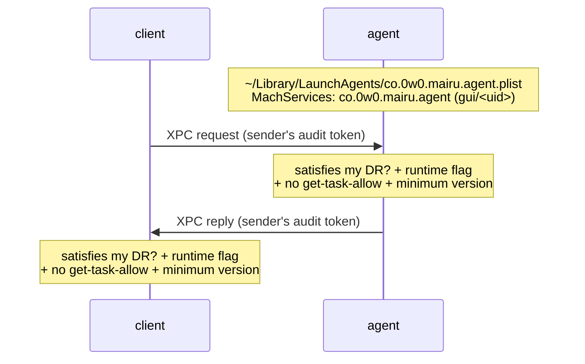
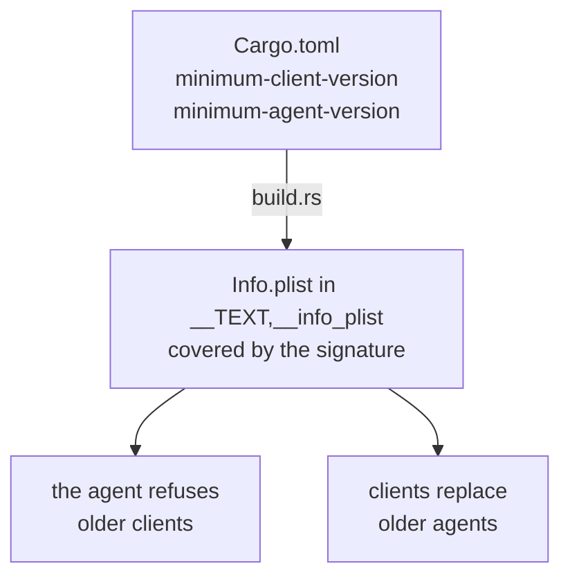

# 017-macos-peer-verification

## Summary

This step is the macOS counterpart of [003](003-marker-gid.md) and [004](004-peer-verification.md). On macOS, a process's identity is its code signature, not a setgid marker. Clients reach the agent over XPC, through a per-user LaunchAgent. Both ends verify every message against a requirement derived from **their own** designated requirement, so no team identifier is hardcoded, and the same code serves official, third-party and ad-hoc builds. Signed minimum client and agent versions keep old official releases from being used as a downgrade. The macOS process primitives (process facts, session ids, ancestry) replace `FallbackProcess` on macOS.

The macOS implementation is done separately from the Linux work, in the macOS implementer's own layers. Linux and BSD keep the Unix socket and the marker gid of [003](003-marker-gid.md) unchanged.

## Motivation

[004](004-peer-verification.md) verifies peers with `SO_PEERCRED`, a snapshot the kernel takes at `connect()` and `listen()`. Until this step, macOS runs `FallbackProcess` ([004](004-peer-verification.md)): no verification, every peer `Unverifiable`, as before hardening. The adversary is the same as on Linux: code running as the user ([001 Adversary](001-security-model.md#adversary)).

**macOS has no snapshot with a pid (confirmed on macOS 27.2).** `LOCAL_PEERTOKEN` and `LOCAL_PEERPID` are **not** snapshots: they report the last process that did I/O on the peer socket. Only `LOCAL_PEERCRED` is a snapshot, and it carries uid and groups but no pid.

That makes one check per connection unsound. An unsigned process can connect, hand the connected fd to a genuine signed mairu as its stdout, and let it write anything. The peer token then names the genuine binary, while the attacker keeps the fd and continues talking. A transport that identifies the sender of **each message** is needed.

**Code signing is the native identity.** The kernel and the Security framework can tell which signed code a process runs, from its audit token. A requirement derived from the verifier's own designated requirement lets every build tier use the same code, without a team identifier compiled in, and lets forks and source builds verify each other.

**A team requirement accepts every official release ever published,** including ones with a fixed vulnerability, and they all stay downloadable. Same-user code can start any genuine binary with any arguments ([001 Adversary](001-security-model.md#adversary)), so it can run an old official agent with a known agent-side flaw, and current clients would then send it OAuth codes and requests. Official builds therefore need a signed floor that a peer below it fails.

**Every code path must run without Apple Developer Program membership.** A Developer ID only makes the identity stable across versions. Contributors develop and test the same code paths with ad-hoc builds, and only a small set of official-only properties is checked by maintainers before a release.

## Explanation

### macOS at a glance

```text
              Linux                              macOS, Developer ID build                 macOS, ad-hoc build
anchor        setgid marker group                team + identifier co.0w0.mairu            cdhash (byte-identical binaries)
transport     Unix socket                        XPC Mach service of a per-user LaunchAgent (both tiers)
peer id       SO_PEERCRED + pidfd                audit token of each XPC message + pid version (both tiers)
anti-tamper   AT_SECURE, non-dumpable            hardened runtime, PT_DENY_ATTACH (both tiers)
downgrade     minimum versions (004)             signed minimum versions                   cdhash differs per version
top of chain  root                               administrator (sudo, /etc/authorization)
```

```text
verify_peer(message)
  audit token of the XPC message                  → sender's pid + pid version
  SecCodeCopyGuestWithAttributes(audit token)     → peer code
  SecCodeCheckValidity(peer code, my own designated requirement)
  require hardened runtime, no get-task-allow
  require the peer's signed version ≥ my minimum for its role
```

Identity comes from the peer's audit token, never a pid:

1. Get the audit token of each XPC message ([XPC transport](#xpc-transport)). `getsockopt(SOL_LOCAL, LOCAL_PEERTOKEN)` serves only the platform helper's inherited socketpair ([006 Helper process](006-platform-helper.md#helper-process)).
2. Get the peer's code with `SecCodeCopyGuestWithAttributes(kSecGuestAttributeAudit)`.
3. Check it with `SecCodeCheckValidity` against a requirement derived from **the verifier's own** designated requirement (`SecCodeCopySelf` + `SecCodeCopyDesignatedRequirement`).

No team identifier is hardcoded:

- Developer ID builds match on team and identifier `co.0w0.mairu`, so any version from the same team matches. Signed minimum client and agent versions reject old versions ([Minimum versions](#minimum-versions)).
- Ad-hoc builds (`cargo`, Homebrew from source, forks) match only a byte-identical binary, through the cdhash.
- A binary without the hardened-runtime flag, such as plain `cargo build` output, is treated as unhardened ([Build tiers](#build-tiers)).

Both sides also require the hardened-runtime flag and the absence of `com.apple.security.get-task-allow`. The agent keeps `PT_DENY_ATTACH`. The audit token's pid version (`audit_token_to_pidversion`) is used wherever a pid is recorded.

The macOS process model of verification is the same as on Linux: an unverified peer is rejected as in [004 Agent side](004-peer-verification.md#agent-side) and [004 Client side](004-peer-verification.md#client-side), and a hardened client replaces an unverified agent ([004 Replacing an unverified agent](004-peer-verification.md#replacing-an-unverified-agent)), through launchd ([XPC transport](#xpc-transport)).

### Build tiers

```text
own signature (SecCodeCopySelf → signing information)        treatment
Developer ID, hardened runtime, team = upstream    official      Hardened; peers satisfy team + identifier
Developer ID, hardened runtime, other team         third-party   Hardened; peers satisfy that team + identifier
ad-hoc, hardened runtime                           ad-hoc        Hardened; peers satisfy the cdhash
no hardened runtime (plain cargo build)            unhardened    Unverifiable peers, as before; doctor explains how to sign
```

The runtime decides from **its own observed signature**, never from build flags. The comparison is always "the peer satisfies my own designated requirement", so every tier runs the same verification code. A Developer ID changes how stable the identity is. Every verification feature of this step exists in every hardened tier.

- **Official.** Built by the upstream release pipeline from a signed tag. Signed with the project's Developer ID (hardened runtime, `--timestamp`, identifier `co.0w0.mairu`) and notarized. The team ID is recorded in this spec once the Developer ID is issued.
- **Third-party signed.** Someone else's Developer ID: the same mechanics under that team. Such builds do not interoperate with official installs, because their designated requirements differ. That is by design.
- **Ad-hoc.** Everything else. Linker-signed ad-hoc binaries lack the hardened-runtime flag and so run unhardened. `script/macos-dev-sign` re-signs them with it.
- **Unhardened.** Peers are `Unverifiable`, as before this step. `mairu doctor` ([004 GetAgentStatus](004-peer-verification.md#getagentstatus)) says the binary has no hardened runtime and how to re-sign it.

**Contributors on macOS:**

| Step | Result |
|---|---|
| `cargo build` | unhardened: no peer verification, as before |
| `script/macos-dev-sign <binary>`, which runs `codesign --force --sign - --options runtime --identifier co.0w0.mairu` | hardened ad-hoc: two processes of this build verify each other |
| rebuild | a new cdhash: the dev agent is replaced automatically |

- Plain `cargo build` output has no hardened-runtime flag, so it runs unhardened.
- `script/macos-dev-sign` re-signs a build ad-hoc with the hardened runtime. Processes from that build then verify each other by cdhash, through the same code path official builds use with a team requirement.
- The dev profile ([004 Dev profile](004-peer-verification.md#dev-profile)) uses its own LaunchAgent label and Mach service, `co.0w0.mairu.dev.agent`, so a contributor's build never replaces the installed agent.
- Not possible without the program: an official identity, notarization, team-requirement acceptance across versions, and the minimum client and agent versions between signed versions. Maintainers cover these before each release.

### XPC transport



The check above runs in both directions, on every message.

**Why XPC holds.** The kernel stamps every Mach message with its sender's audit token. A lent or forwarded send right therefore speaks as whichever process actually sends on it, so the fd-lending attack of [Motivation](#motivation) has nothing to borrow.

**Service.**
- The agent is a LaunchAgent, label `co.0w0.mairu.agent`, declaring the Mach service `co.0w0.mairu.agent` in `MachServices`. It is a plain executable (`ProgramArguments`), so it needs no bundle.
- Clients connect with `xpc_connection_create_mach_service`, and launchd starts the agent on the first message.
- The dev profile ([004 Dev profile](004-peer-verification.md#dev-profile)) uses label and service `co.0w0.mairu.dev.agent`.
- Linux and BSD keep the Unix socket.

**Messages.** Every RPC in `proto/mairu.proto` is unary, so each maps to one XPC request and its reply:
- request: `{method: "/mairu.Agent/AssumeRole", body: <protobuf bytes>}`
- reply: `{code, message, metadata, body}`, carrying the gRPC status code and metadata such as `mairu-authorization` unchanged

The protobuf messages and the agent's handlers are shared with Linux. Only the transport differs.

**Verification.**
- Both ends set `xpc_connection_set_peer_code_signing_requirement` to the requirement derived from their own designated requirement.
- The hardened-runtime, get-task-allow and minimum-version ([Minimum versions](#minimum-versions)) checks run on the audit token of each message.
- The agent pins the pid and pid version of the requester for grants and leases, as it pins the pid and start time on Linux ([007 Grants and leases](007-authorization.md#grants-and-leases)).

**Installing and replacing the LaunchAgent.**
- When the service does not answer, the client writes the plist, pointing at the binary to run, and bootstraps it into `gui/<uid>`. If that fails, for example with no GUI login, it bootstraps it into `user/<uid>` with `LimitLoadToSessionType` `Background` (Q-M11).
- Replacing an unverified or outdated agent ([004 Replacing an unverified agent](004-peer-verification.md#replacing-an-unverified-agent)) is `launchctl bootout gui/<uid>/co.0w0.mairu.agent`, then rewriting the plist and bootstrapping it again.
- The plist lives in a user-writable directory and is not trusted. Same-user code can rewrite it, with any arguments and `EnvironmentVariables`. Whatever answers the service name must still pass the client's check, and the agent clears its environment at start as on Linux ([004 Hardened agent environment](004-peer-verification.md#hardened-agent-environment)), so a planted proxy, CA or endpoint never reaches its connections.
- A job that claims the service name first only denies service, which same-user code can also do by killing the agent.

**Session.**
- An agent in `gui/<uid>` runs in the user's GUI session. Both the LocalAuthentication sheet and the administrator dialog (`AuthorizationCopyRights`) can appear from there. This addresses Q-M2: the agent's platform helper ([006 Helper process](006-platform-helper.md#helper-process)) inherits that session.
- An agent in `user/<uid>` still gets the LocalAuthentication sheet on the console while a GUI session exists. `AuthorizationCopyRights` fails there at once with `errAuthorizationInteractionNotAllowed` (`-60007`). Both are confirmed, and the same holds for a process in an SSH session.
- An agent started in `user/<uid>` keeps running when a GUI login appears later. `mairu kill-agent` lets the next client start it in `gui/<uid>`.

**SSH logins (Q-M11, confirmed while a console login exists).** Tested on macOS 27.2, first with launchd Background jobs, then from a real SSH session:
- `launchctl bootstrap` into `gui/<uid>` and into `user/<uid>` both work as the user, without root.
- A client running as a Background job in `user/<uid>` reaches a `gui/<uid>` Mach service while the console session exists (confirmed). A GUI client reaches a `user/<uid>` Background service too (confirmed).
- A real SSH session (`ssh localhost`) gets its own audit session, and `launchctl managername` reports Background. From it, a client reaches the `gui/<uid>` service, and `launchctl bootstrap` into `gui/<uid>` and `user/<uid>` both succeed (confirmed).
- With no console login, `gui/<uid>` is expected not to exist. This is untested and deferred, since no Mac is available to test it on. The client does not depend on the answer: it falls back to `user/<uid>` whenever bootstrapping into `gui/<uid>` fails.

Over SSH, the ssh-agent method ([013](013-ssh-agent.md)) is the one that reaches a remote user, as on headless Linux ([008](008-headless.md)).

**Unchanged by the transport.**
- The agent ↔ helper channel stays an inherited socketpair ([006 Helper process](006-platform-helper.md#helper-process)). Lending needs a copy of an fd, and both ends live only in hardened-runtime processes, whose task ports same-user code cannot obtain.
- The ECS credential endpoint keeps its bearer token.

**Compatibility.** macOS clients from before this change use the Unix socket. They start their own socket agent, which shares no sessions with the XPC agent.

### Minimum versions



```text
release   minimum-client-version   minimum-agent-version
0.18.1    0.13.0                   0.13.0
0.18.2    0.18.2                   0.18.2     fixes a protocol-level flaw: both raised
0.19.0    0.18.2                   0.18.2
0.19.1    0.18.2                   0.19.1     fixes an agent-side flaw: only the agent minimum raised
0.20.0    0.18.2                   0.19.1     a mise-pinned 0.19.0 client still works; a 0.19.0 agent is replaced
```

- Every macOS build embeds an `Info.plist` in the `__TEXT,__info_plist` section through a `build.rs` link argument. The code signature covers it. It carries the build's version, its `MairuMinimumClientVersion` and its `MairuMinimumAgentVersion`, taken from `[package.metadata.mairu]` in `Cargo.toml`.
- Each peer reads the other's signed `Info.plist` (`SecCodeCopySigningInformation`, `kSecCodeInfoPList`):
  - the agent refuses a client older than its minimum client version;
  - a hardened client replaces an agent older than its minimum agent version: `launchctl bootout`, then the plist pointed at itself, then `bootstrap` ([XPC transport](#xpc-transport)).
- **Two values, because the roles are reached differently.** An old official agent with a known agent-side flaw can be started by same-user code, and current clients would then send it OAuth codes and requests. A minimum agent version lets clients refuse it without locking out older clients, whose own handling was never at fault.
- **When to raise them,** to the version of the release that fixes the flaw:
  - `minimum-client-version`: for a client-side or protocol-level flaw.
  - `minimum-agent-version`: for an agent-side or protocol-level flaw.

  This is a step of the `releng` skill.
- **Not every release.** Versions newer than the last raise keep working side by side, such as per-directory mise versions. A minimum client version raised in every release would lock out any older install as soon as a newer agent runs. A minimum agent version raised in every release would make alternating versions replace each other's agents, dropping sessions each time.
- An old client knows only its own release's values, so it accepts any agent at or above them. The protection covers clients from the fixing release on.
- On Linux the same two versions are compiled in and exchanged between verified peers ([004 Minimum versions](004-peer-verification.md#minimum-versions)), since an older hardened copy left on the host is still genuine there. Ad-hoc macOS builds don't need them, because their cdhash identity already differs per version.

### Top of the trust chain

On macOS the top of the trust chain ([001 Trust chain](001-security-model.md#trust-chain)) is the administrator account: `sudo`, and authorization rights in `/etc/authorization`.

## Drawbacks

- **Ad-hoc identities change with every build.** Each rebuild or upgrade of an ad-hoc build gets a new cdhash, so it replaces the running agent ([004 Replacing an unverified agent](004-peer-verification.md#replacing-an-unverified-agent)) and drops its sessions.
- **Separate trust domains.** Third-party Developer ID builds and official builds do not verify each other. Users of both on one Mac run two agents, which the dev profile keeps apart only for debug builds.
- **A second transport.** macOS carries XPC transport code next to the Unix socket that Linux and BSD keep. The handlers are shared, but message mapping, launchd installation and replacement exist only on macOS.
- **Transition.** Clients from before this change start their own socket agent, which shares no sessions with the XPC agent, until every install is upgraded.
- **The minimum versions protect from the fixing release on.** An old client accepts any agent at or above its own values.
- **Denial of service stays possible.** The LaunchAgent plist is user-writable, and another job can claim the service name. Both only deny service.
- **Untested without a console login.** Whether `gui/<uid>` exists with no console login is not confirmed (Q-M11). The `user/<uid>` fallback covers both answers.

## Considered Alternatives

- **Transport (Q-M10, decided 2026-10-23).**
  - (a) Keep the Unix socket, check the token right after `accept()`, and re-check after every read. This narrows the fd-lending attack to a race (the attacker writes, then the lent genuine process writes before the agent re-checks), but does not close it. Rejected.
  - (b) XPC through a per-user LaunchAgent `MachService`, where each message carries its sender's audit token. **Chosen.**
  - (c) A challenge that only a genuine, non-lent process can answer. No such answer exists without a secret, and mairu binaries hold none. Rejected.
- **One check per connection on the Unix socket.** `LOCAL_PEERTOKEN` follows the last process to do I/O, so a lent fd defeats it. Rejected for the client ↔ agent channel.
- **Hardcoding the team identifier or a list of cdhashes.** Forks, source builds and third-party signers could not verify each other, and the code would differ per tier. Rejected for a requirement derived from the verifier's own designated requirement.
- **Deciding the tier from build flags.** Rejected: a build flag says nothing about how the binary was actually signed. The runtime reads its own signature.
- **Downgrade protection.**
  - A single floor, first named the security floor, then renamed to minimum client version: it could not refuse an old agent without also locking out old clients. Replaced by separate minimum client and agent versions (decided 2026-10-23).
  - Raising the minimums in every release: rejected, because it locks out side-by-side versions and makes alternating versions replace each other's agents.
  - Minimum versions on Linux: not needed, because every install re-execs the single hardened copy.
- **launchd domain.** `gui/<uid>` first, so both the LocalAuthentication sheet and the administrator dialog work. `user/<uid>` with `Background` as the fallback when no GUI login exists, rather than failing.
- **The agent ↔ helper channel over XPC.** Not needed: the socketpair is inherited, never in the filesystem, and both ends run with the hardened runtime, so its fd cannot be lent.

## Prior Art

- Apple's XPC services: a per-user LaunchAgent declaring `MachServices`, started on demand by launchd, is the standard shape for a per-user daemon on macOS.
- Apple's guidance for XPC peers: identify the sender by its audit token and a code-signing requirement, never by a pid. `xpc_connection_set_peer_code_signing_requirement` enforces a requirement on every message of a connection.
- The Linux design of [004](004-peer-verification.md): both directions verified, unverified agents replaced.

## Security and Privacy Considerations

| Threat | Mitigation |
|---|---|
| Lending a connected socket to a genuine signed process, so its audit token stands in for the attacker | XPC: every message carries its sender's audit token ([XPC transport](#xpc-transport)) |
| Rogue client | Peer code must satisfy the agent's own designated requirement, with the hardened runtime and no get-task-allow, on every message |
| Rogue agent, or a squatted service name | Clients verify whatever answers, on every reply; squatting only denies service |
| Rewritten LaunchAgent plist | Not trusted; clients verify whatever answers the service on every message; the agent clears the environment the plist sets |
| Injection into or debugging of the genuine binary | Hardened runtime, no `get-task-allow`, `PT_DENY_ATTACH` in the agent |
| An old official agent or client with a known flaw | Signed minimum client and agent versions in the embedded `Info.plist` ([Minimum versions](#minimum-versions)) |
| Pid reuse | Audit-token pid version wherever a pid is recorded |
| Plain `cargo build` output | Unhardened by its own signature; peers `Unverifiable`, as before; `doctor` explains |
| Root reached through the administrator account | Out of scope, but it bounds everything ([001 Trust chain](001-security-model.md#trust-chain)) |

## Mission Scope

### Out of scope

- Linux and BSD transports, which keep the Unix socket and the marker gid ([003](003-marker-gid.md), [004](004-peer-verification.md)).
- The root-owned install, release signing and distribution, and the macOS platform services (LocalAuthentication, integrity stores, notifications). Until they land, the platform helper on macOS is the `FallbackServices` of [006](006-platform-helper.md).
- Q-M11 without a console login: deferred, covered by the `user/<uid>` fallback.
- Recording the official team ID: once the Developer ID is issued.

### Expected Outcomes

- Two processes of the same hardened build verify each other on every XPC message, in both directions, on every tier.
- A different build, an unsigned process, or a process lent a connection is refused.
- Plain `cargo build` output keeps working unhardened, and `doctor` says how to sign it.
- Clients install the LaunchAgent on demand, in `gui/<uid>` or else `user/<uid>`, and replace an unverified or outdated agent.
- Official builds below the peer's signed minimum are refused (clients) or replaced (agents).
- Grants, leases and session identity work on macOS with pids pinned by pid version.

## Implementation Plan

Stack layer: the macOS implementer's own layers, on top of [006](006-platform-helper.md) and [007](007-authorization.md).

### Process primitives on macOS

`MacosProcess` implements `ProcessPlatform` ([004](004-peer-verification.md)) and replaces `FallbackProcess` on macOS. It is the counterpart of [004 Process facts](004-peer-verification.md#process-facts):

- `proc_pidinfo(PROC_PIDTBSDINFO)`: start time `pbi_start_tvsec/usec`, `pbi_ppid`, `e_tdev` for the tty
- `getsid` for the session
- `proc_pidpath` for the executable
- Pid reuse defeated with the audit-token pid version
- `Process.start_time` is microseconds since the epoch on macOS ([006 Protocol](006-platform-helper.md#protocol)).
- Session identity ([007 Session identity](007-authorization.md#session-identity)): `Tty { sid, leader_start_time }` from `getsid` and the leader's `proc_pidinfo` start time, else `Parent { ppid, start_time }`.
- Tool-detection ancestry and session ids ([010 Labels and signals](010-tool-detection.md#labels-and-signals)) use the same rules, through `proc_pidinfo`. This is a process primitive in the agent, not a helper service.

The XPC listener has no `UnixStream`. It builds each `PeerIdentity` from the message's audit token (pid, pid version, uid, executable, trust) with the verification of [Explanation](#explanation). `inspect_peer` and `verify_agent` on a `UnixStream` remain for the helper's socketpair.

### Verification

1. Get the audit token of each XPC message (`xpc_dictionary_get_audit_token`, or the connection's token for the current message).
2. `SecCodeCopyGuestWithAttributes(kSecGuestAttributeAudit)` → peer code.
3. `SecCodeCopySelf` + `SecCodeCopyDesignatedRequirement` → own requirement, computed once at startup. `SecCodeCheckValidity(peer, own requirement)`; a different build fails with `errSecCSReqFailed`.
4. `SecCodeCopySigningInformation`: require `kSecCodeSignatureRuntime` in the flags, and no `com.apple.security.get-task-allow` entitlement.
5. Read the peer's `kSecCodeInfoPList` and compare its `CFBundleShortVersionString` with the own `MairuMinimumClientVersion` (agent) or `MairuMinimumAgentVersion` (client).
6. `xpc_connection_set_peer_code_signing_requirement` with the own requirement on both ends, as a second layer.

**Q-M8 (confirmed, with a caveat).** On a client's connected Unix socket, `LOCAL_PEERTOKEN`/`LOCAL_PEERPID` give the listener's pid, pid version and audit session. `SecCodeCheckValidity` against the verifier's own requirement succeeds for the same build and fails with `errSecCSReqFailed` for a different one, in both directions. The caveat is the asymmetry of [Motivation](#motivation): these values follow the last process to do I/O, so a genuine process lent the fd can stand in for an attacker. That is why the client ↔ agent channel is XPC.

### XPC message mapping

- The agent's tonic services are reused as handlers. An XPC request `{method, body}` is dispatched to the handler for `method` with the decoded `body`. The reply carries `{code, message, metadata, body}`: the gRPC status code, its message, the response metadata (for example `mairu-authorization`), and the encoded response.
- The verified `PeerIdentity` is attached to the request as on Linux ([004 Agent side](004-peer-verification.md#agent-side)), so every handler, `require_verified` and the `Authorizer` see the same types.
- Clients wrap the same calls: one XPC request per unary RPC, the reply mapped back to `tonic::Status` and the response message.

### launchd

- Plist: `~/Library/LaunchAgents/co.0w0.mairu.agent.plist` (dev profile: `co.0w0.mairu.dev.agent.plist`), `Label` and `MachServices` key `co.0w0.mairu.agent`, `ProgramArguments` `[<binary>, "agent"]`.
- Install: write the plist, `launchctl bootstrap gui/<uid> <plist>`; on failure `launchctl bootstrap user/<uid> <plist>` with `LimitLoadToSessionType` `Background`.
- Replace: `launchctl bootout gui/<uid>/co.0w0.mairu.agent` (or the `user/<uid>` domain it was in), rewrite, bootstrap.
- `mairu kill-agent` boots the job out, so the next client starts it in `gui/<uid>` when a GUI login exists.

### Signed Info.plist

- `build.rs` generates `Info.plist` from `CARGO_PKG_VERSION` and `[package.metadata.mairu]` (`minimum-client-version`, `minimum-agent-version`), and passes `-Wl,-sectcreate,__TEXT,__info_plist,<path>` for macOS targets.
- `CFBundleIdentifier` is `co.0w0.mairu`.

### Tests and CI

- Designated-requirement strings and minimum-version parsing are unit-tested, so the team-requirement logic is covered without signing.
- A macOS CI job (pull requests, forks included, no secrets) runs `script/macos-dev-sign` on the built binary, then checks verification between two processes of that build in both directions, and refusal of a different build.

### Files

- `src/platform/process/macos.rs`: `MacosProcess` (audit token, `SecCode` checks, process facts, session ids, ancestry)
- `src/platform/mod.rs`: `crate::platform::process()` selects `MacosProcess` on macOS
- `src/xpc.rs`: XPC listener (agent) and connection (client), message mapping
- `src/launchd.rs`: plist, bootstrap, bootout
- `src/cmd/agent.rs`, `src/agent.rs`, `src/client.rs`: macOS transport in place of the Unix socket; replacement through launchd
- `src/cmd/kill_agent.rs`: `launchctl bootout` on macOS
- `src/cmd/doctor.rs`: tier, hardened-runtime state, transport and LaunchAgent domain
- `build.rs`: signed `Info.plist`
- `Cargo.toml`: `[package.metadata.mairu]` minimum versions; macOS-only dependencies for Security framework and XPC bindings
- `script/macos-dev-sign`
- `.github/workflows/ci.yml`: macOS job
- `.claude/skills/releng/SKILL.md`: when to raise `minimum-client-version` and `minimum-agent-version`

### Findings and open questions

| Id | Topic | Status |
|---|---|---|
| Q-M2 | GUI session for prompts | Addressed: the agent runs in `gui/<uid>` when a GUI login exists ([XPC transport](#xpc-transport)) |
| Q-M8 | `LOCAL_PEERTOKEN` | Confirmed, with the lending caveat ([Verification](#verification)) |
| Q-M10 | Transport | Decided 2026-10-23: XPC through a per-user LaunchAgent ([Considered Alternatives](#considered-alternatives)) |
| Q-M11 | SSH logins | Confirmed while a console login exists; the no-console case is deferred ([XPC transport](#xpc-transport)) |

## Current Status

Spec drafted; awaiting review before implementation. Implementors MUST keep this section updated as they work.

### Checklist

- [ ] `MacosProcess`: process facts, session ids, ancestry, `PeerIdentity` from audit tokens
- [ ] Code-signature peer verification for every tier, on every message
- [ ] XPC transport through the `co.0w0.mairu.agent` LaunchAgent: install, replace, message mapping
- [ ] Embedded `Info.plist` with the minimum client and agent versions; refusal and replacement
- [ ] `mairu doctor` on macOS: tier, hardened runtime, transport
- [ ] `script/macos-dev-sign` and the macOS CI job
- [ ] `releng` skill: when to raise the minimum versions
- [ ] Record the official team ID once the Developer ID is issued
- [x] Q-M2 addressed, Q-M8 confirmed, Q-M10 decided
- [ ] Q-M11 without a console login (deferred)

### Updates

- 2026-10-29: Split out of hardening.md, policy.md and platform-helper.md.
