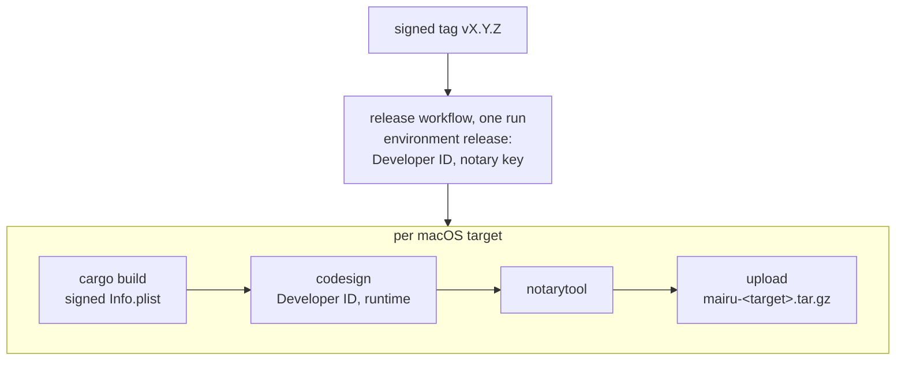
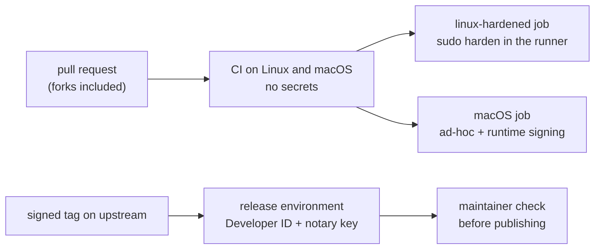

# 018-macos-install

## Summary

This step brings `sudo mairu harden` to macOS, for every build tier, and sets up how official macOS builds are signed, notarized, released and distributed. `harden` copies the binary into a root-owned location, setgid to the `mairu` marker group, re-signed with the hardened runtime when the build is ad-hoc. It creates the protected directory for the strong policy store, and repoints the LaunchAgent at the hardened copy, so every install converges on it.

Official builds come from one release workflow run per signed tag. Each macOS architecture, `aarch64-apple-darwin` and `x86_64-apple-darwin`, gets its own Developer ID-signed and notarized binary. They are distributed as release tarballs (also used by aqua, mise and ubi), a Homebrew cask `mairu`, and a from-source formula `mairu-src`. Maintainers check the signed artifacts before publishing each release, and a dry run lets pull requests that touch the pipeline be tested without publishing.

## Motivation

[017](017-macos-peer-verification.md) verifies peers by code signature. Three gaps remain.

- **Ad-hoc builds run unhardened.** Linker-signed binaries lack the hardened-runtime flag ([017 Build tiers](017-macos-peer-verification.md#build-tiers)). Users who build from source, or install with Homebrew from source or `cargo install`, need a way to get the hardened runtime without the dev script.
- **User-writable binaries.** A binary in a user-writable location can be replaced by same-user code. Verification catches a different binary, but the user then has no working mairu. A root-owned copy cannot be rewritten. It also gives every install of a build one cdhash to converge on through re-exec, so installs stop replacing each other's agent.
- **No strong store without a bundle.** The protected directory of [012 Integrity stores](012-policy-approval.md#integrity-stores) needs the marker group, which only a setgid exec provides. On macOS the setgid marker carries over (Q-M9), so `harden` can give every tier a strong policy store without any app bundle.

Official builds need a stable identity across versions, which only a Developer ID provides, and notarization, so that downloads pass Gatekeeper. The signing secrets must never reach workflows from forks. Properties that only an official build has cannot be tested by contributors, so maintainers check them before a release.

Distribution has its own constraints. Homebrew directs binary-only software to casks, and casks keep the signature. Tools such as aqua, mise and ubi install the release tarball unchanged. Apple is phasing out Intel Macs, so macOS releases are built per architecture ([002](002-build-layout.md)): each user downloads only their own architecture.

## Explanation

### harden on macOS

```text
sudo mairu harden   (macOS, every tier)
  dseditgroup -o create mairu                         refuse if the user is a member; no group password
  /opt/mairu/libexec/mairu/mairu                      copy, root:mairu, mode 2755
    ad-hoc: codesign --force --sign - --options runtime --identifier co.0w0.mairu   (before chown/chmod)
  /private/var/db/mairu                               root:mairu 2770; the helper creates users/<uid>
  LaunchAgent plist                                   points at the hardened copy (017); other installs re-exec into it (005)
```

`harden` is the macOS counterpart of [005 mairu harden](005-install.md#mairu-harden), for every tier. It provides the **protected directory**, the strong policy store that needs no app bundle. Ad-hoc builds also get a root-owned location and the hardened runtime.

- **Group.** The marker group `mairu`, with the preconditions of [003](003-marker-gid.md): the user must not be a member, primary or supplementary, and the group has no password.
- **Harden home.** `/opt/mairu` by default on macOS, a prefix of mairu's own, as Homebrew uses `/opt/homebrew` on Apple silicon. It is configurable as on Linux ([005 Harden home](005-install.md#harden-home)): `--home`, `MAIRU_HARDEN_HOME`, or `harden_home` in `config.json`.
- **Copies.** Mode bits are not covered by a code signature, so the setgid bit leaves a signature valid (confirmed for ad-hoc builds). Ad-hoc builds are re-signed with the runtime before the mode is set. The copy is written fresh, so it does not carry `com.apple.quarantine` over.
  - A quarantined, unnotarized input never reaches `harden`, because Gatekeeper blocks its exec first (observed). Ad-hoc builds are built locally and are not quarantined anyway.
  - A quarantined, notarized official binary, as a cask installs it, passes Gatekeeper's online check. Running it under `sudo` is to be checked with the first official build.
- **Protected directory.** `/private/var/db/mairu`, `root:mairu` mode `2770`. The per-user record lives at `/private/var/db/mairu/users/<uid>/policy.record`, with the rules of [012 Integrity stores](012-policy-approval.md#integrity-stores): it is written holding the marker gid, and the ancestors must be root-owned and not group- or other-writable. `/var` is a symlink, so the canonical path is used.
- **LaunchAgent.** The plist of [017 XPC transport](017-macos-peer-verification.md#xpc-transport) is pointed at the hardened copy. Other installs re-exec into it ([005 Re-exec](005-install.md#re-exec)), so every install of a build ends up talking to the same agent.
- Everything `harden` writes is root-owned.

**Ad-hoc peers** match only byte-identical binaries. Each upgrade therefore replaces the running agent ([004 Replacing an unverified agent](004-peer-verification.md#replacing-an-unverified-agent)) and drops its sessions.

**Ad-hoc re-signing is deterministic (confirmed).** A root-owned copy and a user-writable copy signed the same way from the same bytes have the same cdhash, and they verify each other in both directions. For ad-hoc builds, the `harden` copy therefore adds no identity of its own. What it adds:

- a binary that same-user code cannot rewrite;
- the setgid marker for the protected directory;
- one cdhash that every install converges on through re-exec, so different installs stop replacing each other's agent.

A tampered user-writable binary still fails cdhash verification.

**Operations on macOS:**

```text
upgrade     sudo mairu harden (or the cask's postflight) → mairu kill-agent
uninstall   sudo mairu harden --uninstall [--purge] → dseditgroup -o delete mairu
diagnose    mairu doctor
```

- **Upgrades.** The hardened copy must be refreshed after upgrading. Until then, other installs re-exec the older copy and warn about the version skew ([005 Re-exec](005-install.md#re-exec)).
  - The Homebrew cask's `postflight` runs the new binary's `sudo mairu harden` when a hardened copy already exists (decided 2026-10-23). `harden` never re-execs, so the new version installs itself. This asks for a password during `brew upgrade`. If it fails, for example in a non-interactive upgrade, the upgrade still succeeds and prints the command to run.
  - Other installs re-run it by hand.
- **Uninstall** works as in [005 mairu harden](005-install.md#mairu-harden). The group is removed with `dseditgroup -o delete mairu`.

### Distribution

```text
GitHub release tarball · aqua · mise · ubi   official: mairu-<arch>-apple-darwin.tar.gz, installed unchanged
Homebrew cask "mairu"                        official: binary symlinked from Caskroom, never re-signed
Homebrew formula "mairu-src"                 ad-hoc (built from source)
cargo install                                ad-hoc
```

- **Release tarballs** are per architecture: `mairu-aarch64-apple-darwin.tar.gz` and `mairu-x86_64-apple-darwin.tar.gz`. No universal binary is published ([002](002-build-layout.md)).
- **aqua, mise and ubi** install the official release tarball unchanged.
  - They download with their own HTTP clients, which do not set quarantine.
  - They keep each version in its own directory, and versions can run side by side. The team-based requirement does not depend on paths ([017 Build tiers](017-macos-peer-verification.md#build-tiers)).
  - The aarch64 asset name is unchanged. Intel Macs switch from the universal asset to `x86_64-apple-darwin`, so the aqua registry entry and any mise or ubi asset matching that picked the universal asset need updating.
- **Homebrew cask `mairu`** in `sorah/homebrew-sorah`:
  - `binary "mairu"`, pointing at the notarized release tarball, with a URL and checksum per architecture (`on_arm`, `on_intel`), and Linux URLs too.
  - Nothing strips quarantine.
  - Users of the old formula are migrated with `tap_migrations.json`.
  - `postflight` refreshes an existing hardened copy, and prints the command instead of failing when `sudo` fails.
- **Homebrew formula `mairu-src`** builds from source, so it produces ad-hoc builds. When a formula and a cask share a name, `brew install` picks the formula, which is why the from-source formula takes another name.
- **`cargo install`** produces ad-hoc builds.

### Contributors with their own Developer ID

Their signed builds are the third-party tier ([017 Build tiers](017-macos-peer-verification.md#build-tiers)). They get full strength under their own team, but do not interoperate with official installs. The dev profile ([004 Dev profile](004-peer-verification.md#dev-profile)) keeps the two apart on the same machine.

## Drawbacks

- **A password prompt during `brew upgrade`.** The cask's `postflight` runs `sudo mairu harden` when a hardened copy exists. Non-interactive upgrades leave the copy stale until the user runs the printed command.
- **Stale hardened copies.** Installs that are not upgraded through the cask re-exec the older hardened copy until `harden` is re-run by hand.
- **Ad-hoc upgrades drop sessions,** because each upgrade has a new cdhash and replaces the running agent.
- **The first run of a downloaded official binary needs an online notarization check** when the download is quarantined. A bare Mach-O cannot carry a stapled ticket.
- **Signing needs a maintainer.** Pull requests that change the signing pipeline cannot exercise it from a fork, so a maintainer runs the dry run.
- **Intel users of the universal download must switch** to the `x86_64-apple-darwin` asset, and anything that selects the universal asset by name breaks until it is updated.

## Considered Alternatives

- **`/usr/local` as on Linux.** Rejected as the macOS default: on Intel Macs Homebrew takes `/usr/local` as its prefix and makes much of it writable by the user, which breaks the root-owned-ancestors rule of [005 Re-exec](005-install.md#re-exec). A prefix of mairu's own keeps every ancestor root-owned.
- **Homebrew packaging (Q-M7, decided 2026-10-23).**
  - A prebuilt-binary formula: rejected as the primary channel. homebrew/core formulae must build from source, Homebrew directs binary-only software to casks, and Homebrew maintainers call prebuilt-binary formulae unsupported. GoReleaser moved from formulae to casks for that reason.
  - **A cask `mairu`** for official builds, a from-source formula `mairu-src` for ad-hoc builds, and `tap_migrations.json` to move users: **chosen**.
  - **Fallback:** a formula that installs the signed artifact, as hashicorp/tap and cirruslabs/tart do. It keeps the signature and avoids quarantine, but Homebrew maintainers call the pattern unsupported.
- **Refreshing the hardened copy on cask upgrades** (decided 2026-10-23): the cask's `postflight` runs `sudo mairu harden` when a copy exists, and degrades to printing the command. The alternative, leaving it to the user, keeps every install on the old copy until someone notices the skew warning.
- **`harden` for every tier**, not only Developer ID builds (decided 2026-10-23). It is the only strong policy store an ad-hoc build can have, and it gives ad-hoc builds the hardened runtime and a root-owned location.
- **Release builds per architecture**, not universal (decided 2026-10-29). Apple is phasing out Intel Macs, and a universal binary carries both architectures in every download ([002](002-build-layout.md)).
- **One release run.** Every artifact of a release, macOS included, is built, signed and published from one tag in one workflow run, so all artifacts always share a version. Separate pipelines per platform were rejected: GitHub releases do not work well with several pipelines writing to one release.
- **Official-only checks as a releng checklist step** (decided 2026-10-23), rather than automated tests, because they need the signed artifact and the Developer ID, which CI on pull requests never has.
- **A release dry run for pipeline changes** (decided 2026-10-23). Forks never receive the secrets, so a maintainer-triggered workflow is the only way to exercise signing and notarization before merging.

## Prior Art

- [Acceptable Formulae](https://docs.brew.sh/Acceptable-Formulae): homebrew/core formulae must build from source, and binary-only software belongs in casks.
- GoReleaser moved from formulae (`brews`) to casks (`homebrew_casks`) after Homebrew maintainers called prebuilt-binary formulae unsupported. It added casks in v2.10 and deprecated `brews` in v2.16 ([v2.10](https://goreleaser.com/blog/goreleaser-v2.10/), [v2.16](https://goreleaser.com/blog/goreleaser-v2.16/)).
- hashicorp/tap and cirruslabs/tart install signed artifacts through formulae, the fallback above.
- Since Homebrew 6.0.0, users must `brew trust` third-party taps ([Tap Trust](https://docs.brew.sh/Tap-Trust)).

## Security and Privacy Considerations

| Threat | Mitigation |
|---|---|
| Same-user code rewriting the binary that other installs re-exec | The hardened copy is root-owned; ad-hoc copies are re-signed before the mode is set |
| Injection into a setgid exec | A setgid exec by a non-member makes a restricted process: `P_SUGID`, `DYLD_INSERT_LIBRARIES` stripped, same-user `task_for_pid` refused (Q-M9) |
| User in the marker group | Membership silently disables the restriction, so `harden` refuses when the user is a member, primary or supplementary ([003](003-marker-gid.md)) |
| A group password (`newgrp`) | `harden` creates the group with no password ([003](003-marker-gid.md)) |
| A quarantined, unnotarized input | Gatekeeper blocks its exec before `harden` runs (observed) |
| Quarantine carried into the hardened copy | The copy is written fresh |
| Signing secrets reaching untrusted code | Secrets live in the protected `release` environment; workflows from forks never receive them; the dry run is gated by the environment's reviewers |
| A tampered user-writable binary | Fails cdhash or team verification ([017](017-macos-peer-verification.md)) |
| Whoever holds the Developer ID key | Can sign a mairu that every official client trusts; bounded like the administrator at the top of the trust chain ([001 Trust chain](001-security-model.md#trust-chain)) |

**Q-M9 (confirmed 2026-10-23): the marker group carries over.** Tested on macOS 27.2 with a group the user is not a member of, for a linker-signed build and for an ad-hoc build re-signed with the runtime. A setgid exec makes a restricted process:

- the egid is set, `P_SUGID` is set, and `issetugid()` returns 1;
- `DYLD_INSERT_LIBRARIES` is stripped;
- same-user `task_for_pid` is refused (`vmmap`, `lldb -p`);
- `LOCAL_PEERCRED` reports the egid as `cr_groups[0]`.

A **member** of the group gets the egid but none of the restriction: `P_SUGID` was 0, `DYLD_INSERT_LIBRARIES` was honoured, and `task_for_pid` worked. Membership, primary or supplementary, therefore silently disables it, and `harden` refuses when the user is a member.

## Mission Scope

### Out of scope

- The macOS platform services that use the protected directory, and anything written into it.
- Changes in other repositories: the cask, `mairu-src` and `tap_migrations.json` in `sorah/homebrew-sorah`, and the aqua registry entry. They are follow-ups.
- Running `sudo mairu harden` on a quarantined, notarized official binary: checked with the first official build.

### Expected Outcomes

- `sudo mairu harden` on macOS creates the group, the root-owned setgid copy (re-signed with the runtime for ad-hoc builds), and the protected directory, and points the LaunchAgent at the copy.
- Every install of a build re-execs the hardened copy, so all of them share one agent.
- A signed tag produces, in one workflow run, Developer ID-signed and notarized `aarch64-apple-darwin` and `x86_64-apple-darwin` binaries, together with every other artifact of the release.
- Maintainers check the draft release before publishing, and can dry-run the pipeline on a branch.
- The cask installs the official binary unchanged and refreshes an existing hardened copy on upgrade.

## Implementation Plan

Stack layer: the macOS implementer's own layers, on top of [017](017-macos-peer-verification.md).

### harden steps

`src/cmd/harden.rs` gains a macOS branch, root-only, following [005 mairu harden](005-install.md#mairu-harden) where the platforms agree:

1. **Group.** `dseditgroup -o read mairu`; if missing, `dseditgroup -o create mairu`. Refuse if `SUDO_UID`'s user is a member, primary or supplementary, and print how to fix it. The group has no password.
2. **Binary.** Copy its own executable (`proc_pidpath` of its own pid) to `mairu.tmp` in `<harden_home>/libexec/mairu/` ([005 Harden home](005-install.md#harden-home); `/opt/mairu` on macOS), creating missing directories as `root:wheel` mode `0755`. For an ad-hoc build, re-sign the temporary copy with `codesign --force --sign - --options runtime --identifier co.0w0.mairu` while it is still root-owned and before the mode is set. Then `fchown root:mairu`, `fchmod 02755`, `fsync`, rename into place. Official builds are copied unchanged.
3. **Protected directory.** `install -d -o root -g mairu -m 2770 /private/var/db/mairu`.
4. **LaunchAgent.** Rewrite the user's plist ([017 XPC transport](017-macos-peer-verification.md#xpc-transport)) to point at the hardened copy, `/opt/mairu/libexec/mairu/mairu` by default, as the user (`SUDO_UID`), then boot the old job out so the next client starts the hardened copy.
5. Re-exec candidates on macOS are `<harden_home>/libexec/mairu/mairu` only ([005 Re-exec](005-install.md#re-exec)), validated with the same rules: root-owned, group `mairu`, setgid, no group or other write, root-owned ancestors.

`--uninstall [--purge]` removes what these steps wrote; the group is left for `dseditgroup -o delete mairu`.

### Release pipeline



- Each target runs `cargo build --release --target <target> --bin mairu`, which embeds the signed `Info.plist` ([017 Minimum versions](017-macos-peer-verification.md#minimum-versions)). Then `codesign` with the Developer ID, the hardened runtime, a timestamp and identifier `co.0w0.mairu`, then `notarytool` on a zip of the binary, then the upload of `mairu-<target>.tar.gz`.
- The secrets live in a protected GitHub environment, `release` (the Developer ID certificate and the notary API key). Workflows triggered from forks never receive them.
- A bare Mach-O cannot carry a stapled ticket. Gatekeeper checks notarization online for quarantined downloads only. Tarballs fetched by mise, aqua or curl are usually not quarantined.
- Both macOS targets are built on the macOS runner, `x86_64-apple-darwin` cross-compiled ([002](002-build-layout.md)).
- The macOS jobs are part of the same run that builds the Linux binaries, the debs and the crate publish ([002](002-build-layout.md)), so a release never mixes versions.
- Maintainers check the signed artifacts before publishing the draft release (below).

### Development and release process



```text
pull_request (forks included)    build + test on Linux and macOS, no secrets
push of a signed tag (upstream)  environment "release": Developer ID + notary key → release pipeline
release dry run (maintainers)    manual trigger on a branch: build, sign, notarize, no publish; same environment
maintainer check (draft release) signed artifact: doctor, minimum versions, upgrade keeps sessions
```

- **Maintainer check.** Properties only an official build has are checked by a maintainer on the draft release before publishing it:
  - acceptance of the previous release under the team requirement;
  - the minimum versions ([017 Minimum versions](017-macos-peer-verification.md#minimum-versions));
  - an upgrade keeps sessions;
  - `mairu doctor` on the signed artifact.

  The same step raises `minimum-client-version` for a client-side or protocol-level flaw, and `minimum-agent-version` for an agent-side or protocol-level flaw. This is a checklist step in the `releng` skill (`.claude/skills/releng/SKILL.md`), between the release workflow and publishing.
- **Release dry run.** Pull requests that change the signing or notarization pipeline cannot exercise it from a fork, because forks never receive the secrets. A maintainer runs a release dry run on the PR's branch. It is a manually triggered workflow that builds, signs and notarizes without publishing, gated by the `release` environment's reviewers.
- **With the first official build:** `sudo mairu harden` on a quarantined, notarized binary installed by the cask.

### Files

- `src/cmd/harden.rs`: macOS branch (group, re-signed setgid copy, protected directory, LaunchAgent repointing, `--uninstall`)
- `src/hardening.rs`: re-exec candidate validation on macOS
- `.github/workflows/release.yml`: Developer ID signing and notarization per macOS target, in the `release` environment
- `.github/workflows/release-dry-run.yml`: manual trigger, build, sign, notarize, no publish
- `.claude/skills/releng/SKILL.md`: maintainer check step, dry run, follow-ups for the tap and the aqua registry
- README: `sudo mairu harden` on macOS, the cask, upgrades
- Follow-ups in other repositories: `sorah/homebrew-sorah` (cask `mairu` with per-architecture URLs and `postflight`, formula `mairu-src`, `tap_migrations.json`); the aqua registry entry

### Findings and open questions

| Id | Topic | Status |
|---|---|---|
| Q-M7 | Homebrew | Decided 2026-10-23 ([Considered Alternatives](#considered-alternatives), [Distribution](#distribution)) |
| Q-M9 | setgid exec by a non-member | Confirmed 2026-10-23 ([Security and Privacy Considerations](#security-and-privacy-considerations)) |

**Q-M7 research findings, as of 2026-10-23:**

- Homebrew policy:
  - homebrew/core formulae must build from source, and Homebrew directs binary-only software to casks ([Acceptable Formulae](https://docs.brew.sh/Acceptable-Formulae)).
  - GoReleaser moved from formulae (`brews`) to casks (`homebrew_casks`) after Homebrew maintainers called prebuilt-binary formulae unsupported.
  - Third-party taps are unrestricted, but since Homebrew 6.0.0 users must `brew trust` them ([Tap Trust](https://docs.brew.sh/Tap-Trust)).
- Signatures:
  - Homebrew re-signs a Mach-O file ad-hoc only after rewriting it: install names, rpaths, or embedded prefix strings. mairu needs none of those, so an unrelocated bottle keeps its signature.
  - A build from source is ad-hoc anyway, because the linker signs it.
  - Casks never re-sign: a `binary` artifact is a symlink into `Caskroom/<token>/<version>/`.
- Quarantine and Gatekeeper:
  - Cask downloads are quarantined; formula downloads are not. `--no-quarantine` is gone as of Homebrew 6.0.0.
  - homebrew/cask has disabled casks that fail Gatekeeper since 2026-09-01. A notarized official build passes. A bare binary cannot be stapled, so its first run needs an online notarization check.

## Current Status

Spec drafted; awaiting review before implementation. Implementors MUST keep this section updated as they work.

### Checklist

- [ ] `harden` on macOS for every tier: group, setgid copy re-signed for ad-hoc builds, protected directory, LaunchAgent repointing
- [ ] `--uninstall` on macOS
- [ ] Release pipeline: Developer ID signing and notarization for `aarch64-apple-darwin` and `x86_64-apple-darwin`, in the one release run
- [ ] Release dry-run workflow
- [ ] Maintainer check step in the `releng` skill
- [ ] With the first official build: `sudo mairu harden` on a quarantined, notarized binary
- [ ] Follow-ups: cask `mairu` (per-architecture URLs, `postflight`), formula `mairu-src`, `tap_migrations.json`, aqua registry entry
- [x] Q-M7 decided, Q-M9 confirmed

### Updates

- 2026-10-29: Split out of hardening.md, policy.md and platform-helper.md.
