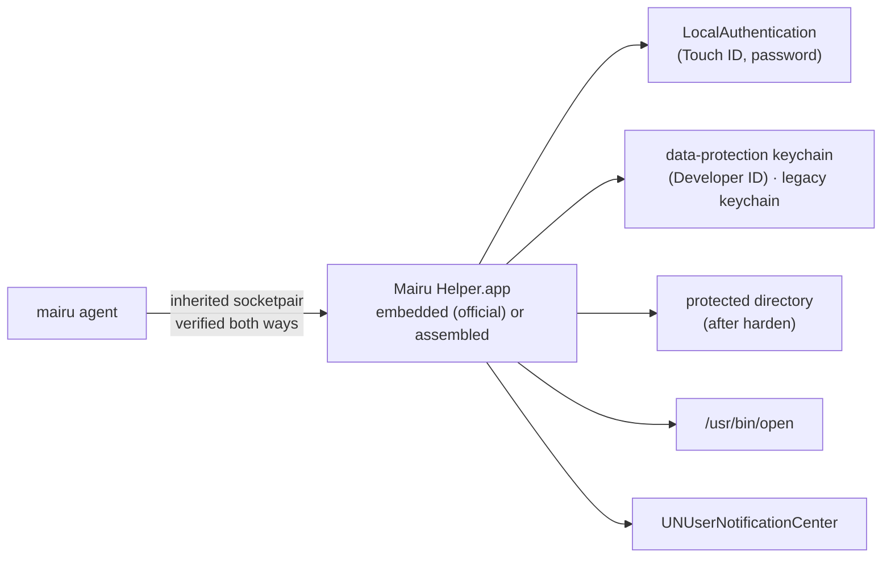
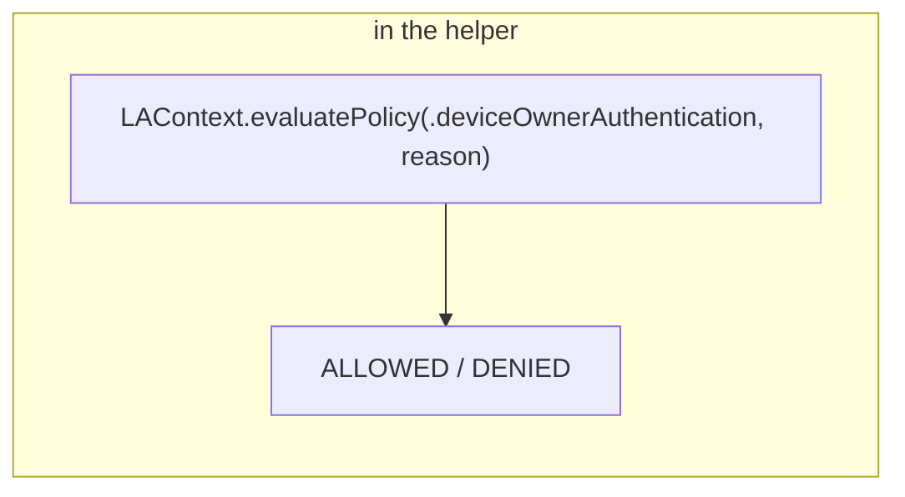
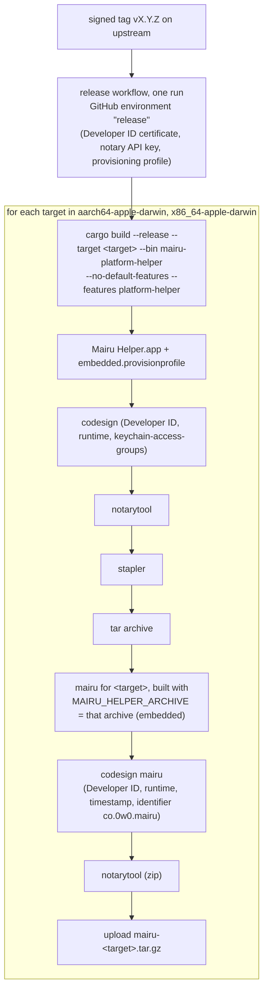

# 019-macos-platform-helper

## Summary

This step gives macOS its platform services. The platform helper of [006](006-platform-helper.md) runs from an app bundle, `Mairu Helper.app`, which serves the `platform` presence method through LocalAuthentication (Touch ID or the login password), holds the macOS integrity stores, posts notifications and opens URLs. Official builds embed the bundle, signed with the Developer ID, and write it out at startup. Every other build assembles the bundle from its own binary and signs it ad-hoc. The agent and the helper verify each other as on Linux, plus a code-signature check of the running child.

Integrity on macOS has two strong stores: the protected directory created by `harden` ([018 harden on macOS](018-macos-install.md#harden-on-macos)), on every tier, and the data-protection keychain, reachable only from the Developer ID-signed helper bundle. The legacy keychain is a weak store. When every approval key is lost, `mairu policy reset-record` removes the record after an administrator authorization. A request from outside the console's audit session, such as an SSH login, raises the LocalAuthentication sheet on the Mac's screen with its origin named. `context.console_session` lets a policy forbid that.

## Motivation

Until this step, macOS runs the `FallbackServices` of [006](006-platform-helper.md) in its helper: authorization `UNAVAILABLE`, no integrity stores, no notifications. The `platform` method of [007](007-authorization.md) therefore fails closed on macOS, and no policy can ever be approved there.

macOS imposes several constraints that shape this step:

- **Notifications need a bundle.** `UNUserNotificationCenter` needs the main executable of a signed bundle that LaunchServices has registered. A plain binary cannot post.
- **The legacy keychain has no integrity** (confirmed on macOS 27.2). Same-user code can delete an item and plant a forged one that mairu cannot tell from a genuine one. A strong store must be unreachable by same-user code.
- **The data-protection keychain needs an entitlement,** and macOS grants `keychain-access-groups` only through a provisioning profile, which only an executable inside an app bundle can carry. Only a Developer ID build can hold it.
- **The protected directory works on every tier** after `harden`, because the setgid marker carries over on macOS ([018](018-macos-install.md), Q-M9). It needs no bundle.
- **The LocalAuthentication sheet always appears on the console,** whichever session asked. A remote user over SSH would otherwise see nothing in the terminal and not know why, and a user who never wants the console sheet raised from an SSH login needs a way to forbid it.
- **Recovery needs an administrator.** Root cannot reach the data-protection keychain item; only the helper bundle can. When every approval key is lost, something other than root must be able to remove the record.

## Explanation

### Origin of a prompt

The LocalAuthentication sheet always appears on the Mac's screen, whichever session asked. By default it is still offered for a requester outside the console's audit session, such as an SSH login (decided 2026-10-23):

- The reason text names the origin, for example `requested from an SSH session: terraform apply`.
- The client prints `Approve on the Mac's screen.` instead of the usual last line of [007 What the human sees](007-authorization.md#what-the-human-sees), so a remote user knows why nothing appears in the terminal:

  ```
  :: mairu :: Authorization required: 123456789012/Admin on contoso
  :: mairu ::   command: terraform apply
  :: mairu ::   cwd:     /Users/u/src/infra
  :: mairu ::   from:    /dev/ttys003 (zsh, ssh)
  :: mairu :: Approve on the Mac's screen.
  ```

- `context.console_session` is `false` for such requests, and a `forbid` like the one below turns the sheet off for them. Key-based methods ([013](013-ssh-agent.md)) then remain.

| Attribute | Values | Source |
|---|---|---|
| `console_session` | present only on macOS; `false` for SSH logins and other non-console audit sessions | agent, from the peer's audit token |

`console_session` is determined by the agent, so it may grant ([007 Cedar schema](007-authorization.md#cedar-schema)): the requester cannot influence it beyond actually being in that session.

```cedar
// macOS: never raise the Touch ID sheet on the console for a request from an SSH login.
@id("no-console-sheet-from-ssh")
forbid (principal, action == Mairu::Action::"AssumeRole", resource)
when {
  context.presence has method && context.presence.method == "platform" &&
  context has console_session && !context.console_session
};
```

With no GUI session at all, the sheet cannot appear, and the `platform` method is `UNAVAILABLE`.

### Notifications on macOS

- Notifications ([014 Modes](014-notify.md#modes), `agent` mode) are posted by the helper bundle itself. They appear on the console whether the agent runs in `gui/<uid>` or `user/<uid>`, or was started over SSH.
- **Turning them on.** A new bundle starts out denied, with no prompt (Q-M3). Until notifications are authorized, `notify` reports `delivered = false`, and `mairu doctor` and the first undelivered notification tell the user to turn on "mairu" in System Settings → Notifications. The permission is kept across upgrades (Q-M4).
- System Settings shows each flavour as its own row: `mairu` (official builds), `mairu (ad-hoc)`, and `mairu (dev)` for the dev profile.
- Notifications carry no actions. Clicking one does nothing beyond what macOS does itself.
- URLs open through `NSWorkspace` or `/usr/bin/open`, in the user's GUI session.

### Integrity stores on macOS

| Tier | Strong | Weak |
|---|---|---|
| Developer ID with the helper bundle (official) | data-protection keychain; also the protected directory after `harden` | legacy keychain |
| Ad-hoc, or Developer ID without a helper bundle | the protected directory after `harden` | legacy keychain |
| Unhardened (no runtime flag) | none | legacy keychain, which approves here as on unhardened Linux |

- Up to three stores are used concurrently: the protected directory after `harden` and the data-protection keychain of the helper bundle (both strong), and a legacy keychain item (weak). Every store holds the whole `IntegrityRecord` of [012 Integrity records](012-policy-approval.md#integrity-records), including the approval anchor.
- The state rules are those of [012 Integrity states](012-policy-approval.md#integrity-states). On a hardened macOS build without a strong store (no helper bundle, no `harden`), a policy is never `APPROVED`. The legacy keychain can be forged by same-user code, so counting it would let that code relax a policy that the build's signature checks otherwise enforce. Its policy only tightens ([011 Effective policy](011-user-policy.md#effective-policy)).
- **Ad-hoc builds get strong integrity only through `harden`** (Q-M6, decided 2026-10-23). Without it they have only the weak legacy keychain.
- On Developer ID builds after `harden`, the helper holds both the entitlement for the data-protection keychain and the marker for the protected directory, so both strong stores are written together.

### Recovery: `mairu policy reset-record`

```text
recover   mairu policy reset-record (administrator authorization)    # macOS
```

When every approval key is lost, an administrator removes the record from every strong store ([012 Recovery](012-policy-approval.md#recovery) is the Linux counterpart):

- `mairu policy reset-record` sends `ResetPolicyRecord`. The helper first requires an administrator authorization (`AuthorizationCopyRights` for `system.privilege.admin`, which asks for an administrator's name and password), then removes the record from every strong store it can reach.
- It needs the agent in `gui/<uid>` ([017 XPC transport](017-macos-peer-verification.md#xpc-transport)). Elsewhere the authorization fails with `-60007`, and the command says to run it from a GUI login after `mairu kill-agent`.
- The state becomes `UNAPPROVED`, and the anchor falls back to `["platform"]`. A stale weak record then reads as `MISMATCHED`, so lockdown applies until the next approval.
- Requiring an administrator here is deliberate: the administrator is already the top of the trust chain on macOS ([017](017-macos-peer-verification.md)).

### Self-extracting official binaries

Official binaries carry the helper bundle for their own architecture, and the agent writes it out at startup. Release tarballs, aqua, mise and ubi ([018 Distribution](018-macos-install.md#distribution)) need no knowledge of bundles. Versions installed side by side keep their bundles per version.

### Contributors on macOS

- The helper bundle is assembled from the dev binary and signed ad-hoc as `co.0w0.mairu.dev.platform-helper`. Its notification permission starts out denied and is turned on once in System Settings (Q-M3). It is keyed by bundle id, so it survives rebuilds (Q-M4).
- Integrity stores: the weak legacy keychain store works in every build. The protected directory needs `sudo mairu harden`, best in a disposable VM. The data-protection keychain needs the project's provisioning profile, so only official builds have it.
- LocalAuthentication works with ad-hoc binaries.
- Not possible without the program: the embedded Developer ID helper bundle with its data-protection keychain. Maintainers check it before each release.

## Drawbacks

- **An app bundle in the user's Library.** Every build writes or assembles `Mairu Helper.app` under `~/Library/Application Support`, registers it with LaunchServices, and keeps up to five per flavour.
- **Notifications start denied** for a new bundle, and the user must turn them on once in System Settings.
- **Only Developer ID builds get a strong store without `harden`.** Ad-hoc builds that skip `harden` never have an approved policy.
- **The console sheet from SSH.** By default an SSH login can raise the Touch ID sheet on the Mac's screen, where someone else might approve it. A `forbid` on `context.console_session` turns that off.
- **Recovery needs a GUI login,** because the administrator dialog cannot appear from `user/<uid>` or an SSH session.
- **Untested until the Developer ID is issued:** the entitled helper bundle and its data-protection keychain item (Q-M12 parts 1–3), and notifications from the Developer ID flavour.

## Considered Alternatives

- **One helper bundle (Q-M13, confirmed 2026-10-24),** rather than a separate notifier bundle beside an unbundled helper. `UNUserNotificationCenter` needs the main executable of a signed, registered bundle, but not a LaunchServices launch. The helper is therefore one bundle that posts notifications itself, on every build, and on Developer ID builds also holds the keychain entitlement. Earlier drafts avoided any app bundle, then planned a separate notifier, then merged the two.
- **Strong integrity on macOS: both stores** (decided 2026-10-23).
  - The protected directory through `harden` works on every tier, but needs root once.
  - The data-protection keychain needs a Developer ID with a provisioning profile, but no root.
  - Both are supported, and every available store is written.
- **The legacy keychain as a strong store.** Rejected: an item can be deleted and planted again by same-user code, under any requirement, team-based or cdhash. A MAC key kept in the keychain does not help either, because both items can be deleted and planted again.
- **Secure Enclave `.userPresence` keys** for authorization. Rejected (tested): an unentitled binary can create one as a CryptoKit `dataRepresentation` blob, but any other binary that reads the blob can sign with it after Touch ID, under its own prompt text. A signature would prove that someone was present at this Mac, not that mairu asked. Permanent keys need an entitlement (`-34018`). The helper that reports the `LAContext` result is itself verified, so a boolean result is enough. A Secure Enclave key signing the integrity record would add nothing either, since it would sit behind the same access group.
- **The official helper executable as a copy of mairu.** Impossible: mairu would then have to embed itself. The official helper is the `mairu-platform-helper` binary of [006 Helper binary](006-platform-helper.md#helper-binary). Other builds assemble the bundle around a clone of their own binary, which needs no embedding.
- **"Trusted by construction" for the bundle.** Not enough on the agent's side: the bundle may sit in a user-writable directory and be swapped between any check and the exec. The agent checks the running child's code instead.
- **Modifying an extracted bundle in place.** Rejected: since macOS Ventura, Gatekeeper checks notarized apps on every launch, and any modification makes the app show as damaged. Each version and flavour gets a fresh directory.
- **The directory key for official bundles includes the architecture** (decided 2026-10-29, with per-architecture releases). An `x86_64` and an `aarch64` official mairu of the same version on one Mac then never share a bundle.
- **Separate bundle ids per flavour,** so LaunchServices never resolves to another flavour's copy, and System Settings rows stay apart.
- **Click actions.** Rejected: they would need `NSApplication` in the instance LaunchServices starts on a click. Notifications carry no actions, and that instance exits at once.
- **Routing around a notification denial with `osascript`.** Rejected: the user's choice in System Settings stands. `osascript` is only the fallback for an unusable bundle.
- **The console sheet for requests from SSH** (decided 2026-10-23): allowed by default with the origin shown, rather than refused by default. The user's own SSH sessions to their Mac are the common case, and `context.console_session` lets a policy forbid it.
- **Recovery through root.** Impossible for the data-protection keychain, which only the helper bundle can reach. An administrator authorization in the helper is used instead.

## Prior Art

- SSH agents that use Touch ID, such as Secretive, keep keys in the Secure Enclave. mairu deliberately does not (above): its helper reports a verified boolean instead.
- Apple's data-protection keychain with `keychain-access-groups`, the standard way for apps of one team to share keychain items that other code cannot reach.

## Security and Privacy Considerations

| Threat | Mitigation |
|---|---|
| Forging the policy record | Only strong stores count on hardened tiers: the helper bundle's data-protection keychain and the protected directory through `harden`. The forgeable legacy keychain never approves on hardened builds. |
| Deleting or forging a legacy keychain item | Weak by design: it never approves on hardened builds |
| Swapping the extracted or assembled helper bundle | The agent checks the running child's code before use. On failure it runs the unbundled helper, which loses notifications and the data-protection keychain, so policy only tightens. |
| A rogue parent of the helper | The helper checks `token.pid == getppid()` and the parent's code against its own requirement before serving |
| Lending the helper's socketpair | Both ends live only in hardened-runtime processes, whose task ports same-user code cannot obtain ([017 XPC transport](017-macos-peer-verification.md#xpc-transport)) |
| A same-user bundle claiming the helper's bundle id | It inherits the notification permission and can post as "mairu", which carries no security weight. It never passes the running-child check. |
| A notification click starting the helper bundle | That instance has no `--fd` and exits at once |
| A Touch ID sheet raised from an SSH login | The origin is named in the reason text; `context.console_session` lets a policy forbid it |
| A Secure Enclave key blob reused by another binary | Not used; the verified helper reports a boolean |
| Whoever holds the project's Developer ID key | For official builds, the data-protection keychain also trusts that key holder, who could sign a helper that rewrites the record. That adds nothing new: the same key can already sign a mairu that every official client trusts. |
| A bug reached through LocalAuthentication, keychain or notification code | Runs only in the helper, which holds no tokens ([006](006-platform-helper.md)) |

## Mission Scope

### Out of scope

- Click actions on notifications.
- Secure Enclave keys.
- Q-M12 parts 1–3 and the Developer ID flavour of Q-M3: deferred until the Developer ID is issued, then confirmed on the first official build.
- Whether Q-M3's denied-by-default comes from macOS 27 for apps without a team, or from the MDM-managed test host: not pursued, since no unmanaged Mac is available and the status handling covers both.

### Expected Outcomes

- On every hardened macOS tier, the agent spawns the helper from `Mairu Helper.app`, and the two verify each other.
- The `platform` method prompts with LocalAuthentication, names the origin for requests from outside the console session, and honours `context.console_session` in policies.
- Policies are approved by the protected directory after `harden`, and on Developer ID builds also by the data-protection keychain. The legacy keychain approves only on unhardened builds.
- Notifications are posted from the bundle once the user allows them, and `doctor` says when they are not.
- `mairu policy reset-record` restores a lost-key installation after an administrator authorization.
- Official releases embed a Developer ID-signed, notarized helper bundle per architecture.

## Implementation Plan

Stack layer: the macOS implementer's own layers, on top of [017](017-macos-peer-verification.md) and [018](018-macos-install.md).



On macOS the platform helper always runs from an app bundle, `Mairu Helper.app` ([Helper bundle](#helper-bundle)). Official builds embed it, signed with the Developer ID. Other builds assemble it from their own binary and sign it ad-hoc. Everything below runs in the helper process, never in the agent ([006](006-platform-helper.md)). `MacosServices` implements `PlatformServices` inside the helper and replaces `FallbackServices` on macOS.

### Helper process on macOS

The process model of [006 Helper process](006-platform-helper.md#helper-process), with the same binary identity rules: the agent and the helper have the same designated requirement, team-based for Developer ID builds and cdhash for ad-hoc ones ([017 Build tiers](017-macos-peer-verification.md#build-tiers)). Each checks the other against its own requirement, as clients and the agent do.

**Q-M1 (confirmed).** On a socketpair whose end is inherited across fork and exec:

- Before any I/O, both ends report the creator (`LOCAL_PEERPID`, `LOCAL_PEERTOKEN` with its pid version, and `LOCAL_PEERCRED`).
- Once the child does I/O, the creator's end reports the child, by the last-I/O rule ([017](017-macos-peer-verification.md)). The child's end keeps reporting the creator.
- After the child exits, the token query fails with `EINVAL`, while `LOCAL_PEERCRED` still works.

So the helper checks `token.pid == getppid()` and `SecCodeCheckValidity` on that token before serving. The agent keeps "trusted by construction" plus pid pinning as its primary check, because a later token query on its end still follows the last I/O.

**The helper bundle is a separately signed executable** on every macOS build.

- **The helper verifies its parent:** `token.pid == getppid()`, the hardened runtime, and identifier `co.0w0.mairu`. Beyond that:
  - official builds: the helper's own team ID and version;
  - assembled bundles: the cdhash recorded in its own signed `Info.plist` as `MairuAgentCDHash`.
- **The agent verifies the running child,** because the bundle may sit in a user-writable directory and be swapped between any check and the exec:
  1. It spawns it with the socketpair, exactly as in [006 Helper process](006-platform-helper.md#helper-process).
  2. Before sending anything, it checks the running child: `SecCodeCopyGuestWithAttributes` with the child's pid, which cannot be reused while the agent has not reaped it, then `SecCodeCheckValidity` against the flavour's identifier and the hardened runtime. Beyond that:
     - official builds: the agent's own team ID, plus a `CFBundleShortVersionString` equal to the agent's own version;
     - assembled bundles: the cdhash the agent expects.

     This check is confirmed for ad-hoc builds from `gui/<uid>`, Background and SSH parents (Q-M13).
  3. If that fails, it kills the child and runs the unbundled `mairu platform-helper` instead. That helper cannot post notifications, and it reports the data-protection keychain `UNAVAILABLE`, so a policy approved only there falls back to tighten-only ([011 Effective policy](011-user-policy.md#effective-policy)). A failure never relaxes anything.

### Helper bundle

```text
official builds (Developer ID, embedded)
  extract   <base>/helper-<version>-<arch>/Mairu Helper.app   byte-exact from MAIRU_HELPER_ARCHIVE
  check     SecStaticCodeCheckValidity: own team, identifier, CFBundleShortVersionString == own version
other builds (ad-hoc, or Developer ID without an embedded bundle)
  assemble  <base>/helper-<version>-<own cdhash, 12 hex>/Mairu Helper.app
            Contents/Info.plist (MairuAgentCDHash = own cdhash)
            Contents/Resources/mairu.icns (embedded bytes)
            Contents/MacOS/mairu = clonefile(own binary)
  sign      /usr/bin/codesign --force --sign - --options runtime --identifier <flavour id>
both
  write a temporary sibling directory, check it, rename it into place; never modify a bundle in place
  strip com.apple.quarantine from what mairu wrote
  register  lsregister -f <bundle>, as the user, before the first exec of that path
  spawn     <exe> --fd <n> (official) · mairu platform-helper --fd <n> (assembled)   direct exec
  verify    the running child (above)
  cleanup   unused for 30 days → lsregister -u, remove; at most 5 per flavour; never the running one
each notification
  UNUserNotificationCenter add, from the helper; no NSApplication, no delegate, no actions
started without --fd (a click relaunch by LaunchServices)
  exit 0 at once
fallback (bundle unusable)
  the unbundled helper: osascript display notification, else delivered = false
```

`<base>` is `~/Library/Application Support/mairu`, or `~/Library/Application Support/mairu-dev` for the dev profile ([004 Dev profile](004-peer-verification.md#dev-profile)). `<arch>` is the target architecture of the binary, `aarch64` or `x86_64`.

- **One bundle (Q-M13, confirmed 2026-10-24).** `UNUserNotificationCenter` needs the main executable of a signed bundle that LaunchServices has registered. It does not need a LaunchServices launch. The helper is therefore one bundle that posts notifications itself, on every build, and on Developer ID builds it also holds the keychain entitlement ([Integrity store backends](#integrity-store-backends)).
- **Official builds** embed the bundle that the release pipeline built from the `mairu-platform-helper` binary ([006 Helper binary](006-platform-helper.md#helper-binary)), with the macOS backends (objc2, UserNotifications, LocalAuthentication), then signed with the Developer ID, notarized and stapled ([Release pipeline additions](#release-pipeline-additions)).
  - The executable cannot be a copy of mairu, which would then have to embed itself. A single `mairu` binary remains the only artifact.
  - `MAIRU_HELPER_ARCHIVE` is a `tar` of the signed, stapled bundle that keeps modes and symlinks. It is embedded with `include_bytes!`, so mairu's own signature covers it. Each architecture's mairu embeds the bundle built for that architecture only.
- **Other builds** assemble the bundle from their own binary, which runs as `mairu platform-helper`, and sign it ad-hoc.
  - `MairuAgentCDHash` in the signed `Info.plist` lets the helper verify its parent.
  - Ad-hoc signing is deterministic (confirmed), so the same input always gives the same cdhash.
  - The directory carries the agent's own cdhash, because rebuilds keep the version but change the binary.
  - The agent records the cdhash of the bundle it assembled. Before using one that another process assembled, it checks that the executable and `Info.plist` are byte-identical to what it would write and that the signature is valid, then takes that bundle's cdhash.
  - These bundles carry no keychain entitlement.
- **Flavours.** Each sets `LSUIElement` true and an icon, plus a `CFBundleIdentifier` and display name of its own:
  - official builds: `co.0w0.mairu.platform-helper`, shown as `mairu`
  - other builds: `co.0w0.mairu.platform-helper.adhoc`, shown as `mairu (ad-hoc)`
  - the dev profile: `co.0w0.mairu.dev.platform-helper`, shown as `mairu (dev)`

  Separate identifiers keep LaunchServices from resolving to another flavour's copy, and keep their rows in System Settings apart.
- **Who writes it.**
  - The agent extracts or assembles the bundle at startup, before spawning the helper.
  - `harden` writes its root-owned copy directly into `/usr/local/libexec/mairu/`, from its own archive or by assembling and signing it as root, with no user-writable intermediate ([harden additions](#harden-additions)). The agent prefers that copy and registers it as the user.
  - Concurrent agents or `harden` runs each write their own temporary directory. If the target appeared meanwhile, the later writer discards its copy and checks the existing one.
- **Extraction rules:**
  - **Byte-exact, never in place.** Since macOS Ventura, Gatekeeper checks notarized apps on every launch, and any modification makes the app show as damaged. App Management may also block a process signed by another team from modifying a notarized bundle. Each version and flavour therefore gets a fresh directory.
  - **Quarantine.** Unsandboxed tools don't quarantine the files they create by default. A process that inherited quarantine, for example one started from a terminal inside a quarantined GUI app, may get every file it writes quarantined. mairu therefore removes `com.apple.quarantine` from the bundle it wrote. Files written by a quarantined, user-approved CLI, and by its child, carried no quarantine (confirmed).
  - **Location.** Bundles under temporary directories are rejected ("Failed to find or validate client"), and a bundle under `~/Library/Application Support` registers (confirmed). An unsigned arm64 bundle does not launch at all.
  - **Registration.** A directly exec'd bundle executable gets "Notifications are not allowed" until the bundle is registered with `lsregister -f`. lsd's own automatic registration is not enough (confirmed). `open` registers as a side effect, which is why the earlier tests did not see this.
- **Notifications.**
  - The helper posts with `UNUserNotificationCenter`. Posting needs neither `NSApplication` nor a run loop, since completion handlers run on a background queue (confirmed).
  - They appear on the console whether the agent runs in `gui/<uid>` or `user/<uid>`, or was started over SSH (confirmed).
- **Clicks.**
  - Notifications carry no actions, and the helper sets no delegate.
  - A click makes LaunchServices start the bundle, even while the helper runs, because a process without `NSApplication` is not LaunchServices' running instance. That instance has no arguments and no `--fd`, its parent is `launchd`, and `XPC_SERVICE_NAME` starts with `application.` (confirmed).
  - It exits at once with status 0, before touching anything else. Click actions would need `NSApplication` in that instance, and are out of scope.
- **Authorization status.**
  - The helper reads `getNotificationSettings` into `Capabilities.notes`.
  - While notifications are not authorized, `notify` reports `delivered = false`. `doctor` and the first undelivered notification tell the user to turn on "mairu" in System Settings → Notifications.
  - mairu does not route around a denial with `osascript`. That fallback is only for an unusable bundle.
- **Q-M3 (confirmed for ad-hoc builds).** Tested on macOS 27.2 with the screen unlocked:
  - A registered ad-hoc bundle appears in System Settings → Notifications, whether launched through `open` or exec'd directly.
  - It starts out denied, before any request. `requestAuthorization` returns `UNErrorDomain` 1 with no prompt, with or without the runtime flag and `LSUIElement`. Once the user turns on "Allow notifications" in System Settings, it is authorized.
  - Whether that default comes from macOS 27 for apps without a team, or from this MDM-managed host, is unknown. It is not pursued, since no unmanaged Mac is available and the status handling above covers both.
  - The Developer ID flavour is deferred until the identity is issued.
- **Q-M4 (confirmed): the permission survives upgrades.**
  - It is keyed by bundle id, not by cdhash. After the binary changed, both a fresh directory and an in-place rewrite stayed authorized with no user action.
  - The grant also outlives the bundle. After the bundle was deleted and unregistered, a new bundle with the same id at a new path came up authorized.
  - Any same-user bundle claiming the id inherits the permission and can post as "mairu". Notifications carry no security weight, and such a bundle never passes the running-child check.
- **Q-M5 (settled 2026-10-23): name, icon and cleanup.**
  - Display names (`CFBundleName`, `CFBundleDisplayName`) differ per flavour, as listed above. System Settings shows each bundle id as its own row, and rows with identical names cannot be told apart.
  - The icon is `pkg/macos/mairu.icns` (`CFBundleIconFile`). Without one, the row shows a blank icon.
  - Cleanup is as in the block above. Each bundle directory's mtime is touched on every spawn.

### LocalAuthentication backend



- `LAContext.evaluatePolicy(.deviceOwnerAuthentication, localizedReason:)`, with the reason built from the details of [007 What the human sees](007-authorization.md#what-the-human-sees) and the origin ([Origin of a prompt](#origin-of-a-prompt)). It works from a plain binary, signed ad-hoc or with a Developer ID.
- Track lid/clamshell state (Touch ID unavailable) and fall back to password.
- `LAError -4` ("system authentication is running", for example while the screen is locked) maps to `UNAVAILABLE`, which can be retried.
- `Capabilities.authorization` is `AUTHORIZATION_FACILITY_LOCAL_AUTHENTICATION` ([006 Protocol](006-platform-helper.md#protocol)).
- **Where the sheet appears.** coreauthd shows it on the console whenever a GUI session exists, even for a process outside that session (confirmed for a Background job and from an SSH session). With no GUI session it is `UNAVAILABLE`.
  - A request from an SSH session therefore prompts on the Mac's screen, not in the terminal. This is allowed by default, with the origin in the reason text, and a policy can forbid it ([Origin of a prompt](#origin-of-a-prompt)).
  - The ssh-agent method ([013](013-ssh-agent.md)) is the one that reaches a remote user.
- **Q-M2 (addressed):** the agent runs as a LaunchAgent in `gui/<uid>` whenever a GUI login exists ([017 XPC transport](017-macos-peer-verification.md#xpc-transport)), and its helper inherits that session. LocalAuthentication works from either launchd domain, and from an SSH session, while a GUI session exists (confirmed), but the administrator dialog needs `gui/<uid>`.

### Origin computation

- The agent decides the origin, not the client: it looks up the session of the peer's audit token (`audit_token_to_asid`, then `SessionGetInfo`). `context.console_session` is true when that session has graphic access and is not remote. Confirm those session attributes for SSH logins during implementation.
- The agent names the origin in the one-line reason it sends as `AuthorizeRequest.message` ([006 Protocol](006-platform-helper.md#protocol)), for example `requested from an SSH session: terraform apply`, which the helper passes to LocalAuthentication as `localizedReason`.
- Cedar schema ([007 Cedar schema](007-authorization.md#cedar-schema)): the request context gains one optional attribute, so approved policies stay valid across upgrades:

  ```text
  // Present only on macOS: whether the requester is in the console's audit session; false for SSH logins.
  console_session?: Bool,
  ```

### Integrity store backends

```text
record "policy" on macOS
strong   protected directory (after harden, every tier) · data-protection keychain (Developer ID, helper bundle)
weak     legacy keychain item
```

- **The legacy keychain provides no integrity** (confirmed on macOS 27.2). Same-user code deleted an item with `security delete-generic-password` and no prompt. An unrelated unsigned binary then created a new item with the same service and account, whose access list trusts only mairu, holding forged content. mairu read it without a prompt, and the planted access list is indistinguishable from a genuine one. This applies to any requirement, team-based or cdhash. A MAC key kept in the keychain does not help either, because both items can be deleted and planted again. A legacy keychain item (`INTEGRITY_STORE_KIND_LEGACY_KEYCHAIN`) is therefore a **weak** store, like Secret Service on Linux: it catches careless edits only. The record is not secret, so the item's access list allows every application, which avoids prompts after ad-hoc rebuilds.
- **Strong store for Developer ID builds: the data-protection keychain, through the helper bundle** (`INTEGRITY_STORE_KIND_DATA_PROTECTION_KEYCHAIN`).

  ```text
  Mairu Helper.app/Contents/MacOS/mairu-platform-helper   identifier co.0w0.mairu.platform-helper
    entitlement   keychain-access-groups = [<TEAMID>.co.0w0.mairu]
    profile       Contents/embedded.provisionprofile (Developer ID, App ID co.0w0.mairu.platform-helper)
  item            generic password · service co.0w0.mairu.policy-record · account <record name>
                  access group <TEAMID>.co.0w0.mairu · kSecUseDataProtectionKeychain
                  kSecAttrAccessibleAfterFirstUnlockThisDeviceOnly · not synchronizable
  ```

  - Only code signed by the team with that entitlement can read, write or delete the item. Same-user code can neither remove nor plant it, so the record is strong without root.
  - From an unbundled, unentitled binary, `SecItemAdd` fails with `-34018` (confirmed). macOS grants `keychain-access-groups` only through a provisioning profile, and only an executable inside an app bundle can carry one. That is why this helper is a bundle.
  - Ad-hoc builds cannot hold the entitlement. A third-party Developer ID build can, with a profile for its own team.
  - After `harden`, the agent runs the root-owned copy, whose executable is setgid `mairu`.
  - The agent execs it directly, not through LaunchServices, so the socketpair is inherited. It is verified as a running child ([Helper process on macOS](#helper-process-on-macos)).
  - **Q-M12**, deferred until the Developer ID is issued, then confirmed on the first official build. If part 1 fails, the agent runs the unbundled helper, and Developer ID builds rely on `harden` alone, like ad-hoc builds. The parts:
    1. a restricted entitlement with an embedded profile is honored when the bundle's executable is exec'd directly by a non-LaunchServices parent, also with the setgid bit set;
    2. the item is reachable from the helper of the LaunchAgent-run agent, and from an SSH-only login (Q-M11);
    3. the item survives an upgrade of the bundle (same team, same access group);
    4. `AuthorizationCopyRights` for `system.privilege.admin` works from the helper, for `ResetIntegrity`. Confirmed for an unbundled ad-hoc binary: the dialog appears from a terminal and from a `gui/<uid>` LaunchAgent, and a Background job or an SSH session gets `-60007` at once, with no dialog on the console.
- **Strong store for every tier: the protected directory through `harden`** (`INTEGRITY_STORE_KIND_PROTECTED_DIRECTORY`; Q-M6, Q-M9). `/private/var/db/mairu/users/<uid>/policy.record`, written by the helper holding the marker gid, with the rules of [012 Integrity stores](012-policy-approval.md#integrity-stores). `LOCAL_PEERCRED` reports the effective gid as `cr_groups[0]` (confirmed), so the Linux marker group carries over.
  - A setgid exec by a user **outside** the group makes a restricted process: `P_SUGID` set, `DYLD_INSERT_LIBRARIES` stripped, same-user `task_for_pid` refused (confirmed, [018](018-macos-install.md)).
  - A **member** of the group gets the egid without the restriction: `P_SUGID` was 0, `DYLD_INSERT_LIBRARIES` was honoured, and `task_for_pid` worked. Hence the "user must not be a member" rule ([003](003-marker-gid.md)).
- `Capabilities.integrity_stores` lists the reachable stores in authority order: strong stores first.
- Every store holds the whole `IntegrityRecord`, including the approval anchor.

### ResetIntegrity and ResetPolicyRecord

The helper protocol's `ResetIntegrity` ([006 Protocol](006-platform-helper.md#protocol)) is served only by the macOS backends:

```proto
// macOS only: asks for an administrator authorization, then removes the record from every strong store.
message ResetIntegrityRequest {
  string name = 1;
  uint32 uid = 2;
}
message ResetIntegrityResponse { repeated IntegrityStoreResult results = 1; }
```

This step adds the agent RPC that drives it, in `proto/mairu.proto`:

```proto
service Agent {
  // ... existing RPCs ...
  rpc ResetPolicyRecord(ResetPolicyRecordRequest) returns (ResetPolicyRecordResponse);
}

// macOS: the helper asks for an administrator authorization first.
// Linux: UNIMPLEMENTED; root uses `mairu harden --reset-policy-record` instead.
message ResetPolicyRecordRequest {}
message ResetPolicyRecordResponse {
  PolicyIntegrity integrity = 1;
  repeated mairu.platform.IntegrityStoreResult stores = 2;
}
```

1. `mairu policy reset-record` sends `ResetPolicyRecord`. It needs only a trusted peer; the administrator authorization is the check.
2. The agent calls `ResetIntegrity{name: "policy", uid}` on the helper.
3. The helper calls `AuthorizationCopyRights` for `system.privilege.admin` with interaction allowed. `-60007` (`errAuthorizationInteractionNotAllowed`) maps to an error telling the user to run the command from a GUI login after `mairu kill-agent`.
4. On success it removes the record from every strong store it can reach, and returns the per-store results.
5. The agent re-verifies and returns the new integrity state, `UNAPPROVED` with the anchor `["platform"]` ([012 Recovery](012-policy-approval.md#recovery)).

### Open URL

- `NSWorkspace` or `/usr/bin/open`, in the user's GUI session, from the helper.
- The URL rules of [014](014-notify.md) apply: only `http`/`https`.

### Release pipeline additions

[018 Release pipeline](018-macos-install.md#release-pipeline) gains the helper bundle, per architecture:



- The helper bundle's provisioning profile is a Developer ID profile for the explicit App ID `co.0w0.mairu.platform-helper`, with the keychain access group `<TEAMID>.co.0w0.mairu`. It is created once in the developer account and kept in the `release` environment with the certificate. It is not secret, but it is bound to the team. One profile serves both architectures.
- `build.rs` embeds `MAIRU_HELPER_ARCHIVE` with `include_bytes!` when the variable is set, and builds without an embedded bundle otherwise (every non-official build).
- The maintainer check before publishing ([018](018-macos-install.md)) adds: the embedded helper bundle posts notifications, and `doctor` reports the data-protection keychain.

### harden additions

[018 harden on macOS](018-macos-install.md#harden-on-macos) also writes the helper bundle:

```text
/usr/local/libexec/mairu/Mairu Helper.app     official: from the archive; other builds: assembled and signed as root
                                              executable root:mairu 2755
```

- Official builds extract it from their archive. Other builds assemble and sign it as root, with `MairuAgentCDHash` set to the hardened copy's cdhash.
- Everything `harden` writes is root-owned. The agent only registers the bundle with LaunchServices, as the user.

### Tests and CI

- The macOS CI job of [017](017-macos-peer-verification.md) also assembles the ad-hoc helper bundle, spawns it from a `script/macos-dev-sign`ed agent, and checks verification in both directions and the fallback to the unbundled helper when the bundle is altered.
- Unit tests: bundle assembly (Info.plist contents, directory names, byte-identity check of another process's bundle), cleanup selection, `LAError` mapping, the store tier table.
- With the first official build: notifications from the Developer ID helper bundle (Q-M3), Q-M12 parts 1–3.

### Files

- `src/platform/services/macos/mod.rs`: `MacosServices`
- `src/platform/services/macos/local_authentication.rs`
- `src/platform/services/macos/integrity.rs`: data-protection keychain, legacy keychain, protected directory, `ResetIntegrity`
- `src/platform/services/macos/notify.rs`, `open_url.rs`
- `src/platform/helper_bundle.rs`: extraction, assembly, signing, registration, cleanup; the running-child check in `HelperClient`
- `src/cmd/platform_helper.rs`: parent verification by audit token on macOS; exit at once without `--fd`
- `src/cmd/policy.rs`: `reset-record`
- `src/agent.rs`: `ResetPolicyRecord`; `console_session` from the peer's audit session
- `proto/mairu.proto`: `ResetPolicyRecord`
- `src/policy/mairu.cedarschema`: `console_session?`
- `src/cmd/harden.rs`: the helper bundle in `/usr/local/libexec/mairu/`
- `build.rs`: `MAIRU_HELPER_ARCHIVE`
- `pkg/macos/mairu.icns`
- `.github/workflows/release.yml`: helper bundle per architecture, provisioning profile, embedding
- `.claude/skills/releng/SKILL.md`: helper bundle items in the maintainer check

### Findings and open questions

```text
Q-M1  socketpair peer info (confirmed)   Q-M2  GUI session (addressed)         Q-M3  notification authorization (confirmed)
Q-M4  permission kept on upgrade         Q-M5  bundle name, icon (settled)     Q-M6  ad-hoc store (decided)
Q-M7  Homebrew (decided)                 Q-M8  LOCAL_PEERTOKEN (confirmed)     Q-M9  setgid non-member (confirmed)
Q-M10 transport (XPC, decided)           Q-M11 SSH (no-console: deferred)      Q-M12 helper bundle (deferred)
Q-M13 one helper bundle (confirmed)
```

- Q-M8, Q-M10, Q-M11: [017](017-macos-peer-verification.md)
- Q-M7, Q-M9: [018](018-macos-install.md)
- Q-M1, Q-M2 (prompts), Q-M3 to Q-M6, Q-M12, Q-M13: this spec

## Current Status

Spec drafted; awaiting review before implementation. Implementors MUST keep this section updated as they work.

### Checklist

- [ ] `MacosServices` in the helper
- [ ] LocalAuthentication backend
- [ ] Integrity stores: legacy keychain (weak), protected directory after `harden` (strong)
- [ ] Helper on macOS: always the bundle (unbundled only as the fallback), spawned by the LaunchAgent-run agent and verified as a running child both ways
- [ ] Helper bundle: embedded (official) or assembled (`MairuAgentCDHash`), registration, notifications, click-relaunch exit, per-flavour names, icon `pkg/macos/mairu.icns`, cleanup
- [ ] Helper bundle `mairu-platform-helper` with the data-protection keychain store, and `ResetIntegrity` with an administrator authorization
- [ ] `ResetPolicyRecord` and `mairu policy reset-record`
- [ ] `context.console_session` and the origin in the reason text; confirm the session attributes for SSH logins
- [ ] Release pipeline: helper bundle per architecture with its provisioning profile, embedded through `MAIRU_HELPER_ARCHIVE`
- [ ] `harden` writes the helper bundle
- [ ] With the first official build: notifications from the Developer ID helper bundle (Q-M3), Q-M12 parts 1–3
- [x] Q-M1 confirmed, Q-M2 addressed, Q-M3 confirmed for ad-hoc builds, Q-M4 confirmed, Q-M5 settled, Q-M6 decided, Q-M13 confirmed
- [ ] Q-M12 (deferred until the Developer ID is issued)

### Updates

- 2026-10-29: Split out of hardening.md, policy.md and platform-helper.md.
