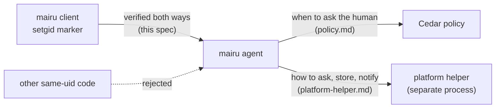
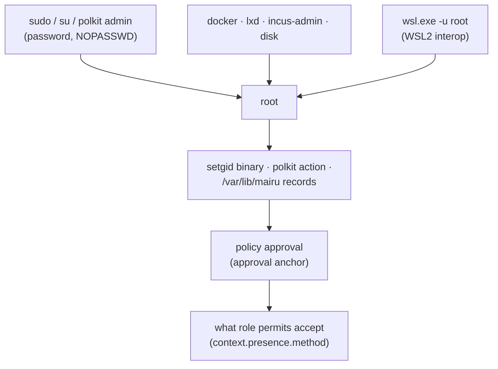
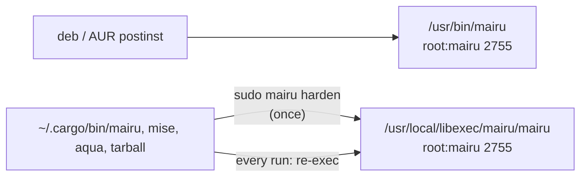
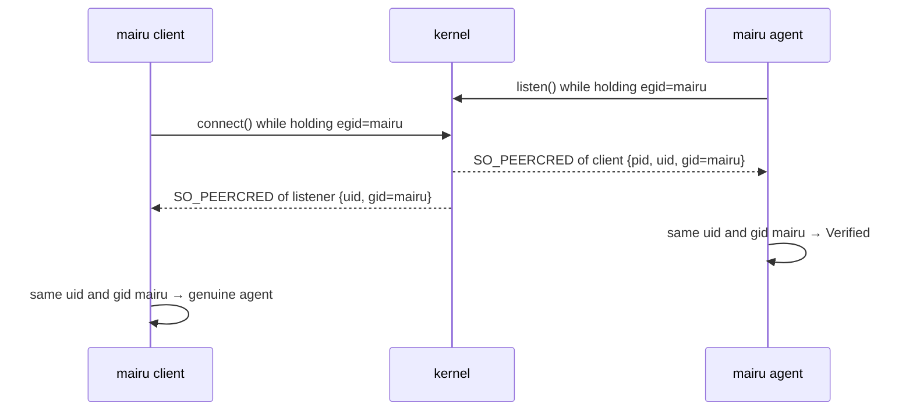
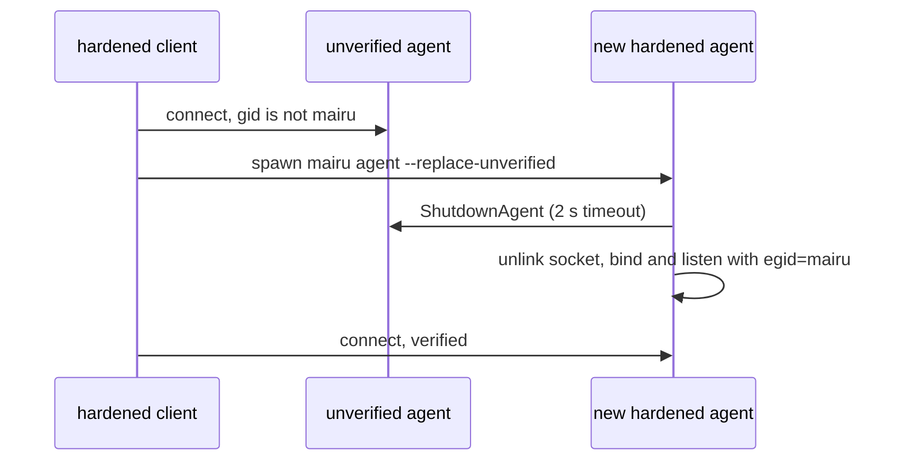
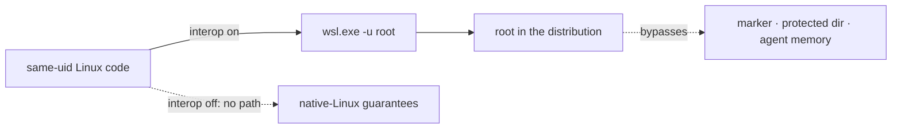
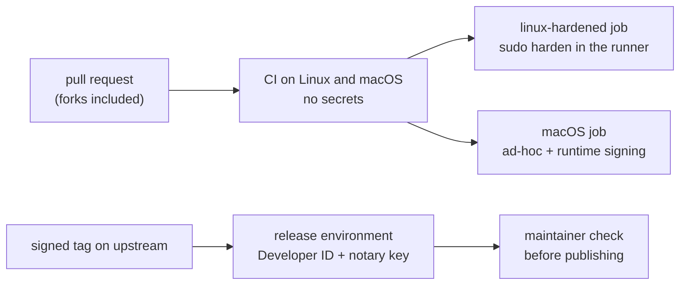

# Agent hardening

Mutual verification between `mairu` clients and `mairu agent`, the hardened installation that anchors it, and the threat model shared by the related specs.

Related specs:

- [policy.md](policy.md): when the agent asks the human, how answers are remembered, and the Cedar policy that decides it.
- [platform-helper.md](platform-helper.md): the platform abstraction, the `mairu.platform` protocol, the separate platform helper process that runs every platform service, and the platform backends (polkit, integrity stores, notifications, opening URLs).

Each section opens with a short visual summary. It is illustrative; the text after it is normative.

## 1. Overview



`mairu agent` holds credential-server sessions in memory and vends AWS credentials to whoever connects to its Unix socket. Today that is any process running as the user. Nothing checks who the client is, nothing lets a client check who the agent is, and nothing asks the human before credentials leave the agent.

Together with the related specs, this work adds three things:

1. **Mutual verification** between `mairu` (clients) and `mairu agent`, anchored in a platform mechanism that same-user code cannot forge. Clients only talk to a genuine agent, and the agent only serves genuine clients. Covered here.
2. **Platform authorization.** The agent asks the human, through a platform facility, before vending credentials, and remembers the answer per terminal session for a short time. When to ask is decided by a [Cedar](https://www.cedarpolicy.com/) policy, in which a human check is just another condition, as MFA is in AWS IAM. The user's policy is integrity-protected. Covered in [policy.md](policy.md).
3. **A common platform protocol** (`mairu.platform`, protobuf) and a matching Rust trait, covering authorization prompts, integrity records, notifications and opening URLs, so the agent core stays platform-independent. Every platform service runs in a separate platform helper process that shares the agent's lifetime. Notifications and opening URLs carry no security weight, and each client chooses how they are delivered. Covered in [platform-helper.md](platform-helper.md).

Linux is implemented first, with WSL2 as a first-class variant (§8). macOS is designed in these specs and implemented separately against them. BSD is design-only.

### 1.1 Terminology

```text
agent
├── peers             # verified by the marker gid (§5)
├── grants            # (session, server, rolespec) → 5 min idle / 12 h max by default
├── leases            # (running exec sidecar, server, rolespec) → while it lives
└── integrity record  # digest + approval anchor, root-protected
```

| Term | Meaning |
|---|---|
| client | Any `mairu` process that talks to the agent: `exec` (its sidecar), `credential-process`, `login`, `list-*`, `policy`, `lock`, `doctor`, … |
| agent | The `mairu agent` process. |
| hardened | A process whose integrity the platform enforces: on Linux/BSD, exec'd from the setgid marker binary; on macOS, running a validly signed binary with hardened runtime. |
| marker group | The Unix group `mairu`. It grants nothing; it marks processes exec'd from the hardened binary. |
| peer | The process on the other end of a Unix socket, as reported by the kernel. |
| grant | A remembered authorization keyed by (session identity, server, rolespec), with an idle timeout and a hard cap. |
| lease | A remembered authorization tied to one live `mairu exec` sidecar process, valid for that process's lifetime. |
| integrity record | A digest (or signature) of the user policy file, kept where same-user code cannot rewrite it. |
| official build | Built by the upstream release pipeline from a signed tag and signed with the project's Apple Developer ID (§9.1). |
| ad-hoc build | Any build without a Developer ID signature: `cargo build`/`cargo install`, Homebrew from source, forks (§9.1). |
| dev profile | The isolated socket, state and record names that debug builds use by default, so a contributor's build never touches an installed mairu (§15.1). |
| platform helper | The separate process, spawned by the agent and sharing its lifetime, that serves the `mairu.platform.PlatformHelper` service. Every platform service runs there. |

## 2. Threat model

```text
attacker = code running as your uid
  can     read/write ~, connect to your sockets, run genuine mairu with any args,
          use $SSH_AUTH_SOCK, read your ptys, drive your tmux server
  cannot  ptrace a hardened mairu, forge SO_PEERCRED or a code signature,
          become root*                     * unless the host allows it (§2.4)
```

### 2.1 Adversary

```text
same uid ──► your files · sockets · processes · Secret Service · session D-Bus
             · forwarded $SSH_AUTH_SOCK · ptys · tmux server
```

Code running **as the same Unix user** as the human, which the human did not intend to act. Examples: a compromised dependency's install script, a malicious repository script, or an AI coding agent going beyond what it was asked to do. It can:

- read and write every file the user can, including `~/.config/mairu`, `~/.local/state/mairu` and `.mairu.json`
- connect to the user's Unix sockets, kill the user's processes, and bind sockets in the user's runtime directory
- run any binary, including genuine `mairu`, with arbitrary arguments, environment and file descriptors
- ptrace the user's ordinary, dumpable processes (subject to `kernel.yama.ptrace_scope`)
- read and write the user's Secret Service (no per-application access control on Linux) and claim names on the user's session D-Bus
- use the user's forwarded SSH agent socket
- open the user's ptys (`/dev/pts/N` belongs to the user) and race the foreground program for keystrokes
- drive the user's tmux server through its socket: key bindings that log and forward every key, `send-keys`, and `pipe-pane -I` to inject input

### 2.2 Out of scope

```text
out of scope   root · kernel · physical access · malicious credential server or IdP
               · escalation through your own sudo · credentials after delivery to your command
```

Root, kernel compromise, physical access, and malicious credential servers or IdPs.

Escalation to root through the user's own `sudo` is also out of scope. If the user types the sudo password where same-user code can capture it ([platform-helper §6.1](platform-helper.md)), that code can become root. mairu cannot defend against that, and its guarantees hold only on hosts where sudo is not used that way, or is backed by FIDO. §2.4 covers this and the other routes to root.

Credentials *after delivery* are also out of scope. Once `mairu exec` hands credentials to the user's command, same-user code that can inspect that command (its environment, its memory, or the ECS bearer token in its environment) can take them. This design protects the agent's ability to mint credentials for arbitrary roles and its session tokens. It does not protect credentials already given to an unprotected process.

### 2.3 What is a boundary and what is a guardrail

```text
boundary   platform prompt / FIDO touch / Windows Hello
           + mutual verification (prompt contents are true)
           + policy integrity
guardrail  AI-agent detection · disallow_roles · .mairu.json trust prompt
```

- **Boundary**:
  - The platform authorization step (polkit, macOS LocalAuthentication, or the ssh-agent FIDO touch).
  - The mutual verification that makes the prompt's contents truthful: a genuine client reports what it will actually do with the credentials.
  - Integrity of the policy that decides when to prompt.
- **Guardrails**, best-effort and never relied on alone:
  - AI-agent detection ([policy §5](policy.md))
  - `disallow_roles` in `config.json`
  - the `.mairu.json` trust prompt

### 2.4 Trust chain and the weakest link



```text
strength = min(path to root, approval_methods, methods accepted by permits)
```

On a hardened Linux host every anchor is root-owned:
- the setgid binary
- the polkit action file
- the integrity records in `/var/lib/mairu`, including the approval anchor that says which keys may approve policy changes ([policy §9.7](policy.md))

Root can replace any of these, and can also read the agent's memory directly. **Every guarantee in these specs is therefore bounded by how hard it is for same-user code to become root.**

Ways a same-user attacker reaches root:

| Path | How |
|---|---|
| `sudo`, `su` | PAM, usually the user's password, which is capturable at a tty ([platform-helper §6.1](platform-helper.md)). Also `NOPASSWD` rules and cached sudo timestamps. |
| polkit administrator actions | `auth_admin` actions such as `pkexec` and systemd units; PAM again |
| Root-equivalent group memberships | `docker`, `lxd`, `incus-admin`, `disk` |
| WSL2 interop | `wsl.exe -u root` (§8) |

The effective strength of a deployment is the **weakest** of:
1. becoming root
2. approving a policy change (`approval_methods`, [policy §9.5](policy.md), anchored in the protected record)
3. the presence methods that a role's `permit` policies accept (`context.presence.method`)

Registering a FIDO or Windows Hello key strengthens 2 and 3. It does nothing for 1. A password that passes `sudo` also passes polkit `auth_self` ([platform-helper §6.1](platform-helper.md)), so on a host where that password can be captured, key-based methods only add a guardrail.

Recommendations (README; `mairu doctor` warns where it can detect the condition, §12):
- Back `sudo` and the `polkit-1` PAM stack with FIDO: `pam_u2f` locally, `pam_ssh_agent_auth` with an `sk-` key over SSH, `pam_wsl_hello` on WSL2. Avoid `NOPASSWD` and root-equivalent groups for the user.
- Once keys are registered, keep `approval_methods` key-only (the default, [policy §9.5](policy.md)), and require a key-based `context.presence.method` in permits for sensitive roles.
- On WSL2, disable interop for strong guarantees (§8).

## 3. Trust anchors

```text
Linux/BSD  exec setgid mairu → egid = mairu, AT_SECURE, non-dumpable → peer checks SO_PEERCRED.gid
macOS      signed + hardened runtime → audit token → SecCode satisfies my own designated requirement
```

### 3.1 Linux and BSD: the setgid marker group

```text
execve(/usr/local/libexec/mairu/mairu)      root:mairu 2755
  egid      := mairu     # the marker, reported by SO_PEERCRED
  AT_SECURE := 1         # loader ignores LD_PRELOAD and friends
  dumpable  := 0         # no same-uid ptrace, /proc/<pid>/mem, environ, fd
  traced by an unprivileged tracer?  → setgid not applied → no marker
```

The hardened binary is installed root-owned, with group `mairu` and mode `2755` (setgid). When any user execs it, the kernel:

- sets the process's effective gid to `mairu`. This is the marker.
- sets `AT_SECURE`, so the dynamic loader ignores `LD_PRELOAD`, `LD_LIBRARY_PATH` and similar. Release musl binaries are static anyway.
- makes the process non-dumpable from the first instruction. Same-uid ptrace, `/proc/<pid>/mem`, `/proc/<pid>/environ` and `/proc/<pid>/fd` become inaccessible, and the existing `prctl(PR_SET_DUMPABLE, 0)` in the agent then only reaffirms it.
- **does not** apply the setgid bit if the exec happens under ptrace by an unprivileged tracer.

The marker therefore cannot be obtained by same-user code except by running the genuine binary untraced and uninjected. `SO_PEERCRED` reports the peer's *effective* gid, snapshotted by the kernel:

- for the connecting side, at `connect()`
- for the listening side, at `listen()`. A connected client socket inherits the listener's credentials.

So each side can check the other's marker without trusting anything it says.

Preconditions, checked at runtime (§4.2):

- The user must **not** be a member of `mairu`, neither as primary nor as supplementary group. A member can obtain the marker with `sg`/`newgrp`.
- `fs.protected_hardlinks = 1`, so users cannot hardlink old hardened binaries and keep running them after an upgrade. This is a warning only.

### 3.2 macOS: code signature

```text
verify_peer(socket)
  getsockopt(SOL_LOCAL, LOCAL_PEERTOKEN)          → audit token (pid + pid version)
  SecCodeCopyGuestWithAttributes(audit token)     → peer code
  SecCodeCheckValidity(peer code, my own designated requirement)
  require hardened runtime, no get-task-allow
```

Identity comes from the peer's audit token, never a pid:

1. Get the audit token with `getsockopt(SOL_LOCAL, LOCAL_PEERTOKEN)` on the Unix socket, or from the XPC connection.
2. Get the peer's code with `SecCodeCopyGuestWithAttributes(kSecGuestAttributeAudit)`.
3. Check it with `SecCodeCheckValidity` against a requirement derived from **the verifier's own** designated requirement (`SecCodeCopySelf` + `SecCodeCopyDesignatedRequirement`).

This means no team identifier is hardcoded:

- Developer ID builds match on team and identifier `co.0w0.mairu`, so any version from the same team matches. A signed security floor rejects old versions (§9.3).
- Ad-hoc builds (`cargo`, Homebrew from source, forks) match only a byte-identical binary, through the cdhash.
- A binary without the hardened-runtime flag, such as plain `cargo build` output, is treated as unhardened (§9.1).

Both sides also require the hardened-runtime flag and the absence of `com.apple.security.get-task-allow`. The agent keeps `PT_DENY_ATTACH`. Use the audit token's pid version (`audit_token_to_pidversion`) wherever a pid is recorded. Details, and the questions still open, are in §9.

## 4. Hardened installation (Linux)



### 4.1 Layout

```text
/usr/local/libexec/mairu/
├── mairu                   root:mairu 2755   # the hardened binary
└── .harden-manifest        root:root  0644   # what --uninstall removes
/usr/share/polkit-1/actions/co.0w0.mairu.policy
/var/lib/mairu/             root:mairu 2770   # users cannot traverse it
└── users/                  root:mairu 2770
    └── <uid>/              <uid>:mairu 0700
        └── policy.record   # digest + approval anchor
```

| Path | Owner | Mode | Purpose |
|---|---|---|---|
| `/usr/local/libexec/mairu/mairu` | `root:mairu` | `2755` | Hardened binary installed by `mairu harden` |
| `/usr/bin/mairu` | `root:mairu` | `2755` | Hardened binary installed by distro packages |
| `/usr/local/libexec/mairu/.harden-manifest` | `root:root` | `0644` | Files written by `mairu harden`, for `--uninstall` |
| `/usr/share/polkit-1/actions/co.0w0.mairu.policy` | `root:root` | `0644` | polkit actions ([platform-helper §6.1](platform-helper.md)) |
| `/var/lib/mairu` | `root:mairu` | `2770` | Protected state root. Users cannot traverse it, but the marker gid can. |
| `/var/lib/mairu/users` | `root:mairu` | `2770` | |
| `/var/lib/mairu/users/<uid>` | `<uid>:mairu` | `0700` | Per-user integrity records ([policy §9.7](policy.md)). Created by the platform helper with the marker gid held ([platform-helper §7](platform-helper.md)). |

`/var/lib/mairu/users/<uid>` is owned by the user, but the user cannot reach it by path: they are neither owner nor group of `/var/lib/mairu`, and "other" has no search permission. Only a process holding the marker gid can open it, and the genuine agent only ever opens the directory for `getuid()`. User namespaces do not help, because unmapped owners keep their permission semantics.

### 4.2 Classifying the running process

```text
detect()
  g = getgrnam("mairu")                    none → Unhardened
  rgid == g or g ∈ getgroups()             → Misconfigured (marker forgeable)
  egid == g                                → Hardened; setresgid(rgid, rgid, g)
  otherwise                                → Unhardened (try re-exec, §4.3)

with_privileged_gid(f)    egid := g; f(); egid := rgid      # connect, listen, /var/lib/mairu
before exec of anything   setresgid(rgid, rgid, rgid)       # marker never leaks
```

`crate::hardening::Hardening::detect()` runs first in `main`, before argument handling has any side effects:

1. Look up group `mairu` (`getgrnam_r`; static musl builds read `/etc/group` only, which is fine because `harden` creates a local system group). Read `getresgid()`.
2. Classify:

   | Condition | State |
   |---|---|
   | Group absent | `Unhardened` |
   | `rgid == mairu`, or `mairu` is in `getgroups()`, or the user is listed in the group's members | `Misconfigured`: the marker is forgeable. Warn, and act as `Unhardened`. |
   | `egid == mairu` and `rgid != mairu` | `Hardened` |
   | Otherwise | `Unhardened`. The system may be hardened but this binary is not, which triggers re-exec (§4.3). |

3. When `Hardened`, immediately call `setresgid(rgid, rgid, mairu)`. The effective gid is then the real gid, and the marker stays only in the saved gid until needed.

Helpers:

- `with_privileged_gid(f)`: under a process-wide mutex, `setresgid(-1, mairu, -1)`, run `f`, then `setresgid(-1, rgid, -1)`. glibc and musl apply set\*id calls to all threads. Used around `connect()`, `bind()`+`listen()`, and access to `/var/lib/mairu`.
- `drop_privileged_gid_permanently()`: `setresgid(rgid, rgid, rgid)`, then assert that `getresgid()` returns `rgid` three times. On failure the caller aborts; it never execs with the marker.
- `command(program)`: a `std::process::Command` whose `pre_exec` performs the permanent drop. Every child process mairu spawns uses it (`xdg-open`, `pkttyagent`, the agent itself), except the exec of the user's command, which calls the drop directly. Re-exec'ing the setgid binary re-acquires the marker through the setgid bit, so dropping before spawning the agent is harmless.

Process-specific rules:

- **Executor** (`mairu exec` parent): drops permanently before `exec`'ing the user's command. Without this, the command (attacker-influenced) would inherit `egid == mairu` and pass the agent's check.
- **Sidecar** (`mairu exec` child): keeps the saved marker for reconnects, and holds the effective marker only inside `with_privileged_gid`.
- **Agent**: holds the effective marker only for `listen()` and for creating the platform helper's socketpair ([platform-helper §4](platform-helper.md)).
- **Platform helper**: holds it only for protected-directory I/O.

### 4.3 Re-exec from non-packaged installs

```text
main  (~/.cargo/bin/mairu exec …)
  Hardening::detect                       → Unhardened
  reexec_hardened_if_available
    validate candidate                    root-owned, setgid mairu, no g/o write, not FUSE, safe parents
    exec /usr/local/libexec/mairu/mairu   + MAIRU_HARDENED_REEXEC_{FROM,VERSION}
main  (hardened copy)
  read and unset MAIRU_HARDENED_REEXEC_*  → warn if versions differ
```

`mise`, `cargo install`, `aqua` and tarball installs keep the binary in a user-writable location, where it cannot be setgid. `crate::hardening::reexec_hardened_if_available()` runs right after classification when the state is `Unhardened`. It is skipped for the `harden` subcommand and when `MAIRU_NO_HARDENED_REEXEC=1` is set; the opt-out produces an unhardened client, which a hardened agent rejects anyway, so it is safe for development.

1. For each candidate in order, `/usr/local/libexec/mairu/mairu` then `/usr/bin/mairu`:
   - canonicalize the path
   - `statfs`: reject FUSE (`f_type == 0x65735546`)
   - `stat`: regular file, `st_uid == 0`, `st_gid == mairu`, mode has `S_ISGID`, `mode & 0o022 == 0`, executable
   - every ancestor directory of the canonical path: `st_uid == 0` and `mode & 0o022 == 0`

   These checks are pure functions over `(uid, gid, mode, fs_magic)` so they can be unit-tested.
2. Exec the first valid candidate with the original `argv[1..]`, setting `MAIRU_HARDENED_REEXEC_FROM=<own canonical exe path>` and `MAIRU_HARDENED_REEXEC_VERSION=<own CARGO_PKG_VERSION>`.
3. The hardened process reads and **unsets** both variables. If the version differs from its own, it prints once to the terminal:

   ```
   :: mairu :: Using hardened mairu 0.13.0 (/usr/local/libexec/mairu/mairu) instead of mairu 0.14.0 (/home/u/.local/share/mise/installs/mairu/0.14.0/mairu).
   :: mairu :: To update the hardened copy, run: sudo /home/u/.local/share/mise/installs/mairu/0.14.0/mairu harden
   ```

   The variables only feed this message, so a forged value cannot do more than print a misleading warning.
4. If no candidate exists, the platform is Linux, and stderr is a terminal: show a one-time suggestion (`:: mairu :: Run 'sudo <exe> harden' to protect your AWS credentials from other programs …`), then create the marker file `state_dir()/hardening-suggested`. `mairu doctor` always shows the state.

The hardened copy is the single authoritative binary. Every installation execs it, whatever version invoked it.

### 4.4 `mairu harden`

```text
sudo mairu harden
  ensure group mairu exists and has no members
  /proc/self/exe → .mairu.tmp.<pid> → fchown root:mairu → fchmod 2755 → fsync → rename
  setcap cap_ipc_lock=+ep             # after chown, which clears file caps
  write co.0w0.mairu.policy, mkdir /var/lib/mairu{,/users} 2770
  record .harden-manifest
```

Linux only (BSD later). It must run as root (`euid == 0`); otherwise it exits with the exact command to run: `sudo <canonical exe path> harden`. It is idempotent, and re-running it upgrades the binary.

1. **Group.** If `mairu` is missing, run `groupadd --system mairu`, falling back to `addgroup --system mairu` (busybox). Refuse if the group has members, or if `SUDO_UID`'s primary gid is `mairu`, and print how to fix it.
2. **Directory.** Create `/usr/local/libexec/mairu` as `root:root 0755`. Check that the ancestor chain is root-owned and not group/other-writable.
3. **Binary.**
   1. Open `/proc/self/exe`, which is the exact image running as root.
   2. Create `.mairu.tmp.<pid>` in the target directory with `O_EXCL`, mode `0600`, and copy into it.
   3. `fchown(0, mairu)`, `fchmod(0o2755)`, `fsync`.
   4. `rename` to `mairu`, then `fsync` the directory.
   5. If `/usr/sbin/setcap` or `/usr/bin/setcap` exists, run `setcap cap_ipc_lock=+ep` on the final path. This must come after the `chown`, because `chown` clears file capabilities. It is needed so the agent's `mlockall` succeeds without RLIMIT_MEMLOCK headroom.
4. **polkit.** If `/usr/share/polkit-1/actions` exists, write `co.0w0.mairu.policy` (embedded with `include_str!`) unless an identical file is already there. Otherwise warn that authorization will be unavailable.
5. **State directory.** Create `/var/lib/mairu` and `/var/lib/mairu/users` as `root:mairu 2770`.
6. **Manifest.** Record every file written in `.harden-manifest`.
7. **Next steps.** Print them: the next hardened `mairu` invocation replaces the running unhardened agent automatically (§5.3), or the user can run `mairu kill-agent`.

`mairu harden --uninstall` removes the files listed in the manifest. `--purge` also removes `/var/lib/mairu`. The group is left in place; `groupdel mairu` is documented.

`mairu harden --reset-policy-record --user <name>` deletes that user's `/var/lib/mairu/users/<uid>/policy.record`, the recovery path for lost approval keys ([policy §9.9](policy.md)).

### 4.5 Distribution packages

```diff
 #!/bin/sh
+getent group mairu >/dev/null || groupadd --system mairu
+chgrp mairu /usr/bin/mairu
+chmod 2755 /usr/bin/mairu
 setcap cap_ipc_lock=+ep /usr/bin/mairu
+install -d -o root -g mairu -m 2770 /var/lib/mairu /var/lib/mairu/users
```

- **Debian** (`cargo deb`, `pkg/debian/postinst`):

  ```sh
  getent group mairu >/dev/null || groupadd --system mairu
  chgrp mairu /usr/bin/mairu
  chmod 2755 /usr/bin/mairu
  setcap cap_ipc_lock=+ep /usr/bin/mairu   # after chgrp: chown clears file caps
  install -d -o root -g mairu -m 2770 /var/lib/mairu /var/lib/mairu/users
  ```

  The polkit file ships as an asset at `/usr/share/polkit-1/actions/co.0w0.mairu.policy`. Add `recommends: polkitd | policykit-1`.
- **systemd distributions**: `pkg/sysusers.d/mairu.conf` (`g mairu -`) and `pkg/tmpfiles.d/mairu.conf` (`d /var/lib/mairu 2770 root mairu -`, `d /var/lib/mairu/users 2770 root mairu -`) for packagers.
- **AUR** (`mairu`, `mairu-bin`, separate repositories): install the polkit file plus the sysusers/tmpfiles snippets. A `.install` `post_install`/`post_upgrade` runs `chgrp mairu /usr/bin/mairu && chmod 2755 /usr/bin/mairu && setcap cap_ipc_lock=+ep /usr/bin/mairu`. Tracked as a follow-up.
- **Homebrew on Linux, mise, cargo, aqua, tarballs**: `sudo mairu harden`.

## 5. Mutual verification (client ↔ agent)



### 5.1 Agent side

```text
on accept(stream)
  cred = SO_PEERCRED                       cred.uid != me → close
  pidfd = SO_PEERPIDFD ?: pidfd_open(cred.pid)
  start_time = /proc/<pid>/stat field 22; pidfd still alive?
  trust = hardened ? (cred.gid == mairu ? Verified : Rejected) : Unverifiable
on every RPC except PingAgent, GetAgentStatus
  Rejected → PERMISSION_DENIED, REASON_UNVERIFIED_PEER
```

The agent wraps every accepted stream in `PeerStream { inner: tokio::net::UnixStream, peer: Arc<PeerIdentity> }`, which implements `tonic::transport::server::Connected<ConnectInfo = Arc<PeerIdentity>>`. tonic inserts the connect info into every request's extensions. At accept:

1. `SO_PEERCRED` → `(pid, uid, gid)`. If `uid != geteuid()`, close the connection immediately. The runtime directory is already `0700`; this is defense in depth.
2. Obtain a pidfd:
   - `SO_PEERPIDFD` on Linux 6.5+ is race-free.
   - Otherwise `pidfd_open(pid)` on Linux 5.3+. This leaves a pid-reuse window between `connect()` and accept handling that only affects attribution (session identity, ancestry), never the gid check.
3. Read `/proc/<pid>/stat` (§6) for `start_time`, then confirm the pidfd still refers to a live process (`pidfd_send_signal(pidfd, 0)`) so the values read belong to it.
4. Compute trust:

   | Agent state | Peer gid | `PeerTrust` |
   |---|---|---|
   | Hardened | `mairu` | `Verified` |
   | Hardened | anything else | `Rejected` |
   | Unhardened or Misconfigured | any | `Unverifiable` |

Each handler calls `require_trusted(&request)`. `Rejected` peers get `PERMISSION_DENIED` with `AuthorizationError{reason: UNVERIFIED_PEER}` ([policy §10.1](policy.md)) on every RPC except `PingAgent` and `GetAgentStatus`, which stay open so unverified binaries can diagnose themselves. `Unverifiable` peers are served as they are today.

### 5.2 Client side

```text
connect_to_agent(path)                     # tonic calls this on every reconnect
  with_privileged_gid { std connect(path) }
  cred = SO_PEERCRED(stream)               # the agent's credentials at listen()
  require cred.uid == me
  hardened client: require cred.gid == mairu, else only Ping / GetAgentStatus / Shutdown
```

`connect_to_agent_with_path` connects with a blocking `std::os::unix::net::UnixStream::connect` inside `with_privileged_gid`, then converts the stream to tokio. tonic calls the connector closure again on every reconnect, so reconnects behave the same. After connecting, it reads `SO_PEERCRED` of the stream, which carries the agent's credentials at `listen()`:

- `uid` must equal `geteuid()`.
- If the client is `Hardened`, `gid` must equal `mairu`. Otherwise the agent is **unverified**: never send it anything except `PingAgent`, `GetAgentStatus` or `ShutdownAgent`.

The `MAIRU_AGENT_SOCK` override remains supported. A redirected socket still has to pass this check.

### 5.3 Replacing an unverified agent



A hardened client that finds a live but unverified agent at the socket path (an old agent started before `harden`, or a squatter) does not use it. `connect_or_start` spawns a hardened agent with `--replace-unverified`. That agent's bind logic:

1. connects to the existing socket and sees an unverified agent
2. sends `ShutdownAgent` with a 2 s timeout
3. unlinks the socket file if it is a socket
4. binds and listens with the marker held

The client's connect loop treats unverified agents as not ready, and prints:

```
:: mairu :: Replacing an agent that is not hardened (pid 12345); you may need to log in again.
```

A squatter that ignores `ShutdownAgent` keeps running on an unlinked socket and is never reached again.

`mairu kill-agent` sends `ShutdownAgent` without requiring a verified agent, because shutting down an impostor is harmless. An unhardened client never replaces a hardened agent.

### 5.4 Session tokens on the wire

```text
mairu login
  agent verified (§5.2)?  no → stop      # a squatter never sees the code
  CompleteOauthCode{handle, code, state} → agent
```

`CompleteOauthCode` carries authorization codes to the agent. Client-side agent verification (§5.2) is what keeps these codes away from a socket squatter.

## 6. Process facts (Linux)

```text
stat = read /proc/<pid>/stat
rest = text after the LAST ")"           # comm may contain ") "
ppid, pgrp, session, tty_nr = fields 4..7
starttime = field 22                     # clock ticks since boot
pidfd still alive after reading?         # values belong to this process, not a recycled pid
```

`src/platform/process/linux/procfs.rs` parses `/proc/<pid>/stat` by splitting at the **last** `)` (comm may contain spaces and parentheses), giving:

- field 4 `ppid`
- 5 `pgrp`
- 6 `session`
- 7 `tty_nr`
- 22 `starttime` (clock ticks since boot)

It also reads `/proc/<pid>/comm`, `/proc/<pid>/exe` (readlink; may fail), and `/proc/<pid>/cmdline` (argv split on NUL, and only used for display and AI matching). Every read is followed by a pidfd or start-time liveness check so the values cannot belong to a recycled pid.

## 7. Agent status and compatibility

```text
mairu doctor
  PingAgent        → version, policy_integrity
  GetAgentStatus   → hardening, how the agent sees me, capabilities, grants/leases
  GetPolicy        → effective policy, per-store integrity
  local checks     → sudo -n, root-equivalent groups, WSL interop, $SSH_AUTH_SOCK, tty
```

### 7.1 `GetAgentStatus`

```text
PingAgent, GetAgentStatus   open to unverified peers (self-diagnosis)
every other RPC             Rejected peer → REASON_UNVERIFIED_PEER
```

```proto
service Agent {
  // ... existing RPCs ...
  rpc GetAgentStatus(GetAgentStatusRequest) returns (GetAgentStatusResponse);
}

enum HardeningState {
  HARDENING_STATE_UNSPECIFIED = 0;
  HARDENING_STATE_UNHARDENED = 1;
  HARDENING_STATE_HARDENED = 2;
  HARDENING_STATE_MISCONFIGURED = 3;
}

message GetAgentStatusRequest {}
message GetAgentStatusResponse {
  string version = 1;
  HardeningState agent_hardening = 2;
  PeerView caller = 3;
  mairu.platform.Capabilities capabilities = 4;
  PolicyIntegrity policy_integrity = 5;
  uint32 grants = 6;
  uint32 leases = 7;
  string platform_helper = 8;           // e.g. "running pid=4321 verified", "unavailable: helper-unverified"
  repeated string authorization_methods = 9;  // effective order, e.g. ["ssh-agent", "platform"]
}

message PeerView {
  bool verified = 1;
  uint32 pid = 2;
  uint64 start_time = 3;
  string session = 4;                   // e.g. "tty sid=4242 /dev/pts/3", "parent pid=777", "none"
  repeated string ai_agent_signals = 5; // e.g. "ancestor comm=claude", "env AI_AGENT"
}
```

`GetAgentStatus` and `PingAgent` stay open to unverified peers so that unverified binaries can diagnose themselves (§5.1). `PolicyIntegrity` is defined in [policy §10](policy.md) and `mairu.platform.Capabilities` in [platform-helper §3](platform-helper.md). Every other RPC refuses a `Rejected` peer with `AuthorizationError{reason: REASON_UNVERIFIED_PEER}` ([policy §10](policy.md)).

### 7.2 Compatibility

```text
old client → new agent   no ClientContext → intent "unknown", no lease
new client → old agent   unknown fields ignored; existing version warning fires
```

- New fields are optional. An old client talking to a new agent sends no `ClientContext`, and the agent then treats intent as unknown: no lease, and `command` is shown as "(unknown)".
- An old agent ignores unknown fields.
- Versions already diverge noisily (the existing `PingAgent` warning). Hardened deployments run one binary, so mixed versions are transitional.

## 8. WSL2



WSL2 runs a real Linux kernel in a lightweight VM, so everything in these specs applies inside a distribution unchanged. Two things differ: Windows interop, and the authenticators available on the Windows side. WSL1 translates system calls instead of running a Linux kernel, and is not supported for hardening. On WSL1, `doctor` reports `HARDENING_STATE_MISCONFIGURED`.

### 8.1 Detection (agent)

```text
wsl2    = osrelease contains "microsoft-standard-WSL2" and /run/WSL exists
interop = /proc/sys/fs/binfmt_misc/WSLInterop{,-late} exists and starts with "enabled"
→ context.wsl_interop, GetAgentStatus notes, doctor
```

- **WSL2**: `/proc/sys/kernel/osrelease` contains `microsoft-standard-WSL2`, and `/run/WSL` exists.
- **Interop enabled**: `/proc/sys/fs/binfmt_misc/WSLInterop` (or `WSLInterop-late`) exists, and its first line is `enabled`.

These facts are agent-determined and feed `context.wsl_interop` ([policy §9.2](policy.md)), `GetAgentStatus` capability notes and `doctor`.

### 8.2 Interop makes root reachable

```text
interop on    same-uid code → wsl.exe -u root → root (Q-W1) → context.wsl_interop = true, warnings
any time      Windows-side code as the same Windows user outranks the distro (out of scope)
```

With interop enabled, any process in the distribution can run Windows programs as the Windows user, including `wsl.exe`. `wsl.exe -u root` opens a root shell in the distribution without authentication. This is documented from the Windows side; **Q-W1** confirms it from inside a session.

So with interop on, same-user Linux code can become root and bypass the marker group, the protected directory and the agent's memory protection (§2.4). mairu still runs hardened in this mode, reports `context.wsl_interop = true`, and `harden` and `doctor` warn.

Windows-side code running as the same Windows user can do this with or without interop. Like root, it is outside the threat model: on WSL2 the Windows account sits at the top of the trust chain.

### 8.3 Profiles

```text
integrated (interop on)    convenient: Windows Hello, Windows browser · guardrail only
isolated   (interop off)   ssh -A from Windows into the distro · native-Linux strength
```

| | Integrated (interop on, the WSL default) | Isolated (interop off) |
|---|---|---|
| Root reachable by same-user Linux code | Yes, through `wsl.exe -u root` | No; as native Linux |
| Strength | A guardrail against over-eager tools such as AI agents, and against accidents. Not a boundary against malicious code. | As native Linux (§2.4) |
| Presence methods | `windows-hello` ([policy §6.3](policy.md)). `ssh-agent` through a relay of the Windows OpenSSH agent (npiperelay + socat, or `wsl2-ssh-agent`). `platform` through `pkttyagent`. | `ssh-agent`, by SSHing into the distribution from Windows with `ssh -A`. This is the headless reference workflow ([platform-helper §9](platform-helper.md)). `platform` through `pkttyagent`. |
| `open_url` in `auto` mode | The Windows default browser: `wslview` when installed, otherwise `explorer.exe <url>` | URL printed, or `command` mode |
| `notify` in `auto` mode | None. Use `command` mode with a Windows toast helper. | None |
| Secret Service | Usually absent | Usually absent |

To disable interop, write `/etc/wsl.conf` and then restart the distribution from Windows (`wsl.exe --terminate <distro>`). Turning it back on requires root inside the distribution, or Windows-side access.

```ini
[interop]
enabled = false
appendWindowsPath = false
```

### 8.4 Integration points

```text
doctor   WSL version · interop · profile · Hello helper · relayed agent
harden   proceeds, warns about interop
policy   forbid … when { context has wsl_interop && context.wsl_interop }
sudo     pam_wsl_hello closes the sudo row of §2.4, not the interop row
```

- **`open_url` and `notify`**: [platform-helper §10](platform-helper.md).
- **`doctor`** reports:
  - the WSL version, interop state and profile in effect
  - whether the Windows Hello helper is reachable and its key enrolled
  - whether a relayed Windows OpenSSH agent is reachable
- **`harden`** on WSL2 with interop enabled proceeds, but prints the root-reachability warning and how to disable interop.
- **Policy.** `context.wsl_interop` lets a policy refuse sensitive roles while interop is on:

  ```cedar
  @id("no-prod-with-interop")
  forbid (principal, action, resource in Mairu::Account::"999999999999")
  when { context has wsl_interop && context.wsl_interop };
  ```

- **`sudo`.** `pam_wsl_hello` (WSL-Hello-sudo) backs `sudo` with Windows Hello, which addresses the `sudo` row of §2.4. It cannot close the interop row.

### 8.5 Open questions (need a WSL2 host)

```text
Q-W1 root via interop?   Q-W2 Hello signature padding   Q-W3 Hello through OpenSSH FIDO
Q-W4 channel without interop   Q-W5 WSLg and auto modes
```

- **Q-W1**: `wsl.exe -u root` started from inside a WSL2 session obtains root without authentication.
- **Q-W2**: the padding of KeyCredential signatures, PSS or PKCS #1 v1.5. Microsoft's documentation contradicts itself; pin it with a test vector.
- **Q-W3**: whether Windows OpenSSH's FIDO support (`webauthn.dll`) can use Windows Hello itself as the authenticator on current builds. Reports vary by build. If it can, the isolated profile gets Windows Hello through ssh-agent forwarding with no helper at all.
- **Q-W4**: whether a channel that doesn't use interop is practical for Windows Hello in the isolated profile. For example, a Hyper-V socket (`AF_VSOCK`) to a Windows-side service; registering one needs Windows administrator rights.
- **Q-W5**: how WSLg should influence `auto` modes beyond [platform-helper §10](platform-helper.md).

## 9. macOS hardening (implemented separately)

```text
              Linux                              macOS, Developer ID build                 macOS, ad-hoc build
anchor        setgid marker group                team + identifier co.0w0.mairu            cdhash (byte-identical binaries)
peer id       SO_PEERCRED + pidfd                LOCAL_PEERTOKEN audit token + pid version (both tiers)
anti-tamper   AT_SECURE, non-dumpable            hardened runtime, PT_DENY_ATTACH (both tiers)
location      /usr/local/libexec/mairu (root)    anywhere                                  harden copy recommended
downgrade     old copies unreachable             signed security floor (§9.3)              cdhash differs per version
top of chain  root                               administrator (sudo, /etc/authorization)
```

This section and [platform-helper §11](platform-helper.md) are the brief for the macOS implementation. Items marked **Q** must be settled there and written back into these specs.

### 9.1 Build identities

```text
own signature (SecCodeCopySelf → signing information)        treatment
Developer ID, hardened runtime, team = upstream    official      Hardened; peers satisfy team + identifier
Developer ID, hardened runtime, other team         third-party   Hardened; peers satisfy that team + identifier
ad-hoc, hardened runtime                           ad-hoc        Hardened; peers satisfy the cdhash
no hardened runtime (plain cargo build)            unhardened    Unverifiable peers, as today; doctor explains §15
```

The runtime decides from **its own observed signature**, never from build flags. The comparison is always "the peer satisfies my own designated requirement" (§3.2), so every tier runs the same verification code. A Developer ID changes how stable the identity is, not which features exist.

- **Official.** Built by the upstream release pipeline (§9.4) from a signed tag. Signed with the project's Developer ID (hardened runtime, `--timestamp`, identifier `co.0w0.mairu`) and notarized. The team ID is recorded here once the Developer ID is issued.
- **Third-party signed.** Someone else's Developer ID: the same mechanics under that team. Such builds do not interoperate with official installs, because their designated requirements differ. That is by design.
- **Ad-hoc.** Everything else. Linker-signed ad-hoc binaries lack the hardened-runtime flag and so run unhardened. `sudo mairu harden` (§9.5) or `script/macos-dev-sign` (§15.3) re-signs them with it.

### 9.2 Peer verification

```text
client ── LOCAL_PEERTOKEN ──► agent's audit token ──► satisfies my DR? + runtime flag + no get-task-allow
agent  ── LOCAL_PEERTOKEN ──► client's audit token ──► same checks, then the security floor (§9.3)
```

§3.2, in both directions. **Q-M8:** confirm that `LOCAL_PEERTOKEN` on the *client's* connected socket yields the listener's token, the counterpart of Linux listen-time credentials. If not, the agent proves itself another way, such as XPC with a code-signing requirement.

### 9.3 Security floor (downgrade protection)

```text
build.rs  → -Wl,-sectcreate,__TEXT,__info_plist,<generated Info.plist>    # covered by the signature
Info.plist  CFBundleIdentifier co.0w0.mairu · CFBundleShortVersionString X.Y.Z · MairuSecurityFloor A.B.C
peer check  SecCodeCopySigningInformation(kSecCodeInfoPList).version >= my MairuSecurityFloor
```

- With a team-based requirement, *every* official release ever published satisfies it, including ones with a fixed vulnerability, and they are all downloadable.
- Every macOS build therefore embeds an `Info.plist` in the `__TEXT,__info_plist` section through a `build.rs` link argument. The code signature covers it.
- Each peer reads the other's signed `Info.plist` (`SecCodeCopySigningInformation`, `kSecCodeInfoPList`) and refuses one whose version is below its own `MairuSecurityFloor`. A hardened client that finds an agent below the floor replaces it (§5.3).
- The floor is raised only for security fixes. Versions installed side by side, such as per-directory mise versions, keep working.
- Linux needs no floor: every installation re-execs the single hardened copy (§4.3), and old copies are unreachable.

### 9.4 Release pipeline (official builds)

```text
signed tag vX.Y.Z on upstream
└─ release workflow, GitHub environment "release" (Developer ID certificate, notary API key)
   ├─ mairu-notifier → Mairu Notifier.app → codesign (Developer ID, runtime) → notarytool → stapler → archive
   ├─ mairu, built with MAIRU_NOTIFIER_ARCHIVE=<archive> (embedded, platform-helper §11)
   ├─ codesign mairu (Developer ID, runtime, timestamp, identifier co.0w0.mairu) → notarytool (zip)
   └─ publish aarch64 and universal tarballs
```

- The secrets live in a protected GitHub environment. Workflows triggered from forks never receive them.
- A bare Mach-O cannot carry a stapled ticket. Gatekeeper checks notarization online for quarantined downloads only. Tarballs fetched by mise, aqua or curl are usually not quarantined.
- Maintainers check the signed artifact before publishing the draft release (§15.5).

### 9.5 Ad-hoc builds

```text
sudo mairu harden   (macOS, ad-hoc builds)
  copy to /usr/local/libexec/mairu/mairu (root-owned)
  codesign --force --sign - --options runtime --identifier co.0w0.mairu
  re-exec from other installs, as on Linux (§4.3)
```

- Peers match only byte-identical binaries. Each upgrade therefore replaces the running agent (§5.3) and drops its sessions.
- **Q-M9:** `sudo mairu harden` on macOS for ad-hoc builds. It would copy the binary to root-owned `/usr/local/libexec/mairu/mairu`, re-sign it ad-hoc with `-o runtime`, and add re-exec as on Linux. Ad-hoc builds usually live in user-writable locations, such as `/opt/homebrew` or `~/.cargo/bin`. A replaced binary there would run attacker code whenever the user invokes it, though it still could not pass peer verification.
- The integrity store for ad-hoc builds is **Q-M6** ([platform-helper §11](platform-helper.md)).
- The notifier bundle is assembled locally ([platform-helper §11](platform-helper.md)).

### 9.6 Process facts

```text
proc_pidinfo(PROC_PIDTBSDINFO) → start time, ppid, tty · getsid · proc_pidpath · audit-token pid version
```

The counterpart of §6:

- `proc_pidinfo(PROC_PIDTBSDINFO)`: start time `pbi_start_tvsec/usec`, `pbi_ppid`, `e_tdev` for the tty
- `getsid` for the session
- `proc_pidpath` for the executable
- Pid reuse defeated with the audit-token pid version

### 9.7 Trust chain

```text
administrator (sudo, /etc/authorization) ──► everything on the host
```

On macOS the top of the trust chain (§2.4) is the administrator account: `sudo`, and authorization rights in `/etc/authorization`.

### 9.8 Distribution

```text
GitHub release tarball · aqua · mise · ubi   official: one self-extracting binary, installed unchanged
Homebrew cask "mairu"                        official: binary symlinked from Caskroom, never re-signed
Homebrew formula "mairu-src"                 ad-hoc (built from source)
cargo install                                ad-hoc
```

- **aqua, mise and ubi** install the official release tarball unchanged.
  - The binary is self-extracting: it carries the notifier bundle and writes it out on first use ([platform-helper §11](platform-helper.md)). No installer needs to know about bundles.
  - These tools download with their own HTTP clients, which do not set quarantine.
  - They keep each version in its own directory, and versions can run side by side. The team-based requirement does not depend on paths (§9.1), and notifiers are kept per version.
  - Release asset names stay as they are, so the existing aqua registry entry and the mise and ubi asset matching keep working.
- `cargo install` produces ad-hoc builds.
- **Q-M7: Homebrew.** Research findings, as of 2026-10-23:
  - Homebrew policy:
    - homebrew/core formulae must build from source, and Homebrew directs binary-only software to casks ([Acceptable Formulae](https://docs.brew.sh/Acceptable-Formulae)).
    - GoReleaser moved from formulae (`brews`) to casks (`homebrew_casks`) after Homebrew maintainers called prebuilt-binary formulae unsupported. It added casks in v2.10 and deprecated `brews` in v2.16 ([v2.10](https://goreleaser.com/blog/goreleaser-v2.10/), [v2.16](https://goreleaser.com/blog/goreleaser-v2.16/)).
    - Third-party taps are unrestricted, but since Homebrew 6.0.0 users must `brew trust` them ([Tap Trust](https://docs.brew.sh/Tap-Trust)).
  - Signatures:
    - Homebrew re-signs a Mach-O file ad-hoc only after rewriting it: install names, rpaths, or embedded prefix strings. mairu needs none of those, so an unrelocated bottle keeps its signature.
    - A build from source is ad-hoc anyway, because the linker signs it.
    - Casks never re-sign: a `binary` artifact is a symlink into `Caskroom/<token>/<version>/`.
  - Quarantine and Gatekeeper:
    - Cask downloads are quarantined; formula downloads are not. `--no-quarantine` is gone as of Homebrew 6.0.0.
    - homebrew/cask has disabled casks that fail Gatekeeper since 2026-09-01. A notarized official build passes. A bare binary cannot be stapled, so its first run needs an online notarization check.
  - **Decided (2026-10-23):**
    - A cask `mairu` in `sorah/homebrew-sorah`: `binary "mairu"` pointing at the notarized release tarball, with Linux URLs too, and nothing that strips quarantine.
    - Migrate users from the formula with `tap_migrations.json`.
    - Keep a from-source formula under another name, such as `mairu-src`, for ad-hoc builds. When a formula and a cask share a name, `brew install` picks the formula.
  - **Fallback:** a formula that installs the signed artifact, as hashicorp/tap and cirruslabs/tart do. It keeps the signature and avoids quarantine, but Homebrew maintainers call the pattern unsupported.
  - The tap change is a follow-up in `sorah/homebrew-sorah`.

### 9.9 Open questions (macOS)

```text
Q-M1 socketpair peer info      Q-M2 GUI session / LaunchAgent   Q-M3 notifier authorization
Q-M4 permission across upgrade Q-M5 notifier icon and cleanup   Q-M6 ad-hoc integrity store
Q-M7 Homebrew (decided)       Q-M8 LOCAL_PEERTOKEN on client   Q-M9 harden for ad-hoc builds
```

- Q-M1 to Q-M6: [platform-helper §4, §11](platform-helper.md)
- Q-M7: §9.8
- Q-M8: §9.2
- Q-M9: §9.5

## 10. BSD (design only)

```text
SO_PEERCRED        → LOCAL_PEERCRED (xucred: cr_groups[0] = egid, cr_pid on 13+)
/proc/<pid>/stat   → kinfo_proc via sysctl
groupadd           → pw groupadd
same marker group, same harden layout
```

- FreeBSD `LOCAL_PEERCRED` (`struct xucred`, `cr_groups[0]` is the effective gid, `cr_pid` on 13+), with the setgid marker as on Linux.
- Process facts from `kinfo_proc` via `sysctl`.
- polkit is in ports.
- `harden` would use `pw groupadd`.
- `crate::ppid` already handles `PROC_PDEATHSIG_CTL`.

## 11. Security considerations

```text
rogue client                       ✗ marker gid at connect()
LD_PRELOAD / ptrace into mairu     ✗ AT_SECURE, non-dumpable, setgid dropped under ptrace
socket squatter / rogue agent      ✗ client checks the listen-time marker; replaced
pid reuse                          ✗ pidfd + start time
marker leaking to children         ✗ setresgid before every exec
root via sudo / groups / WSL       ! out of scope, bounds everything; doctor warns
```

| Threat | Mitigation |
|---|---|
| Rogue client process | Marker gid via `SO_PEERCRED` at `connect()` (§5.1) |
| Genuine binary run with arbitrary arguments | Authorization prompt shows truthful client-reported intent ([policy §7](policy.md)) |
| `LD_PRELOAD` or ptrace into the genuine binary | `AT_SECURE`, non-dumpable, setgid dropped under ptrace (§3.1) |
| Marker leaking to children | Permanent drop before every exec; `hardening::command()` (§4.2) |
| Socket squatter or rogue agent stealing OAuth codes | Client checks the agent's listen-time marker (§5.2); hardened clients replace unverified agents (§5.3) |
| Pid reuse | `SO_PEERPIDFD`/pidfd, start times in every identity, liveness re-checks (§5.1, §6) |
| Root reached through `sudo`/polkit passwords, `NOPASSWD`, root-equivalent groups | Out of scope, but it bounds everything (§2.4); `doctor` warns (§12) |
| Root reached through WSL2 interop (`wsl.exe -u root`) | Isolated profile, or `context.wsl_interop` forbids; `doctor` and `harden` warn (§8) |
| User in the marker group | Detected → `Misconfigured`; `harden` refuses (§4.2, §4.4) |
| Hardlinked old hardened binaries | `fs.protected_hardlinks` warning; atomic replace (§3.1, §4.4) |
| Environment injection into a hardened agent (`HOME`, `XDG_*`, `DBUS_*`) | Integrity keyed by uid ([policy §9.1](policy.md)); system bus pinned ([platform-helper §5](platform-helper.md)). `servers.d` is unprotected (future work, §13). |
| Credentials after delivery to the user's command | Out of scope (§2.2) |

Authorization-related threats are in [policy §11](policy.md), and helper- and backend-related ones in [platform-helper §12](platform-helper.md).

## 12. Operations

```text
upgrade     sudo mairu harden (or the package manager) → mairu kill-agent
uninstall   sudo mairu harden --uninstall [--purge] → groupdel mairu
recover     sudo mairu harden --reset-policy-record --user <name>
diagnose    mairu doctor
```

- **Kernel**: Linux ≥ 5.3 (pidfd) is required for hardened mode; ≥ 6.5 (`SO_PEERPIDFD`) is recommended. polkit was developed against 127.
- **Upgrade**: re-run `sudo mairu harden`, or let the package manager upgrade it. Running agents keep the old image until restarted; the existing version-divergence warning tells the user to run `mairu kill-agent`.
- **Uninstall**: `sudo mairu harden --uninstall [--purge]`, then optionally `groupdel mairu`.
- **Diagnostics**: `mairu doctor` (`GetAgentStatus`, `GetPolicy`, plus local checks) shows:
  - client and agent hardening, paths and versions
  - the platform helper's state: pid, verified, last respawn ([platform-helper §4](platform-helper.md))
  - the caller as the agent sees it
  - capabilities and their notes
  - effective methods: polkit reachable and agent present, `SSH_AUTH_SOCK` reachable and registered keys present
  - policy integrity per store
  - grant and lease counts
  - warnings: protected hardlinks, marker membership, missing `SO_PEERPIDFD`, Secret Service unavailable, stale `SSH_AUTH_SOCK`, no tty
  - root reachability (§2.4):
    - `sudo -n true` succeeding, meaning `NOPASSWD` or a cached timestamp; run through `hardening::command()`
    - membership in `docker`, `lxd`, `incus-admin` or `disk`
    - WSL2 interop (§8)
    - `"platform"` in an anchored `approval_methods` while keys are registered

## 13. Scope

```text
in    marker group · harden + re-exec · mutual verification · GetAgentStatus/doctor · WSL2 detection
out   macOS implementation · WSL1 · BSD · TPM token wrapping · servers.d integrity · AUR/Homebrew
```

**In scope (Linux):** §3–§8 and §15, plus the `mairu harden` and `mairu doctor` commands. The WSL2 parts can be built on Linux; verifying §8.5 needs a Windows host with WSL2.

**Out of scope, and future work:**
- macOS implementation (§9)
- WSL1 hardening (§8)
- BSD (§10)
- Tokens wrapped by TPM or Secure Enclave and unwrapped only for use, plus a zeroizing global allocator (`zeroizing-alloc`) so HTTP client buffers are wiped too
- Integrity for `servers.d` and `.mairu.json` trust records
- AUR and Homebrew packaging changes (separate repositories)

## 14. Deliverables and stack

```text
(main) ← spec ← marker-gid ← peer-verification ← install ← platform-helper ← authorization
       ← headless ← ai-agents ← policy ← ssh-agent ← wsl ← notify
```

The three specs are delivered together as one `gh stack`, one PR per layer, in this order. Each layer updates `README.md`, `CHANGELOG.md` (`[not yet released]`) and the Current Status of every spec it implements. The dev profile (§15.1) lands with `hardening/peer-verification`, and the linux-hardened CI job (§15.5) with `hardening/install`. The macOS work (§9, §15.3–§15.5) plans its own layers.

| Layer | Specs | Files |
|---|---|---|
| `hardening/spec` | all | `docs/specs/{hardening,policy,platform-helper}.md` |
| `hardening/marker-gid` | hardening | `src/hardening.rs`, `src/main.rs`, `src/agent.rs` (connect), `src/cmd/agent.rs` (listen, spawn), `src/cmd/exec.rs` (executor drop), `Cargo.toml` (`nix` features `user`, `socket`) |
| `hardening/peer-verification` | hardening, platform-helper | `src/platform/mod.rs`, `src/platform/process/{linux,fallback}.rs`, `proto/mairu_platform.proto`, `proto/mairu.proto` (`GetAgentStatus`, `AuthorizationError`), `build.rs`, `src/proto.rs`, `src/agent.rs`, `src/cmd/agent.rs` (`PeerStream`, replacement), `src/cmd/kill_agent.rs`, `src/cmd/doctor.rs`, `src/main.rs` |
| `hardening/install` | hardening | `src/cmd/harden.rs` (including `--reset-policy-record`), `src/hardening.rs` (re-exec, validation, suggestion), `src/cmd/doctor.rs` (root-reachability warnings), `pkg/debian/postinst`, `pkg/sysusers.d/mairu.conf`, `pkg/tmpfiles.d/mairu.conf` |
| `hardening/platform-helper` | platform-helper | `src/platform/helper.rs` (`HelperClient`, spawn, respawn), `src/cmd/platform_helper.rs` (hidden `mairu platform-helper --fd`), `src/platform/services/{mod,fallback}.rs`, agent startup wiring |
| `hardening/authorization` | policy, platform-helper | `src/authorization.rs`, `src/policy/{mod.rs,mairu.cedarschema,builtin/*.cedar}`, `src/platform/services/linux/polkit.rs`, `pkg/polkit/co.0w0.mairu.policy`, `proto/mairu.proto` (`ClientContext`, `RevokeAuthorizations`), `src/cmd/{exec,credential_process,lock}.rs`, `src/ecs_server.rs`, `Cargo.toml` (`cedar-policy`, `zbus`, `zbus_polkit`, deb asset) |
| `hardening/headless` | platform-helper | `src/polkit_tty_agent.rs`, client retry paths, `src/cmd/doctor.rs` |
| `hardening/ai-agents` | policy | `src/authorization.rs` (signals), `src/platform/process/linux/procfs.rs` (ancestry), client `env_names` |
| `hardening/policy` | policy, platform-helper | `src/policy/{files,integrity_state,settings}.rs`, `src/platform/services/linux/integrity.rs`, `proto/mairu.proto` (`GetPolicy`, `ApprovePolicy`), `src/cmd/policy.rs`, `Cargo.toml` (Secret Service crate) |
| `hardening/ssh-agent` | policy | `src/ssh_agent_presence.rs`, `proto/mairu.proto` (challenge messages), client relay, `Cargo.toml` (`ssh-key`, `ssh-encoding`) |
| `hardening/wsl` | hardening, policy, platform-helper | `src/platform/process/linux/wsl.rs` (detection, `wsl_interop`), `src/platform/services/linux/wsl.rs` (Windows-side `open_url`), `src/windows_hello.rs`, `windows-hello-helper/`, `src/cmd/policy.rs` (`enroll-windows-hello`), `proto/mairu.proto` (`windows_hello_signature`), `.github/workflows/release.yml`, README WSL2 guide |
| `hardening/notify` | platform-helper | `src/convenience.rs`, `src/config.rs` (`UserConfig.open_url`, `UserConfig.notify`), `src/platform/services/linux/{notify,open_url}.rs`, `proto/mairu.proto` (`OpenUrl`, `Notify`, `PingAgentResponse.policy_integrity`), `proto/mairu_platform.proto` (`SessionHint`), `src/agent.rs`, `src/cmd/{login,exec}.rs` |

## 15. Development process and contributors



Every code path must run without Apple Developer Program membership. A Developer ID only makes the identity stable across versions (§9.1). Contributors therefore develop and test the same code paths with ad-hoc builds, and only a small set of official-only properties is checked by maintainers before a release.

### 15.1 Dev profile

```text
debug build (cfg(debug_assertions))  → profile "dev"        MAIRU_PROFILE=dev|default overrides
  agent socket       $XDG_RUNTIME_DIR/mairu/mairu-dev-agent.sock
  state directory    ~/.local/state/mairu-dev
  integrity records  name "policy-dev" in every store
  notifier           co.0w0.mairu.dev.notifier
  re-exec            off, as if MAIRU_NO_HARDENED_REEXEC=1
  configuration      shared: ~/.config/mairu (servers.d, policy files)
```

A contributor's build must never touch their installed mairu. Its identity differs from the installed agent's, so without isolation it would replace that agent (§5.3), dropping its sessions, and it could overwrite the installed integrity records.

- Debug builds therefore default to the **dev profile**, and release builds to `default`. `MAIRU_PROFILE` overrides either way.
- Configuration is shared, but integrity records are not. A dev agent sees the user's policy files as `UNAPPROVED` until they are approved under the dev profile, so it applies only their `forbid` policies ([policy §9.8](policy.md)).
- The profile appears in `GetAgentStatus` and `doctor`.
- Setting `MAIRU_PROFILE` on someone else's mairu gains nothing. A separate agent has no sessions, and unapproved policy can only tighten.

### 15.2 Linux contributors

```text
unhardened debug build   Cedar policy · decision procedure · key-based methods (test vectors)
                         · convenience modes · platform helper (uid + pid pinning)
disposable VM/container  sudo ./target/debug/mairu harden → marker gid, re-exec, protected directory
polkit without a human   /etc/polkit-1/rules.d/49-mairu-test.rules → YES/NO for co.0w0.mairu.*
```

- Unhardened debug builds exercise most of the code: the Cedar policy and decision procedure, ssh-agent and Windows Hello verification (with recorded test vectors), convenience modes, and the platform helper, which falls back to uid plus pid pinning.
- Hardened paths need root: the marker gid, re-exec, the protected directory and polkit actions. Contributors run `sudo ./target/debug/mairu harden` in a disposable VM or container. CI does the same on its runners.
- polkit is driven without a human by a test-only rules file, `/etc/polkit-1/rules.d/49-mairu-test.rules`, that returns `YES` or `NO` for `co.0w0.mairu.*`. That covers the result mapping of [platform-helper §6.1](platform-helper.md). `pkttyagent` is exercised through a pty in an integration test.

### 15.3 macOS contributors

```text
cargo build                       → unhardened: no peer verification, as today
script/macos-dev-sign <binary>    → codesign --force --sign - --options runtime --identifier co.0w0.mairu
                                    → hardened ad-hoc: two processes of this build verify each other
rebuild                           → new cdhash → the dev agent is replaced automatically
```

- Plain `cargo build` output has no hardened-runtime flag, so it runs unhardened (§9.1).
- `script/macos-dev-sign` re-signs a build ad-hoc with the hardened runtime. Processes from that build then verify each other by cdhash, through the same code path official builds use with a team requirement.
- The notifier bundle is assembled from the dev binary and signed ad-hoc as `co.0w0.mairu.dev.notifier` ([platform-helper §11](platform-helper.md)). The notification permission may be asked again after rebuilds (Q-M4).
- The keychain integrity store follows Q-M6. To exercise its code, `MAIRU_DEV_KEYCHAIN=1` in the dev profile uses an item scoped to the cdhash and accepts a keychain prompt after each rebuild.
- LocalAuthentication works with ad-hoc binaries.
- Not possible without the program: an official identity, notarization, team-requirement acceptance across versions, the security floor between signed versions, and the embedded Developer ID notifier. Maintainers cover these (§15.5).

### 15.4 Contributors with their own Developer ID

```text
their Developer ID → third-party tier (§9.1): full strength under their team, separate from official installs
```

Their signed builds are the third-party tier (§9.1). They get full strength under their own team, but do not interoperate with official installs. The dev profile keeps the two apart on the same machine.

### 15.5 CI and release

```text
pull_request (forks included)    build + test on Linux and macOS, no secrets
  linux-hardened job             sudo harden in the runner; marker, re-exec, helper socketpair, polkit test rule
  macos job                      macos-dev-sign; verification between two processes; notifier assembly (ad-hoc)
push of a signed tag (upstream)  environment "release": Developer ID + notary key → §9.4
release dry run (maintainers)    manual trigger on a branch: build, sign, notarize, no publish; same environment
maintainer check (draft release) signed artifact: doctor, notifier, security floor, upgrade keeps sessions
```

- Designated-requirement strings and security-floor parsing are unit-tested, so the team-requirement logic is covered without signing.
- Properties only an official build has are checked by a maintainer on the draft release before publishing it: acceptance of the previous release under the team requirement, the floor, and the embedded notifier. This is a checklist step in the `releng` skill (`.claude/skills/releng/SKILL.md`), between the release workflow and publishing.
- Pull requests that change the signing or notarization pipeline cannot exercise it from a fork, because forks never receive the secrets. A maintainer runs a **release dry run** on the PR's branch. It is a manually triggered workflow that builds, signs and notarizes without publishing, gated by the `release` environment's reviewers.

## Current Status

Spec drafted; awaiting review before implementation. Implementors MUST keep this section updated as they work.

### Checklist

Linux:
- [ ] Marker gid confinement (`src/hardening.rs`)
- [ ] Peer verification, both directions; unverified-agent replacement
- [ ] `GetAgentStatus` and `mairu doctor`
- [ ] `mairu harden` and re-exec; debian postinst; sysusers/tmpfiles snippets
- [ ] Root-reachability warnings in `doctor`; `harden --reset-policy-record`
- [ ] Manual end-to-end verification across all three specs: GUI session, SSH + tmux, headless

WSL2 (§8):
- [ ] Detection and `context.wsl_interop`
- [ ] Settle Q-W1 and Q-W4 on a WSL2 host

macOS (separate implementation, §9):
- [ ] Settle Q-M1 to Q-M9 (§9.9) and write them back here
- [ ] Code-signature peer verification for every tier (§9.1, §9.2)
- [ ] Embedded `Info.plist` and the security floor (§9.3)
- [ ] Release pipeline: Developer ID signing, notarization, embedded notifier (§9.4)
- [ ] Ad-hoc tier: `harden` on macOS (Q-M9)

Development process (§15):
- [ ] Dev profile (§15.1)
- [ ] linux-hardened CI job and polkit test rules (§15.2, §15.5)
- [ ] macOS CI job and `script/macos-dev-sign` (§15.3, §15.5)
- [ ] Maintainer checklist step in the `releng` skill, and the release dry-run workflow (§15.5)

BSD:
- [ ] Design only (§10)

Future:
- [ ] TPM/Secure Enclave token wrapping and zeroizing allocator
- [ ] `servers.d` and trust-record integrity
- [ ] AUR and Homebrew packaging updates (Homebrew: cask `mairu` and formula `mairu-src`, §9.8)

### Updates

- 2026-10-23: Drafted as part of a single combined spec, `docs/specs/agent-hardening.md`.
- 2026-10-23: Corrected the tty password-capture vectors and stated `sudo` escalation as out of scope.
- 2026-10-23: Added the trust chain and weakest-link analysis (§2.4) and the WSL2 profiles (§8).
- 2026-10-23: Split into hardening, policy and platform-helper specs.
- 2026-10-23: Added show-me style visual summaries to every section (additive; Mermaid blocks validated with mermaid 11.4.1).
- 2026-10-23: Platform services moved permanently into a separate platform helper process (platform-helper §1, §4); the helper layer moves early in the stack.
- 2026-10-23: macOS rewritten around Developer ID build tiers (§9): official, third-party and ad-hoc, a signed security floor, the release pipeline; development process for contributors without Apple Developer Program access (§15).
- 2026-10-23: Homebrew research recorded under Q-M7 (§9.8); a cask is the proposed shape for official builds.
- 2026-10-23: Homebrew decided: cask `mairu` for official builds, formula `mairu-src` from source. aqua, mise and ubi install the self-extracting official binary unchanged (§9.8).
- 2026-10-23: Decided: dev profile on by default for debug builds; official-only checks as a releng checklist step; release dry run for pipeline PRs (§15).
