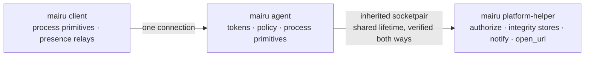
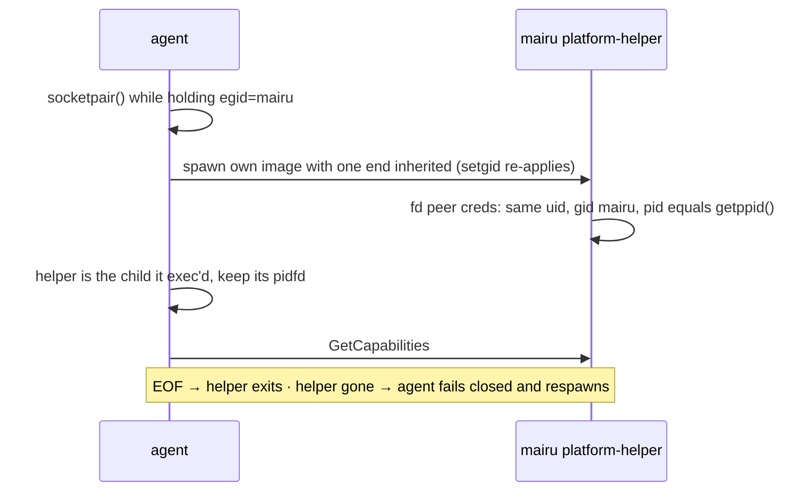
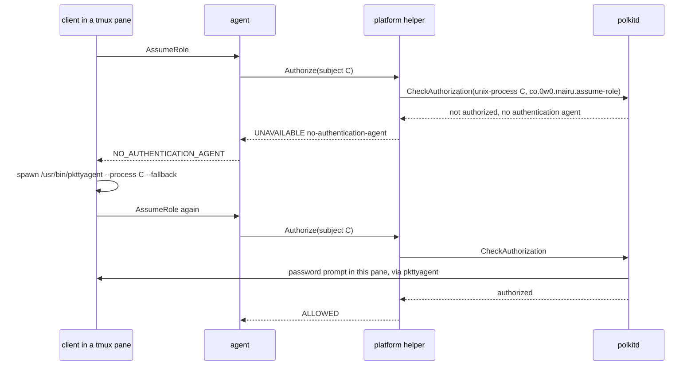
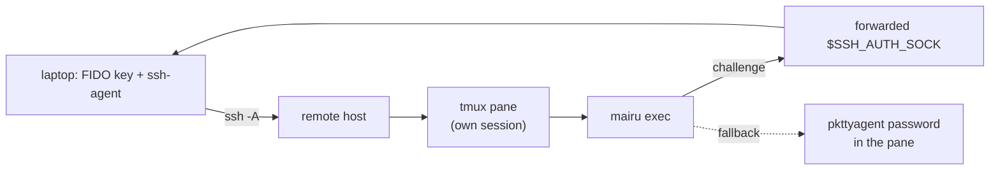
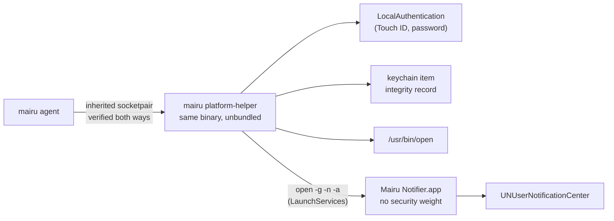

# Platform abstraction and platform helper

The platform-dependent code of mairu: process primitives that every process runs for itself, and platform services that always run in a separate platform helper process, which shares the agent's lifetime and is mutually verified with it, behind one protobuf contract (`mairu.platform`); plus the Linux backends.

Related specs:

- [hardening.md](hardening.md): threat model, terminology, trust anchors, and the peer verification reused by the helper transport.
- [policy.md](policy.md): when the agent asks the human and what it does with the answer; the integrity records the stores here hold.

Each section opens with a short visual summary. It is illustrative; the text after it is normative.

## 1. Overview



```text
src/platform/
├── mod.rs        # ProcessPlatform and PlatformServices traits, PeerIdentity, SessionIdentity
├── process/      # in-process primitives per OS: linux (procfs, peer, wsl detection), fallback
├── helper.rs     # HelperClient: the agent's only PlatformServices, over the socketpair
└── services/     # backends that run only inside the helper: linux (polkit, integrity, notify, open_url, wsl), fallback
```

Platform-dependent code lives in four places, each with one home:

| Kind | Runs in | Examples | Trust |
|---|---|---|---|
| Process primitives | Every mairu process, in-process, never remoted | marker gid, peer credentials (`inspect_peer`, `verify_agent`), process facts, safe spawning | Part of the process's own trust |
| Platform services | **Only the platform helper**, on every OS | `authorize` (polkit, LocalAuthentication), integrity stores, `notify`, `open_url` | Verified both ways with the agent (§4) |
| Presence relays | The client | `pkttyagent` registration (§6.1), ssh-agent signing and the Windows Hello helper ([policy §6](policy.md)) | Untrusted by design: the agent trusts only polkitd's own answer or a verified signature |
| Convenience commands | The client | user `command` helpers for `notify` and `open_url` (§8) | No security weight |

- **The agent never runs platform-service code.** The process that holds session tokens contains no D-Bus client, Secret Service, notification, desktop portal or LocalAuthentication code paths at run time. A bug reached through those surfaces lands in the helper, which holds no tokens.
- **One code path.** The agent reaches every service through `HelperClient` (§2), always over IPC, with no in-process/IPC branching, on every OS.
- **Clients make one connection**, to the agent. They reach services only through agent RPCs (`AssumeRole`, `ApprovePolicy`, `OpenUrl`, `Notify`, …), never directly.
- **The helper shares the agent's lifetime** (§4): the agent spawns it, talks to it over an inherited socketpair, and the helper exits when the agent goes away.
- **Packaging does not matter.** The helper is `mairu platform-helper`, the same binary, by default. A separately signed executable, inside an app bundle or not, can serve the same protocol under the same checks, and nothing else in these specs changes. The platform helper is never bundled. On macOS, notifications alone use a separate notifier app bundle, installed from the single binary and kept off the security path (§11).
- Inside the helper, the Linux backends verify the system services they call (§5).
- Backends: authorization facilities (§6), integrity stores (§7), and notifications and opening URLs (§8). Notifications and opening URLs carry no security weight, and each client chooses how they are delivered.
- Headless Linux (§9) and WSL2 (§10) are first-class environments. The macOS backends are briefed in §11.

## 2. Rust traits

```text
agent accept                → ProcessPlatform::inspect_peer               in-process
client connect              → ProcessPlatform::verify_agent               in-process
Authorizer (policy.md)      → ProcessPlatform::session_identity, ancestry in-process
                            → PlatformServices::authorize                 helper
policy approval             → PlatformServices::record/verify_integrity   helper
OpenUrl / Notify RPCs (§8)  → PlatformServices::open_url, notify          helper
```

`src/platform/mod.rs`:

```rust
/// Runs in-process in every mairu process; never remoted.
pub trait ProcessPlatform: Send + Sync + std::fmt::Debug {
    /// Agent side, at accept time.
    fn inspect_peer(&self, stream: &tokio::net::UnixStream) -> crate::Result<PeerIdentity>;
    /// Client side, right after connect.
    fn verify_agent(&self, stream: &std::os::unix::net::UnixStream) -> crate::Result<AgentTrust>;

    fn session_identity(&self, peer: &PeerIdentity) -> Option<SessionIdentity>;
    fn ancestry(&self, peer: &PeerIdentity) -> Vec<crate::proto::platform::Process>;
}

/// The `PlatformHelper` contract (§3) as a trait. The agent only holds `HelperClient`;
/// the backends that implement it run inside the platform helper.
#[async_trait::async_trait]
pub trait PlatformServices: Send + Sync + std::fmt::Debug {
    async fn capabilities(&self) -> crate::proto::platform::Capabilities;

    async fn authorize(
        &self,
        req: crate::proto::platform::AuthorizeRequest,
    ) -> crate::proto::platform::AuthorizeResponse;
    async fn notify(&self, req: crate::proto::platform::NotifyRequest) -> crate::proto::platform::NotifyResponse;
    async fn open_url(&self, req: crate::proto::platform::OpenUrlRequest) -> crate::proto::platform::OpenUrlResponse;
    async fn record_integrity(
        &self,
        req: crate::proto::platform::RecordIntegrityRequest,
    ) -> crate::proto::platform::RecordIntegrityResponse;
    async fn verify_integrity(
        &self,
        req: crate::proto::platform::VerifyIntegrityRequest,
    ) -> crate::proto::platform::VerifyIntegrityResponse;
}
```

- `PeerIdentity`: `uid`, `gid`, `pid`, `pidfd: Option<OwnedFd>`, `start_time: u64`, `exe: Option<PathBuf>`, `trust: PeerTrust`.
- `SessionIdentity`: `enum { Tty { sid: i32, leader_start_time: u64 }, Parent { ppid: i32, start_time: u64 } }`.
- `crate::platform::process()` returns the `ProcessPlatform` for the OS, chosen by `cfg`:
  - `LinuxProcess`
  - `FallbackProcess`: macOS and BSD until they are implemented. No verification (`Unverifiable`).
- The agent's `PlatformServices` is always `HelperClient` (§4). When the helper is unavailable, every call returns `RESULT_UNAVAILABLE` (`helper-unavailable` or `helper-unverified`) and capabilities are empty, so the agent fails closed.
- Inside the helper, `crate::platform::services()` returns the backend, chosen by `cfg`:
  - `LinuxServices` (§5–§8, §10)
  - `FallbackServices`: macOS and BSD until they are implemented. Authorization `UNAVAILABLE`, no integrity stores, no notifications. `open_url` uses `/usr/bin/open` on macOS.
- Clients never construct a `PlatformServices`.

## 3. Protocol: `proto/mairu_platform.proto`

```text
mairu.platform.PlatformHelper
├── GetCapabilities  → {peer_verification, authorization, integrity_stores, notifications, open_url, notes}
├── Authorize        → ALLOWED | DENIED | CANCELLED | UNAVAILABLE(reason)
├── Notify, OpenUrl                     # carry the client's SessionHint
└── RecordIntegrity, VerifyIntegrity    # IntegrityRecord = digest + ApprovalAnchor
```

The types here are the contract. The platform helper serves them over gRPC on the inherited socketpair (§4), and the agent is its only client. Enum values are prefixed with the enum name, because proto3 enum values share their package's scope.

```proto
syntax = "proto3";
package mairu.platform;

service PlatformHelper {
  rpc GetCapabilities(GetCapabilitiesRequest) returns (Capabilities);
  rpc Authorize(AuthorizeRequest) returns (AuthorizeResponse);
  rpc Notify(NotifyRequest) returns (NotifyResponse);
  rpc OpenUrl(OpenUrlRequest) returns (OpenUrlResponse);
  rpc RecordIntegrity(RecordIntegrityRequest) returns (RecordIntegrityResponse);
  rpc VerifyIntegrity(VerifyIntegrityRequest) returns (VerifyIntegrityResponse);
}

enum PeerVerification {
  PEER_VERIFICATION_UNSPECIFIED = 0;
  PEER_VERIFICATION_NONE = 1;
  PEER_VERIFICATION_SETGID = 2;
  PEER_VERIFICATION_CODE_SIGNATURE = 3;
}

enum AuthorizationFacility {
  AUTHORIZATION_FACILITY_UNSPECIFIED = 0;
  AUTHORIZATION_FACILITY_NONE = 1;
  AUTHORIZATION_FACILITY_POLKIT = 2;
  AUTHORIZATION_FACILITY_LOCAL_AUTHENTICATION = 3;
}

enum IntegrityStoreKind {
  INTEGRITY_STORE_KIND_UNSPECIFIED = 0;
  INTEGRITY_STORE_KIND_PROTECTED_DIRECTORY = 1;
  INTEGRITY_STORE_KIND_SECRET_SERVICE = 2;
  INTEGRITY_STORE_KIND_SECURE_ENCLAVE = 3;
  INTEGRITY_STORE_KIND_KEYCHAIN = 4;
}

enum IntegrityStatus {
  INTEGRITY_STATUS_UNSPECIFIED = 0;
  INTEGRITY_STATUS_MATCHED = 1;
  INTEGRITY_STATUS_MISMATCHED = 2;
  INTEGRITY_STATUS_NOT_RECORDED = 3;
  INTEGRITY_STATUS_UNAVAILABLE = 4;
}

message GetCapabilitiesRequest {}

message Capabilities {
  PeerVerification peer_verification = 1;
  AuthorizationFacility authorization = 2;
  // Stores reachable right now, in authority order.
  repeated IntegrityStoreKind integrity_stores = 3;
  bool notifications = 4;
  bool open_url = 5;
  // Free-form diagnostics for `mairu doctor`, e.g. "session bus unreachable".
  repeated string notes = 6;
}

message Process {
  uint32 pid = 1;
  // Linux: clock ticks since boot (/proc/<pid>/stat field 22). macOS: microseconds since epoch.
  uint64 start_time = 2;
  uint32 uid = 3;
  bytes executable = 4;
  repeated bytes argv = 5;
  string name = 6;
}

message AuthorizeRequest {
  enum Action {
    ACTION_UNSPECIFIED = 0;
    ACTION_ASSUME_ROLE = 1;
    ACTION_APPROVE_POLICY = 2;
  }
  Action action = 1;
  // The process the human is approving; the polkit subject on Linux.
  Process subject = 2;
  // One line, shown where the facility allows a custom reason.
  string message = 3;
  // Keys: server, role, command, cwd, tty, requester, intent, ai_agent, policy_digest.
  map<string, string> details = 4;
}

message AuthorizeResponse {
  enum Result {
    RESULT_UNSPECIFIED = 0;
    RESULT_ALLOWED = 1;
    RESULT_DENIED = 2;
    RESULT_CANCELLED = 3;
    RESULT_UNAVAILABLE = 4;
  }
  Result result = 1;
  // Machine-readable for UNAVAILABLE: "no-authentication-agent", "polkit-action-not-installed",
  // "polkit-unavailable", "untrusted-authority", "helper-unavailable", "helper-unverified", "timeout".
  string reason = 2;
  string detail = 3;
}

message NotifyRequest {
  enum Urgency {
    URGENCY_UNSPECIFIED = 0;
    URGENCY_LOW = 1;
    URGENCY_NORMAL = 2;
    URGENCY_CRITICAL = 3;
  }
  string title = 1;
  string body = 2;
  Urgency urgency = 3;
  string event = 4;  // "login-required" | "ai-agent-denied" | "policy-lockdown"
  SessionHint session = 5;
}
message NotifyResponse { bool delivered = 1; }

message OpenUrlRequest {
  string url = 1;
  SessionHint session = 2;
}
message OpenUrlResponse { bool opened = 1; string detail = 2; }

// The requesting client's desktop session, passed through by the agent (§8.4).
message SessionHint {
  string display = 1;                   // $DISPLAY
  string wayland_display = 2;           // $WAYLAND_DISPLAY
  string dbus_session_bus_address = 3;  // honored only as unix:path= under $XDG_RUNTIME_DIR
  bool ssh = 4;                         // $SSH_CONNECTION or $SSH_TTY was set
}

// What a store keeps for a name ([policy §9.7](policy.md)).
message IntegrityRecord {
  bytes digest = 1;            // 32 bytes
  ApprovalAnchor approval = 2;
}

// Who may approve the next change: the approval_methods and their keys at the time of approval.
message ApprovalAnchor {
  repeated string methods = 1;             // e.g. "ssh-agent", "windows-hello", "platform"
  repeated string ssh_agent_keys = 2;      // OpenSSH public key lines
  repeated bytes windows_hello_keys = 3;   // DER SubjectPublicKeyInfo
}

message RecordIntegrityRequest {
  string name = 1;   // "policy"
  uint32 uid = 2;
  IntegrityRecord record = 3;
}
message RecordIntegrityResponse { repeated IntegrityStoreResult results = 1; }

message VerifyIntegrityRequest {
  string name = 1;
  uint32 uid = 2;
  bytes digest = 3;
}
message VerifyIntegrityResponse { repeated IntegrityStoreResult results = 1; }

message IntegrityStoreResult {
  IntegrityStoreKind store = 1;
  // For record: MATCHED means written; UNAVAILABLE means skipped.
  IntegrityStatus status = 2;
  string detail = 3;
  IntegrityRecord stored = 4;  // verify: the record the store holds, when it holds one
}
```

Helpers reject requests whose `uid` differs from their own.

## 4. Platform helper process and mutual verification



The helper is a separate process on every OS. It holds no tokens, and the agent never runs platform-service code itself (§1).

Both directions are security-critical:

- A rogue **helper** answering `RESULT_ALLOWED` bypasses authorization, and answering `MATCHED` accepts a forged policy.
- A rogue **caller** of `RecordIntegrity` records a digest of a tampered policy.

Rules:

1. **Spawn.** At startup, before serving clients, the agent:
   1. creates a `socketpair(AF_UNIX, SOCK_STREAM)` inside `with_privileged_gid`, so the credentials the kernel records for the pair carry the marker gid;
   2. spawns its own image (`/proc/self/exe platform-helper --fd <n>` on Linux) via `hardening::command()`, with that end as the only inherited fd. The setgid bit re-applies the marker, which the helper needs for the protected directory (§7);
   3. closes its copy of the helper's end.

   There is no rendezvous in the filesystem, so there is nothing to squat. The helper runs from the setgid binary, so it is non-dumpable and its fd cannot be taken over through `/proc`.
2. **The helper verifies the agent** before serving: `SO_PEERCRED` of the inherited fd must show `uid == own`, `gid == mairu` (when hardened) and **`pid == getppid()`**. On a socketpair the kernel reports the creator of the pair, which is the agent. The helper serves only that fd and exits on EOF, which is how it shares the agent's fate. `crate::ppid` remains a backstop.
3. **The agent verifies the helper by construction:** it exec'd its own image and keeps the child's pidfd. A socketpair reports its creator to both ends, so `SO_PEERCRED` cannot identify the helper, and the agent does not need it to.
4. Both ends reject requests whose `uid` differs from their own (§3).
5. **Failure.** If the helper fails verification, exits or crashes, `HelperClient` returns `RESULT_UNAVAILABLE` (`helper-unavailable` or `helper-unverified`) and empty capabilities, and the agent fails closed. It respawns the helper at most once per 30 s. `GetAgentStatus` reports the helper's state ([hardening §7.1](hardening.md)).
6. **Unhardened Linux:** the checks reduce to uid plus pid pinning.
7. **macOS:** the same process model, with the same binary (§11). The agent and the helper therefore have the same designated requirement: team-based for Developer ID builds, cdhash for ad-hoc ones ([hardening §9.1](hardening.md)). Each checks the other against its own requirement, as clients and the agent do.
   - **Q-M1:** whether a socketpair yields usable peer information there. `LOCAL_PEERTOKEN` on a socketpair may report the creator, as `SO_PEERCRED` does on Linux. If it does not, the helper checks its parent's code signature through `getppid()` and its audit token, and pins the pid and pid version.
   - A separately signed helper executable, bundled or not, follows the same rules. The helper then verifies its caller against identifier `co.0w0.mairu` with the same team ID, and the agent verifies the helper against identifier `co.0w0.mairu.platform-helper` with its own team ID. Use `xpc_connection_set_peer_code_signing_requirement` / `NSXPCConnection.setCodeSigningRequirement:` when on XPC, or `LOCAL_PEERTOKEN` on a socket. Ad-hoc builds need a cdhash pin recorded at install time.

## 5. Verifying system services (Linux helper backends)

```text
system bus   hardened: ignore $DBUS_SYSTEM_BUS_ADDRESS → /run/dbus/system_bus_socket (root-owned dir)
polkit       GetConnectionUnixUser("org.freedesktop.PolicyKit1") == 0, else untrusted-authority
session bus  Secret Service, notifications, portal: claimable by same uid → never trusted alone
```

- **System bus.** When hardened, the helper ignores `DBUS_SYSTEM_BUS_ADDRESS`, which is attacker-controllable environment, and connects to `unix:path=/run/dbus/system_bus_socket`. The socket's parent directory must be root-owned and not group/other-writable.
- **polkit authority.** Before trusting a result, the helper checks that the owner of `org.freedesktop.PolicyKit1` is uid 0 (`org.freedesktop.DBus.GetConnectionUnixUser`). A mismatch maps to `UNAVAILABLE`/`untrusted-authority`.
- **Session bus** services (Secret Service, notifications, the desktop portal) can be claimed by any same-uid process. They are treated as untrusted conveniences, and this is why Secret Service is a secondary integrity store ([policy §9.7](policy.md)).

## 6. Authorization facilities



The `platform` presence method ([policy §6.1](policy.md)) is backed by these. They run in the platform helper (§4), which talks to polkitd or LocalAuthentication on the agent's behalf.

### 6.1 polkit (Linux)

```text
CheckAuthorization(unix-process{pid, start-time, uid}, action, details, AllowUserInteraction)
  authorized                          → ALLOWED
  dismissed                           → CANCELLED
  challenge, no agent for the subject → UNAVAILABLE no-authentication-agent  (client: pkttyagent, retry)
  action not registered               → UNAVAILABLE polkit-action-not-installed
  bus unreachable / owner uid ≠ 0     → UNAVAILABLE polkit-unavailable / untrusted-authority
```

`pkg/polkit/co.0w0.mairu.policy`:

```xml
<?xml version="1.0" encoding="UTF-8"?>
<!DOCTYPE policyconfig PUBLIC "-//freedesktop//DTD PolicyKit Policy Configuration 1.0//EN"
 "http://www.freedesktop.org/standards/PolicyKit/1/policyconfig.dtd">
<policyconfig>
  <vendor>mairu</vendor>
  <vendor_url>https://github.com/sorah/mairu</vendor_url>
  <action id="co.0w0.mairu.assume-role">
    <description>Provide AWS credentials</description>
    <message>Authentication is required to provide AWS credentials for $(role) on $(server)</message>
    <defaults>
      <allow_any>auth_self</allow_any>
      <allow_inactive>auth_self</allow_inactive>
      <allow_active>auth_self</allow_active>
    </defaults>
  </action>
  <action id="co.0w0.mairu.approve-policy">
    <description>Approve mairu authorization policy</description>
    <message>Authentication is required to approve the mairu authorization policy</message>
    <defaults>
      <allow_any>auth_self</allow_any>
      <allow_inactive>auth_self</allow_inactive>
      <allow_active>auth_self</allow_active>
    </defaults>
  </action>
</policyconfig>
```

- `auth_self` on `allow_any` means SSH and other remote sessions get a prompt rather than a silent "no". `auth_self_keep` is not used; mairu keeps its own grants.
- Check: `CheckAuthorization(subject, action_id, details, flags = AllowUserInteraction, cancellation_id)`.
  - `subject` is `("unix-process", {pid: u32, start-time: u64, uid: i32})` of the **peer** (the sidecar for `exec`), passed with `zbus_polkit` ≥ 5.1 (CVE-2026-78422).
  - `cancellation_id` is unique per check. If the request is dropped, for example because the client disconnected, the agent cancels its `Authorize` call, and a drop guard in the helper spawns `CancelCheckAuthorization`. The helper's own timeout is 5 min, after which it cancels and returns `CANCELLED`/`timeout`.
- `$(role)`/`$(server)` expand from `details`. Whether a given authentication agent shows the expansion or the other `details` keys varies, so the client terminal always prints the full context too ([policy §7](policy.md)). Confirm the expansion against polkit 127 during implementation.
- Result mapping. The exact signals for "no agent" and "dismissed" must be confirmed empirically on polkit 127 and pinned with a test; this table is the contract.

  | polkit outcome | `AuthorizeResponse` |
  |---|---|
  | `is_authorized` | `ALLOWED` |
  | not authorized, details `polkit.dismissed` | `CANCELLED` |
  | not authorized, `is_challenge`, no authentication agent for the subject | `UNAVAILABLE`/`no-authentication-agent` |
  | not authorized otherwise (wrong password, …) | `DENIED` |
  | `Error.Failed` "action … not registered" | `UNAVAILABLE`/`polkit-action-not-installed` |
  | system bus or authority unreachable | `UNAVAILABLE`/`polkit-unavailable` |
  | authority owner uid ≠ 0 | `UNAVAILABLE`/`untrusted-authority` |

- polkit evaluates `allow_*` from the subject's logind session. A tmux server keeps the session of the SSH login that started it, even after that login ends. Because the subject is a `unix-process` and the fallback agent below registers for that same process, prompting works regardless of the logind session's state.

**Headless fallback: `pkttyagent`.** On `REASON_NO_AUTHENTICATION_AGENT` the client (`src/polkit_tty_agent.rs`) does the following:

1. Check it can prompt: `/dev/tty` must open. Otherwise it fails with guidance; no tty means no prompt, as with an AI agent's non-interactive shell.
2. Locate `/usr/bin/pkttyagent`, a **fixed path** that must be root-owned and not group/other-writable. `PATH` is attacker-controlled, and a fake agent would receive the password.
3. Spawn `/usr/bin/pkttyagent --process <own pid>,<own start_time> --fallback --notify-fd 3` via `hardening::command()`, with stdio on `/dev/tty`. Wait up to 5 s for fd 3 to close, which means the agent is registered.
4. Print the context ([policy §7](policy.md)), then retry the RPC once.
5. Send `SIGTERM` to `pkttyagent` when the RPC returns.

The process that spawns `pkttyagent` is the one making the RPC, so polkit's subject and the registered agent are the same process. For `exec` that is the sidecar.

**Risk documented for users:** same-user code can capture a password typed at a tty prompt and replay it later. The echo is off, so output capture such as `pipe-pane -O` or `capture-pane` does not see it. Input capture does:

- reading the pane's pty concurrently
- tmux key bindings installed through the server socket
- a fake prompt written to the pty first
- ptrace of the terminal path when `kernel.yama.ptrace_scope = 0`

This is the same exposure as `sudo`'s prompt in the same pane, and `auth_self` asks for the same login password. So on a host where the user types the sudo password into tmux, same-user code can already become root, which defeats everything here ([hardening §2.2](hardening.md)). The mairu prompt adds more opportunities, not a new kind of exposure. Prefer ssh-agent presence ([policy §6.2](policy.md)). For `sudo` itself, the analogous fix is FIDO-backed PAM: `pam_u2f` locally, or `pam_ssh_agent_auth` with an `sk-` key over SSH.

### 6.2 LocalAuthentication (macOS)

```text
LAContext.evaluatePolicy(.deviceOwnerAuthentication, reason) → ALLOWED / DENIED     in the helper (§11)
```

Briefed in §11.

## 7. Integrity stores

```text
record "policy" = {digest, approval anchor}
├── /var/lib/mairu/users/<uid>/policy.record   hardened only · authoritative · anchor source
└── Secret Service item                        when reachable · weak · backfilled
```

The stores hold the `IntegrityRecord` (§3) of [policy §9.7](policy.md): a digest plus the approval anchor. The state machine that interprets their answers is [policy §9.8](policy.md).

- **Linux stores**, used **concurrently** (§3 `IntegrityStoreKind`):

  | Store | Available when | Location | Strength |
  |---|---|---|---|
  | `PROTECTED_DIRECTORY` | Helper hardened (it inherits the marker through the setgid exec, §4), and `/var/lib/mairu` is `root:mairu`, mode `2770` with no "other" bits, not FUSE | `/var/lib/mairu/users/<uid>/policy.record` (the record JSON of [policy §9.7](policy.md)), written atomically (temp + rename + fsync) by the helper inside `with_privileged_gid` | Strong: unreachable by same-user code. Authoritative when present. |
  | `SECRET_SERVICE` | Session bus reachable, `org.freedesktop.secrets` present, default collection unlocked. A locked collection is `UNAVAILABLE`; the helper never triggers an unlock prompt. | Item in the default collection: label `mairu policy record (uid N)`, attributes `{application: "co.0w0.mairu", kind: "policy-record", name: "policy", uid: "N"}`, secret = the record JSON | Weak: same-user code can read and write it. It catches offline or careless edits, and on hardened hosts any disagreement with the protected directory. |

- **macOS stores** (§11): Developer ID builds keep the record in a keychain item whose access is limited to their team-based requirement. Ad-hoc builds follow Q-M6.

## 8. Convenience features: notifications and opening URLs

```text
mode = --no-browser ?? $MAIRU_OPEN_URL ?? config.json open_url ?? auto
auto      → agent
agent     OpenUrl / Notify RPC → agent → platform helper, with the client's SessionHint
command   your helper program, run by the client
none      terminal output only
```

These carry no security weight. Nothing relies on a notification being seen or a URL being opened, and the URLs involved are not secret (PKCE and `state` protect the code flow). They are therefore chosen **per client**, from unprotected settings, and can be redirected or switched off freely. Terminal output and printed URLs never depend on these settings.

### 8.1 Who emits what

```text
mairu login                    → open the authorize URL
exec sidecar, UNAUTHENTICATED  → "login required"            once / server / 10 min
refused AI-agent request       → "AI-agent request refused"  once / (server, rolespec) / min
PingAgent says TAMPERED        → "policy lockdown"           once / agent instance
```

Emission always happens in a client, never on the agent's own initiative, so every notification follows the client's choice.

| Event | Emitted by | Limit |
|---|---|---|
| Open the authorize URL (`verification_uri_complete` for the device code grant) | `mairu login`, including the login inside `mairu exec` | once per login |
| Login required | `mairu exec` sidecar (ECS backend and auto-refresh) when the agent returns `UNAUTHENTICATED` | once per server per 10 min |
| AI-agent request refused | The client that receives `REASON_FORBIDDEN` or `REASON_NOT_PERMITTED` with `ai_agent = true` | once per (server, rolespec) per minute |
| Policy lockdown | Any client whose `PingAgent` reports `POLICY_INTEGRITY_TAMPERED` ([policy §10](policy.md)) | once per agent instance |

Rate-limit state is best-effort: one file per event key under `runtime_dir()/notified/`, compared by mtime.

### 8.2 Modes

```text
per feature (open_url, notify):   auto | agent | command | none
```

`open_url` and `notify` each take one of:

| Mode | Behavior |
|---|---|
| `auto` (default) | `agent` |
| `agent` | Ask the agent through the `OpenUrl`/`Notify` RPCs (§8.5). The agent passes the request, with the client's `SessionHint`, to the platform helper, whose backend (§8.4) decides where to deliver it. The helper delivers to the client's desktop session when the hint names one, even if the agent was started elsewhere. It reports `opened`/`delivered = false`, rather than using some other session, when the hint shows SSH without a display, or no display at all. On WSL2 with interop it uses the Windows side (§10). |
| `command` | Run a different helper program supplied by the user (§8.3) |
| `none` | Disabled |

A failure in any mode is logged at debug level and otherwise ignored.

### 8.3 Configuration

```text
--no-browser  >  MAIRU_OPEN_URL / MAIRU_NOTIFY (+ *_COMMAND)  >  config.json  >  auto
helper argv   open_url → command + [url]
              notify   → command + [title, body], env MAIRU_NOTIFY_{URGENCY,EVENT}
```

Precedence: command-line flag, then environment, then `config.json`, then `auto`.

- `config.json` (`UserConfig`, unprotected):

  ```jsonc
  {
    "open_url": {"mode": "command", "command": ["my-open-url"]},
    "notify": {"mode": "agent"}
  }
  ```

  `command` is an argv array, required when `mode` is `command`.
- Environment:
  - `MAIRU_OPEN_URL` / `MAIRU_NOTIFY` set the mode: `auto|agent|command|none`.
  - `MAIRU_OPEN_URL_COMMAND` / `MAIRU_NOTIFY_COMMAND` hold a shell command line, run as `/bin/sh -c '<value> "$@"' mairu <args…>`. Setting one implies `command` mode.
- Flags: `--no-browser` on `mairu login` and `mairu exec` means `open_url = none`.

The helper command interface:

- `open_url`: argv is `command + [url]`.
- `notify`: argv is `command + [title, body]`, plus the environment variables `MAIRU_NOTIFY_URGENCY` (`low|normal|critical`) and `MAIRU_NOTIFY_EVENT` (`login-required|ai-agent-denied|policy-lockdown`).
- The command is spawned through `hardening::command()`, which drops the marker gid, with stdin set to `/dev/null`. It isn't waited on for more than 5 s, and is reaped in the background.

The README gives examples: a `notify-send` wrapper, and for tmux over SSH, a script that forwards the URL to the local machine or calls `tmux display-message`.

### 8.4 Backends (in the platform helper)

```text
notify     org.freedesktop.Notifications on the session bus · no bus or daemon → no-op
open_url   portal OpenURI → xdg-open · http/https only · title/body truncated
```

- **Session hint.** The client fills `SessionHint` from its own environment, and the agent passes it through unchanged. The values are requester-chosen, which is acceptable because these features carry no security weight. The helper honors `dbus_session_bus_address` only as `unix:path=` under the user's `$XDG_RUNTIME_DIR`, so a hint cannot point it at an arbitrary socket or a TCP address.
- **Linux notifications**:
  - `org.freedesktop.Notifications.Notify` on the session bus (`app_name = "mairu"`, urgency hint).
  - The address comes from the hint's `dbus_session_bus_address` when honored, otherwise the helper's `DBUS_SESSION_BUS_ADDRESS`, falling back to `unix:path=$XDG_RUNTIME_DIR/bus` when that exists.
  - Headless (no bus, or no notification daemon): `notifications = false`, and calls are no-ops.
- **Linux open URL**: `org.freedesktop.portal.OpenURI.OpenURI("", url, {})` on that bus, falling back to `xdg-open` via `hardening::command()` with `DISPLAY`/`WAYLAND_DISPLAY` from the hint. A `PATH` lookup is acceptable here.
- **macOS**: §11.
- **Fallback**: `/usr/bin/open` on macOS, otherwise unavailable.

Every mode passes on only `http`/`https` URLs, so a URL can never reach `file://` or a custom-scheme handler. Notification title and body are truncated to 256 and 1024 bytes.

### 8.5 Agent RPCs

```text
client ──OpenUrl / Notify + SessionHint──► agent ──► platform helper backend
trusted peer only · never authorization · same URL and length rules
```

```proto
service Agent {
  rpc OpenUrl(mairu.platform.OpenUrlRequest) returns (mairu.platform.OpenUrlResponse);
  rpc Notify(mairu.platform.NotifyRequest) returns (mairu.platform.NotifyResponse);
}
```

Both need only a trusted peer ([hardening §5.1](hardening.md)), never authorization. The agent applies the URL and length rules of §8.4 before forwarding to the helper, which applies them again.

## 9. Headless Linux



The reference workflow is long-lived **tmux sessions on a remote host, reached over SSH**.

| Capability | GUI session | SSH + tmux | No session bus | No polkitd |
|---|---|---|---|---|
| Peer verification | ✓ | ✓ | ✓ | ✓ |
| ssh-agent presence | ✓ (if agent has an sk key) | ✓ (forwarded agent) | ✓ | ✓ |
| polkit prompt | GUI agent | `pkttyagent` in the pane (§6.1) | ✓ (system bus) | ✗ → `UNAVAILABLE` |
| Integrity: protected directory | ✓ (hardened) | ✓ (hardened) | ✓ (hardened) | ✓ (hardened) |
| Integrity: Secret Service | usually ✓ | usually ✗ | ✗ | — |
| Notifications, `auto` mode (§8.2) | ✓ | ✗ (no-op) | ✗ | — |
| Open URL, `auto` mode (§8.2) | ✓ | ✗ (URL printed) | ✗ | — |
| Notifications / open URL, `command` mode | as configured | as configured (e.g. forward to the local machine) | as configured | as configured |

**Fails closed:**
- A role that requires a prompt when no method can ask: no ssh-agent key and polkit unavailable, or no tty for `pkttyagent`.

**Degrades:**
- Notifications and open-url fall back to terminal output only. Users can point them at their own helper (§8.3).
- Secret Service. On hardened hosts the protected directory carries integrity alone. On unhardened headless hosts there is no store, so the policy is `UNAPPROVED` and only tightens.

**Admin guidance** (README):
- polkit's PAM stack (`/etc/pam.d/polkit-1`) can use `pam_fprintd` or `pam_u2f` on local machines.
- For SSH, the ssh-agent method is preferred, because a FIDO key on the local machine cannot be reached through PAM on the remote host.

## 10. WSL2

```text
WSL2 + interop   open_url → wslview / explorer.exe   notify → command   auth → windows-hello, pkttyagent
WSL2 isolated    open_url → printed                   notify → none      auth → ssh -A from Windows
```

Profiles, interop and the root path are in [hardening §8](hardening.md). Platform-specific behavior inside a WSL2 distribution:

- **`open_url`.** On WSL2 with interop, the helper's `open_url` backend uses `wslview` when installed, otherwise `explorer.exe` located through `wslpath`, started via `hardening::command()`. The helper runs in the same distribution as the agent, so it has interop whenever the agent does. This takes precedence over WSLg's `DISPLAY`/`WAYLAND_DISPLAY`, since the Linux side usually has no browser.
- **`notify`.** The helper has no WSL2 notification backend, so `agent` mode reports `delivered = false`. `command` mode with a Windows toast helper is the documented option.
- **Authorization facility.** WSL2 normally has no polkit agent, so the `pkttyagent` fallback (§6.1) applies. The key-based methods ([policy §6](policy.md)) are preferred.
- **Integrity stores.** Secret Service is usually absent, so hardened distributions rely on the protected directory alone.
- **Q-W5** ([hardening §8.5](hardening.md)): how WSLg should influence `auto` modes beyond this.

## 11. macOS backends (implemented separately)



Together with [hardening §9](hardening.md), this is the brief for the macOS implementation. Items marked **Q** must be settled there and written back into these specs.

The platform helper is the same binary as the agent and is never bundled. Everything below runs in the helper process, never in the agent (§1, §4). The one exception is the notifier, a separate app bundle that only posts notifications.

1. **Authorization.**
   - `LAContext.evaluatePolicy(.deviceOwnerAuthentication, localizedReason:)`, with the reason built from [policy §7](policy.md). It works from a plain binary, signed ad-hoc or with a Developer ID.
   - Track lid/clamshell state (Touch ID unavailable) and fall back to password.
   - **Q:** whether to use a Secure Enclave key gated by `.userPresence` so the result is cryptographic rather than boolean. Optional, because the agent enforcing the result is itself protected.
   - Over SSH there is no UI, so the ssh-agent method ([policy §6.2](policy.md)) applies unchanged.
   - **Q-M2:** an agent first started from an SSH login, and so its helper, may sit outside the user's GUI session, where the LocalAuthentication UI cannot appear (`UNAVAILABLE`). The candidate fix is a per-user LaunchAgent plist that runs the plain binary in the GUI session; it needs no bundle.
2. **Integrity store.**
   - **Developer ID builds:** a Keychain generic-password item in the legacy file-based keychain, holding the record, with access limited to the build's team-based designated requirement. The access survives upgrades, and it needs no entitlements. This is the planned store, `IntegrityStoreKind` `KEYCHAIN`.
   - The alternative is a Secure Enclave P-256 key (`kSecAttrTokenIDSecureEnclave`) signing the digest, with the signature in `$HOME` and the latest record kept in the Keychain against rollback. It needs `keychain-access-groups`. That in turn needs an app bundle and a provisioning profile, so it is not planned. It would report `SECURE_ENCLAVE`.
   - **Ad-hoc builds, Q-M6:** an item limited to a cdhash would prompt after every upgrade. The options are no store, so policy only tightens as on headless unhardened Linux, or porting the Linux protected directory to macOS through `harden` (Q-M9). Setgid binaries on macOS are restricted processes, so the marker group carries over.
   - Whatever the choice, the store must hold the whole `IntegrityRecord`, including the approval anchor, where same-user code cannot rewrite it.
3. **Notifications: the notifier bundle.**

   ```text
   Developer ID build carrying an embedded notifier of the same team
     extract   ~/Library/Application Support/mairu/notifier-<version>/Mairu Notifier.app   (no signing at run time)
     check     SecStaticCodeCheckValidity: same team, identifier co.0w0.mairu.notifier
   any other build
     assemble  Contents/Info.plist + Contents/MacOS/mairu-notifier = clonefile(own binary)
     sign      /usr/bin/codesign --force --sign - --options runtime   (codesign ships with macOS)
   both
     write into a fresh directory per version and flavour; never modify an existing bundle
     strip com.apple.quarantine from what mairu wrote; check the designated requirement
     rename into place atomically; remove older versions
   each notification
     open -g -n -a <full path to the bundle> --args notifier --title … --body … --event …
     notifier: request authorization the first time, add the request, exit
   fallback (bundle unusable, no GUI session)
     osascript display notification, else delivered = false
   ```

   - `UNUserNotificationCenter` requires the calling process to be the main executable of a signed app bundle. A bare binary fails with `bundleProxyForCurrentProcess is nil`. An ad-hoc signature is enough for local builds.
   - **Official builds** embed a notifier built, Developer ID–signed, notarized and stapled by the release pipeline ([hardening §9.4](hardening.md)). Its executable is a small dedicated binary target, `mairu-notifier` (objc2 + UserNotifications). It cannot be a copy of mairu, which would then have to embed itself. A single `mairu` binary remains the only artifact, and the notifier's identity is stable, so its permission survives upgrades.
   - **Other builds** carry no notifier. They assemble one from their own binary, run in `notifier` mode, and sign it ad-hoc.
   - The bundle sets `LSUIElement` true, `CFBundleName` `mairu`, an icon, and a `CFBundleIdentifier` per flavour:
     - official builds: `co.0w0.mairu.notifier`
     - ad-hoc builds: `co.0w0.mairu.notifier.adhoc`
     - the dev profile: `co.0w0.mairu.dev.notifier` ([hardening §15.1](hardening.md))

     Separate identifiers keep LaunchServices from resolving to another flavour's copy, and keep an ad-hoc mairu away from the official bundle.
   - Extraction and assembly follow these rules:
     - **Byte-exact, never in place.** Since macOS Ventura, Gatekeeper checks notarized apps on every launch, and any modification makes the app show as damaged. App Management may also block a process signed by another team from modifying a notarized bundle. Each version and flavour therefore gets a fresh directory.
     - **Quarantine.** Unsandboxed tools don't quarantine the files they create by default. A process that inherited quarantine, for example one started from a terminal inside a quarantined GUI app, may get every file it writes quarantined. mairu therefore removes `com.apple.quarantine` from the bundle it wrote, then checks the designated requirement before launching it.
     - **Launch by full path.** `open -a <name>` resolves by name or bundle id and could pick a different copy.
   - It is launched through LaunchServices so that it is registered and authorized. It is not the helper's child and doesn't need to be: it carries no security weight, so a same-user process that swaps it gains nothing.
   - The platform helper itself is never the bundle. LaunchServices cannot pass the socketpair (§4), and a bundle in a user-writable location would break "trusted by construction".
   - **Q-M3:** does a LaunchServices-launched notifier get notification authorization and appear in System Settings, for both the Developer ID and the ad-hoc flavour on current macOS? Does that hold when the agent itself was started from an SSH login while a GUI session exists? One source claims unsigned apps can never be authorized, while ad-hoc or self-signed ones can. Also: does quarantine carry over from a cask-quarantined mairu process to files it writes?
   - **Q-M4:** does the permission survive an ad-hoc notifier's upgrade, where the cdhash changes but the bundle id does not?
   - **Q-M5:** the notifier's icon, display name, and cleanup of old versions.
4. **Open URL.** `NSWorkspace` or `/usr/bin/open`, in the user's GUI session.
5. **AI-agent ancestry** ([policy §5](policy.md)). The same rules, using `proc_pidinfo` (process facts in [hardening §9.6](hardening.md)). This is a process primitive in the agent, not a helper service.

## 12. Security considerations

```text
rogue helper or helper caller    ✗ inherited socketpair, parent checked, child by construction, fail closed
bug via D-Bus / portal / keychain ✗ runs in the helper, which holds no tokens
fake polkit / bus / pkttyagent   ✗ pinned bus path, authority uid 0, fixed /usr/bin/pkttyagent
Secret Service rewritten         ! weak store; protected directory is authoritative
spoofed notifications / URLs     · no security weight by design
```

| Threat | Mitigation |
|---|---|
| Rogue platform helper or rogue helper caller | Inherited socketpair with no filesystem rendezvous; the helper checks its parent's credentials, and the agent trusts the child it exec'd; fail closed (§4) |
| A bug reached through D-Bus, Secret Service, notification, portal or LocalAuthentication code | Platform services run only in the helper, which holds no tokens (§1) |
| A swapped macOS notifier bundle | Launched only to post notifications; no security weight, so swapping it gains nothing (§11) |
| Fake polkit, D-Bus or `pkttyagent` | System bus path pinned; authority uid 0; fixed `/usr/bin/pkttyagent` with ownership check (§5, §6.1) |
| Password capture at a tty prompt | Documented (§6.1); key-based methods preferred ([policy §6](policy.md)) |
| Secret Service read or rewritten by same-user code | Secondary store; the protected directory is authoritative when hardened (§7) |
| Spoofed, redirected or suppressed notifications and URL opening | Not relied on for security; unprotected client settings by design. Helpers run with the marker dropped and receive only `http`/`https` URLs (§8). |

## 13. Scope

```text
in    trait · protocol · helper · polkit + pkttyagent · integrity stores · notify / open_url · headless · WSL2
out   macOS backends · agent-initiated login · hosts without polkitd (prompting roles fail closed)
```

**In scope (Linux):** §2–§10, plus the hidden `mairu platform-helper` command.

**Out of scope, and future work:**
- macOS backends (§11)
- Agent-initiated login with browser opening
- Linux hosts without polkitd: prompts are `UNAVAILABLE` there, so roles that require a platform prompt fail closed, while key-based methods and `forbid` policies still work

## 14. Deliverables

```text
peer-verification ← platform-helper ← authorization ← headless ← policy ← wsl ← notify
```

Layers of the stack in [hardening §14](hardening.md) that implement this spec:

| Layer | Files |
|---|---|
| `hardening/peer-verification` | `src/platform/mod.rs` (traits), `src/platform/process/{linux,fallback}.rs` (procfs, peer), `proto/mairu_platform.proto`, `build.rs`, `src/proto.rs` |
| `hardening/platform-helper` | `src/platform/helper.rs` (`HelperClient`, spawn, respawn), `src/cmd/platform_helper.rs` (hidden `mairu platform-helper --fd`), `src/platform/services/{mod,fallback}.rs`, agent startup wiring |
| `hardening/authorization` | `src/platform/services/linux/polkit.rs`, `pkg/polkit/co.0w0.mairu.policy`, `Cargo.toml` (`zbus`, `zbus_polkit`, deb asset) |
| `hardening/headless` | `src/polkit_tty_agent.rs`, client retry paths, `src/cmd/doctor.rs` |
| `hardening/policy` | `src/platform/services/linux/integrity.rs`, `Cargo.toml` (Secret Service crate) |
| `hardening/wsl` | `src/platform/process/linux/wsl.rs` (detection), `src/platform/services/linux/wsl.rs` (Windows-side `open_url`) |
| `hardening/notify` | `src/convenience.rs` (mode resolution `auto|agent|command|none`, helper commands, rate limits), `src/config.rs` (`UserConfig.open_url`, `UserConfig.notify`), `src/platform/services/linux/{notify,open_url}.rs`, `proto/mairu.proto` (`OpenUrl`, `Notify`), `proto/mairu_platform.proto` (`SessionHint`), `src/agent.rs`, `src/cmd/{login,exec}.rs` (`--no-browser`, event emission) |

## Current Status

Spec drafted; awaiting review before implementation. Implementors MUST keep this section updated as they work.

### Checklist

Linux:
- [ ] `mairu.platform` proto; `ProcessPlatform` and `PlatformServices` traits
- [ ] Platform helper process: inherited socketpair, mutual verification, fail closed, respawn
- [ ] polkit backend and policy file; system bus and authority checks
- [ ] `pkttyagent` fallback
- [ ] Protected-directory and Secret Service integrity stores
- [ ] Notifications and open-url: helper backends, `SessionHint`, client-chosen modes (`auto|agent|command|none`), agent `OpenUrl`/`Notify` RPCs
- [ ] WSL2: Windows-side `open_url`; settle Q-W5

macOS (separate implementation, §11):
- [ ] Settle the Q items in §11 and write them back here
- [ ] LocalAuthentication backend
- [ ] Integrity store
- [ ] Helper on macOS (same binary, unbundled); settle Q-M1 and Q-M2
- [ ] Notifier bundle: embedded Developer ID notifier (`mairu-notifier`) and ad-hoc assembly; settle Q-M3 to Q-M5
- [ ] Keychain integrity store for Developer ID builds; settle Q-M6 for ad-hoc builds

### Updates

- 2026-10-23: Drafted as part of a single combined spec; notifications and URL opening moved to client-side emission with client-chosen modes.
- 2026-10-23: Split out of the combined spec.
- 2026-10-23: Added show-me style visual summaries to every section (additive; Mermaid blocks validated with mermaid 11.4.1).
- 2026-10-23: Platform services always run in a separate platform helper that shares the agent's lifetime (inherited socketpair), on every OS; process primitives split into their own trait; convenience modes reduced to `auto|agent|command|none` with a session hint; no app bundle planned on macOS.
- 2026-10-23: macOS backends rewritten around Developer ID build tiers: embedded Developer ID notifier or locally assembled ad-hoc notifier, keychain store per tier.
- 2026-10-23: Notifier extraction hardened: fresh directory per version and flavour, quarantine removed and designated requirement checked before launch, launch by full path, separate bundle ids per flavour.
