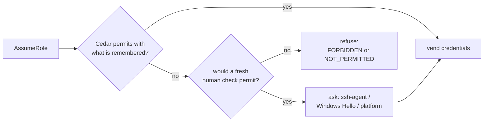
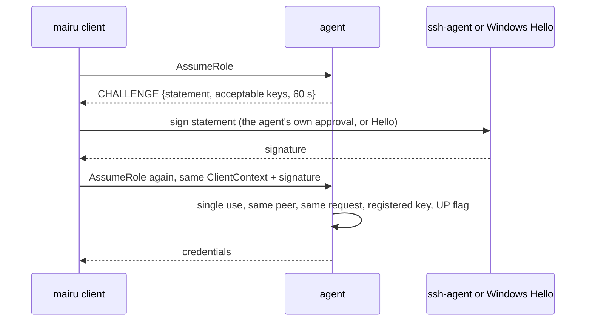
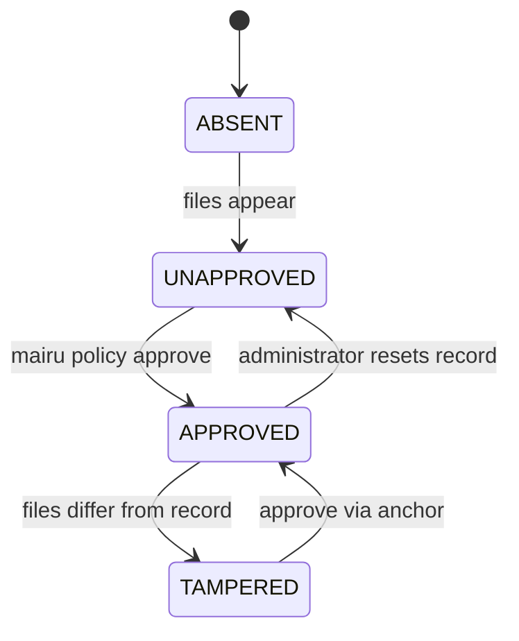
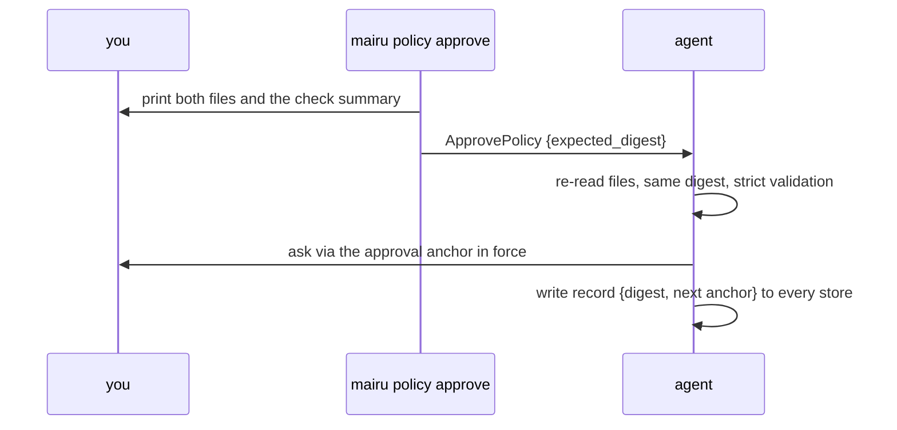

# Authorization and policy

When `mairu agent` asks the human before vending credentials, how it remembers the answer, and the [Cedar](https://www.cedarpolicy.com/) policy that decides both.

Related specs:

- [hardening.md](hardening.md): threat model, terminology, trust chain, and the mutual verification every request here depends on.
- [platform-helper.md](platform-helper.md): the platform facilities that ask the human (polkit, LocalAuthentication), the integrity stores, and the `mairu.platform` protocol.

Each section opens with a short visual summary. It is illustrative; the text after it is normative.

## 1. Overview



Each credential request passes two gates, and each gate decides as above:

```text
gate 1  AssumeRole       before fetching   server, role (the account only when the role name has one)
        ↓ credential server (+ sts:AssumeRole for chains) → sts:GetCallerIdentity, cached with the credentials
gate 2  UseCredentials   before vending    the same, plus the real caller: account, ARN, …
```

The agent asks the human before vending credentials, and remembers the answer for a while. This spec defines:

- when authorization applies (§2), and the session identity that answers are remembered against (§3)
- grants per terminal session, leases per running `mairu exec`, and the decision procedure that consults the policy at both gates (§4)
- tool detection, such as AI agents, as a guardrail (§5)
- presence methods: the platform's own facility, and the key-based ssh-agent and Windows Hello methods (§6)
- what the human sees (§7) and revocation (§8)
- the Cedar policy, its settings, built-ins, integrity records, approval anchor and commands (§9)
- the agent protocol for all of the above (§10)

A human check is just another condition in the policy, as MFA is in AWS IAM: the agent asks only when some fresh presence would make the policy permit the request.

The threat model, terminology and the trust chain that bounds everything here are in [hardening §1.1, §2](hardening.md). Peer verification ([hardening §5](hardening.md)) must succeed before anything in this spec applies.

## 2. When authorization applies

```text
AssumeRole       peer check → server + user config → GATE 1 → credential cache or server
                 → caller identity → GATE 2 → vend
ApprovePolicy    peer check → AUTHORIZE (always asks, never uses grants)
ListRoles, ListSessions, GetServer, RefreshSession, login RPCs, ShutdownAgent → peer check only
```

Authorization runs twice in `AssumeRole` (§4). Gate 1 runs after the peer trust check and server/user-config loading, and **before** the credential cache lookup. Gate 2 runs once the credentials are in hand and their caller identity is known, **before** they are returned, whether they came from the cache or the server. `ApprovePolicy` always requires authorization (§9.9). `ListRoles`, `ListSessions`, `GetServer`, `RefreshSession`, the login RPCs and `ShutdownAgent` require only a trusted peer.

## 3. Session identity

```text
session_identity(peer)
  has a tty and its session leader is alive   → Tty{sid, leader start time}
  else parent alive                           → Parent{ppid, parent start time}
  else                                        → none (no grants)

tmux pane → own session    ssh login → own session    AI tool shell (setsid, no tty) → Parent
```

```
SessionIdentity =
  Tty    { sid, leader_start_time }   if tty_nr != 0 and /proc/<sid> exists with session == sid
  Parent { ppid, start_time }         else if ppid > 1 and the parent is alive
  none                                otherwise: no grants (every request prompts unless leased)
```

- Pairing each id with a start time defeats id reuse.
- Each GUI terminal tab, each SSH login and **each tmux pane** is its own POSIX session: the pane shell is created through `forkpty` → `setsid`. A grant therefore covers one pane, and survives detach/reattach within the idle window.
- Tools that run commands without a controlling tty and in a fresh session, such as an AI agent's shell tool (observed: Claude Code runs each command under `setsid` with no tty), fall into `Parent`. That parent is usually short-lived, so grants rarely carry over.

## 4. Grants, leases and the decision procedure

```text
authorize(request)
  disallow_roles matches                                → FORBIDDEN
  ctx = principal, resource, context(tools, session, intent, cwd, …)
  for presence in [none, lease, grant]                  # what is remembered
    cedar(ctx + presence) == Allow                      → allow (touch grant)
  for m in methods                                      # what could be asked
    cedar(ctx + fresh(m)) == Allow                      → ask with m → record lease + grant → allow
  a forbid decided some evaluation                      → FORBIDDEN (policy ids)
  otherwise                                             → NOT_PERMITTED
  any Cedar evaluation error                            → that evaluation counts as Deny
```

The agent remembers human checks as grants and leases, and the Cedar policy (§9) decides whether a remembered check is good enough for a given request. The agent never hardcodes "this role needs a prompt": it only asks whether some presence would make the policy permit the request, which is how MFA conditions behave in AWS IAM.

**Clock.** `CLOCK_BOOTTIME`, so suspended time counts toward ages and idle times. `std::time::Instant` uses `CLOCK_MONOTONIC` on Linux, which excludes suspend.

**Grant.**

- Key: `(SessionIdentity, server_id, Rolespec)`. `server_id` is the canonical id from the server config. `Rolespec` includes the chained `assume_role` fields, since a chained role is different access.
- Value: `{created, last_used, method}`.
- Recorded after every successful human check when the peer has a session identity.
- When a grant is what permits a request, `last_used = now`.
- Dropped after `grant_retention_secs` (default 43200, §9.5) to bound memory. Freshness itself is a policy matter (`context.presence.age`, `context.presence.idle`).

**Lease.**

- Key: `(peer pid, peer start_time, server_id, Rolespec)`. Value: `{created, method, last_demand_expiry}` and the peer's pidfd.
- Recorded after every successful human check whose intent is `exec`.
- Exists while the pidfd's process is alive. Swept every 60 s and checked on lookup. How long it stays good enough is a policy matter, through `context.presence.age` and `context.presence.idle`. The built-in policy keeps it for the process's lifetime, until the process goes 1 h without credentials (§9.6).
- **Demand vs pre-fetch.** The sidecar's auto-refresh fetches credentials before they expire whether or not the command uses AWS, so it marks those requests `ExecIntent.prefetch` (§10). Every other request under a lease is demand: the preflight check, the ECS endpoint serving the command, and static mode.
  - When credentials are vended on demand, `last_demand_expiry` becomes their expiration.
  - Pre-fetches never move it, so a process that stops using AWS goes idle even though auto-refresh keeps running.

All authorization state is in memory only. Restarting the agent forgets every grant and lease.

**Request digest.** SHA-256 over the prost encoding of `{action, server_id, rolespec, ClientContext without authorization_response}`. It binds ssh-agent challenges to the exact request, which the retry must repeat.

**Decision procedure** (`src/authorization.rs`, `Authorizer::authorize_assume_role`):

1. `UserConfig::is_role_disallowed` (existing `disallow_roles`) → `REASON_FORBIDDEN`. This check stays outside Cedar and behaves as today.
2. Build the Cedar request (§9.3): principal, action, resource entities, and the base context including tool labels (§5).
3. Evaluate the effective policy set (§9.8) with each **remembered presence** in turn. The first candidate that is `Allow` permits the request; for a grant, also touch `last_used`.

   | Candidate | `presence` |
   |---|---|
   | nothing remembered | `{verified: false, scope: "none", age: 0, idle: 0}` |
   | the lease for (peer, server, rolespec), if any | `{verified: true, scope: "process", method, age: now − created, idle: max(0, now − last_demand_expiry)}` |
   | the grant for (session, server, rolespec), if any | `{verified: true, scope: "session", method, age: now − created, idle: now − last_used}` |

4. Otherwise, for each method `m` in the effective method order (§9.5) that is usable for this request, evaluate a **fresh** candidate: `{verified: true, scope: "request", method: m, age: 0, idle: 0}`. The first `m` whose candidate is `Allow` is the method to ask with:
   - **ssh-agent** and **windows-hello**, the key-based methods (§6.2, §6.3):
     - The request carries a valid response (`sshsig` or `windows_hello_signature`) for an outstanding challenge of that method → verify → permit.
     - It carries `declined` → continue with the next method.
     - Otherwise → issue a challenge for that method → `REASON_CHALLENGE`.
   - **platform** (`PlatformServices::authorize`, served by the platform helper):
     - `ALLOWED` → permit.
     - `DENIED`/`CANCELLED` → `REASON_DENIED`.
     - `UNAVAILABLE`/`no-authentication-agent` → `REASON_NO_AUTHENTICATION_AGENT`.
     - Any other `UNAVAILABLE` → continue with the next method.

   If a fresh candidate allows but no method can ask → `REASON_UNAVAILABLE`, with a detail listing what was tried.
   **Pre-fetch requests skip this step.** If no remembered presence permits a request marked `ExecIntent.prefetch`, the agent returns `REASON_PRESENCE_REQUIRED` without asking anyone. The sidecar then stops pre-fetching until the command next asks for credentials, and that demand request asks the human as usual. A background refresh never raises a prompt.
5. On a permit from step 4, record the lease (exec intent) and the grant (session identity present).
6. Otherwise refuse:
   - If any evaluation in steps 3–4 was `Deny` with a `forbid` among its determining policies → `REASON_FORBIDDEN`, listing those policy ids.
   - Otherwise → `REASON_NOT_PERMITTED`: no `permit` applies, even after a human check.

   `AuthorizationError.tools` lists the tool labels detected (§5).

**Fail closed on evaluation errors.** Cedar skips a policy whose evaluation errors, which would silently drop a `forbid`. Any candidate whose response carries errors is therefore treated as `Deny`, and the errors are logged. Strict validation (§9.9) keeps this from happening in practice.

Concurrent requests with the same grant key wait on one platform prompt through the existing `crate::singleflight::Singleflight`. ssh-agent challenges are per request and are not coalesced.

**Two gates.** Before fetching, the agent knows only the server and the role name. For a custom credential server, a role name can be opaque, and only the credentials themselves say which account they open. So the decision procedure runs twice:

1. **Gate 1**, action `AssumeRole`: the procedure above, before the credential cache lookup. Nothing is fetched for a request it refuses, so refused requests leave no credentials, CloudTrail events or server audit entries behind.
2. **Fetch** from the cache, or from the server, plus `sts:AssumeRole` for a chained role.
3. **Caller identity.** `sts:GetCallerIdentity` with the final credentials, once per credential set. It needs no IAM permission and cannot be denied by policy. The result is cached with the credentials, in memory, so later vends from the cache need no network call. The endpoint is fixed by the agent (§9.5), never by the environment.
4. **Gate 2**, action `UseCredentials`: the same procedure, with:
   - the same principal and context, plus `context.caller` (§9.2);
   - the same role entity, except that its `Account` parent is the caller's real account (§9.3);
   - first, as an extra remembered candidate, the presence that gate 1 accepted for this request. A human check made at gate 1 therefore also counts at gate 2.

   If gate 2 needs a fresh check, it asks exactly as gate 1 would: a challenge or a platform prompt. The prompt shows the real identity (§7). Credentials waiting on a gate-2 challenge are held with it, at most 60 s, so the retry fetches nothing again.
5. **Vend**, or refuse with the reason from whichever gate refused. `AuthorizationError.gate` says which.

Gate 2 also applies to every vend from the cache. Pre-fetches never ask at gate 2 either: they get `REASON_PRESENCE_REQUIRED`. A check at gate 2 records the lease and the grant as at gate 1, under the same keys.

Two always-on built-ins apply at gate 2 whatever the policy state (§9.6): an open default, and a refusal when the role name declares an account and the credentials belong to another. If the caller identity cannot be obtained, gate 2 fails closed with `REASON_UNAVAILABLE`, and nothing is cached for it.

Gate 2 is skipped only on an unhardened agent without an approved policy, where everything is permitted anyway (§9.6).

## 5. Tool detection (guardrail)

```text
peer: aws → mairu credential-process
└── ancestors: zsh ← claude ← tmux ← …    comm / exe / argv0 / argv1 ∈ a label's process_names → label
client env names ∩ a label's env_names                                                  → label
an ancestor in a session marked with `mairu lock --tool <label>`                        → label
context.tools = {"ai-agent", …}   context.tool_matches = {"process:claude", "env:CI", "mark:ai-agent", …}
```

Detection attaches **labels** to a request, each with its own signals. `ai-agent` ships with built-in signals, and the built-in policies (§9.6) use it. Other labels come from `tool_detection` in `authorization.json` (§9.5), such as `ci` or `terraform`.

Signals, all positive-only (they can add a label, never remove one):

- **Ancestry.** Walk from the peer up through `ppid`, stopping at pid 1, at a uid change, or after 64 hops. Match each ancestor's `comm`, `exe` basename, `argv[0]` basename and `argv[1]` basename (interpreters such as `node script`) exactly against each label's `process_names`. The built-in `ai-agent` list is `["claude", "codex", "gemini", "cursor-agent", "aider", "opencode", "goose", "amp", "crush", "qwen", "copilot"]`; recheck it against current agents during implementation.
- **Environment names.** The client sends the names (never values) of its environment variables. They are matched against each label's `env_names`. The built-in `ai-agent` list is `["AI_AGENT", "CLAUDECODE", "GEMINI_CLI", "CODEX_SANDBOX"]`; `AI_AGENT` and `CLAUDECODE` were observed in Claude Code's tool environment, and the rest need verifying. The agent cannot read `/proc/<pid>/environ` of a hardened (non-dumpable) peer, so the genuine client reports them.
- **Session marks.** A human runs `mairu lock --tool <label>` (§8) in a terminal before starting a tool there.
  - The agent records the label against that terminal session (§3): the session id and its leader's start time.
  - A request carries the label when any process in its ancestry belongs to a marked session. This covers commands that an AI tool runs in a fresh session with no tty, as long as their ancestry passes through the marked terminal.
  - A mark lasts until that session ends. Removing it earlier asks the human (§8), since the marked tool could otherwise remove it itself.

The result is `context.tools`, the set of labels, and `context.tool_matches`, what matched, prefixed `process:`, `env:` or `mark:` (§9.2). What happens to a labelled request is up to the policy. The built-in policy requires a human check for every new `ai-agent` request, and never lets such requests reuse session grants.

**This is a guardrail.**
- Labels can be evaded: `setsid` plus a double fork, `systemd-run --user`, or a renamed binary.
- They can also be forged: any program can call itself `terraform` or set `CI=1`, and same-user code can mark a session.
- Policies may still use labels both to restrict and to grant, knowing this. The authorization prompt remains the boundary.
- `mairu policy check` lists every `permit` that depends on a label, next to those that need no human check (§9.4).
- Detected labels appear in the prompt details and in `doctor`.

## 6. Presence methods



A presence method asks the human and proves the answer to the agent. Methods are tried in the order of `methods` in `authorization.json` (§9.5). A policy can require one through `context.presence.method`.

| Method | Mechanism | Proof |
|---|---|---|
| `platform` | The platform's facility: polkit on Linux, LocalAuthentication on macOS ([platform-helper §6](platform-helper.md)) | A yes/no from the verified platform helper |
| `ssh-agent` | A signature from your SSH agent, usually forwarded, which applies its own lock (§6.2) | Signature over a challenge |
| `windows-hello` | Windows Hello key credential on WSL2 (§6.3) | Signature over a challenge |

### 6.1 Platform method

```text
PlatformServices::authorize(ACTION_ASSUME_ROLE, subject = peer, details)   → platform helper
  ALLOWED                              → permit
  DENIED / CANCELLED                   → REASON_DENIED
  UNAVAILABLE no-authentication-agent  → REASON_NO_AUTHENTICATION_AGENT (client may run pkttyagent)
  UNAVAILABLE other                    → next method
```

The agent calls `PlatformServices::authorize`, which the platform helper serves ([platform-helper §4](platform-helper.md)), with action `ACTION_ASSUME_ROLE` or `ACTION_APPROVE_POLICY`, the peer as the subject, and the details of §7. Results map as in §4 (step 4). The Linux backend, including the `pkttyagent` fallback for headless sessions, is specified in [platform-helper §6.1](platform-helper.md), and the macOS one in [platform-helper §11](platform-helper.md).

### 6.2 ssh-agent presence (approval through your SSH agent)

```text
verify(response)
  challenge = pending.remove(id)                 # single use
  not expired; same peer (pid, start); same request digest
  sshsig namespace == "co.0w0.mairu.authorize"
  key ∈ ssh_agent_keys and key.verify(statement, sshsig)
  sk- key only: flags & UP (and & UV if required) # the one lock visible in a signature
```

This is a platform-independent method. mairu asks your SSH agent, usually forwarded over SSH, to sign a challenge with a key you registered.

**The lock on that key belongs to your SSH agent, not to mairu.** mairu cannot know what an agent requires before it signs: a FIDO touch, an `ssh-add -c` confirmation, Touch ID (for example Secretive or a password manager's SSH agent), or nothing at all. Registering a key states that its use requires your approval. Choosing such a key, and configuring its agent, is your responsibility.

On headless hosts, and inside tmux over SSH in particular, this is often the only way to reach you. Unlike a typed password, a signature over a one-time challenge cannot be replayed.

**Registration** (`authorization.json`, §9.5), as `ssh_agent_keys[]`:

- `{"key": "<OpenSSH public key line>"}`, for any key type an SSH agent can sign with: `ssh-ed25519`, `ecdsa-sha2-nistp256/384/521`, `ssh-rsa` (signed as `rsa-sha2-512`), `sk-ssh-ed25519@openssh.com`, `sk-ecdsa-sha2-nistp256@openssh.com`.
- For `sk-` keys the signature carries a user-present flag, so mairu also requires it. That flag is the only lock visible in a signature.
- Optional `"require_user_verification": true` (`sk-` keys only) additionally requires the user-verified flag: a PIN or biometric on the key.

**Challenge.** In step 4 of §4, when keys are registered and ssh-agent is the selected method, the agent:

1. creates `AuthorizationStatement{nonce, agent_instance_id, peer pid/start_time, action, server_id, rolespec, request_digest, expires_at = now + 60 s}` and serializes it once
2. stores `PendingChallenge{statement bytes, peer, request_digest, expires_at}` under a fresh `challenge_id`, keeping at most 4 outstanding per peer and evicting expired ones
3. returns `REASON_CHALLENGE` with `AuthorizationChallenge{challenge_id, statement, key_fingerprints, expires_at}`

**Client relay** (`src/ssh_agent_presence.rs`):

1. Connect to `$SSH_AUTH_SOCK` and send `SSH_AGENTC_REQUEST_IDENTITIES`. Pick the first identity whose `SHA256:` fingerprint is in `key_fingerprints`. If there is no socket or no key, retry with `declined`.
2. Print the context (§7) with `:: mairu :: Approve the signature on your SSH agent (<key comment>) to authorize …`.
3. Build the SSHSIG signed-data blob for namespace `co.0w0.mairu.authorize`, hash `sha512`, message = `statement` bytes, and send `SSH_AGENTC_SIGN_REQUEST`. Wrap the result into a binary SSHSIG.
4. Retry once with `authorization_response{challenge_id, sshsig}` and the same `ClientContext`.

**Verification** (agent):

1. The challenge exists and is **removed** (single use).
2. It has not expired.
3. The peer `(pid, start_time)` matches.
4. `request_digest` matches the retried request.
5. The SSHSIG namespace is `co.0w0.mairu.authorize`.
6. The public key equals a registered key.
7. The signature verifies with the `ssh-key` crate (`PublicKey::verify`, which covers the key types above, including sk-ed25519 and sk-p256).
8. For `sk-*` keys, mairu **parses the flags byte itself**, because `ssh-key` does not check it: the trailer after the inner signature is `flags (u8) || counter (u32)`. It requires `UP (0x01)`, plus `UV (0x04)` when configured.

A failure at any step returns `REASON_INVALID_RESPONSE`.

**Residual risk.** Same-user code can also reach the agent socket and request a signature. The only thing between that code and a signature is the agent's own lock. With an unlocked key, this method proves no more than "the agent is reachable", which is why the choice of key is yours (above). The challenge is bound to the requesting process and request, and one approval satisfies one pending request. An attacker who times a request to coincide with the user's own can steal one approval. This is documented.

**tmux note.** `SSH_AUTH_SOCK` in a long-lived pane points at a forwarded socket that disappears when that SSH login ends. The README recommends a stable symlink (`~/.ssh/rc` updating `~/.ssh/agent.sock`, plus `set -g update-environment` / `SSH_AUTH_SOCK=~/.ssh/agent.sock`). `doctor` reports reachability, and a stale socket declines to the next method.

### 6.3 Windows Hello presence (WSL2)

```text
client (WSL2, interop)
  mairu-windows-hello.exe sign   ← statement on stdin
    KeyCredentialManager.OpenAsync("co.0w0.mairu")
    RequestSignAsync              → Windows Hello dialog
  → windows_hello_signature
agent
  RSA-2048 PKCS #1 v1.5 / SHA-256 verify with windows_hello_keys   # Q-W2 (confirmed)
```

This is a key-based method, like ssh-agent (§6.2), for WSL2 distributions with interop enabled ([hardening §8](hardening.md)). It follows the pattern of WSL-Hello-sudo (`pam_wsl_hello`):
- a TPM-backed Windows Hello key credential signs a challenge from Linux
- Linux verifies the signature against a registered public key

The helper's output is never trusted on its own; only the signature counts.

**Helper.** `mairu-windows-hello.exe` is a small Rust binary in this repository (`windows-hello-helper/`), built for `x86_64-pc-windows-msvc` and `aarch64-pc-windows-msvc` with the `windows` crate. It is published with releases. It uses `Windows.Security.Credentials.KeyCredentialManager` with credential name `co.0w0.mairu`:
- `create`: `RequestCreateAsync(…, FailIfExists)` creates the key, then prints the base64 SubjectPublicKeyInfo of the public key.
- `public-key`: `OpenAsync` the existing key, then print its public key. Neither shows a prompt.
- `sign`: read base64 bytes on stdin, `OpenAsync`, then `RequestSignAsync`, which shows the Windows Hello dialog. Print the base64 signature.
- A console process owns no foreground window, so the dialog can open behind other windows (observed). The helper makes sure it comes to the front, for example by creating a foreground window to own it. `UserCanceled` and timeouts are a denial.

The client locates the helper through its own unprotected configuration: `config.json` `windows_hello_helper`, default `$(wslpath "$(cmd.exe /c echo %LOCALAPPDATA%)")/mairu/mairu-windows-hello.exe`. A replaced helper can trigger prompts, but cannot forge a signature.

**Registration.**
1. `mairu policy enroll-windows-hello` runs `create` (or `public-key` if the key already exists).
2. It prints the entry to add to `authorization.json` `windows_hello_keys` (§9.5).
3. The user approves the new policy as usual.

**Challenge and verification.** This is the same flow as §6.2, with `AuthorizationChallenge.method = "windows-hello"`:

1. The client pipes the `statement` bytes to `sign` through WSL interop, and retries with `windows_hello_signature`.
2. The agent verifies the signature over the statement bytes with the registered key: RSA-2048, **PKCS #1 v1.5 with SHA-256** (Q-W2, confirmed on Windows 11 25H2). Microsoft's documentation says PSS, but every PSS salt length fails. Windows hashes the data itself, so the helper passes the statement, never a digest.
3. Windows Hello itself requires the PIN or biometric, so a valid signature means a verified user.

**Test vector (Q-W2).** From a Windows Hello key on Windows 11 25H2, verified with OpenSSL 3.5.5 (`openssl dgst -sha256 -verify`). Unit tests pin the verifier with it.

```text
spki       MIIBIjANBgkqhkiG9w0BAQEFAAOCAQ8AMIIBCgKCAQEAzXqNwEiMhTbmSIZQbFz7qICqSP/pTwGiwHPzu5pUh6uIK72wZGT2NgfmkahtC0wZBW2VXw9Z37fCLdYdAhtIl7dU//58lktKckkwfXCKkYQ4QD/K1R5CvnceXUuqIgwR3qxJCV1KW1Kv7CvH7NiZK1VaiAtqbPNOe4Uilk14rntMfH0OhPfS6HiTg7UmRoaYsR4q70owKnC6ahHBYILwDY6X4h3Lip8k9sOUUGVsE2CSCON78jejJqism166CNYsP99nlundVddlhh2m3BhcYoqObg7WVNGqZH/ovQQluuh0oktVGsrvvBpTFs7LKoHZMHt/YWSF+A1CSUue+PpFaQIDAQAB
data       bWFpcnUgUS1XMiB0ZXN0IHZlY3RvcjogaGVsbG8=      ("mairu Q-W2 test vector: hello")
signature  yQ3hK8Zppf577e0I86Kr1jmsENGG5By1w6viC81BSRsbkmP+TFTDCcuF1Wmp3qPkCD6E9fpJoVL8nM6YFEAETsLDdCbGRSodBGV8konQrp3AZCcLN768hU6UtJ0VNOooZ7aJh3RvyMd3hQ2RdWaRyR15gPESvlWNRVN+Q9G65A+iGgEFyIyH7O6pLeJIT8t1JazKyzfSCKT37BZiOd3WVwolruy7vKHV96+i5XWGF6mkrx+F2ArjwBnnRTuUWfu6ntswzh2zc0lSS8obKzHCX1hSEfQlwbCZjiTcTqhmSjRtOiGUroq4UoRtIOTHvdTVs35iYRJ5i6uvcrVHVf8oBA==
```

**Residual risk.** This is the same as ssh-agent:
- Same-user code (Windows-side, or Linux-side through interop) can run its own program against the same key credential and cause a Windows Hello dialog. The human still has to pass it.
- The challenge binds the signature to one request and peer.
- Timing-based phishing remains possible.

On WSL2 with interop enabled, the root path in [hardening §8](hardening.md) dominates anyway.

## 7. What the human sees

```text
ClientContext + peer facts ──► terminal lines (§7 sample)
                           └─► polkit details: server, role, command, cwd, tty, requester, intent, tools
```

While waiting, the client prints context to its terminal through `crate::terminal` (the existing `/dev/tty`-or-stderr writer):

```
:: mairu :: Authorization required: 123456789012/Admin on contoso
:: mairu ::   command: terraform apply
:: mairu ::   cwd:     /home/u/src/infra
:: mairu ::   from:    /dev/pts/3 (zsh, tmux pane)   tools: ai-agent (process:claude)
:: mairu :: Approve in the system dialog.             # or: enter your password below / approve on your SSH agent
```

A prompt raised at gate 2 (§4) adds the identity the credentials really carry, for example `:: mairu ::   identity: 999999999999 assumed-role/Admin`.

**macOS: requests from outside the console session.** The LocalAuthentication sheet always appears on the Mac's screen, whichever session asked ([platform-helper §11](platform-helper.md)). By default it is still offered for a requester outside the console's audit session, such as an SSH login (decided 2026-10-23):
- The reason text names the origin, for example `requested from an SSH session: terraform apply`.
- The client prints `Approve on the Mac's screen.`, so a remote user knows why nothing appears in the terminal.
- `context.console_session` is `false` for such requests (§9.2), and a `forbid` like `no-console-sheet-from-ssh` (§9.3) turns the sheet off for them. Key-based methods then remain.

The same keys go into polkit `details`:

- `server`, `role`
- `command`: shell-escaped, truncated to 512 bytes
- `cwd`, `tty`
- `requester`: peer exe path and pid
- `intent`, `tools`
- `caller`: the account and ARN, at gate 2 only

## 8. Revocation and marks: `mairu lock`

```text
mairu lock                  drop all grants and pending challenges
mairu lock --session        drop grants of my terminal session only
mairu lock --running        also drop leases: running `mairu exec` asks again on next refresh
mairu lock --tool <label>   drop my session's grants, and mark my session as that tool (§5)
mairu unlock --tool <label> remove the mark from my session: asks the human
```

`mairu lock` sends `RevokeAuthorizations{SCOPE_ALL}`.

- `--session` limits it to the caller's session identity.
- `--running` also revokes leases, so running `mairu exec` processes prompt again on their next refresh.
- `--tool <label>` (repeatable) implies `--session`, and adds `mark_tools`. It needs a terminal session: with no tty there is nothing lasting to mark, and the command fails with guidance.
- Outstanding ssh-agent challenges are always dropped.

No authorization is required for any of these, since they only tighten. A label used to grant in a policy is the exception: marking then relaxes, which is part of why labels are a guardrail (§5).

`mairu unlock --tool <label>` sends `UnmarkTools`. Removing a mark relaxes the guardrail, and the marked tool itself could run it, so the agent always asks the human, as for `ApprovePolicy`. It uses the effective `methods` (§9.5) and never a grant. The prompt names the session and the labels being removed.

## 9. Protected policy (Cedar)

```text
~/.config/mairu/
├── policy.cedar          # permit / forbid                 ┐ one digest
└── authorization.json    # methods, keys, AI names, …      ┘
/var/lib/mairu/users/<uid>/policy.record   # digest + approval anchor (root-protected, authoritative)
Secret Service item                         # same record (weak copy)
```

Authorization policy is written in [Cedar](https://www.cedarpolicy.com/), the policy language behind Amazon Verified Permissions. It is evaluated with the `cedar-policy` crate (4.x, `default-features = false`, since no extension types are used).

The semantics match AWS IAM:
- The default is deny.
- A `forbid` overrides any `permit`.
- A human check is just another condition on the request, like `aws:MultiFactorAuthPresent`.

### 9.1 Files

```text
you edit         ~/.config/mairu/{policy.cedar, authorization.json}
agent reads      the same files itself (clients never send policy)
records keyed by uid, never by path      # HOME tricks → TAMPERED
```

| File | Content |
|---|---|
| `config_dir()/policy.cedar` | Cedar policies. Only static policies are allowed; templates are rejected. |
| `config_dir()/authorization.json` | Settings that are not policies (§9.5) |

Both are ordinary files the user edits. Only their integrity record lives elsewhere (§9.7). The agent reads them itself; clients never send policy content.

Integrity records are keyed by **uid, never by path**. An agent started with a different `HOME` or `XDG_CONFIG_HOME` reads files whose digest does not match, and ends up in `TAMPERED` → lockdown.

The schema (§9.2) and built-in policies (§9.6) are embedded in the binary. `mairu policy schema` prints the schema for use with Cedar's own tooling (for example `cedar validate --schema`).

### 9.2 Schema (`src/policy/mairu.cedarschema`)

```text
Mairu::User    "<uid>"
Mairu::Server  "contoso"            ─┐
Mairu::Account "123456789012"       ─┴─ parents of
Mairu::Role    "contoso:123456789012/Admin"
action AssumeRole (gate 1), UseCredentials (gate 2)
  context.presence  {verified, scope: none|request|process|session, method?, age, idle}
  context.*         tools, tool_matches, session, tty?, hardened, wsl_interop?, console_session?,
                    intent, exec_command?, exec_command_line?, cwd?, chained_role_arn?,
                    caller? {account, arn, user_id, type, role_name?, session_name?}   gate 2 only
```

```cedarschema
namespace Mairu {
  // The local Unix user the agent runs for. Entity id: the uid.
  entity User = {
    name: String,
    uid: Long
  };

  // A credential server from servers.d. Entity id: the server id.
  entity Server = {
    url: String
  };

  // An AWS account named by a role. Entity id: the 12-digit account id, shared across servers.
  entity Account;

  // A role on a server. Entity id: "<server id>:<role>".
  // Parents: its Server, and its Account when the role names one.
  entity Role in [Server, Account] = {
    name: String,
    server: Server,
    account_id?: String
  };

  type Presence = {
    // A human check (ssh-agent signature, Windows Hello or platform prompt) covers this request.
    verified: Bool,
    // "none"; "request": checked for this very request; "process": the lease of this running
    // `mairu exec`; "session": a grant for this terminal session.
    scope: String,
    // "ssh-agent", "windows-hello" or "platform"; absent when not verified.
    method?: String,
    // Seconds since the covering human check; 0 when not verified.
    age: Long,
    // Session grant: seconds since it was last used.
    // Process lease: seconds since the credentials last obtained on demand expired (0 while valid).
    // Otherwise 0.
    idle: Long
  };

  // The identity the credentials really carry, from sts:GetCallerIdentity (§4).
  type Caller = {
    account: String,
    arn: String,
    user_id: String,
    // "assumed-role", "user", "federated-user", "root" or "other".
    type: String,
    role_name?: String,
    session_name?: String
  };
  // AssumeRole is gate 1, before fetching; UseCredentials is gate 2, before vending (§4).
  action AssumeRole, UseCredentials appliesTo {
    principal: [User],
    resource: [Role],
    context: {
      presence: Presence,
      // Tool labels, such as "ai-agent", and what matched (§5).
      tools: Set<String>,
      tool_matches: Set<String>,
      // "tty", "parent" or "none" (§3); tty is the device path when "tty".
      session: String,
      tty?: String,
      // Whether the agent runs hardened ([hardening §4.2](hardening.md)).
      hardened: Bool,
      // Present only on WSL2: whether Windows interop is enabled, which makes root reachable ([hardening §8](hardening.md)).
      wsl_interop?: Bool,
      // Present only on macOS: whether the requester is in the console's audit session; false for SSH logins (§7).
      console_session?: Bool,
      // Reported by the client: truthful about what it will do, but chosen by whoever runs it (§9.4).
      intent: String,
      exec_command?: String,
      exec_command_line?: String,
      cwd?: String,
      chained_role_arn?: String,
      // Present exactly at gate 2.
      caller?: Caller
    }
  };
}
```

Reference for the context attributes:

| Attribute | Values | Source |
|---|---|---|
| `presence.*` | as commented | agent (§4) |
| `tools`, `tool_matches` | labels; matches prefixed `process:`, `env:` or `mark:` | agent (ancestry, session marks) + client (env names) |
| `session`, `tty` | `"tty"` `"parent"` `"none"`, `/dev/pts/N` | agent, from the kernel |
| `hardened` | | agent |
| `wsl_interop` | present only on WSL2 | agent ([hardening §8](hardening.md)) |
| `console_session` | present only on macOS; `false` for SSH logins and other non-console audit sessions | agent, from the peer's audit token ([platform-helper §11](platform-helper.md)) |
| `intent` | `"exec"` `"credential-process"` `"unknown"` | client |
| `exec_command` | basename of `argv[0]` | client, `exec` only |
| `exec_command_line` | shell-escaped argv, truncated to 4 KiB | client, `exec` only |
| `cwd` | absolute path | client |
| `chained_role_arn` | ARN | client (`--assume-role`, `.mairu.json`) |
| `caller` | from `sts:GetCallerIdentity`; `type` from the ARN; `role_name` and `session_name` for an assumed role | agent, gate 2 only (§4) |

Cedar strings are UTF-8, so non-UTF-8 bytes in paths and argv are replaced with U+FFFD.

The schema may only grow by adding optional attributes, so approved policies stay valid across upgrades. Any other change re-validates them as described in §9.8.

### 9.3 Entities and request

```text
principal  Mairu::User::"1000"
action     Mairu::Action::"AssumeRole"
resource   Mairu::Role::"contoso:123456789012/Admin"  in  Server "contoso", Account "123456789012"
context    built per candidate presence (§4)
```

For each evaluation the agent builds:

- **principal**: `Mairu::User::"<uid>"` with `name` (from `getpwuid`) and `uid`.
- **action**: `Mairu::Action::"AssumeRole"`.
- **resource**: `Mairu::Role::"<server id>:<role>"` with `name`, `server` and `account_id`. Its parents are:
  - `Mairu::Server::"<server id>"` (`url`)
  - `Mairu::Account::"<account id>"`, when the role names an account: an AWS SSO role `^\d{12}/`, or an `arn:aws:iam::\d{12}:role/` ARN.
- **context**: as in the schema, with `presence` set per candidate (§4).
- **At gate 2** (`UseCredentials`), the role's `Account` parent is the account in `context.caller`, the real one, while `resource.account_id` keeps the account the role name declares. So `resource in Mairu::Account::"…"` means the declared account at gate 1 and the real account at gate 2. A policy that leaves `action` unconstrained, such as `no-ai-prod` below, applies at both gates.

`Request::new(…, Some(&schema))` and `Entities::from_json_value(…, Some(&schema))` check every request against the schema.

Example `policy.cedar`:

```cedar
// Read-only access needs no human check.
@id("readonly-free")
permit (
  principal,
  action == Mairu::Action::"AssumeRole",
  resource == Mairu::Role::"contoso:123456789012/ReadOnly"
);

// Admin: approve through the SSH agent for every new command.
// A running `mairu exec` keeps its approval.
@id("admin-ssh-agent")
permit (
  principal,
  action == Mairu::Action::"AssumeRole",
  resource == Mairu::Role::"contoso:123456789012/Admin"
) when {
  context.presence.verified &&
  ["request", "process"].contains(context.presence.scope) &&
  context.presence has method && context.presence.method == "ssh-agent"
};

// Everything else on contoso: once per terminal session, 15 minutes idle, 8 hours at most.
@id("contoso-session")
permit (principal, action == Mairu::Action::"AssumeRole", resource in Mairu::Server::"contoso")
when {
  !context.tools.contains("ai-agent") &&
  context.presence.verified &&
  context.presence.idle <= 900 &&
  context.presence.age <= 28800
};

// Never hand production to AI agents, on any server.
@id("no-ai-prod")
forbid (principal, action, resource in Mairu::Account::"999999999999")
when { context.tools.contains("ai-agent") };

// Production, whatever the role is called: credentials whose real account is production
// need a fresh check through the SSH agent (gate 2). The opaque role names of a custom
// server cannot say which account they open.
@id("prod-by-real-account")
forbid (principal, action == Mairu::Action::"UseCredentials", resource in Mairu::Account::"999999999999")
unless {
  context.presence.verified && context.presence.scope == "request" &&
  context.presence has method && context.presence.method == "ssh-agent"
};

// macOS: never raise the Touch ID sheet on the console for a request from an SSH login.
@id("no-console-sheet-from-ssh")
forbid (principal, action == Mairu::Action::"AssumeRole", resource)
when {
  context.presence has method && context.presence.method == "platform" &&
  context has console_session && !context.console_session
};
```

### 9.4 Which context can be trusted

```text
agent-determined   presence · hardened · wsl_interop · console_session · session · tty · caller → may grant
requester-chosen   intent · exec_command · cwd · chained_role_arn                         → narrow or forbid only
guardrail          tools · tool_matches (names and marks anyone can produce or avoid)      → either, knowingly (§5)
```

- **Determined by the agent**: `presence`, `hardened`, `wsl_interop`, `console_session`, `session`, `tty`, and `caller`, which comes from STS over TLS to an endpoint the agent fixes (§9.5). These cannot be influenced by the requester beyond actually being in that position.
- **Reported by the client**: `intent`, `exec_command`, `exec_command_line`, `cwd` and `chained_role_arn`. A verified client reports them truthfully, but whoever runs `mairu` chooses them: same-user code can `cd` into any directory or exec any command. Use them to **narrow** a `permit` that also requires `context.presence.verified`, or in a `forbid`. Never rely on them alone to grant access.

- **Guardrail**: `tools` and `tool_matches`. The agent collects them, but from process names, environment names and session marks that same-user code can produce or avoid (§5).

`mairu policy check` and `mairu policy approve` list every `permit` that can apply without a human check, and every `permit` that depends on a tool label, so these are always visible at approval time.

### 9.5 Settings (`authorization.json`)

```text
authorization.json
├── methods            # order to ask for AssumeRole
├── approval_methods   # who may approve the next change → becomes the approval anchor
├── ssh_agent_keys     # any key type; its lock is your SSH agent's (§6.2)
├── windows_hello_keys
├── tool_detection     # labels and their process / env names (§5)
├── grant_retention_secs
└── sts                # how gate 2 reaches STS (§4)
```

```jsonc
{
  "version": 1,
  // Order in which to try ways of asking the human for AssumeRole.
  // Default: the key-based methods with registered keys ("ssh-agent", "windows-hello"), then "platform".
  "methods": ["ssh-agent", "platform"],
  // Methods allowed to approve the next policy change (§9.9). Recorded in the approval anchor (§9.7).
  // Default: the key-based methods with registered keys; ["platform"] only when no key is registered.
  "approval_methods": ["ssh-agent"],
  "ssh_agent_keys": [
    {"key": "sk-ssh-ed25519@openssh.com AAAA... me@laptop"},
    {"key": "sk-ecdsa-sha2-nistp256@openssh.com AAAA... spare", "require_user_verification": true},
    {"key": "ecdsa-sha2-nistp256 AAAA... secretive@mac"}
  ],
  "windows_hello_keys": [
    // base64 SubjectPublicKeyInfo (§6.3)
    {"name": "desktop", "public_key": "MIIBIjANBgkqhkiG9w0BAQEFAAOCAQ8AMIIBCgKCAQEA..."}
  ],
  "tool_detection": {
    // Each key is a label in context.tools (§5). "ai-agent" extends the built-in lists.
    "ai-agent": {"process_names": ["my-agent"], "env_names": ["MY_AGENT_ACTIVE"]},
    "ci": {"env_names": ["CI", "GITHUB_ACTIONS"]},
    "terraform": {"process_names": ["terraform", "tofu"]}
  },
  "grant_retention_secs": 43200,
  // How gate 2 reaches sts:GetCallerIdentity (§4). Default: the global endpoint, sts.amazonaws.com.
  "sts": {
    "region": "us-east-1",
    "endpoint": "https://vpce-0123-abcd.sts.us-east-1.vpce.amazonaws.com",  // optional, https only
    "servers": {"cn": {"region": "cn-north-1"}}  // per server, for other partitions
  }
}
```

- The file is plain JSON; the comments are for documentation only.
- Every field except `version` is optional.
- Unknown fields are rejected, so a typo never silently weakens anything.
- Tool labels are lowercase `[a-z0-9-]+`.
- `sts` takes effect only from an approved file. An endpoint that answered `GetCallerIdentity` falsely could report any identity, so unapproved files fall back to the default.
- For the gate-2 call, a hardened agent ignores the environment's endpoint and region overrides (`AWS_ENDPOINT_URL*`, `AWS_REGION`, `AWS_PROFILE` and the shared config files), and verifies TLS against the build's own roots. Under `AT_SECURE`, OpenSSL ignores `SSL_CERT_FILE` and `SSL_CERT_DIR` anyway.
- Method names:
  - `"ssh-agent"` (§6.2) and `"windows-hello"` (§6.3), the key-based methods
  - `"platform"`, the platform's own facility: polkit on Linux, LocalAuthentication on macOS

  A policy can require a specific method through `context.presence.method`.
- Putting `"platform"` in `approval_methods` while keys are registered lets a captured password approve a policy that registers someone else's key. `check` warns about it ([hardening §2.4](hardening.md)).

### 9.6 Built-in policies (`src/policy/builtin/*.cedar`)

```text
no approved policy.cedar?
  hardened agent    builtin-human + builtin-ai-agent-per-request
  unhardened agent  builtin-unhardened (permit everything, today's behavior)
  tampered          builtin-lockdown + builtin-lockdown-no-ai
```

Used when no approved `policy.cedar` exists. Ids starting with `builtin-` are reserved.

**Always on**, added to every effective policy set (approved, unapproved, tampered or absent) wherever gate 2 runs (§4):

```cedar
// Gate 2 is open unless a forbid closes it. A forbid that a fresh human check would satisfy
// makes the agent ask at gate 2.
@id("builtin-use-credentials")
permit (principal, action == Mairu::Action::"UseCredentials", resource);

// Credentials for another account than the one the role name declares are never vended.
@id("builtin-caller-account-mismatch")
forbid (principal, action == Mairu::Action::"UseCredentials", resource)
when {
  resource has account_id && context has caller &&
  resource.account_id != context.caller.account
};
```

Hardened agent:

```cedar
// Humans: one check per terminal session, remembered for 5 minutes idle, 12 hours at most.
// A running `mairu exec` keeps its approval for its lifetime, until it goes 1 hour without credentials.
@id("builtin-human")
permit (principal, action == Mairu::Action::"AssumeRole", resource)
when {
  !context.tools.contains("ai-agent") &&
  context.presence.verified &&
  (context.presence.scope != "session" ||
   (context.presence.idle <= 300 && context.presence.age <= 43200)) &&
  (context.presence.scope != "process" || context.presence.idle <= 3600)
};

// AI agents: a human approves every new request; a running `mairu exec` keeps its approval
// as above.
@id("builtin-ai-agent-per-request")
permit (principal, action == Mairu::Action::"AssumeRole", resource)
when {
  context.tools.contains("ai-agent") &&
  context.presence.verified &&
  (context.presence.scope == "request" ||
   (context.presence.scope == "process" && context.presence.idle <= 3600))
};
```

Unhardened agent (today's behavior):

```cedar
@id("builtin-unhardened")
permit (principal, action == Mairu::Action::"AssumeRole", resource);
```

Lockdown (§9.8):

```cedar
@id("builtin-lockdown")
permit (principal, action == Mairu::Action::"AssumeRole", resource)
when {
  context.presence.verified &&
  (context.presence.scope == "request" ||
   (context.presence.scope == "process" && context.presence.idle <= 3600))
};

@id("builtin-lockdown-no-ai")
forbid (principal, action, resource)
when { context.tools.contains("ai-agent") };
```

`mairu policy init` writes the hardened built-in policies, with explanatory comments, into `policy.cedar`, plus a minimal `authorization.json`. The user then edits and approves them.

Callers without a tty, such as IDEs running `credential-process`, have `session == "parent"`. Their SDKs cache credentials for about an hour, which outlasts the 5-minute idle window, so under the built-ins they are asked roughly once an hour. The built-ins keep 5 minutes. The README documents this relaxation for users who want fewer prompts:

```cedar
// IDEs and other callers without a tty: reuse a grant for up to 1 hour idle.
@id("tty-less-callers-1h-idle")
permit (principal, action == Mairu::Action::"AssumeRole", resource)
when {
  !context.tools.contains("ai-agent") &&
  context.presence.verified &&
  context.session == "parent" &&
  context.presence.scope == "session" &&
  context.presence.idle <= 3600 &&
  context.presence.age <= 43200
};
```

### 9.7 Integrity records

```text
approve #1 (no record yet)   ask via platform        → record {digest₁, anchor: [ssh-agent, key A]}
approve #2                   ask via anchor: key A   → record {digest₂, anchor from the new files}
attacker edits files         anchor unchanged        → still needs key A
every key lost               admin resets the record → anchor falls back to platform
```

- **Digest**: `SHA-256("mairu.policy.v1\0" || part(policy.cedar) || part(authorization.json))`, where `part(f)` is `0x00` when the file is absent, and `0x01 || u64be(len) || bytes` otherwise.
- **Record**: name `"policy"`, content `IntegrityRecord` ([platform-helper §3](platform-helper.md)): a **generation**, the digest, and the **approval anchor**, which holds the `approval_methods` and the corresponding registered keys from the approved `authorization.json`. Each approval writes a generation one higher than any strong store held, which orders records when strong stores disagree (§9.8). Stores serialize it as JSON:

  ```json
  {"version": 1, "generation": 7, "digest": "<hex>",
   "approval": {"methods": ["ssh-agent"], "ssh_agent_keys": ["sk-ssh-ed25519@openssh.com AAAA..."], "windows_hello_keys": []}}
  ```

  The anchor lives with the digest so that the next approval is authorized by what was *last approved*, never by whatever the home-directory files say now. Editing `authorization.json`, or tampering with it and forcing lockdown, cannot downgrade approval to a password.
- **Stores** that hold the record, and when each is available, are specified in [platform-helper §7](platform-helper.md). They are either **strong**, writable only by a genuine mairu helper, or **weak**, writable by any process of the user.
  - Linux runs two concurrently: the protected directory (strong) after hardening, and Secret Service (weak).
  - macOS runs up to three: the protected directory after `harden` and the data-protection keychain of the helper bundle (both strong), and a legacy keychain item (weak).

### 9.8 Integrity state and effective policy



```text
ABSENT      built-ins
APPROVED    your policy.cedar + authorization.json
UNAPPROVED  built-ins + your forbid policies only
TAMPERED    lockdown + your forbid policies only
```

**Record** (approve) writes the record (digest and approval anchor) to every available store. It fails if none is available.

**Approval anchor in force:**
- The strong record (below), when a strong store holds one. Weak stores are never consulted for it then.
- Otherwise, on an unhardened agent: the weak record. Same-user code can rewrite it, but an unhardened agent verifies no peers either.
- No record (never approved, or reset by an administrator): `["platform"]`.

**Verify** collects per-store statuses, then:

1. **Strong record.** Among the strong stores that hold a record, the one with the highest generation is the strong record. A strong store holding a lower generation missed an approval while it was unavailable, so it is overwritten with the strong record before step 2. Only strong stores take part: a weak store could claim any generation.
2. **State:**

| Situation | State |
|---|---|
| Both files absent and no store has a record | `ABSENT` |
| Any store `MISMATCHED` after step 1 (including a record existing while both files are absent) | `TAMPERED` |
| A strong store `MATCHED` | `APPROVED`, and backfill every available store that is `NOT_RECORDED` |
| A strong store is available, and none `MATCHED` | `UNAPPROVED`. Re-approve after hardening, whatever weak stores say. |
| No strong store available, unhardened agent, a weak store `MATCHED` | `APPROVED` |
| Otherwise | `UNAPPROVED` |

On Linux this means that hardened hosts are approved by the protected directory alone, and unhardened ones by Secret Service. On a hardened macOS build without a strong store (no helper bundle, no `harden`), a policy is never `APPROVED`. The legacy keychain can be forged by same-user code, so counting it would let that code relax a policy that the build's signature checks otherwise enforce ([platform-helper §11](platform-helper.md)).

An `APPROVED` policy that no longer validates against this binary's schema, for example after an upgrade, is treated as `UNAPPROVED`, and the user is warned to re-approve.

**Effective policy:**

| State | Policies | Settings |
|---|---|---|
| `ABSENT` | Built-ins for the hardening state | Defaults |
| `APPROVED` | `policy.cedar`, or the built-ins when only `authorization.json` exists | `authorization.json` |
| `UNAPPROVED` | Built-ins **plus only the `forbid` policies** of `policy.cedar`. Adding a `forbid` can only remove permissions, so unapproved content can only tighten. `permit` policies are ignored. If the file does not parse it is ignored, and `forbid` policies that fail validation are dropped one by one. | Defaults, plus `tool_detection` additions and a smaller `grant_retention_secs` (which tighten, or only add guardrail labels). `methods` and keys in the file are ignored, since registering a key relaxes. Key-based methods use only the keys of the approval anchor in force (§9.8), followed by `"platform"`. |
| `TAMPERED` | **Lockdown**: lockdown built-ins plus the file's `forbid` policies (same rules as `UNAPPROVED`) | As `UNAPPROVED`: the keys in the file are not trusted, but the anchored keys are. `doctor` and every client print a warning, and clients emit the lockdown notification ([platform-helper §8.1](platform-helper.md)). |

Verification runs:
- at agent start
- before every authorization decision, cached by `(dev, ino, mtime, size)` of both files plus a 5 s TTL
- after `ApprovePolicy`

Rollback: only the latest record is kept. Restoring older files plus their record works against weak stores only; strong stores do not allow it.

### 9.9 Validation and commands



**Validation** happens at approval, at load, and in `mairu policy check`. A policy file is valid when:
- it parses as a set of **static** Cedar policies
- `Validator::validate(…, ValidationMode::Strict)` against the embedded schema passes; strict mode, for example, requires `has` before an optional attribute
- every `@id` is unique, and none starts with `builtin-`
- `authorization.json` matches §9.5

Policies without `@id` are shown as `policy.cedar#<n>`, and `check` warns about them.

**Commands:**

- `mairu policy init [--force]`: writes the templates (§9.6).
- `mairu policy check`: client-local, no agent involved. Validates both files, lists every policy (id, effect, scope), and flags any `permit` that applies without a human check (§9.4).
- `mairu policy show`: from `GetPolicy`, prints the effective policies and settings, the integrity state, per-store statuses, and notes such as dropped policies.
- `mairu policy explain <server> <role> [--assume-role ARN] [--tool LABEL]… [--intent exec|credential-process] [--cwd PATH] [--exec CMD]`:
  - Fetches the effective policy through `GetPolicy`.
  - Evaluates it locally for every candidate presence of §4: none, process lease, session grant at a given age and idle time, and fresh per method.
  - Prints each decision with its determining policy ids. This answers "what would happen if…".
- `mairu policy schema`: prints the schema.
- `mairu policy reset-record` (macOS): the recovery below.
- `mairu policy approve`:
  1. The client runs `check`, prints both files and the summary, and computes the digest.
  2. It sends `ApprovePolicy{expected_digest}`.
  3. The agent re-reads both files. If the digest differs → `FAILED_PRECONDITION` ("policy changed while approving"). This binds approval to what the human saw.
  4. The agent validates them → `INVALID_ARGUMENT` on error.
  5. The agent asks the human with action `approve-policy`. This always asks and never uses grants. It uses only the methods and keys of the **approval anchor in force** (§9.8), never those of the files being approved or of the current effective settings. Before any approval, that anchor is `["platform"]`, which is how the first key registration is bootstrapped.
  6. It records the new digest, with the new files' `approval_methods` and keys as the next anchor, into all available stores, and returns the per-store results.

**Recovery.** When every approval key is lost, an administrator removes the record from every strong store:
- **Linux:** `sudo mairu harden --reset-policy-record --user <name>`.
- **macOS:** `mairu policy reset-record`, through `ResetPolicyRecord` (§10). Root cannot reach the data-protection keychain item; only the helper bundle can. The helper therefore first requires an administrator authorization (`AuthorizationCopyRights` for `system.privilege.admin`, which asks for an administrator's name and password), then removes the record from every strong store it can reach. It needs the agent in `gui/<uid>` ([hardening §9.2](hardening.md)). Elsewhere the authorization fails with `-60007`, and the command says to run it from a GUI login after `mairu kill-agent`.

The state becomes `UNAPPROVED`, and the anchor falls back to `["platform"]`. A stale weak record then reads as `MISMATCHED`, so lockdown applies until the next approval. Requiring root or an administrator here is deliberate: either is already the top of the trust chain ([hardening §2.4, §9.7](hardening.md)).

## 10. Agent protocol (`proto/mairu.proto`)

```text
AssumeRoleRequest
└── ClientContext {intent, cwd, auto_config_path, env_names, authorization_response?}
non-OK status → details: AuthorizationError {reason, challenge?, policy_ids, tools}
GetPolicy · ApprovePolicy · ResetPolicyRecord (macOS) · RevokeAuthorizations · UnmarkTools · PingAgentResponse.policy_integrity
```

```proto
import "mairu_platform.proto";

service Agent {
  // ... existing RPCs ...
  rpc GetPolicy(GetPolicyRequest) returns (GetPolicyResponse);
  rpc ApprovePolicy(ApprovePolicyRequest) returns (ApprovePolicyResponse);
  rpc ResetPolicyRecord(ResetPolicyRecordRequest) returns (ResetPolicyRecordResponse);
  rpc RevokeAuthorizations(RevokeAuthorizationsRequest) returns (RevokeAuthorizationsResponse);
  rpc UnmarkTools(UnmarkToolsRequest) returns (UnmarkToolsResponse);
}

message PingAgentResponse {
  string version = 1;
  // Lets every client warn about, and notify of, lockdown ([platform-helper §8.1](platform-helper.md)) without an extra RPC.
  PolicyIntegrity policy_integrity = 2;
}

message AssumeRoleRequest {
  string server_id = 1;
  oneof query {
    string role = 2;
    Rolespec rolespec = 4;
  }
  bool cached = 3;
  ClientContext client_context = 5;
}

// What the client is about to do with the credentials. Reported by a verified client, so it can
// be shown to the human as fact.
message ClientContext {
  oneof intent {
    ExecIntent exec = 1;
    CredentialProcessIntent credential_process = 2;
  }
  bytes cwd = 3;
  bytes auto_config_path = 4;      // .mairu.json path when role = auto
  repeated string env_names = 5;   // names only, never values; used for tool detection (§5)
  AuthorizationResponse authorization_response = 6;
}

message ExecIntent {
  repeated bytes command = 1;
  string mode = 2;                 // "ecs" | "static"
  bool prefetch = 3;               // the sidecar's auto-refresh, not a request by the command (§4)
}

message CredentialProcessIntent {}

message AuthorizationChallenge {
  bytes challenge_id = 1;          // 16 random bytes
  bytes statement = 2;             // serialized AuthorizationStatement; signed byte-for-byte
  // Acceptable registered keys: OpenSSH "SHA256:..." fingerprints for ssh-agent,
  // "wh:SHA256:..." (SHA-256 of the SubjectPublicKeyInfo) for Windows Hello.
  repeated string key_fingerprints = 3;
  google.protobuf.Timestamp expires_at = 4;
  string method = 5;               // "ssh-agent" | "windows-hello"
}

message AuthorizationStatement {
  bytes nonce = 1;                 // 32 random bytes
  bytes agent_instance_id = 2;     // 16 random bytes chosen at agent start
  uint32 peer_pid = 3;
  uint64 peer_start_time = 4;
  string action = 5;               // "assume-role" | "use-credentials" | "approve-policy" | "unmark-tools"
  string server_id = 6;
  Rolespec rolespec = 7;
  bytes request_digest = 8;        // §4
  google.protobuf.Timestamp expires_at = 9;
}

message AuthorizationResponse {
  bytes challenge_id = 1;
  oneof result {
    bytes sshsig = 2;              // binary SSHSIG blob
    string declined = 3;           // why the client could not sign: "no-ssh-agent", "no-helper", "no-registered-key", "sign-failed"
    bytes windows_hello_signature = 4;  // §6.3
  }
}

// Carried as the binary details of a non-OK tonic::Status (grpc-status-details-bin).
message AuthorizationError {
  enum Reason {
    REASON_UNSPECIFIED = 0;
    REASON_UNVERIFIED_PEER = 1;          // PERMISSION_DENIED
    REASON_DENIED = 2;                   // PERMISSION_DENIED: the human said no or cancelled
    REASON_FORBIDDEN = 3;                // PERMISSION_DENIED: a forbid policy, or disallow_roles
    REASON_NOT_PERMITTED = 4;            // PERMISSION_DENIED: no permit applies, even after a human check
    REASON_UNAVAILABLE = 5;              // FAILED_PRECONDITION: no method could ask the human
    REASON_CHALLENGE = 6;                // FAILED_PRECONDITION: sign `challenge` and retry
    REASON_NO_AUTHENTICATION_AGENT = 7;  // FAILED_PRECONDITION: register pkttyagent and retry
    REASON_INVALID_RESPONSE = 8;         // PERMISSION_DENIED: bad, expired or replayed response
    REASON_PRESENCE_REQUIRED = 9;        // FAILED_PRECONDITION: pre-fetch needs a fresh check; nobody was asked (§4)
  }
  Reason reason = 1;
  string detail = 2;
  AuthorizationChallenge challenge = 3;
  repeated string policy_ids = 4;        // @id of the determining forbid policies, for REASON_FORBIDDEN
  repeated string tools = 5;             // tool labels detected (§5)
  string gate = 6;                       // "assume-role" (gate 1) or "use-credentials" (gate 2) (§4)
  string caller_arn = 7;                 // gate 2: the identity the credentials carry
}

enum PolicyIntegrity {
  POLICY_INTEGRITY_UNSPECIFIED = 0;
  POLICY_INTEGRITY_ABSENT = 1;
  POLICY_INTEGRITY_APPROVED = 2;
  POLICY_INTEGRITY_UNAPPROVED = 3;
  POLICY_INTEGRITY_TAMPERED = 4;
}

message GetPolicyRequest {}
message GetPolicyResponse {
  string effective_policies = 1;        // Cedar text actually in force (§9.8), built-ins included
  string effective_settings_json = 2;   // authorization.json as in force
  PolicyIntegrity integrity = 3;
  bytes digest = 4;                     // §9.7 digest of the files as read
  repeated mairu.platform.IntegrityStoreResult stores = 5;
  repeated string notes = 6;            // e.g. "dropped forbid policy.cedar#3: validation error …"
}

message ApprovePolicyRequest {
  bytes expected_digest = 1;
  ClientContext client_context = 2;     // only authorization_response and env_names are used
}
message ApprovePolicyResponse {
  PolicyIntegrity integrity = 1;
  repeated mairu.platform.IntegrityStoreResult stores = 2;
}

// macOS: the helper asks for an administrator authorization first (§9.9).
// Linux: UNIMPLEMENTED; root uses `mairu harden --reset-policy-record` instead.
message ResetPolicyRecordRequest {}
message ResetPolicyRecordResponse {
  PolicyIntegrity integrity = 1;
  repeated mairu.platform.IntegrityStoreResult stores = 2;
}

message RevokeAuthorizationsRequest {
  enum Scope {
    SCOPE_UNSPECIFIED = 0;
    SCOPE_ALL = 1;
    SCOPE_CALLER_SESSION = 2;
  }
  Scope scope = 1;
  bool include_leases = 2;
  repeated string mark_tools = 3;       // mark the caller's terminal session with these labels (§8)
}
message RevokeAuthorizationsResponse {
  uint32 revoked_grants = 1;
  uint32 revoked_leases = 2;
}

// Always asks the human (§8).
message UnmarkToolsRequest {
  repeated string tools = 1;
  ClientContext client_context = 2;     // only authorization_response and env_names are used
}
message UnmarkToolsResponse {
  repeated string remaining = 1;        // labels still marked on the caller's session
}
```

`GetAgentStatus` is in [hardening §7](hardening.md); `OpenUrl` and `Notify` are in [platform-helper §8.5](platform-helper.md).

### 10.1 Errors

```text
PERMISSION_DENIED     UNVERIFIED_PEER · DENIED · FORBIDDEN · NOT_PERMITTED · INVALID_RESPONSE
FAILED_PRECONDITION   UNAVAILABLE · CHALLENGE (sign, retry) · NO_AUTHENTICATION_AGENT (pkttyagent, retry)
                      · PRESENCE_REQUIRED (pre-fetch only: stop pre-fetching)
UNAUTHENTICATED       unchanged: log in to the credential server
```

Every authorization failure is a non-OK status whose binary details hold `AuthorizationError`, with the status code given in the enum comments. Clients decode the details first and fall back to the status message.

Existing codes keep their meanings. In particular, `UNAUTHENTICATED` still means a credential-server login is required.

## 11. Security considerations

```text
AI agent in your session          ! tools ∋ ai-agent → fresh check per request (built-ins)
tool removing its own mark        ✗ unmarking always asks the human
relaxing the policy by editing     ✗ unapproved files contribute forbids only
a role name hiding the account     ✗ gate 2 checks the real caller identity
downgrading approval to password   ✗ approval uses the stored anchor
forbid skipped by an error         ✗ strict validation; errors count as Deny
replayed or relayed signatures     ✗ single-use challenge bound to peer and request
```

| Threat | Mitigation |
|---|---|
| AI agent sharing the user's terminal session | Ancestry, env-name and session-mark signals in `context.tools`; built-in policy requires a fresh check per `ai-agent` request (§5, §9.6). Guardrail only. |
| A marked tool removing its own mark | `UnmarkTools` always asks the human (§8) |
| A `permit` that depends on a forgeable tool label | Documented as a guardrail (§5); `check` and `approve` list such permits (§9.4) |
| Editing the policy to relax it | Integrity records; only `forbid` policies apply when unapproved; lockdown on tamper (§9.8) |
| A server or role name that hides the real account | Gate 2 checks `sts:GetCallerIdentity`; built-in forbid when the declared and real accounts differ (§4, §9.6) |
| A forged `GetCallerIdentity` answer through an endpoint override | Endpoint fixed by the agent; environment overrides ignored; `sts` taken only from approved settings; TLS (§9.5) |
| Rolling back the policy | The protected directory keeps only the latest record (§9.8) |
| Approval downgraded to a password by editing or tampering with `authorization.json` | Approval uses only the anchor in the last approved record (§9.7, §9.9) |
| A `forbid` silently skipped because its evaluation errors | Strict schema validation; any evaluation error makes the candidate `Deny` (§4, §9.9) |
| A `permit` that relies only on requester-chosen context (`cwd`, `exec_command`, …) | Documented (§9.4); `check` and `approve` list every permit that needs no human check |
| Schema drift after an upgrade | Approved policy re-validated at load; invalid → `UNAPPROVED` (§9.8) |
| Password capture in tmux/tty | Documented ([platform-helper §6.1](platform-helper.md)); key-based methods preferred (§6) |
| Abuse of the forwarded ssh-agent or the Windows Hello credential | The SSH agent's own lock (the user's choice of key; the user-present flag is verified for `sk-` keys), or Windows Hello. Challenge bound to peer + request; single use; 60 s (§6.2, §6.3). |

Every guarantee here is also bounded by the trust chain in [hardening §2.4](hardening.md).

Logging: authorization decisions go to the agent log at `info` (peer pid, session identity, server, rolespec, method, result, tool labels), never with credentials or signatures.

## 12. Scope

```text
in    decision procedure · Cedar policy · methods · integrity states · mairu policy / lock
out   the platform facilities themselves · servers.d and trust-record integrity
```

**In scope:** §2–§10, plus the `mairu policy` and `mairu lock` commands. The Windows Hello helper needs a Windows host with WSL2 to verify; its questions are settled ([hardening §8.5](hardening.md)).

**Out of scope:** the platform facilities themselves ([platform-helper.md](platform-helper.md)), and integrity for `servers.d` and `.mairu.json` trust records ([hardening §13](hardening.md)).

## 13. Deliverables

```text
authorization ← tool-detection ← policy ← ssh-agent ← wsl      (layers touching this spec)
```

Layers of the stack in [hardening §14](hardening.md) that implement this spec:

| Layer | Files |
|---|---|
| `hardening/authorization` | `src/authorization.rs` (grants, leases, decision procedure at both gates), `src/caller_identity.rs` (`GetCallerIdentity`, cached with the credentials), `src/policy/{mod.rs,mairu.cedarschema,builtin/*.cedar}` (Cedar engine with built-in policies only), `proto/mairu.proto` (`ClientContext`, `AuthorizationError`, `RevokeAuthorizations`), `src/cmd/{exec,credential_process,lock}.rs` (auto-refresh marks `prefetch`), `src/ecs_server.rs`, `Cargo.toml` (`cedar-policy`), README (relaxing idle for tty-less callers) |
| `hardening/tool-detection` | `src/tool_detection.rs` (labels, signals, session marks), `src/authorization.rs`, `src/cmd/lock.rs` (`--tool`, `unlock`), `proto/mairu.proto` (`mark_tools`, `UnmarkTools`), client `env_names` |
| `hardening/policy` | `src/policy/{files,integrity_state,settings}.rs` (user files, tighten-only and lockdown sets, approval anchor), `proto/mairu.proto` (`GetPolicy`, `ApprovePolicy`, `PingAgentResponse.policy_integrity`), `src/cmd/policy.rs` (`init`, `check`, `show`, `explain`, `schema`, `approve`) |
| `hardening/ssh-agent` | `src/ssh_agent_presence.rs`, `proto/mairu.proto` (challenge messages), client relay, `Cargo.toml` (`ssh-key`, `ssh-encoding`) |
| `hardening/wsl` | `src/windows_hello.rs` (agent verification, client relay), `windows-hello-helper/` (Windows binary, `windows` crate), `src/cmd/policy.rs` (`enroll-windows-hello`), `proto/mairu.proto` (`windows_hello_signature`), `.github/workflows/release.yml` (Windows helper builds) |

## Current Status

Spec drafted; awaiting review before implementation. Implementors MUST keep this section updated as they work.

### Checklist

- [ ] Cedar engine: schema, entities, built-in policies, fail-closed evaluation
- [ ] `Authorizer`: grants, leases, singleflight, decision procedure (§4)
- [ ] Gate 2: `GetCallerIdentity`, `UseCredentials`, always-on built-ins, `sts` settings, held credentials for gate-2 challenges
- [ ] Agent RPCs: `ClientContext`, `AuthorizationError`, `GetPolicy`, `ApprovePolicy`, `RevokeAuthorizations`, `PingAgentResponse.policy_integrity`; `ResetPolicyRecord` with the macOS work
- [ ] Tool detection: labels, signals, session marks; `mairu lock --tool`, `mairu unlock --tool`
- [ ] Policy files: `policy.cedar` + `authorization.json`, integrity states, forbid-only when unapproved, lockdown
- [ ] Approval anchor in integrity records; recovery through `harden --reset-policy-record`
- [ ] ssh-agent presence method
- [ ] Windows Hello method and `mairu-windows-hello.exe` (Q-W2 and Q-W3 settled)
- [ ] `mairu lock`, `mairu policy init|check|show|explain|schema|approve|enroll-windows-hello`

### Updates

- 2026-10-23: Drafted as part of a single combined spec; redesigned around Cedar, with schema and policies validated with cedar-policy 4.14.0 in strict mode.
- 2026-10-23: Approval anchored in the integrity record; Windows Hello method added.
- 2026-10-23: Split out of the combined spec.
- 2026-10-23: Added show-me style visual summaries to every section (additive; Mermaid blocks validated with mermaid 11.4.1).
- 2026-10-23: The platform method goes through the separate platform helper.
- 2026-10-23: Leases last the process lifetime under policy control, with a 1 h idle timeout counted from the expiry of the last credentials obtained on demand; auto-refresh pre-fetches are marked and never prompt (§4, §9.6, §10). IDE relaxation documented rather than built in (§9.6).
- 2026-10-23: The ssh-agent method accepts any registered key type; the lock on a key is the SSH agent's and the user's responsibility. `sk-` keys still have their user-present flag checked (§6.2).
- 2026-10-23: Integrity stores classified as strong or weak, with a generation in each record to order strong stores; weak stores count as approval only on unhardened agents; macOS recovery through `mairu policy reset-record` with an administrator authorization (§9.7–§9.9, §10).
- 2026-10-23: Q-W2 confirmed: Windows Hello KeyCredential signatures are RSA-2048 PKCS #1 v1.5 with SHA-256; test vector recorded (§6.3).
- 2026-10-23: Decided: on macOS, requests from outside the console's audit session may use the platform sheet by default, with the origin shown; `context.console_session` lets a policy forbid it (§7, §9.2–§9.4).
- 2026-10-24: AI-agent detection generalized into labelled tool detection (`tool_detection`, `context.tools`); `ai-agent` is the built-in label; humans can mark a session with `mairu lock --tool`, and unmarking asks the human (§5, §7–§11).
- 2026-10-24: Two gates: `AssumeRole` before fetching and `UseCredentials` before vending, with the real caller from `sts:GetCallerIdentity`; gate 2 runs the full decision procedure; always-on built-ins open gate 2 and refuse account mismatches; `sts` settings (§1, §2, §4, §7, §9.2–§9.6, §10, §11).
